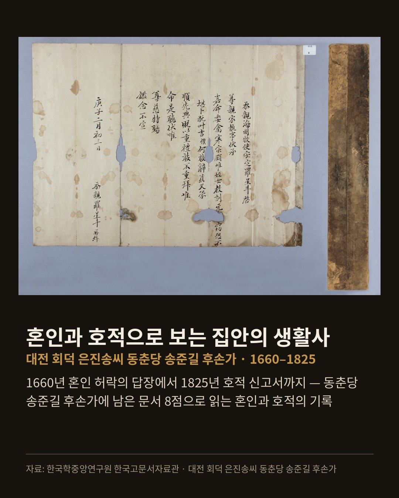
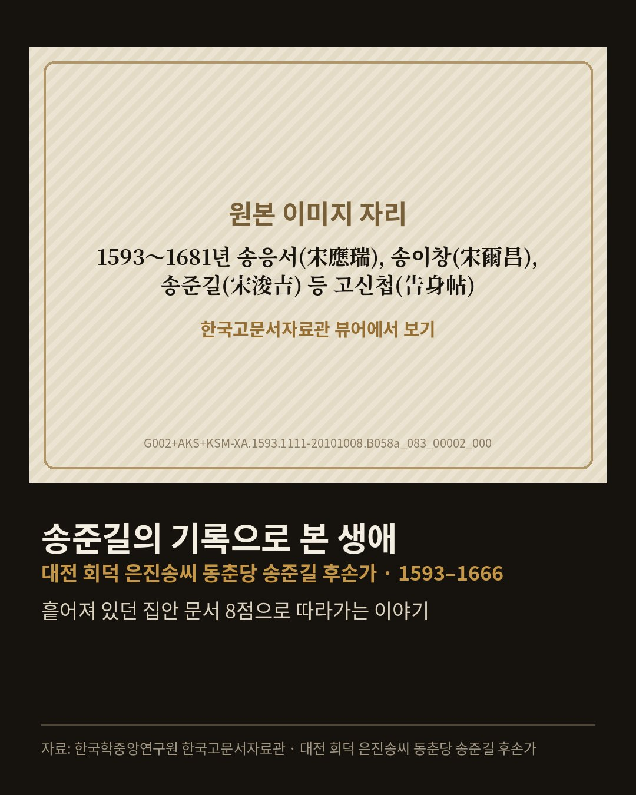
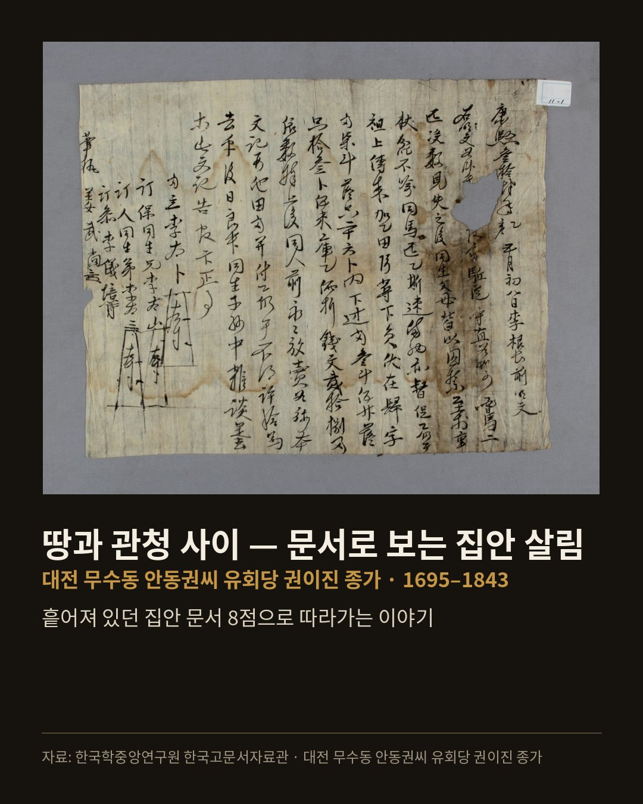
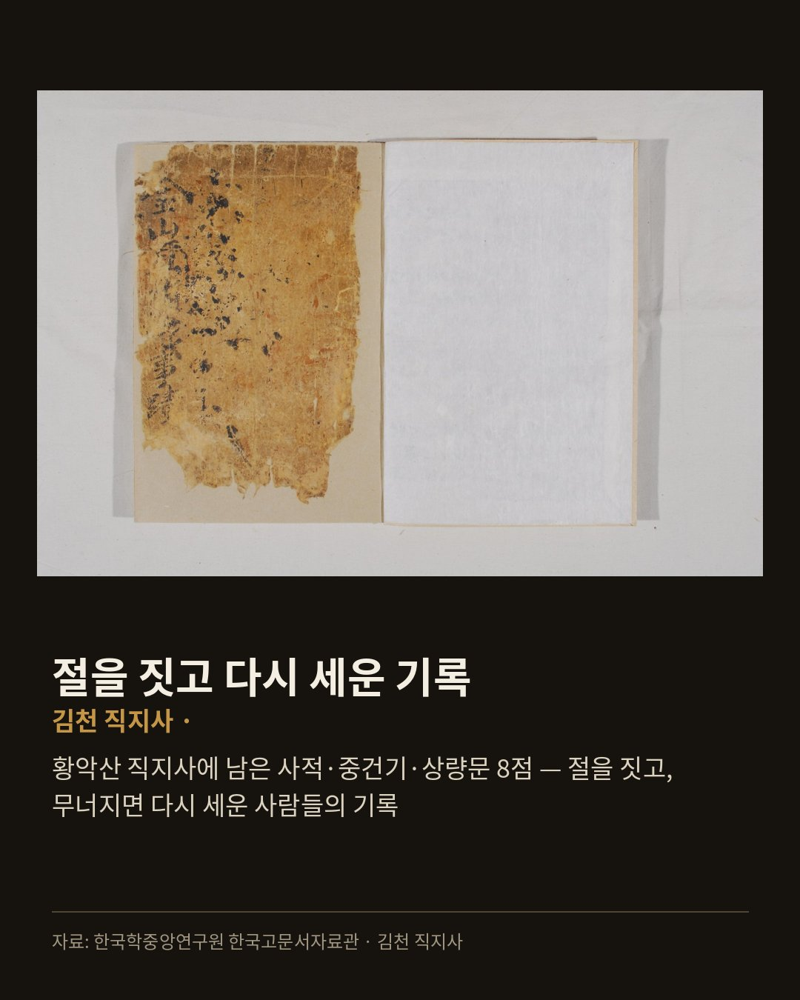
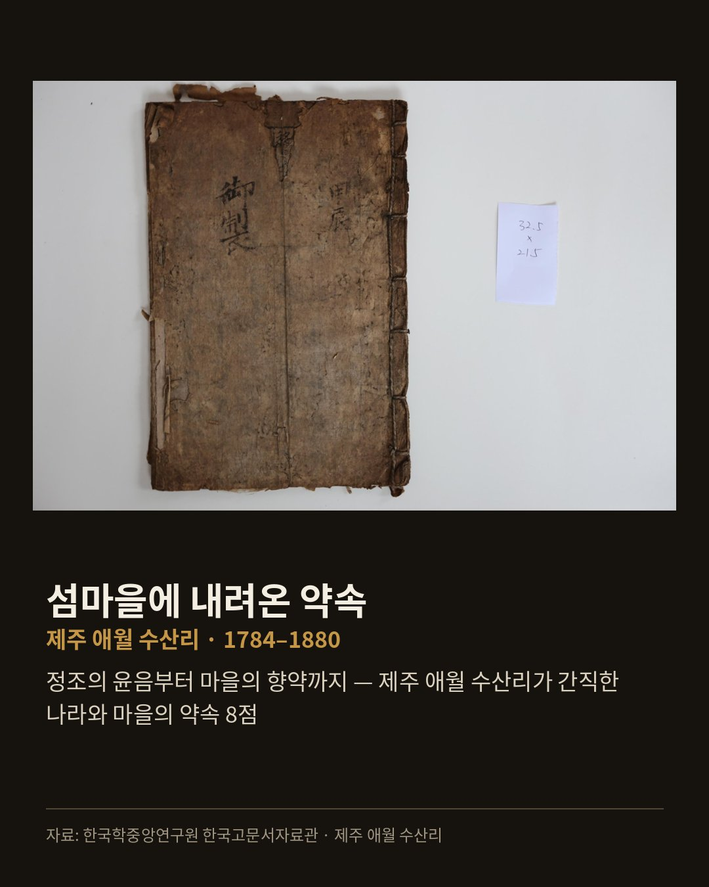
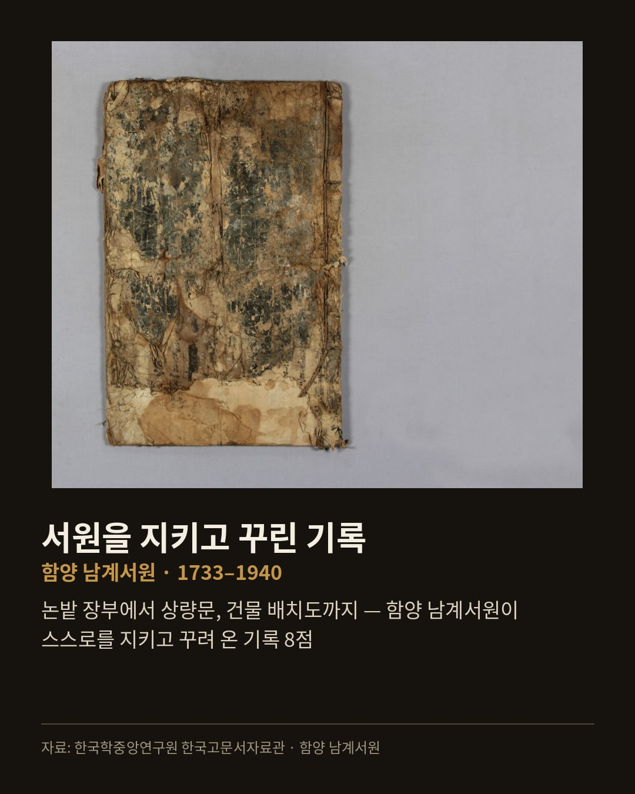
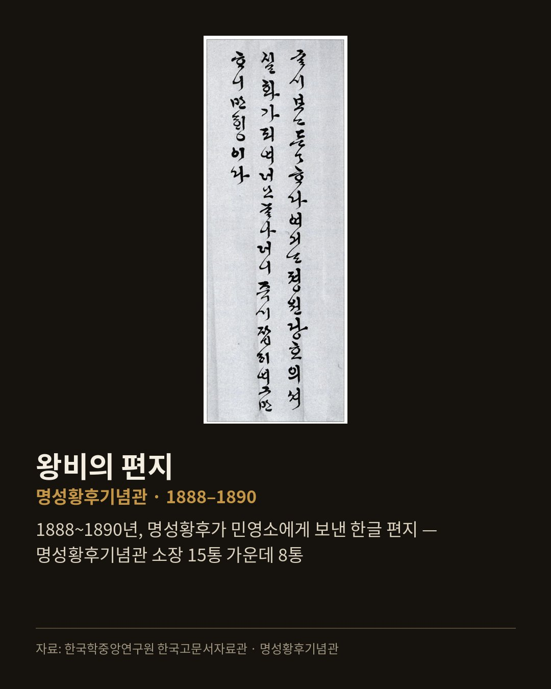

# archive-tools

[](https://github.com/changgi/archive-tools/actions/workflows/selftest.yml)

기록·고문서 아카이브 조사와 수집을 위한 Claude 플러그인 모음입니다.

| 플러그인 | 하는 일 |
|---|---|
| [aks-archive-harvester](plugins/aks-archive-harvester) | 한국고문서자료관 고문서 ① 수집 ② 큐레이션 ③ 에디팅(문구 · 전달) ④ 매개(전시 웹페이지·카드뉴스·수업 활동지·영상) ⑤ 시리즈 사이트·통합 분석·연구 패키지·여러 문중 비교 연구 |

## 한눈에 보기 — 여기 있는 것 전부

| 하려는 일 | 바로 가기 |
|---|---|
| 👀 구경하기 | [갤러리 첫 화면](https://changgi.github.io/archive-tools/examples/) · [「고문서 한 장」 161편](https://changgi.github.io/archive-tools/examples/#browse) · [1분 소개 릴스](https://changgi.github.io/archive-tools/examples/#series) |
| 📊 전체를 한 장에 | [**통합 분석**](https://changgi.github.io/archive-tools/examples/analysis.html) — 문서 580건 · 소장처 132곳 · 1403–1959년 · 판독 한자 33,009자 · 원문 인용 549곳 |
| 🌏 English | [English overview](https://changgi.github.io/archive-tools/examples/en.html) — what the series is and how to explore it |
| 📦 데이터 | [전체 데이터 묶음 ZIP](https://changgi.github.io/archive-tools/examples/data.zip) — 판독 · 번역 · 해제 · 노트 · 분석 집계(이미지 없음) |
| 🔎 찾기 | [전체 검색](https://changgi.github.io/archive-tools/examples/search.html) — 문서 580건의 판독 · 번역 · 해제 · 이야기 전문에서 낱말 · 한자로 · [문서 유형 사전](https://changgi.github.io/archive-tools/examples/types.html) |
| 🗂️ 모아 보기 | [종이에 적힌 문장 549곳](https://changgi.github.io/archive-tools/examples/quotes.html) · [전체 연표](https://changgi.github.io/archive-tools/examples/timeline.html) · [인물 찾아보기 211명](https://changgi.github.io/archive-tools/examples/people.html) — 광해군 · 이언적 · 박의장처럼 여러 편에 걸친 인물 · [남겨 둔 질문 카드(인쇄용)](https://changgi.github.io/archive-tools/examples/questions.html) |
| ✍️ 함께 고치기 | 갤러리 「원문 읽기」 · 전시 웹페이지의 「판독 고침 제보」 → GitHub 이슈 · [기여 안내](CONTRIBUTING.md) |
| ✅ 원본과 대조하기 | [검토 현황](https://changgi.github.io/archive-tools/examples/review.html) 「검토 기록하기」에서 대조한 문서에 표시 → `reviews.csv` 내려받기 → 이슈로 보내거나 `studio.py review --from` |
| 📜 원문 읽기 | 편마다 판독 · 번역 · 해제 · 요약 · "현대어(原文)" 이야기 (갤러리 각 편 「원문 읽기」) |
| 🧑‍🏫 수업 · 🏛️ 전시 | 편마다 활동지 · 전시 웹페이지 · 카드뉴스 · CSV — [전체 결과물 표](https://changgi.github.io/archive-tools/examples/#alltable) · [활용 가이드](https://changgi.github.io/archive-tools/examples/use.html) |
| 🗃️ 기록 꾸러미 | 편마다 `record.json`(맥락 · 출처 · 파생물 · 고정값 · 작업 이력) · [전체 목록 JSONL](https://changgi.github.io/archive-tools/examples/records.jsonl) · [Dublin Core CSV](https://changgi.github.io/archive-tools/examples/records-dc.csv) · [제작 도구](tools/series/README.md) |
| ✍️ 기획 · 비하인드 | [기획 노트](https://changgi.github.io/archive-tools/examples/about.html) · 편별 큐레이터 노트 · 비하인드 카드 · 전달 에디팅 |
| 📢 홍보 | [채널별 홍보 가이드](https://changgi.github.io/archive-tools/examples/promote.html) · 편별 `channels.md` · [시리즈 게시 문구](examples/series/promo.md) |
| 🛠️ 직접 만들기 | [플러그인 설치](#설치) · [처음부터 끝까지 따라하기](examples/tutorial/README.md) · [완성 사이트](https://changgi.github.io/archive-tools/examples/tutorial/site/index.html) |

## 예시 보기

▶ **https://changgi.github.io/archive-tools/examples/** — 실제로 만든 전시 웹페이지·카드뉴스·수업 활동지·비교 리포트

| 혼인과 호적 (에디팅 후) | 송준길의 생애 (에디팅 전) | 땅과 관청 사이 (다른 소장처) |
|---|---|---|
| [](examples/dongchundang-marriage/) | [](examples/dongchundang-songjungil/) | [](examples/yuhoedang-land/) |

| 절을 짓고 다시 세운 기록 (사찰) | 섬마을에 내려온 약속 (마을) | 서원을 지키고 꾸린 기록 (서원) | 왕비의 편지 (박물관) |
|---|---|---|---|
| [](examples/jikjisa-temple/) | [](examples/susanri-village/) | [](examples/namgye-seowon/) | [](examples/myeongseong-letters/) |

🔎 **읽기 도움:** 옛 한자·이두·흘림 글씨·한글 편지를 현대인이 읽을 수 있게, 문서마다 **원문 전문 판독(한자 위 한글 독음) · 원문 해석 · 해제 · 내용 요약**을 전시 웹페이지와 수업 활동지에 넣습니다.

📜 **원문으로 읽는 이야기 10편 (EP.17–EP.26):** 회재 이언적 · 류성룡의 비답 · 양동 손소 공신교서 · 임청각과 정약용 편지 · 학봉 종가 한글 편지 · 서계 박세당 · 우복 정경세 · 황윤석 집안의 흉년 문서 · 거창향교 · 명성황후의 꽃 편지지 — 원문 전문 판독 + 해석 + 원문 인용 스토리텔링 → [보기](https://changgi.github.io/archive-tools/examples/)

📜 **원문으로 읽는 이야기 24편 더 (EP.27–EP.50):** 강릉 선교장 · 점필재 · 여헌 장현광 · 하회 소년의 경성 유학 엽서 · 박의장 · 진주 사창 사건 · 수당 이남규 · 옥천사 · 제주 해녀 절목 · 최진립 · 김홍욱 · 오윤겸 · 과거 시험지 · 일주일 뒤의 부름 · 숙종이 보낸 숯 · 하위지의 조카 · 기러기와 장터 · 덕남서원 소나무 · 굶주림의 명문 · 큰물과 투장 · 김해 향안 · "술은 석 잔까지" · 효종의 답장 · 송규렴의 한글 편지 → [보기](https://changgi.github.io/archive-tools/examples/)

📜 **원문으로 읽는 이야기 50편 더 (EP.51–EP.100):** 귀화 일본 장수 사여모 · 유희의 『물명고』 · 제주의 종이 신분증 지패 · 공명첩 · 사또의 성적표 포폄 · 밀부 제34부 · 험천의 김홍익 · 1919년 만일계 · 1592년 안동 의병 일지 · 이완용 서명의 관고 · 농암 이현보의 양로연 · 류성룡 증손녀의 호적 · 몰래 무덤 산송 · 1904년 향교 완문 · 하홍도의 여름 편지 외 — 문중 · 서원 · 향교 · 사찰 · 제주 문서까지 → [보기](https://changgi.github.io/archive-tools/examples/) · 첫 화면 「결과물 한눈에 보기」에서 영상 · 전시 · 활동지 · 카드뉴스 · CSV · 홍보 글로 바로 가기

📜 **원문으로 읽는 이야기 38편 더 (EP.101–EP.138):** 섬마을 훈장의 통정대부 · 해남 김선지의 임진년 고신 · 묵재 이문건의 『양아록』 · 술과 음식의 한글 책 「쥬식방문」 · 단종의 조카가 받은 사패 · 1910년 8월 28일의 마지막 칙명 · 굶주린 해 서천 군수의 유서 · 제주 9편(급제 60년의 회방 홍패 · 말 열 필과 선산 · 아버지와 아들의 같은 시험 · 흉년의 납속 · "해유에 흠이 없다") · 장서각의 왕실 문서(왕자 시절 영조의 교지 · 정조의 암행어사 봉서와 "밥을 먹다가 수저를 멈추었다" · 궁녀 엄씨의 교지) · 경주 이씨 집안의 혼서와 대한제국 호적표 외 → [보기](https://changgi.github.io/archive-tools/examples/)

🗃️ **기록 꾸러미 · 제작 도구 공개:** 편마다 맥락 · 출처 · 파생물 · SHA-256 고정값 · 검증 · 검토 · 작업 이력을 담은 `record.json`과 전체 목록([records.jsonl](https://changgi.github.io/archive-tools/examples/records.jsonl) · [Dublin Core CSV](https://changgi.github.io/archive-tools/examples/records-dc.csv)), 푸시마다 고정값 대조(CI) — [설명](plugins/aks-archive-harvester/skills/aks-archive-harvester/references/records.md). 이 시리즈를 만든 스크립트와 원고는 [`tools/series/`](tools/series/README.md)에 그대로 공개해 누구나 다시 만들 수 있습니다.

🧭 **처음부터 끝까지 따라하기 (실제 예제):** 「임금이 보낸 종이 세 장」 — 찾기 → 받기 → 문구 에디팅 → 큐레이터 노트 → 전달 에디팅 → 전시·카드·활동지·비하인드 → 릴스·가로 영상 → 원본 묶음 → 시리즈 사이트까지, 단계마다 자동 초안과 다듬은 결과를 나란히 → [따라하기](examples/tutorial/README.md) · [완성된 사이트](https://changgi.github.io/archive-tools/examples/tutorial/site/index.html)

✍️ **큐레이터 노트 · 기획 노트:** 편마다 왜 골랐고 무엇을 전하려 했는지, 만들며 있었던 일까지 — [기획 노트](https://changgi.github.io/archive-tools/examples/about.html) · 갤러리 각 편 「비하인드」 탭

📢 **2차 홍보 · 채널 · 활용:** [시리즈 비하인드 릴스·카드](https://changgi.github.io/archive-tools/examples/#series) · [채널별 홍보 가이드](https://changgi.github.io/archive-tools/examples/promote.html) · [패키지 활용 가이드](https://changgi.github.io/archive-tools/examples/use.html)

🎭 **문구 에디팅 + 전달 에디팅:** 무엇을 말할지에 더해, 고른 기록을 어떤 정서 · 장면 · 물질 · 통로 · 매개로 전할지 — 갤러리 각 편 「전달 에디팅」 탭 · [기획 노트](https://changgi.github.io/archive-tools/examples/about.html#delivery)

📖 **이야기가 있는 기록 10편 (EP.7–EP.16):** 왕실 가족의 편지 · 운조루의 시간 · 되찾은 제사 땅 · 섬마을의 호소 · 윤음에서 금융조합까지 · 기도와 살림의 기록 · 200년의 상소 · 나아가지 않은 선비 · 서원을 움직인 사람들 · 학자의 벼슬길 → [보기](https://changgi.github.io/archive-tools/examples/)

명령을 하나씩 따라 하는 예제는 [`examples/tutorial/README.md`](examples/tutorial/README.md)(전 과정)와 [`examples/README.md`](examples/README.md)에 있습니다.

🎬 **홍보 영상:** [EP.1 흩어진 기록을, 다시 이야기로(83초)](https://changgi.github.io/archive-tools-next/media/promo-reel.mp4) · [EP.2 만든 것 보기(48초)](https://changgi.github.io/archive-tools-next/media/promo-reel-ep2.mp4) · EP.3–EP.6 예시 세트 영상은 [예시 README](examples/README.md#예시-세트-영상-ep3ep6) · 이미지 출처: 한국학중앙연구원 한국고문서자료관(이미지 재사용은 자료관 문의, 소장처 동의 필요)

## 설치

### Claude Code / Cowork (권장, 업데이트 자동 반영)

```
/plugin marketplace add changgi/archive-tools
/plugin install aks-archive-harvester@changgi-archive-tools
```

새 버전이 나오면:

```
/plugin marketplace update changgi-archive-tools
```

### 파일로 설치

[Releases](../../releases) 또는 `dist/`에서 받으세요.

- `aks-archive-harvester.plugin`: Claude Cowork에 올려 설치
- `aks-archive-harvester-skill.zip`: claude.ai 스킬 설정에서 업로드

### 파이썬만 쓰기

```bash
pip install requests pillow
python3 plugins/aks-archive-harvester/skills/aks-archive-harvester/scripts/harvest.py --help
python3 plugins/aks-archive-harvester/skills/aks-archive-harvester/scripts/studio.py --help
```

## 사용 예

> 한국고문서자료관에서 동춘당 송준길 후손가 문서 전부 받아줘
>
> 혼인과 호적 테마로 전시 웹페이지랑 카드뉴스 만들어줘
>
> 충청도 문중들을 비교 연구할 수 있게 패키지로 묶어줘

## 이용 시 유의

- **이용 조건**: 코드 MIT([LICENSE](LICENSE)) · 판독 · 번역 · 해제 · 이야기 · 노트 · 분석 데이터 등 텍스트 **CC BY 4.0** · 고문서 이미지는 소장처 동의 필요 — [LICENSE-CONTENT.md](LICENSE-CONTENT.md)
- **인용**: [CITATION.cff](CITATION.cff) — GitHub 저장소 오른쪽 「Cite this repository」에서 APA · BibTeX로 바로 복사

- 공공 연구기관 서버입니다. 기본 동시 요청 수(타일 16개, 페이지 2장)를 올리지 마세요.
- 수집한 이미지의 이용·재배포는 한국고문서자료관 이용 조건을 따르세요. 대량 이용은 기관(031-779-2791)에 원본 제공을 요청하는 것이 확실합니다.
- 이 도구는 한국학중앙연구원과 관계없는 개인 제작물입니다.

## 만든 사람

Song Chang-gi · chgsong@naver.com · https://github.com/changgi
