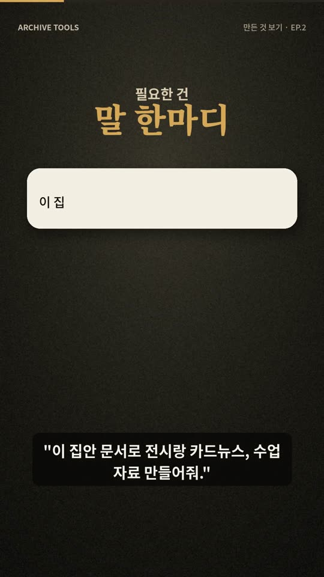
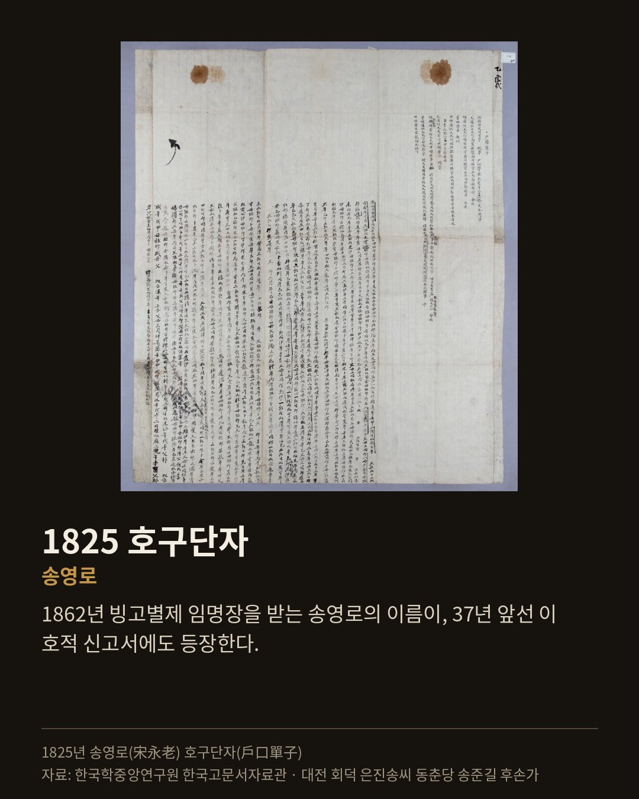

# 예시와 예제

**aks-archive-harvester**로 실제로 만든 결과물(예시)과, 같은 결과를 직접 만들어 보는 단계별 따라하기(예제)입니다.

▶ **웹에서 바로 보기:** https://changgi.github.io/archive-tools/examples/

> **이미지 출처** — 예시에 쓴 고문서 사진은 한국학중앙연구원 한국고문서자료관 소장·제공 자료입니다. 각 문서에는 자료관 뷰어에서 원본을 여는 링크를 달았습니다. 자료관은 이미지 사용에 소장처 동의가 필요하다고 안내하고 있으니(031-730-8873, 8876), 이 예시의 이미지를 다시 쓰려면 자료관에 문의하세요. 게재에 문제가 있으면 [이슈](https://github.com/changgi/archive-tools/issues)나 chgsong@naver.com으로 알려 주시면 바로 내리겠습니다.

## 홍보 영상

| EP.1 흩어진 기록을, 다시 이야기로 (83초) | EP.2 만든 것 보기 (48초) |
|---|---|
| [](https://changgi.github.io/archive-tools/examples/media/promo-reel.mp4) | [](https://changgi.github.io/archive-tools/examples/media/promo-reel-ep2.mp4) |
| 1862년 송영로의 임명장 한 장에서 시작해 ① 수집 ② 큐레이션 ③ 에디팅 ④ 매개 ⑤ 패키징까지 | 말 한마디로 만든 전시 웹페이지·카드뉴스·활동지, 에디팅 전후, 두 집안 비교 |
| [`promo-reel.mp4`](media/promo-reel.mp4) · [자막](media/promo-reel.ko.srt) | [`promo-reel-ep2.mp4`](media/promo-reel-ep2.mp4) · [자막](media/promo-reel-ep2.ko.srt) |

릴스 게시 문구(「고문서 한 장」 EP.03–EP.16)는 [media/reels-captions.md](media/reels-captions.md)에 모았고, 각 폴더 `promo.md`에도 있습니다.

## 이야기가 있는 기록 (EP.7–EP.16)

질문으로 시작해 문서로 따라가고, 한 문장으로 맺는 10편입니다. 각 폴더 README에 내레이션 전문이 있습니다.

| 이야기 | 소장처 | 첫 질문 | 영상·홍보 글 |
|---|---|---|---|
| [**EP.7 왕실 가족의 편지**](royal-letters/) | 오죽헌·시립박물관 (박물관) | 임금도 할머니에게 편지를 썼을까요? | [릴스](https://changgi.github.io/archive-tools/examples/media/ep7-royal-letters_reel.mp4) · [가로](https://changgi.github.io/archive-tools/examples/media/ep7-royal-letters_wide.mp4) · [홍보 글](royal-letters/promo.md) |
| [**EP.8 운조루의 시간**](unjoru/) | 구례 오미 문화류씨 운조루 (문중) | 운조루를 지은 유이주, 그는 어떤 길을 걸어왔을까요? | [릴스](https://changgi.github.io/archive-tools/examples/media/ep8-unjoru_reel.mp4) · [가로](https://changgi.github.io/archive-tools/examples/media/ep8-unjoru_wide.mp4) · [홍보 글](unjoru/promo.md) |
| [**EP.9 되찾은 제사 땅**](jeongon/) | 거창 동계 정온 종가 (문중) | 조상의 제사 땅이 남의 장부에 들어가 버렸다면? | [릴스](https://changgi.github.io/archive-tools/examples/media/ep9-jeongon_reel.mp4) · [가로](https://changgi.github.io/archive-tools/examples/media/ep9-jeongon_wide.mp4) · [홍보 글](jeongon/promo.md) |
| [**EP.10 섬마을의 호소**](gujora/) | 거제 일운 구조라리 (마을) | 섬마을 사람들은 무엇을 호소했을까요? | [릴스](https://changgi.github.io/archive-tools/examples/media/ep10-gujora_reel.mp4) · [가로](https://changgi.github.io/archive-tools/examples/media/ep10-gujora_wide.mp4) · [홍보 글](gujora/promo.md) |
| [**EP.11 윤음에서 금융조합까지**](hagari/) | 제주 애월 하가리 (마을) | 왕의 말씀에서 은행까지, 한 마을이 걸어온 길은? | [릴스](https://changgi.github.io/archive-tools/examples/media/ep11-hagari_reel.mp4) · [가로](https://changgi.github.io/archive-tools/examples/media/ep11-hagari_wide.mp4) · [홍보 글](hagari/promo.md) |
| [**EP.12 기도와 살림의 기록**](yongmunsa/) | 예천 용문사 (사찰) | 불상 안에는 무엇이 들어 있을까요? | [릴스](https://changgi.github.io/archive-tools/examples/media/ep12-yongmunsa_reel.mp4) · [가로](https://changgi.github.io/archive-tools/examples/media/ep12-yongmunsa_wide.mp4) · [홍보 글](yongmunsa/promo.md) |
| [**EP.13 200년의 상소**](deokcheon/) | 산청 덕천서원 (서원) | 한 스승을 높이기 위해, 200년 동안 상소를 올린 사람들이 있습니다. | [릴스](https://changgi.github.io/archive-tools/examples/media/ep13-deokcheon_reel.mp4) · [가로](https://changgi.github.io/archive-tools/examples/media/ep13-deokcheon_wide.mp4) · [홍보 글](deokcheon/promo.md) |
| [**EP.14 나아가지 않은 선비**](yunjeung/) | 논산 명재 윤증 종가 (문중) | 임금이 수십 번 불러도, 나아가지 않은 선비가 있습니다. | [릴스](https://changgi.github.io/archive-tools/examples/media/ep14-yunjeung_reel.mp4) · [가로](https://changgi.github.io/archive-tools/examples/media/ep14-yunjeung_wide.mp4) · [홍보 글](yunjeung/promo.md) |
| [**EP.15 서원을 움직인 사람들**](byeongsan/) | 안동 병산서원 (서원) | 서원을 움직인 사람들은 누구였을까요? | [릴스](https://changgi.github.io/archive-tools/examples/media/ep15-byeongsan_reel.mp4) · [가로](https://changgi.github.io/archive-tools/examples/media/ep15-byeongsan_wide.mp4) · [홍보 글](byeongsan/promo.md) |
| [**EP.16 학자의 벼슬길**](anjeongbok/) | 광주 순암 안정복 종가 (문중) | 『동사강목』을 쓴 학자는 어떤 벼슬길을 걸었을까요? | [릴스](https://changgi.github.io/archive-tools/examples/media/ep16-anjeongbok_reel.mp4) · [가로](https://changgi.github.io/archive-tools/examples/media/ep16-anjeongbok_wide.mp4) · [홍보 글](anjeongbok/promo.md) |

## 예시 세트 영상 (EP.3–EP.6)

| | 릴스 9:16 | 가로 16:9 | 홍보 글 |
|---|---|---|---|
| EP.3 김천 직지사 | [보기](https://changgi.github.io/archive-tools/examples/media/ep3-jikjisa_reel.mp4) | [보기](https://changgi.github.io/archive-tools/examples/media/ep3-jikjisa_wide.mp4) | [promo.md](jikjisa-temple/promo.md) |
| EP.4 제주 애월 수산리 | [보기](https://changgi.github.io/archive-tools/examples/media/ep4-susanri_reel.mp4) | [보기](https://changgi.github.io/archive-tools/examples/media/ep4-susanri_wide.mp4) | [promo.md](susanri-village/promo.md) |
| EP.5 함양 남계서원 | [보기](https://changgi.github.io/archive-tools/examples/media/ep5-namgye_reel.mp4) | [보기](https://changgi.github.io/archive-tools/examples/media/ep5-namgye_wide.mp4) | [promo.md](namgye-seowon/promo.md) |
| EP.6 명성황후기념관 | [보기](https://changgi.github.io/archive-tools/examples/media/ep6-myeongseong_reel.mp4) | [보기](https://changgi.github.io/archive-tools/examples/media/ep6-myeongseong_wide.mp4) | [promo.md](myeongseong-letters/promo.md) |

## 예시 (결과물 갤러리)

| 예시 | 소장처 | 테마 | 보여 주는 것 |
|---|---|---|---|
| [**혼인과 호적**](dongchundang-marriage/) | 대전 회덕 은진송씨 동춘당 송준길 후손가 | 혼인과 호적으로 보는 집안의 생활사 | **③ 에디팅 후**: Claude가 다듬은 이야기 문장 |
| [**송준길의 생애**](dongchundang-songjungil/) | 같은 소장처 | 송준길의 기록으로 본 생애 | **③ 에디팅 전**: 자동 캡션 초안 그대로 · 첩 이미지 중복 제거 |
| [**땅과 관청 사이**](yuhoedang-land/) | 대전 무수동 안동권씨 유회당 권이진 종가 | 사용자 지정 테마(문서유형 필터) | 다른 소장처에도 같은 방식이 통함 |
| [**절을 짓고 다시 세운 기록**](jikjisa-temple/) | 김천 직지사 (사찰) | 사적·중건기·상량문·헌답기 | 영상(릴스·가로) + 홍보 글 세트 |
| [**섬마을에 내려온 약속**](susanri-village/) | 제주 애월 수산리 (마을) | 정조 윤음·향약·절목 | 영상(릴스·가로) + 홍보 글 세트 |
| [**서원을 지키고 꾸린 기록**](namgye-seowon/) | 함양 남계서원 (서원) | 양안·완문·상량문·건치도 | 영상(릴스·가로) + 홍보 글 세트, `download --match`로 필요한 문서만 수집 |
| [**왕비의 편지**](myeongseong-letters/) | 명성황후기념관 (박물관) | 명성황후가 민영소에게 보낸 한글 편지 | 영상(릴스·가로) + 홍보 글 세트 |
| [**소장처 비교**](compare/) | 16곳 4,934건 | 대량 유사 연구 | ⑤ 비교 리포트(그래프) |

각 예시 폴더에는 다음이 들어 있습니다.

- `exhibit.html`: 전시 웹페이지(연표·캡션·출처). 인쇄하면 전시 패널이 됩니다.
- `cards/`: 카드뉴스 1080×1350 (표지 + 문서별 + 마무리)
- `handout.html`: A4 수업 활동지(어떤 문서? · 찾아보기 · 생각해 보기 · 정리하기)
- `sns.txt`: SNS 게시 글 초안
- `selection.csv`: 에디팅 결과(선별 문서·캡션·이야기·검토·뷰어링크)

### 카드뉴스 미리보기

| 표지 | 문서 카드 (에디팅 후) | 문서 카드 (에디팅 후) | 마무리 |
|---|---|---|---|
|  |  |  |  |

### 에디팅 전과 후

같은 도구의 캡션이 사람과 Claude의 손을 거치면 어떻게 바뀌는지 볼 수 있습니다.

| | 문장 |
|---|---|
| 자동 초안 (`edit`) | 1825년 송영로의 호구단자 — 집안 식구를 관에 신고한 호적 서류. |
| 에디팅 후 (`이야기` 칸) | 1862년 빙고별제 임명장을 받는 송영로의 이름이, 37년 앞선 이 호적 신고서에도 등장한다. |

`검토` 칸을 비워 두었기 때문에 모든 결과물에 **"초안 — 원문 확인 전"** 표시가 붙어 있습니다. 원문을 확인한 줄에만 `확인`을 넣으면 그 표시가 사라집니다.

### 데이터

[`data/`](data/) 폴더에는 두 소장처의 다음 파일이 있습니다. 이미지 없이 텍스트만 담겨 있습니다.

- `metadata.csv`: 문서별 연도·유형·인물·장수·자료ID·뷰어링크
- `summary.md`: 유형·시기 분포, 인물 연표
- `themes.json`: 자동 제안된 테마

연도·유형·인물은 문서명에서 자동으로 뽑은 **초안**입니다.

---

## 예제 (따라하기)

아래는 위 예시를 만든 명령 그대로입니다. Claude에게 말로 시켜도 되고, 터미널에서 직접 실행해도 됩니다.

### 준비

```bash
pip install requests pillow
git clone https://github.com/changgi/archive-tools && cd archive-tools
S=plugins/aks-archive-harvester/skills/aks-archive-harvester/scripts
```

Claude Code / Cowork에서는 플러그인을 설치하고 말로 요청하면 됩니다.

```
/plugin marketplace add changgi/archive-tools
/plugin install aks-archive-harvester@changgi-archive-tools
```

### ① 수집: 이름으로 찾고, 원본 해상도로 받기

> 💬 "한국고문서자료관에서 유회당 권이진 종가 문서 받아줘"

```bash
python3 $S/harvest.py find "유회당 권이진" --manifest W
```
```
1. 문중 > 대전광역시 > 대전 무수동 안동권씨 유회당 권이진 종가  [L013003]
문서 601건 발견. 페이지 목록 수집 중...
  교령류: 문서 253건 / 380장
  명문문기류: 문서 19건 / 24장
  ...
합계: 문서 601건 / 1146장
```
```bash
python3 $S/harvest.py download --work W --category 명문문기류 --time 540
```
```
이번 실행 24장 / 51s · 완료 24/24 · 서버에 없음 0 · 남음 0
STATUS: DONE
```

- `--category`를 빼면 전체를 받습니다. `STATUS: DONE`이 나올 때까지 다시 실행하면 이어서 받습니다.
- 사이트 전체 소장처 목록은 `harvest.py catalog`로 볼 수 있습니다.

### ② 큐레이션: 정리하고 테마 고르기

> 💬 "이 집안 문서로 어떤 이야기를 만들 수 있을까?"

```bash
python3 $S/harvest.py curate --work W --collection "대전 무수동 안동권씨 유회당 권이진 종가"
python3 $S/studio.py themes --work W
```
```
[person-1] 권이진의 기록으로 본 생애 — 174건 1681–1743  주요 유형: 고신 118, 유지 33, 녹패 5, 유서 4
[person-2] 권영수의 기록으로 본 생애 — 63건 1808–1867
[life-1] 혼인과 호적으로 보는 집안의 생활사 — 24건   호구단자 18, 납폐서 3
[letters-1] 편지와 제문으로 보는 사람들 사이 — 117건   제문 45, 간찰 30, 고목 25
[office-1] 임명장과 과거로 보는 관직의 길 — 267건
[primer-1] 문서 유형별 대표 한 점 — 고문서 입문 — 12건
```

### ③ 에디팅: 대표 문서 고르고 다듬기

> 💬 "토지 매매 문서랑 관청 보고 문서로 '땅과 관청 사이' 테마를 만들어줘"

```bash
python3 $S/studio.py edit --work W --types 명문,고목,첩정,이관,자문,완문 \
  --title "땅과 관청 사이 — 문서로 보는 집안 살림" --id land --count 8
```
```
테마 "땅과 관청 사이 — 문서로 보는 집안 살림": 후보 40건 중 8건 선별
  01. 1695 토지매매명문 — 1695년 이근장(李根長) 토지매매명문(土地賣買明文)
  02. 1712 토지매매명문 — 1712년 승(僧) 수담(守淡) 토지매매명문(土地賣買明文)
  03. 1783 첩정 — 1783년 용안현감(龍安縣監) 첩정(牒呈)－1
  ...
```

`W/edit/land/`에 `selection.csv`, 대표 이미지, 밀착인화가 생깁니다. 첩(帖)에 든 낱장 문서들은 자료관 서버가 첩 전체 이미지를 똑같이 주기 때문에 첩당 하나만 고르고, 캡션에 "해당 면은 원문 확인 필요"를 붙입니다. Claude가 이미지를 보고 `이야기` 칸을 채우고, 사람이 원문을 확인한 줄에 `검토`=`확인`을 넣습니다.

### ④ 매개: 전시·카드뉴스·활동지·SNS 글

> 💬 "이걸로 전시 웹페이지랑 카드뉴스, 수업 활동지 만들어줘"

```bash
python3 $S/studio.py mediate --work W --theme land                 # 받은 원본 이미지 포함
python3 $S/studio.py mediate --work W --theme land --placeholder   # 이미지 대신 자리 표시 + 뷰어 링크
```
```
→ W/mediate/land
  exhibit.html(전시 웹페이지) · cards/ 10장(카드뉴스) · handout.html(수업 활동지) · sns.txt
```

### ⑤ 패키징과 여러 문중 비교 연구

> 💬 "동춘당이랑 유회당을 비교할 수 있게 연구 패키지로 묶어줘"

```bash
python3 $S/harvest.py bundle --work W --dest pkg --prefix 유회당권이진종가

# 여러 소장처: 목록 파일(이름<TAB>data-url) — catalog로 만들 수 있음
python3 $S/harvest.py catalog --group 문중 --region 대전 --tsv collections.tsv
python3 $S/harvest.py batch --list collections.tsv --root R --step manifest
python3 $S/harvest.py compare --list collections.tsv --root R
python3 $S/studio.py report --root R
```
```
→ R/compare_metadata.csv / compare_summary.md (1098건, 소장처 2곳)
→ R/compare_report.html
```

- 메타데이터만 비교할 때는 `download` 없이 `manifest`만으로 충분합니다.
- 연구 패키지 폴더에 들어가는 것:
  - `metadata.csv/jsonl`, `summary.md`, `수집현황.csv`
  - `CITATION.txt`, `datapackage.json`
  - `edit/`, `mediate/` 결과
  - `images/` (분할 ZIP)

---

## 이 예시를 만든 조건

- 2026-11-14, aks-archive-harvester v0.3.0
- 동춘당 송준길 후손가: 497건 중 이미지를 받은 문서에서 선별(치부기록류 제외)
- 유회당 권이진 종가: 명문문기류·첩관통보류 80장만 받아 선별
- 문서 유형 풀이는 일반적 설명입니다. 개별 문서의 판독·해석은 원문으로 확인하세요.
- 자료: 한국학중앙연구원 한국고문서자료관. 이 저장소는 한국학중앙연구원과 관계없는 개인 제작물입니다.
