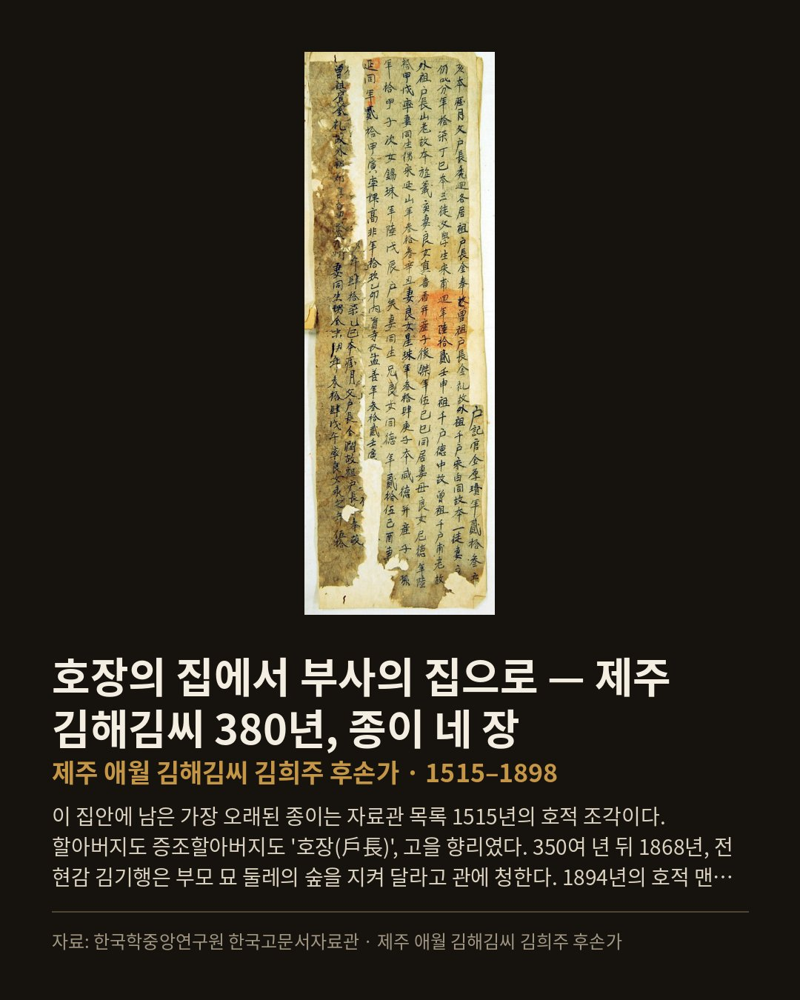
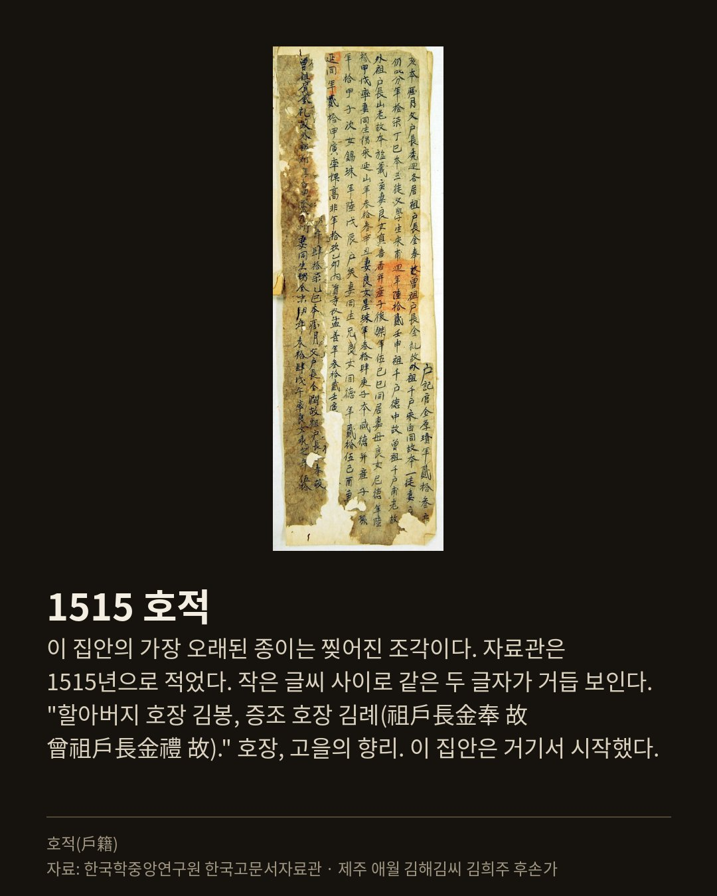
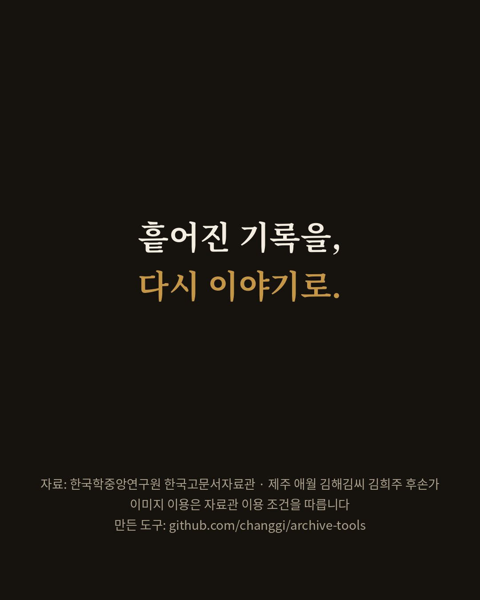

# EP.170 호장의 집에서 부사의 집으로 — 제주 김해김씨 380년, 종이 네 장

제주 애월 김해김씨 김희주 후손가 (문중) · 이 집안에 남은 가장 오래된 종이는 자료관 목록 1515년의 호적 조각이다. 할아버지도 증조할아버지도 '호장(戶長)', 고을 향리였다. 350여 년 뒤 1868년, 전 현감 김기행은 부모 묘 둘레의 숲을 지켜 달라고 관에 청한다. 1894년의 호적 맨 위에는 그 아들 김윤병의 긴 직함 — 가선대부 동지중추부사 행 여산부사 — 이 적히고, 할아버지 칸에는 1815년 무과에 붙은 김종관의 이름이 있다

- 🌐 [전시 웹페이지](https://changgi.github.io/archive-tools/examples/aewol-kim-hj-gamun/exhibit.html) (한자 위 한글 독음 · 원문 해석) · [수업 활동지](https://changgi.github.io/archive-tools/examples/aewol-kim-hj-gamun/handout.html)
- 🎬 영상: [릴스 9:16](https://changgi.github.io/archive-tools-next/media/ep170-aewol-kim-hj-gamun_reel.mp4) · [가로 16:9](https://changgi.github.io/archive-tools-next/media/ep170-aewol-kim-hj-gamun_wide.mp4) · 홍보 글: [`promo.md`](promo.md)
- 카드뉴스: [`cards/`](cards/) · SNS 글: [`sns.txt`](sns.txt) · 판독·해석 표: [`selection.csv`](selection.csv)

<!-- DELIVERY -->
## 전달 에디팅 — 이 기록을 이렇게 전합니다

- **핵심 정서** — 뿌듯함
- **한 문장** — 한 집안의 신분은 종이의 이름표에 남는다 — 조상 칸의 '호장(戶長)'이 300여 년 뒤에는 '현감', '부사', '가선대부'로 바뀌었다. 무과는 그 사이의 사다리였다.
- **열기** — 할아버지는 '호장', 380년 뒤 후손은 '부사'가 되었습니다.
- **펼치기** — 호적 → 소지－8 → 준호구－2 → 소지－9 (1515–1898년) — 1515 호적 조각(호장 · 천호의 집안) → 1868 전 현감 김기행의 산소 금양 소지 → 1894 김윤병 호의 준호구(아버지 김기행 · 할아버지 김종관) → 1898 김승배의 산소 입지 청원(관아 수리에 돈 50냥을 냄)으로, 4백 년 가까운 시간을 네 장으로 이었습니다.
- **절정** — "영원히 지켜 보호하도록 입지를 만들어 주십시오(永爲禁護之意 立旨成給)" — 화면·공간에서 이 한 줄만 크게, 소리를 줄여 집중
- **여운** — 호장의 손자들은, 자기 조상이 '향리'였다는 것을 어떻게 기억했을까요? — 질문으로 끝내고 답은 보는 사람에게
- **감각과 물질** — 조상 칸의 직함 — '戶長'에서 '行旌義縣監'으로, 그리고 '贈嘉善大夫'로 · 나의 신분증 만들기 체험 카드 · 연명한 이름을 벽에 길게 나열하고 관아 마당처럼 서서 읽는 동선
- **통로와 매개** — 온라인: 릴스(열기) → 카드뉴스(펼치기) → 전시 웹페이지(절정·원문) → 비하인드 카드(여운) / 오프라인: 원본 크기 복제·낭독·참여 벽 / 남기기: 활동지·질문 카드
- **여운 장치** — 우리 집안 조상의 '직업'을 거슬러 세 대만 적어 보기
- **전달 에디팅 전** — 4건의 문서를 1515–1898년 연대순으로 놓고 문서명 · 유형 · 해설을 붙인다 — 정확하지만, 지나가면 잊힌다.
- **전달 에디팅 후** — 핵심 정서는 「뿌듯함」. 「할아버지는 '호장', 380년 뒤 후손은 '부사'가 되었습니다.」로 열고, 문서를 대비와 순서로 펼친 뒤, "영원히 지켜 보호하도록 입지를 만들어 주십시오(永爲禁護之意 立旨成給)"에서 멈춘다. 조상 칸의 직함 — '戶長'에서 '行旌義縣監'으로, 그리고 '贈嘉善大夫'로. 마지막엔 「우리 집안 조상의 '직업'을 거슬러 세 대만 적어 보기」로 보는 사람이 자기 이야기를 남기고 떠나게 한다.

전문: [`delivery.md`](delivery.md)
<!-- /DELIVERY -->

<!-- CURATOR -->
## 비하인드 — 큐레이터 노트

- **왜 이 문서들인가** — EP.124에서 이 집안의 무과 홍패 여섯 장(1815–1879)을 읽었습니다. 그 홍패 주인들이 호적과 소지에서 어떻게 이어지는지, 그리고 무과 이전의 집안은 어떠했는지를 같은 소장처의 가장 오래된 종이와 함께 보았습니다.
- **전하고 싶은 것** — 한 집안의 신분은 종이의 이름표에 남는다 — 조상 칸의 '호장(戶長)'이 300여 년 뒤에는 '현감', '부사', '가선대부'로 바뀌었다. 무과는 그 사이의 사다리였다.
- **이렇게 보이길 바랐다** — 1515 호적 조각(호장 · 천호의 집안) → 1868 전 현감 김기행의 산소 금양 소지 → 1894 김윤병 호의 준호구(아버지 김기행 · 할아버지 김종관) → 1898 김승배의 산소 입지 청원(관아 수리에 돈 50냥을 냄)으로, 4백 년 가까운 시간을 네 장으로 이었습니다.
- **이렇게 써 주세요** — 조선 초기 호적의 모습, 제주의 향리(호장 · 천호) 계층, 무과를 통한 신분 상승, 산송과 금양(禁養) 입지, 준호구의 사조 기재 수업에 쓰세요.
- **만들며 있었던 일** — 1515년 호적은 앞뒤가 떨어져 나간 조각이고 글씨가 작아, 또렷한 이름과 직임만 옮기고 나머지는 …로 두었습니다. 연도는 자료관 목록을 따랐습니다. 1894년 준호구는 가족 · 조카 줄이 매우 길어 앞부분만 옮겼습니다. 1898년 소지의 김승배와 김윤병의 관계, 그 '조고(祖考)'가 누구인지는 판단하지 않았습니다.
- **남겨 둔 질문** — 호장의 손자들은, 자기 조상이 '향리'였다는 것을 어떻게 기억했을까요?
- **제작 기록** — 문서 4건 · 1515–1898년 · 원본 사진 4면(문서 전체) · 원문 판독 4건 · 번역 4건

전문: [`curator.md`](curator.md) · 비하인드 카드: [`behind/`](behind/) · 채널별 홍보안: [`channels.md`](channels.md)
<!-- /CURATOR -->

## 이야기 — 사료가 말하는 대로

할아버지는 '호장', 380년 뒤 후손은 '부사'가 되었습니다.

> **1515 호적** — 이 집안의 가장 오래된 종이는 찢어진 조각이다. 자료관은 1515년으로 적었다. 작은 글씨 사이로 같은 두 글자가 거듭 보인다. "할아버지 호장 김봉, 증조 호장 김례(祖戶長金奉 故 曾祖戶長金禮 故)." 호장, 고을의 향리. 이 집안은 거기서 시작했다.
> **1868 소지** — 350여 년 뒤, 1868년 봄. 같은 집안의 김기행이 관에 종이를 올린다. 이름 앞에는 '전 현감', 무과에 붙어 고을 원님까지 지낸 사람이다. 부모 산소 둘레의 숲이 너무 무성하다. "영원히 지켜 보호하도록 입지를 만들어 주십시오(永爲禁護之意 立旨成給)."
> **1894 준호구** — 26년 뒤, 1894년 봄. 이번 호적의 맨 윗줄은 김윤병이다. 가선대부 동지중추부사 행 여산부사. 그 아래 아버지 칸에 "행 정의현감 기행(行旌義縣監 沂行)," 할아버지 칸에 '종관.' 1815년 붉은 홍패를 받은 그 사람이다. 호장의 집안이 부사의 집안이 되어 있었다.
> **1898 소지** — 그리고 1898년, 대한제국. 같은 조천리의 김승배가 할아버지 묘를 지키려 한다. 경계는 오름 네 개다. 거문악, 보리악, 이승악, 논고악. 그리고 한 줄. "관아를 고칠 때 돕는 몫으로 돈 50냥을 바쳤습니다(補公次 錢文五十兩 納上)." 호장의 집안이 4백 년 가까이 걸어온 길 끝에, 돈과 오름과 무덤이 있었다.

| 표지 | 1번 카드 | 마무리 |
|---|---|---|
|  |  |  |

## 선별 문서 (4점)

| # | 연도 | 유형 | 문서명 | 원본 |
|---|---|---|---|---|
| 1 | 1515 | 호적 | 호적(戶籍) | [원본 보기](https://archive.aks.ac.kr/viewer/viewer.do#imgnode.do?itemId=book&gubun=booktree&depth=6&upPath=01%5E0168%5EL016820%5EL016820F02%5EL016820F0204&dataId=G002%2BAKS%2BKSM-XD.1515.5011-20220125.B083a_114_00801_XXX&itemType=) |
| 2 | 1868 | 소지 | 소지(所志)－8 | [원본 보기](https://archive.aks.ac.kr/viewer/viewer.do#imgnode.do?itemId=book&gubun=booktree&depth=6&upPath=01%5E0168%5EL016820%5EL016820F02%5EL016820F0202&dataId=G002%2BAKS%2BKSM-XB.1868.5011-20220125.B083a_114_00799_XXX&itemType=) |
| 3 | 1894 | 준호구 | 준호구(準戶口)－2 | [원본 보기](https://archive.aks.ac.kr/viewer/viewer.do#imgnode.do?itemId=book&gubun=booktree&depth=6&upPath=01%5E0168%5EL016820%5EL016820F02%5EL016820F0204&dataId=G002%2BAKS%2BKSM-XD.1894.5011-20220125.B083a_114_00802_XXX&itemType=) |
| 4 | 1898 | 소지 | 소지(所志)－9 | [원본 보기](https://archive.aks.ac.kr/viewer/viewer.do#imgnode.do?itemId=book&gubun=booktree&depth=6&upPath=01%5E0168%5EL016820%5EL016820F02%5EL016820F0202&dataId=G002%2BAKS%2BKSM-XB.1898.5011-20220125.B083a_114_00800_XXX&itemType=) |

## 원문 판독과 해석

### 1. 호적(戶籍)

**원문 판독**

```
戶記官 金厚璜 年貳拾參 …
… 父學生 … 年陸拾貳壬申 祖千戶德中 故 曾祖千戶甫老 故
外祖千戶來白同 故 … 妻 …
… 祖戶長金奉 故 曾祖戶長金禮 故 外祖戶長山老 故 本旌義 …
… 妻良女 … 寺奴孟善 年參拾貳 …
… 戶長金潤 故 …
(조각, 앞뒤 결락)
```

**원문 해석** 호기관 김후황, 스물세 살 … 아버지 학생 …, 예순두 살 임신생. 할아버지 천호 덕중(죽음), 증조 천호 보로(죽음), 외조 천호 내백동(죽음) … 아내 …. … 할아버지 호장 김봉(죽음), 증조 호장 김례(죽음), 외조 호장 산로(죽음), 본관 정의 … 양녀(良女) 아내 … 시노 맹선, 서른두 살 … 호장 김윤(죽음) … (조각)

**해제** 자료관 목록 1515년(중종 10)의 호적(戶籍) 조각입니다. 앞뒤가 떨어져 나가 여러 호의 기재가 한 장에 이어진 모습만 남았습니다. 가장 눈에 띄는 것은 조상 칸의 직임입니다. '천호(千戶)', '호장(戶長)'이 거듭 나오는데, 호장은 고을 향리의 우두머리, 천호는 고려 말 · 조선 초 제주의 토착 세력이 지니던 직함입니다. 아내는 '양녀(良女)', 함께 사는 사람 가운데 '시노(寺奴)'도 보입니다. 이 집안이 처음에는 제주의 향리 · 토착 세력이었음을 보여 주는 기록입니다. 글씨가 작고 훼손이 심해 이름과 나이 일부는 확정하지 못했으며, 이 조각의 김씨들이 뒤의 김기행 · 김윤병과 몇 대로 이어지는지는 판단하지 않았습니다.

### 2. 소지(所志)－8

**원문 판독**

```
朝天里居民前縣監金沂行單子
恐
鑑 伏以民之親山 在於橋來西助仁納境 而林藪簇立 有妨於局勢 四面數百步之內 伐木翦藪 永
爲禁護之意 立旨成給 千萬至祝
城主 處分
戊辰三月 日 單子
(제사) 林藪鬱密 有害於墳 … 永永禁護 … 立旨成給 …
```

**원문 해석** 조천리에 사는 백성 전 현감 김기행의 단자. 두려운 마음으로 살펴 주시기를 바랍니다. 엎드려 아뢰건대, 저의 부모 산소가 교래 서쪽 조인납 경계에 있는데, 숲과 덤불이 빽빽이 들어서 묏자리 형세를 해치니, 사방 수백 걸음 안의 나무를 베고 덤불을 쳐내어 영원히 지켜 보호하도록 입지를 만들어 주시기를 간절히 빕니다. 원님께서 처분하소서. 무진년(1868) 3월 일 단자. (관아 제사) 숲이 빽빽하여 묘에 해가 되니 … 영원히 지켜 보호하도록 … 입지를 만들어 준다.

**해제** 무진년(1868, 고종 5) 3월, 조천리의 전 현감 김기행(金沂行)이 제주목사에게 올린 단자 형식의 소지입니다. 김기행은 EP.124에서 1836년 무과에 급제한 그 사람으로, 이 무렵 정의현감을 지낸 뒤였습니다(1894년 준호구의 '行旌義縣監'). 부모 산소 둘레의 숲이 묏자리 형세를 해친다며 사방 수백 걸음 안의 나무를 베고 영원히 금양(禁養)하도록 입지(立旨)를 청했습니다. 관아의 큰 초서 제사는 '林藪鬱密 有害於墳'으로 시작해 입지를 내어 주는 내용으로 읽히나 가운데는 확정하지 못했습니다. 향리 집안의 후손이 '전 현감'으로 관에 청원하는 모습입니다.

### 3. 준호구(準戶口)－2

**원문 판독**

```
光緖二十年三月 日 濟州牧
考甲午成籍戶口帳內 左面朝天第六統一戶
嘉善大夫同知中樞府事行礪山府使兼 … 討捕使內禁將 金潤柄 年五十七戊戌 本金海
父 嘉善大夫兵曹參判兼同知義禁府訓鍊院事行旌義縣監 沂行
祖 贈嘉善大夫兵曹參判兼同知義禁府訓鍊院事行旌義縣監 鍾輨
曾祖 贈通政大夫承政院左承旨兼經筵參贊官 南秀
外祖 學生 白鶴瑞 本水原
… (가족 · 노비 줄임)
行敎官 (수결)
```

**원문 해석** 광서 20년(1894) 3월 일 제주목. 갑오년 호적대장을 살피니, 좌면 조천 제6통 제1호. 가선대부 동지중추부사 행 여산부사 겸 … 토포사 내금장 김윤병, 쉰일곱 살 무술생, 본관 김해. 아버지 가선대부 병조참판 겸 동지의금부 훈련원사 행 정의현감 기행. 할아버지 증 가선대부 병조참판 … 행 정의현감 종관. 증조 증 통정대부 승정원 좌승지 겸 경연참찬관 남수. 외조 학생 백학서(본관 수원). … (가족 · 노비 줄임) 행교관 (수결).

**해제** 1894년(고종 31) 3월 제주목이 발급한 김윤병(金潤柄) 호의 준호구입니다. 호주의 직함이 매우 깁니다. 가선대부(종2품) 동지중추부사, 그리고 충청도 여산부사(礪山府使)를 지냈습니다. 사조 칸이 이 집안의 계보를 그대로 보여 줍니다. 아버지는 1868년 소지를 낸 전 정의현감 김기행, 할아버지는 EP.124에서 1815년 무과에 급제한 김종관(金鍾輨)입니다. 증조 남수까지 모두 벼슬(또는 추증)이 붙어, 1515년 호적의 '호장' 조상과는 다른 신분의 이름표를 달고 있습니다. 아래로 아들 · 조카 · 며느리 등 여러 줄이 이어지나 너무 길어 앞부분만 옮겼습니다.

### 4. 소지(所志)－9

**원문 판독**

```
朝天里金丞培
右謹陳所志事段 民之祖考墓 在於旌義禮村境 論高岳 而爲地是乎所
東細川及巨門岳 西細川及甫里岳 南細川及理承岳 北論高岳也
右四標內 將欲爲先墓禁養是乎加尼 幸當此本郡衙舍修理之時 補公次 錢文五十兩 納上爲乎尼
城主三邑都 城主也 伏望下炤後 特爲許施 立旨成給爲白只爲
行下向敎是事
城主 處分
戊戌三月 日
(제사) 士夫墳 … 納 … 付公 … 立旨 …
```

**원문 해석** 조천리 김승배. 삼가 아뢰는 소지의 일은, 저의 할아버지 묘가 정의 예촌 경계의 논고악에 있는데, 그 땅의 사방 경계는 동쪽 세천과 거문악, 서쪽 세천과 보리악, 남쪽 세천과 이승악, 북쪽 논고악입니다. 이 네 경계 안을 선영으로 금양하려 하던 차에, 마침 이 고을 관아 건물을 수리할 때를 맞아 공비를 돕는 몫으로 돈 50냥을 바쳤습니다. 원님께서는 세 고을을 아우르는 원님이시니, 엎드려 바라건대 살피신 뒤 특별히 허락하시어 입지를 만들어 주십시오. 원님께서 처분하소서. 무술년(1898) 3월 일. (관아 제사) 사대부의 묘 … 바친 것을 … 공에 붙이고 … 입지를 ….

**해제** 무술년(1898, 광무 2) 3월 조천리의 김승배(金丞培)가 할아버지 묘역의 사방 경계를 금양하도록 입지를 청한 소지입니다. 묘는 정의 예촌의 논고악에 있고, 동서남북을 세천(細川, 작은 내)과 오름(岳) 이름으로 적었습니다. 눈에 띄는 것은 '마침 관아 건물을 수리할 때를 맞아 공비를 돕는 몫으로 돈 50냥을 바쳤다(補公次 錢文五十兩 納上)'는 구절로, 돈을 내고 입지를 받는 대한제국기의 모습이 드러납니다. 1868년 김기행이 '숲을 베어 지키겠다'고 청한 것과 달리, 이번에는 넓은 땅 전체를 묘역으로 확보하려 했습니다. 김승배가 김윤병과 어떤 관계인지, '조고'가 김기행인지는 문서에 없어 판단하지 않았습니다.

판독·해석·이야기는 이미지에 근거한 초안이며(검토 전 "초안" 표시), 정확한 판독은 원문 확인이 필요합니다. □는 읽지 못한 글자, (?)는 불확실한 글자입니다.
이미지: 한국학중앙연구원 한국고문서자료관 소장·제공. "원본" 링크를 누르면 자료관 뷰어에서 그 문서가 열립니다. 재사용은 자료관에 문의하세요(소장처 동의 필요).
