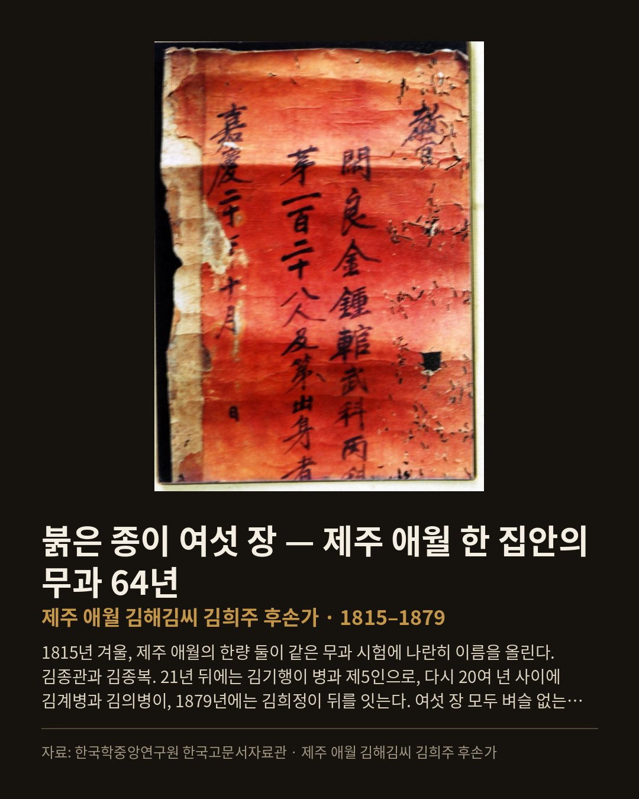
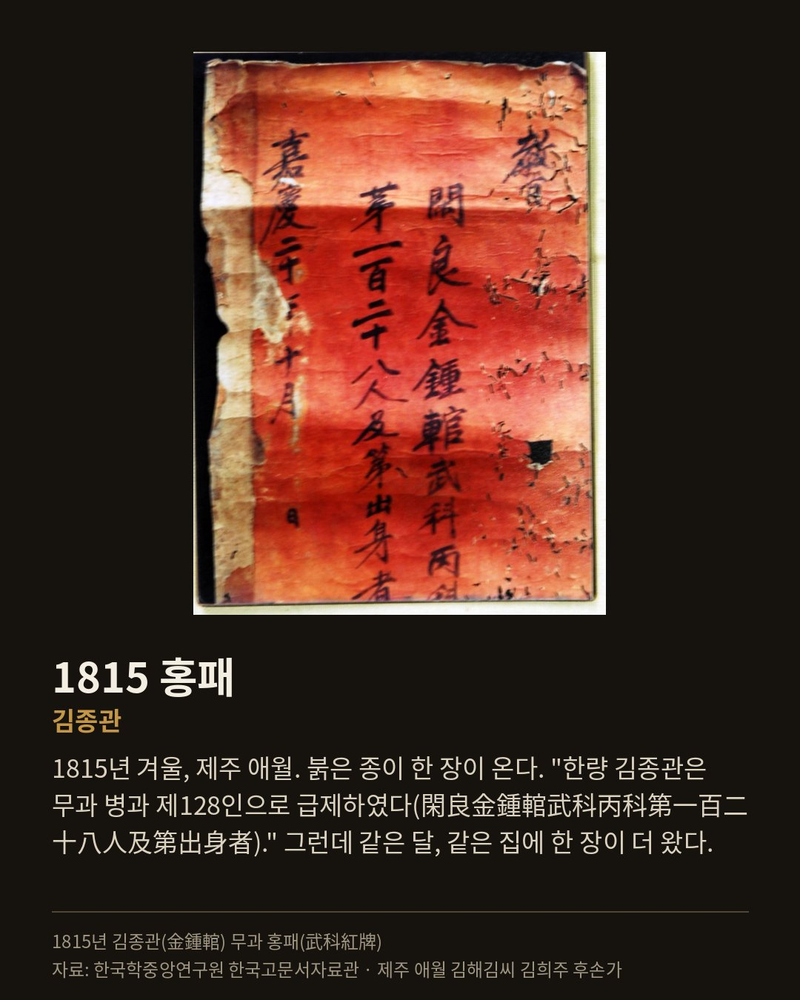
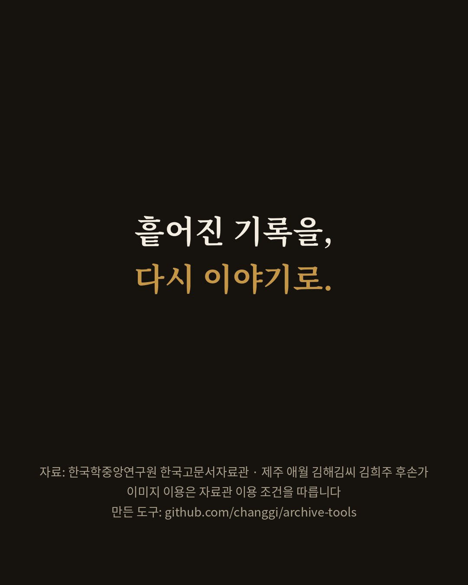

# EP.124 붉은 종이 여섯 장 — 제주 애월 한 집안의 무과 64년

제주 애월 김해김씨 김희주 후손가 (문중) · 1815년 겨울, 제주 애월의 한량 둘이 같은 무과 시험에 나란히 이름을 올린다. 김종관과 김종복. 21년 뒤에는 김기행이 병과 제5인으로, 다시 20여 년 사이에 김계병과 김의병이, 1879년에는 김희정이 뒤를 잇는다. 여섯 장 모두 벼슬 없는 한량으로 받은 무과 홍패다. 마지막 한 장은 붉은빛이 바래 보랏빛으로 남았다

- 🌐 [전시 웹페이지](https://changgi.github.io/archive-tools/examples/aewol-kim-hj/exhibit.html) (한자 위 한글 독음 · 원문 해석) · [수업 활동지](https://changgi.github.io/archive-tools/examples/aewol-kim-hj/handout.html)
- 🎬 영상: [릴스 9:16](https://changgi.github.io/archive-tools/examples/media/ep124-aewol-kim-hj_reel.mp4) · [가로 16:9](https://changgi.github.io/archive-tools/examples/media/ep124-aewol-kim-hj_wide.mp4) · 홍보 글: [`promo.md`](promo.md)
- 카드뉴스: [`cards/`](cards/) · SNS 글: [`sns.txt`](sns.txt) · 판독·해석 표: [`selection.csv`](selection.csv)

<!-- DELIVERY -->
## 전달 에디팅 — 이 기록을 이렇게 전합니다

- **핵심 정서** — 뿌듯함
- **한 문장** — 섬에서 한 집안이 같은 길을 대를 이어 걸었다 — 여섯 장의 붉은 종이가 그 시간을 보여 준다.
- **열기** — 64년 동안, 같은 문장이 적힌 붉은 종이가 한 집에 여섯 번 왔습니다.
- **펼치기** — 김종관 무과 홍패 → 김종복 무과 홍패 → 김기행 무과 홍패 → 김계병 무과 홍패 → 김의병 무과 홍패 → 김희정 무과 홍패 (1815–1879년) — 1815년 같은 달의 두 장 → 1836년 병과 제5인 → 1857 · 1860년 돌림자가 같은 두 장 → 1879년 보랏빛으로 남은 마지막 장 순으로, 반복 속의 작은 차이(등수 · 돌림자 · 빛깔)가 보이게 구성했습니다.
- **절정** — "한량 김기행은 무과 병과 제5인으로 급제하였다(閑良金沂行武科丙科第五人及第出身者)" — 화면·공간에서 이 한 줄만 크게, 소리를 줄여 집중
- **여운** — 64년 동안 여섯 번, 한 집안은 왜 같은 길을 골랐을까요? — 질문으로 끝내고 답은 보는 사람에게
- **감각과 물질** — 같은 크기의 붉은 홍패 여섯 장을 연도순으로 한 줄 — 마지막 보랏빛 한 장 · 붉은 종이를 실물 크기로 복제해 벽에 거는 연출
- **통로와 매개** — 온라인: 릴스(열기) → 카드뉴스(펼치기) → 전시 웹페이지(절정·원문) → 비하인드 카드(여운) / 오프라인: 원본 크기 복제·낭독·참여 벽 / 남기기: 활동지·질문 카드
- **여운 장치** — 우리 집에서 대를 이어 온 것 하나 적어 보기
- **전달 에디팅 전** — 6건의 문서를 1815–1879년 연대순으로 놓고 문서명 · 유형 · 해설을 붙인다 — 정확하지만, 지나가면 잊힌다.
- **전달 에디팅 후** — 핵심 정서는 「뿌듯함」. 「64년 동안, 같은 문장이 적힌 붉은 종이가 한 집에 여섯 번 왔습니다.」로 열고, 문서를 대비와 순서로 펼친 뒤, "한량 김기행은 무과 병과 제5인으로 급제하였다(閑良金沂行武科丙科第五人及第出身者)"에서 멈춘다. 같은 크기의 붉은 홍패 여섯 장을 연도순으로 한 줄 — 마지막 보랏빛 한 장. 마지막엔 「우리 집에서 대를 이어 온 것 하나 적어 보기」로 보는 사람이 자기 이야기를 남기고 떠나게 한다.

전문: [`delivery.md`](delivery.md)
<!-- /DELIVERY -->

<!-- CURATOR -->
## 비하인드 — 큐레이터 노트

- **왜 이 문서들인가** — 한 집안에 무과 홍패가 여섯 장, 그것도 모두 '한량'으로 받은 것이었습니다. 같은 문장이 64년 동안 되풀이된 셈입니다.
- **전하고 싶은 것** — 섬에서 한 집안이 같은 길을 대를 이어 걸었다 — 여섯 장의 붉은 종이가 그 시간을 보여 준다.
- **이렇게 보이길 바랐다** — 1815년 같은 달의 두 장 → 1836년 병과 제5인 → 1857 · 1860년 돌림자가 같은 두 장 → 1879년 보랏빛으로 남은 마지막 장 순으로, 반복 속의 작은 차이(등수 · 돌림자 · 빛깔)가 보이게 구성했습니다.
- **이렇게 써 주세요** — 조선 후기 무과와 한량, 제주 사람의 과거 응시, 집안의 직업과 대물림, 종이와 염료의 보존 수업에 쓰세요.
- **만들며 있었던 일** — 여섯 장 모두 정서라 판독은 확실한 편이나, 1857년 홍패의 등수 '八十七'은 '十'의 모양이 달라 확인이 필요합니다. 여섯 사람의 가계상 관계, 시험의 종류, 마지막 장이 보랏빛인 까닭은 확인하지 않았습니다.
- **남겨 둔 질문** — 64년 동안 여섯 번, 한 집안은 왜 같은 길을 골랐을까요?
- **제작 기록** — 문서 6건 · 1815–1879년 · 원본 사진 6면(문서 전체) · 원문 판독 6건 · 번역 6건 · 해제에 "확인 필요"를 단 문서 4건

전문: [`curator.md`](curator.md) · 비하인드 카드: [`behind/`](behind/) · 채널별 홍보안: [`channels.md`](channels.md)
<!-- /CURATOR -->

## 이야기 — 사료가 말하는 대로

64년 동안, 같은 문장이 적힌 붉은 종이가 한 집에 여섯 번 왔습니다.

> **1815 홍패** — 1815년 겨울, 제주 애월. 붉은 종이 한 장이 온다. "한량 김종관은 무과 병과 제128인으로 급제하였다(閑良金鍾輨武科丙科第一百二十八人及第出身者)." 그런데 같은 달, 같은 집에 한 장이 더 왔다.
> **1815 홍패** — "한량 김종복은 무과 병과 제141인으로 급제하였다(閑良金鍾輻武科丙科第一百四十一人及第出身者)." 같은 돌림자, 같은 수레 거(車) 변. 바다를 건너간 두 사람이, 한 시험에서 나란히 이름을 얻었다.
> **1836 홍패** — 21년 뒤. "한량 김기행은 무과 병과 제5인으로 급제하였다(閑良金沂行武科丙科第五人及第出身者)." 백몇십 번째가 아니라, 다섯 번째. 집안의 이름이 한 걸음 앞으로 나왔다.
> **1857 홍패** — 다시 21년 뒤, 1857년. 김계병이 붉은 종이를 받는다. 그리고 3년 뒤, 돌림자가 같은 김의병이 또 받는다.
> **1860 홍패** — "한량 김의병은 무과 병과 제52인으로 급제하였다(閑良金宜柄武科丙科第五十二人及第出身者)." 다섯 번째 붉은 종이. 누가 누구의 아들인지는 종이에 적혀 있지 않다. 다만 길은 하나였다.
> **1879 홍패** — 그리고 1879년, 여섯 번째. "한량 김희정은 무과 병과 제155인으로 급제하였다(閑良金熙鼎武科丙科第一百五十五人及第出身者)." 붉은빛은 바래 보랏빛이 되었다. 64년, 여섯 사람. 섬의 한 집안이 같은 문장을 여섯 번 받았다.

| 표지 | 1번 카드 | 마무리 |
|---|---|---|
|  |  |  |

## 선별 문서 (6점)

| # | 연도 | 유형 | 문서명 | 원본 |
|---|---|---|---|---|
| 1 | 1815 | 홍패 | 1815년 김종관(金鍾輨) 무과 홍패(武科紅牌) | [원본 보기](https://archive.aks.ac.kr/viewer/viewer.do#imgnode.do?itemId=book&gubun=booktree&depth=6&upPath=01%5E0168%5EL016820%5EL016820F02%5EL016820F0201&dataId=G002%2BAKS%2BKSM-XA.1815.5011-20220125.B083a_114_00767_XXX&itemType=) |
| 2 | 1815 | 홍패 | 1815년 김종복(金鍾輻) 무과 홍패(武科紅牌) | [원본 보기](https://archive.aks.ac.kr/viewer/viewer.do#imgnode.do?itemId=book&gubun=booktree&depth=6&upPath=01%5E0168%5EL016820%5EL016820F02%5EL016820F0201&dataId=G002%2BAKS%2BKSM-XA.1815.5011-20220125.B083a_114_00766_XXX&itemType=) |
| 3 | 1836 | 홍패 | 1836년 김기행(金沂行) 무과 홍패(武科紅牌) | [원본 보기](https://archive.aks.ac.kr/viewer/viewer.do#imgnode.do?itemId=book&gubun=booktree&depth=6&upPath=01%5E0168%5EL016820%5EL016820F02%5EL016820F0201&dataId=G002%2BAKS%2BKSM-XA.1836.5011-20220125.B083a_114_00768_XXX&itemType=) |
| 4 | 1857 | 홍패 | 1857년 김계병(金啓柄) 무과 홍패(武科紅牌) | [원본 보기](https://archive.aks.ac.kr/viewer/viewer.do#imgnode.do?itemId=book&gubun=booktree&depth=6&upPath=01%5E0168%5EL016820%5EL016820F02%5EL016820F0201&dataId=G002%2BAKS%2BKSM-XA.1857.5011-20220125.B083a_114_00769_XXX&itemType=) |
| 5 | 1860 | 홍패 | 1860년 김의병(金宜柄) 무과 홍패(武科紅牌) | [원본 보기](https://archive.aks.ac.kr/viewer/viewer.do#imgnode.do?itemId=book&gubun=booktree&depth=6&upPath=01%5E0168%5EL016820%5EL016820F02%5EL016820F0201&dataId=G002%2BAKS%2BKSM-XA.1860.5011-20220125.B083a_114_00770_XXX&itemType=) |
| 6 | 1879 | 홍패 | 1879년 김희정(金熙鼎) 무과 홍패(武科紅牌) | [원본 보기](https://archive.aks.ac.kr/viewer/viewer.do#imgnode.do?itemId=book&gubun=booktree&depth=6&upPath=01%5E0168%5EL016820%5EL016820F02%5EL016820F0201&dataId=G002%2BAKS%2BKSM-XA.1879.5011-20220125.B083a_114_00771_XXX&itemType=) |

## 원문 판독과 해석

### 1. 1815년 김종관(金鍾輨) 무과 홍패(武科紅牌)

**원문 판독**

```
敎旨
閑良金鍾輨武科丙科
第一百二十八人及第出身者
嘉慶二十年十月 日
```

**원문 해석** 교지. 한량 김종관은 무과 병과 제128인으로 급제하여 출신한 자이다. 가경 20년(1815) 10월 일.

**해제** 1815년(순조 15, 嘉慶 20, 乙亥) 제주 애월의 한량 김종관(金鍾輨)이 무과에 병과 제128인으로 급제하고 받은 홍패입니다. '한량(閑良)'은 관직 없이 무예를 닦던 사람을 이릅니다. 오른쪽 가장자리가 벌레 먹고 왼쪽이 찢겼으나 본문은 온전합니다. 같은 해 같은 달의 김종복 홍패와 짝을 이룹니다.

### 2. 1815년 김종복(金鍾輻) 무과 홍패(武科紅牌)

**원문 판독**

```
敎旨
閑良金鍾輻武科丙科
第一百四十一人及第出身者
嘉慶二十年十月 日
```

**원문 해석** 교지. 한량 김종복은 무과 병과 제141인으로 급제하여 출신한 자이다. 가경 20년(1815) 10월 일.

**해제** 1815년(순조 15, 嘉慶 20) 김종복(金鍾輻)이 같은 무과에 병과 제141인으로 급제하고 받은 홍패입니다. 김종관과 날짜(10월)가 같아 같은 시험의 급제자로 보입니다. 두 사람의 이름은 돌림자 '鍾'에 수레 거(車) 부수의 글자(輨 · 輻)를 써서 형제나 가까운 항렬로 짐작되지만, 가계상 관계는 이번에 확인하지 않았습니다.

### 3. 1836년 김기행(金沂行) 무과 홍패(武科紅牌)

**원문 판독**

```
敎旨
閑良金沂行武科丙科
第五人及第出身者
道光十六年三月初七日
```

**원문 해석** 교지. 한량 김기행은 무과 병과 제5인으로 급제하여 출신한 자이다. 도광 16년(1836) 3월 7일.

**해제** 1836년(헌종 2, 道光 16, 丙申) 한량 김기행(金沂行)이 무과에 병과 제5인으로 급제하고 받은 홍패입니다. 병과 안에서 다섯째로, 여섯 장 가운데 가장 앞선 등수입니다. 연호 위에 어보가 찍혔고, 오른쪽 가장자리가 벌레 먹었습니다.

### 4. 1857년 김계병(金啓柄) 무과 홍패(武科紅牌)

**원문 판독**

```
敎旨
閑良金啓柄武科丙科
第八十七人及第出身者
咸豐七年四月 日
```

**원문 해석** 교지. 한량 김계병은 무과 병과 제87인으로 급제하여 출신한 자이다. 함풍 7년(1857) 4월 일.

**해제** 1857년(철종 8, 咸豐 7, 丁巳) 한량 김계병(金啓柄)이 무과에 병과 제87인으로 급제하고 받은 홍패입니다. 등수의 '十'은 '廿'에 가까운 모양으로 썼으나 '八十七'로 읽었습니다(확인 필요). 3년 뒤의 김의병과 돌림자 '柄'이 같습니다.

### 5. 1860년 김의병(金宜柄) 무과 홍패(武科紅牌)

**원문 판독**

```
敎旨
閑良金宜柄武科丙科
第五十二人及第出身者
咸豐十年三月 日
```

**원문 해석** 교지. 한량 김의병은 무과 병과 제52인으로 급제하여 출신한 자이다. 함풍 10년(1860) 3월 일.

**해제** 1860년(철종 11, 咸豐 10, 庚申) 한량 김의병(金宜柄)이 무과에 병과 제52인으로 급제하고 받은 홍패입니다. 김계병과 돌림자 '柄'이 같아 같은 항렬로 보이나 관계는 확인하지 않았습니다. 연호 위에 어보 자국이 있습니다.

### 6. 1879년 김희정(金熙鼎) 무과 홍패(武科紅牌)

**원문 판독**

```
敎旨
閑良金熙鼎武科丙科
第一百五十五人及第出身者
光緖五年六月 日
```

**원문 해석** 교지. 한량 김희정은 무과 병과 제155인으로 급제하여 출신한 자이다. 광서 5년(1879) 6월 일.

**해제** 1879년(고종 16, 光緖 5, 己卯) 한량 김희정(金熙鼎)이 무과에 병과 제155인으로 급제하고 받은 홍패입니다. 다른 다섯 장과 달리 종이가 보랏빛으로 남아 있는데, 물감이 바랜 탓인지 처음부터 다른 빛이었는지는 확인하지 못했습니다. 1815년 첫 홍패로부터 64년 뒤입니다. 연호 위에 어보가 찍혔습니다.

판독·해석·이야기는 이미지에 근거한 초안이며(검토 전 "초안" 표시), 정확한 판독은 원문 확인이 필요합니다. □는 읽지 못한 글자, (?)는 불확실한 글자입니다.
이미지: 한국학중앙연구원 한국고문서자료관 소장·제공. "원본" 링크를 누르면 자료관 뷰어에서 그 문서가 열립니다. 재사용은 자료관에 문의하세요(소장처 동의 필요).
