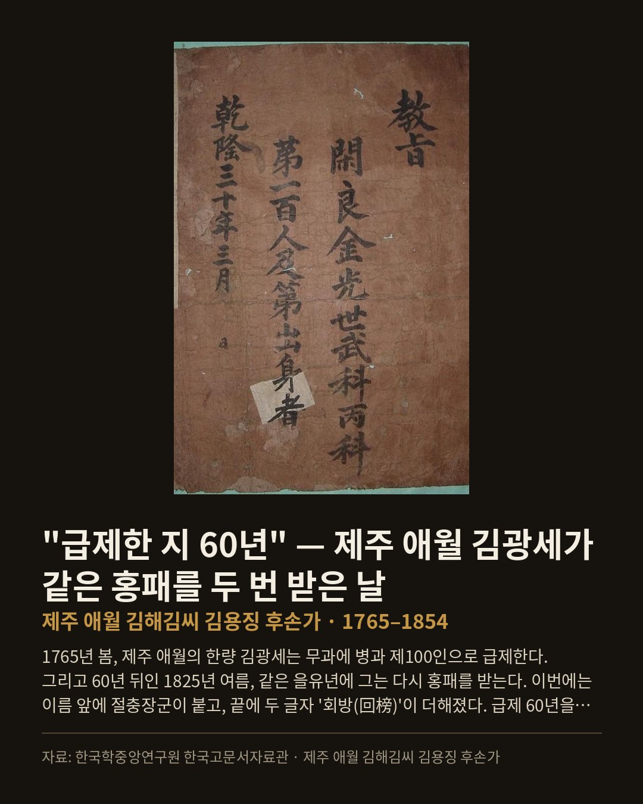
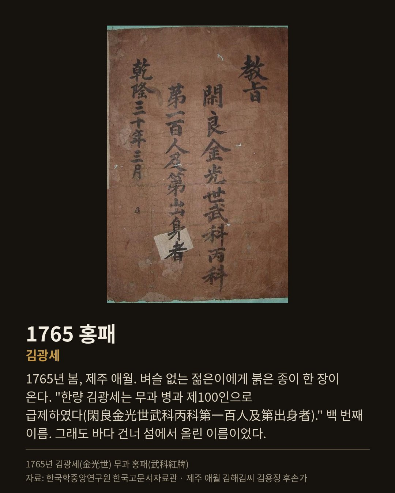
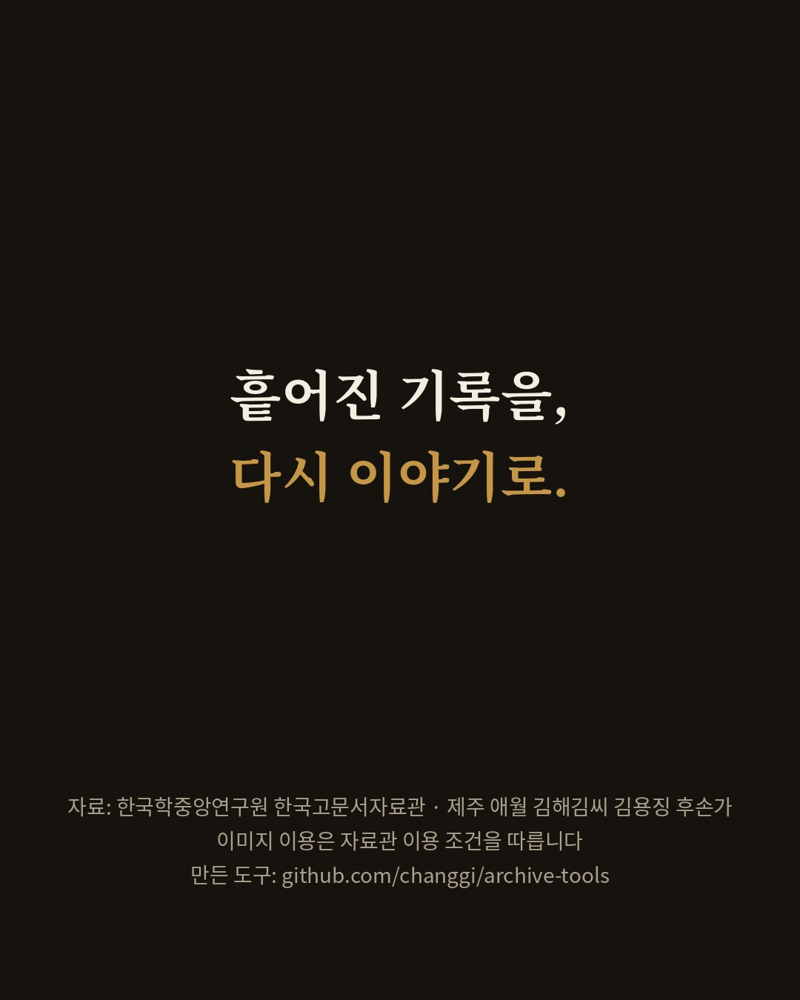

# EP.123 "급제한 지 60년" — 제주 애월 김광세가 같은 홍패를 두 번 받은 날

제주 애월 김해김씨 김용징 후손가 (문중) · 1765년 봄, 제주 애월의 한량 김광세는 무과에 병과 제100인으로 급제한다. 그리고 60년 뒤인 1825년 여름, 같은 을유년에 그는 다시 홍패를 받는다. 이번에는 이름 앞에 절충장군이 붙고, 끝에 두 글자 '회방(回榜)'이 더해졌다. 급제 60년을 살아서 맞은 사람에게 나라가 다시 내린 축하였다. 29년 뒤, 같은 집안의 김명악은 문과 갑과 제1인으로 이름을 올린다

- 🌐 [전시 웹페이지](https://changgi.github.io/archive-tools/examples/aewol-kim-yj/exhibit.html) (한자 위 한글 독음 · 원문 해석) · [수업 활동지](https://changgi.github.io/archive-tools/examples/aewol-kim-yj/handout.html)
- 🎬 영상: [릴스 9:16](https://changgi.github.io/archive-tools/examples/media/ep123-aewol-kim-yj_reel.mp4) · [가로 16:9](https://changgi.github.io/archive-tools/examples/media/ep123-aewol-kim-yj_wide.mp4) · 홍보 글: [`promo.md`](promo.md)
- 카드뉴스: [`cards/`](cards/) · SNS 글: [`sns.txt`](sns.txt) · 판독·해석 표: [`selection.csv`](selection.csv)

<!-- DELIVERY -->
## 전달 에디팅 — 이 기록을 이렇게 전합니다

- **핵심 정서** — 뭉클함
- **한 문장** — 오래 산 것도 기록이 된다 — 급제 60년을 살아서 맞은 사람에게 나라는 같은 합격증을 다시 써 주었다.
- **열기** — 60년 전에 받은 합격증을, 다시 받았습니다. 끝에 두 글자가 더해져서.
- **펼치기** — 김광세 무과 홍패 → 김광세 무과 홍패 회방 → 김광세 회방 가자 고신 → 김명악 문과 홍패 → 김명악 성균관 전적 고신 (1765–1854년) — 1765년 홍패 → 1825년 회방 홍패와 짝 고신 → 29년 뒤 1854년 문과 갑과 제1인 홍패와 첫 고신 순으로, 한 사람의 60년과 한 집안의 다음 걸음을 이어 보이게 구성했습니다.
- **절정** — "급제한 지 회방을 맞은 자(及第出身回榜者)" — 화면·공간에서 이 한 줄만 크게, 소리를 줄여 집중
- **여운** — 60년 전 홍패를 꺼내 새 홍패 옆에 놓았을 때, 김광세는 무엇을 떠올렸을까요? — 질문으로 끝내고 답은 보는 사람에게
- **감각과 물질** — 같은 문장의 붉은 홍패 두 장을 나란히 — 60년의 빛바램 차이 · 붉은 종이를 실물 크기로 복제해 벽에 거는 연출 · 어보·관인 탁본 스탬프를 찍어 보는 체험
- **통로와 매개** — 온라인: 릴스(열기) → 카드뉴스(펼치기) → 전시 웹페이지(절정·원문) → 비하인드 카드(여운) / 오프라인: 원본 크기 복제·낭독·참여 벽 / 남기기: 활동지·질문 카드
- **여운 장치** — 60년 뒤의 나에게 보낼 축하 한 줄 쓰기
- **전달 에디팅 전** — 5건의 문서를 1765–1854년 연대순으로 놓고 문서명 · 유형 · 해설을 붙인다 — 정확하지만, 지나가면 잊힌다.
- **전달 에디팅 후** — 핵심 정서는 「뭉클함」. 「60년 전에 받은 합격증을, 할아버지가 다시 받았습니다. 끝에 두 글자가 더해져서.」로 열고, 문서를 대비와 순서로 펼친 뒤, "급제한 지 회방을 맞은 자(及第出身回榜者)"에서 멈춘다. 같은 문장의 붉은 홍패 두 장을 나란히 — 60년의 빛바램 차이. 마지막엔 「60년 뒤의 나에게 보낼 축하 한 줄 쓰기」로 보는 사람이 자기 이야기를 남기고 떠나게 한다.

전문: [`delivery.md`](delivery.md)
<!-- /DELIVERY -->

<!-- CURATOR -->
## 비하인드 — 큐레이터 노트

- **왜 이 문서들인가** — 같은 사람, 같은 문장의 홍패가 두 장 있었습니다. 날짜는 꼭 60년 차이, 끝에 '회방' 두 글자가 더해져 있었습니다.
- **전하고 싶은 것** — 오래 산 것도 기록이 된다 — 급제 60년을 살아서 맞은 사람에게 나라는 같은 합격증을 다시 써 주었다.
- **이렇게 보이길 바랐다** — 1765년 홍패 → 1825년 회방 홍패와 짝 고신 → 29년 뒤 1854년 문과 갑과 제1인 홍패와 첫 고신 순으로, 한 사람의 60년과 한 집안의 다음 걸음을 이어 보이게 구성했습니다.
- **이렇게 써 주세요** — 조선의 과거 제도와 회방 · 노인 우대, 제주 사람의 과거 급제, 장수와 생애사 수업에 쓰세요.
- **만들며 있었던 일** — 다섯 장 모두 정서라 판독이 확실한 편이나, 1854년 고신의 왼쪽 작은 글씨는 '…第一人'만 남았습니다. 김광세의 나이, 1854년 시험의 종류, 김광세 · 김명악 · 김용징의 가계상 관계, 고신이 홍패보다 날짜가 앞선 까닭은 확인하지 않았습니다.
- **남겨 둔 질문** — 60년 전 홍패를 꺼내 새 홍패 옆에 놓았을 때, 김광세는 무엇을 떠올렸을까요?
- **제작 기록** — 문서 5건 · 1765–1854년 · 원본 사진 5면(문서 전체) · 원문 판독 5건 · 번역 5건 · 해제에 "확인 필요"를 단 문서 3건

전문: [`curator.md`](curator.md) · 비하인드 카드: [`behind/`](behind/) · 채널별 홍보안: [`channels.md`](channels.md)
<!-- /CURATOR -->

## 이야기 — 사료가 말하는 대로

60년 전에 받은 합격증을, 할아버지가 다시 받았습니다. 끝에 두 글자가 더해져서.

> **1765 홍패** — 1765년 봄, 제주 애월. 벼슬 없는 젊은이에게 붉은 종이 한 장이 온다. "한량 김광세는 무과 병과 제100인으로 급제하였다(閑良金光世武科丙科第一百人及第出身者)." 백 번째 이름. 그래도 바다 건너 섬에서 올린 이름이었다.
> **1825 회방** — 그리고 60년이 흐른다. 같은 을유년, 같은 문장이 다시 온다. 다만 이름 앞은 한량이 아니라 절충장군이고, 끝에 두 글자가 붙었다. "급제한 지 회방을 맞은 자(及第出身回榜者)." 급제 60년을 살아서 맞은 사람에게, 나라가 한 번 더 축하를 보낸 것이다.
> **1825 고신** — 같은 달, 또 한 장. 이번엔 품계다. 옆에 작은 글씨로 까닭이 적혀 있다. "무과 회방인은 정해진 규식대로 품계를 올린다(武科回榜人依定式加資事)." 오래 산 것이, 그 자체로 나라의 기록이 되었다.
> **1854 홍패** — 29년 뒤, 같은 집안에 다시 붉은 종이가 온다. 이번엔 무과가 아니라 문과다. "유학 김명악은 문과 갑과 제1인으로 급제하였다(幼學金命岳文科甲科第一人及第出身者)." 백 번째에서 시작한 집안의 이름이, 이번엔 맨 앞에 섰다.
> **1854 고신** — 그리고 첫 벼슬. 나라의 최고 학교, 성균관이다. "김명악을 조봉대부 행 성균관 전적으로 삼는다(金命岳爲朝奉大夫行成均館典籍者)." 바다 건너 애월에서, 한양의 성균관까지. 한 집안의 종이들이 그 거리를 잇는다.

| 표지 | 1번 카드 | 마무리 |
|---|---|---|
|  |  |  |

## 선별 문서 (5점)

| # | 연도 | 유형 | 문서명 | 원본 |
|---|---|---|---|---|
| 1 | 1765 | 홍패 | 1765년 김광세(金光世) 무과 홍패(武科紅牌) | [원본 보기](https://archive.aks.ac.kr/viewer/viewer.do#imgnode.do?itemId=book&gubun=booktree&depth=6&upPath=01%5E0168%5EL016819%5EL016819F02%5EL016819F0201&dataId=G002%2BAKS%2BKSM-XA.1765.5011-20220125.B083a_114_00720_XXX&itemType=) |
| 2 | 1825 | 회방 | 1825년 김광세(金光世) 무과 홍패(武科紅牌) 회방(回榜) | [원본 보기](https://archive.aks.ac.kr/viewer/viewer.do#imgnode.do?itemId=book&gubun=booktree&depth=6&upPath=01%5E0168%5EL016819%5EL016819F02%5EL016819F0201&dataId=G002%2BAKS%2BKSM-XA.1825.5011-20220125.B083a_114_00721_XXX&itemType=) |
| 3 | 1825 | 고신 | 1825년 김광세(金光世) 회방 가자 고신(告身) | [원본 보기](https://archive.aks.ac.kr/viewer/viewer.do#imgnode.do?itemId=book&gubun=booktree&depth=6&upPath=01%5E0168%5EL016819%5EL016819F02%5EL016819F0201&dataId=G002%2BAKS%2BKSM-XA.1825.5011-20220125.B083a_114_00726_XXX&itemType=) |
| 4 | 1854 | 홍패 | 1854년 김명악(金命岳) 문과 홍패(文科紅牌) | [원본 보기](https://archive.aks.ac.kr/viewer/viewer.do#imgnode.do?itemId=book&gubun=booktree&depth=6&upPath=01%5E0168%5EL016819%5EL016819F02%5EL016819F0201&dataId=G002%2BAKS%2BKSM-XA.1854.5011-20220125.B083a_114_00722_XXX&itemType=) |
| 5 | 1854 | 고신 | 1854년 김명악(金命岳) 성균관 전적 고신(告身) | [원본 보기](https://archive.aks.ac.kr/viewer/viewer.do#imgnode.do?itemId=book&gubun=booktree&depth=6&upPath=01%5E0168%5EL016819%5EL016819F02%5EL016819F0201&dataId=G002%2BAKS%2BKSM-XA.1854.5011-20220125.B083a_114_00727_XXX&itemType=) |

## 원문 판독과 해석

### 1. 1765년 김광세(金光世) 무과 홍패(武科紅牌)

**원문 판독**

```
敎旨
閑良金光世武科丙科
第一百人及第出身者
乾隆三十年三月 日
```

**원문 해석** 교지. 한량 김광세는 무과 병과 제100인으로 급제하여 출신한 자이다. 건륭 30년(1765) 3월 일.

**해제** 1765년(영조 41, 乾隆 30, 乙酉) 제주 애월의 김광세(金光世)가 무과에 병과 제100인으로 급제하고 받은 홍패입니다. 이름 앞의 '한량(閑良)'은 관직 없이 무예를 닦던 사람을 이르는 말로, 급제 전 그는 아무 벼슬도 없었습니다. 날짜는 '3월 일'로 날을 비워 두었습니다. 이름 아래 '出身' 언저리에 종이 조각이 덧붙어 있으나 글자는 읽힙니다.

### 2. 1825년 김광세(金光世) 무과 홍패(武科紅牌) 회방(回榜)

**원문 판독**

```
敎旨
折衝將軍金光世武科丙科
第一百人及第出身回榜者
道光五年五月三十日
```

**원문 해석** 교지. 절충장군 김광세는 무과 병과 제100인으로 급제하여 출신한 지 회방을 맞은 자이다. 도광 5년(1825) 5월 30일.

**해제** 1825년(순조 25, 道光 5, 乙酉) 김광세에게 다시 내린 홍패입니다. 문구는 60년 전 홍패와 같되, 이름 앞이 '한량'에서 정3품 당상 무관의 품계인 '절충장군(折衝將軍)'으로 바뀌었고 끝에 '회방(回榜)' 두 글자가 더해졌습니다. 회방은 과거에 급제한 지 60년이 되는 해를 맞는 것으로, 조선에서는 살아서 회방을 맞은 사람에게 홍패를 다시 내리고 품계를 올려 축하했습니다. 1765년과 1825년은 둘 다 을유(乙酉)년으로, 육십갑자가 한 바퀴 돌았습니다. 김광세가 이때 몇 살이었는지는 이번에 확인하지 않았습니다.

### 3. 1825년 김광세(金光世) 회방 가자 고신(告身)

**원문 판독**

```
敎旨
金光世爲
折衝將軍
者
道光五年五月 日
啓下
武科回榜人依定式加資事
```

**원문 해석** 교지. 김광세를 절충장군으로 삼는다. 도광 5년(1825) 5월 일. (왼쪽 작은 글씨) 임금께 아뢰어 재가를 받은 일: 무과 회방인은 정해진 규식에 따라 품계를 올리는 일.

**해제** 1825년(순조 25, 道光 5) 김광세를 절충장군(정3품 당상 무관 품계)으로 삼는다는 고신입니다. 왼쪽의 작은 글씨 '武科回榜人依定式加資事'는 이 품계가 무과 회방을 맞은 사람에게 정해진 규식(定式)대로 품계를 올려 준(加資) 것임을 밝힙니다. 앞의 회방 홍패에 '절충장군'이 이미 적힌 것과 맞물리는, 같은 달의 짝 문서입니다. 위쪽이 떨어져 나갔고 날은 비어 있습니다.

### 4. 1854년 김명악(金命岳) 문과 홍패(文科紅牌)

**원문 판독**

```
敎旨
幼學金命岳文科甲科
第一人及第出身者
咸豐四年八月 日
```

**원문 해석** 교지. 유학 김명악은 문과 갑과 제1인으로 급제하여 출신한 자이다. 함풍 4년(1854) 8월 일.

**해제** 1854년(철종 5, 咸豐 4, 甲寅) 같은 집안의 김명악(金命岳)이 문과에 갑과 제1인으로 급제하고 받은 홍패입니다. 갑과 제1인은 그 시험 급제자 가운데 맨 첫째 자리입니다. 이 시험이 어떤 시험이었는지(제주에서 따로 치른 시험인지 등)는 이번에 확인하지 못했습니다. 김광세의 회방으로부터 29년 뒤이며, 두 사람의 가계상 관계도 확인하지 않았습니다. 종이 군데군데 떨어져 나간 자리가 있으나 글자는 온전합니다.

### 5. 1854년 김명악(金命岳) 성균관 전적 고신(告身)

**원문 판독**

```
敎旨
金命岳爲朝奉
大夫行成均館
典籍者
咸豐四年閏七月十五日
…第一人
```

**원문 해석** 교지. 김명악을 조봉대부 행 성균관 전적으로 삼는다. 함풍 4년(1854) 윤7월 15일. (왼쪽 작은 글씨) …제1인.

**해제** 1854년(철종 5, 咸豐 4) 김명악을 조봉대부(朝奉大夫, 종4품 문관 품계) 행(行) 성균관 전적(典籍, 정6품)으로 삼은 고신입니다. '행'은 품계가 맡은 관직보다 높을 때 붙이는 말입니다. 왼쪽 가장자리가 떨어져 나가 작은 글씨는 '…第一人'만 남았는데, 문과 갑과 제1인으로 급제한 사람에게 내린 것임을 적은 것으로 보입니다. 날짜는 1854년의 윤7월 15일로, 홍패의 '8월'보다 앞섭니다. 두 날짜는 원문대로 적었고, 앞뒤가 바뀐 까닭은 확인하지 못했습니다.

판독·해석·이야기는 이미지에 근거한 초안이며(검토 전 "초안" 표시), 정확한 판독은 원문 확인이 필요합니다. □는 읽지 못한 글자, (?)는 불확실한 글자입니다.
이미지: 한국학중앙연구원 한국고문서자료관 소장·제공. "원본" 링크를 누르면 자료관 뷰어에서 그 문서가 열립니다. 재사용은 자료관에 문의하세요(소장처 동의 필요).
