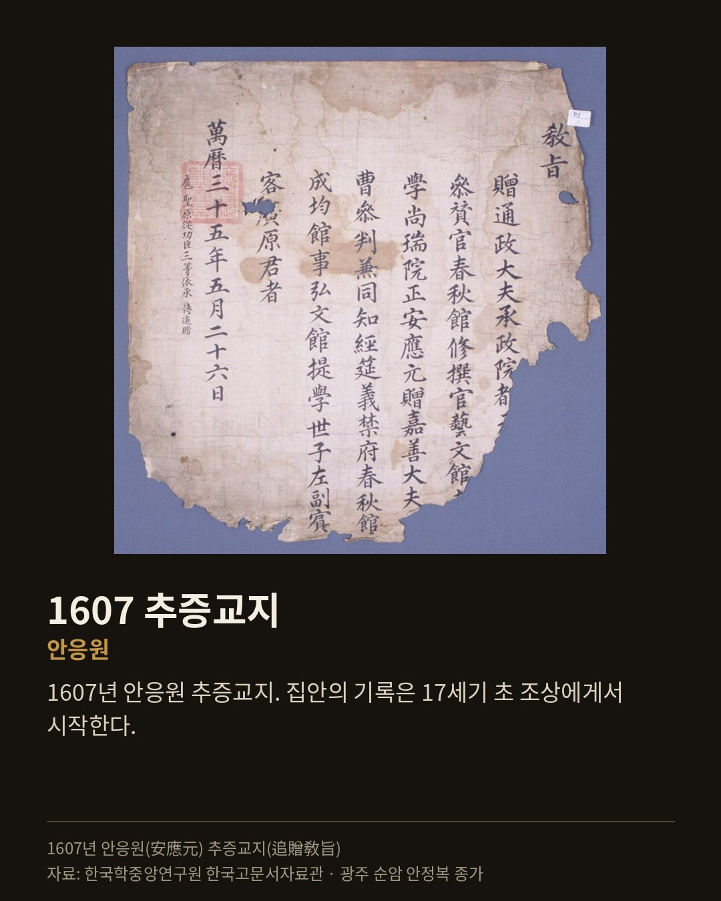
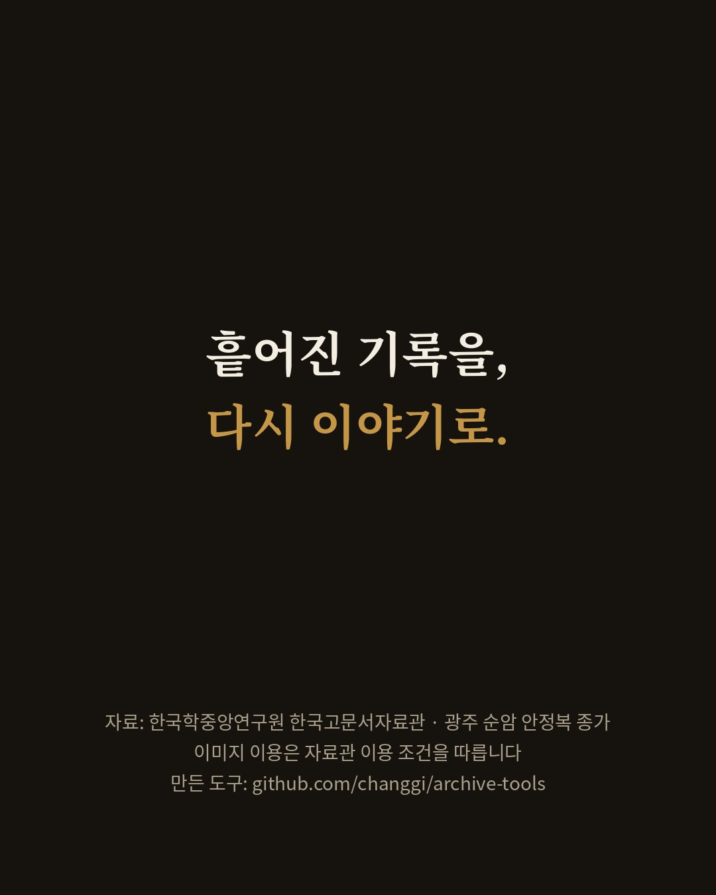

# EP.16 학자의 벼슬길

광주 순암 안정복 종가 (문중) · 첫 벼슬 후릉 참봉에서 가선대부까지, 40여 년 — 『동사강목』의 저자 안정복 집안의 문서

- 🌐 [전시 웹페이지](https://changgi.github.io/archive-tools/examples/anjeongbok/exhibit.html) · [수업 활동지](https://changgi.github.io/archive-tools/examples/anjeongbok/handout.html)
- 🎬 영상: [릴스 9:16](https://changgi.github.io/archive-tools/examples/media/ep16-anjeongbok_reel.mp4) · [가로 16:9](https://changgi.github.io/archive-tools/examples/media/ep16-anjeongbok_wide.mp4) · 홍보 글: [`promo.md`](promo.md)
- 카드뉴스: [`cards/`](cards/) · SNS 글: [`sns.txt`](sns.txt) · 에디팅 결과: [`selection.csv`](selection.csv)

## 이야기 (영상 내레이션)

> 『동사강목』을 쓴 학자는 어떤 벼슬길을 걸었을까요?
> 1749년, 그의 첫 벼슬은 후릉 참봉이었습니다.
> 1765년엔 제용감 주부,
> 1775년, 회인현감이던 그는 물러나기를 청하는 글을 올립니다.
> 1790년, 가선대부 동지중추부사.
> 같은 해, 아내 성씨도 정부인으로 높여집니다.
> 40여 년의 문서가, 한 학자의 시간을 증언합니다.

| 표지 | 1번 카드 | 마무리 |
|---|---|---|
|  |  |  |

## 선별 문서 (8점)

| # | 연도 | 유형 | 문서명 | 원본 |
|---|---|---|---|---|
| 1 | 1607 | 추증교지 | 1607년 안응원(安應元) 추증교지(追贈敎旨) | [원본 보기](https://archive.aks.ac.kr/viewer/viewer.do#imgnode.do?itemId=book&gubun=booktree&depth=6&upPath=01%5E0141%5EL014151%5EL014151F02%5EL014151F0201&dataId=G002%2BAKS%2BKSM-XA.1607.1111-20101008.B006a_008_00002_XXX&itemType=) |
| 2 | 1749 | 고신 | 1749년 안정복(安鼎福) 고신(告身)－1 | [원본 보기](https://archive.aks.ac.kr/viewer/viewer.do#imgnode.do?itemId=book&gubun=booktree&depth=6&upPath=01%5E0141%5EL014151%5EL014151F02%5EL014151F0201&dataId=G002%2BAKS%2BKSM-XA.1749.1111-20101008.B006a_008_00068_XXX&itemType=) |
| 3 | 1765 | 고신 | 1765년 안정복(安鼎福) 고신(告身) | [원본 보기](https://archive.aks.ac.kr/viewer/viewer.do#imgnode.do?itemId=book&gubun=booktree&depth=6&upPath=01%5E0141%5EL014151%5EL014151F02%5EL014151F0201&dataId=G002%2BAKS%2BKSM-XA.1765.1111-20101008.B006a_008_00025_XXX&itemType=) |
| 4 | 1775 | 정사 | 1775년 회인현감(懷仁縣監) 안정복(安鼎福) 정사(呈辭) | [원본 보기](https://archive.aks.ac.kr/viewer/viewer.do#imgnode.do?itemId=book&gubun=booktree&depth=6&upPath=01%5E0141%5EL014151%5EL014151F02%5EL014151F0202&dataId=G002%2BAKS%2BKSM-XB.1775.0000-20101008.B006a_008_00088_XXX&itemType=) |
| 5 | 1789 | 고신 | 1789년 안정복(安鼎福) 고신(告身)－1 | [원본 보기](https://archive.aks.ac.kr/viewer/viewer.do#imgnode.do?itemId=book&gubun=booktree&depth=6&upPath=01%5E0141%5EL014151%5EL014151F02%5EL014151F0201&dataId=G002%2BAKS%2BKSM-XA.1789.1111-20101008.B006a_008_00037_XXX&itemType=) |
| 6 | 1790 | 고신 | 1790년 안정복(安鼎福) 고신(告身)－2 | [원본 보기](https://archive.aks.ac.kr/viewer/viewer.do#imgnode.do?itemId=book&gubun=booktree&depth=6&upPath=01%5E0141%5EL014151%5EL014151F02%5EL014151F0201&dataId=G002%2BAKS%2BKSM-XA.1790.1111-20101008.B006a_008_00040_XXX&itemType=) |
| 7 | 1790 | 녹패 | 1790년 안정복(安鼎福) 녹패(祿牌)－1 | [원본 보기](https://archive.aks.ac.kr/viewer/viewer.do#imgnode.do?itemId=book&gubun=booktree&depth=6&upPath=01%5E0141%5EL014151%5EL014151F02%5EL014151F0201&dataId=G002%2BAKS%2BKSM-XA.1790.1111-20101008.B006a_008_00075_XXX&itemType=) |
| 8 | 1790 | 추증교지 | 1790년 안정복(安鼎福) 처(妻) 성씨(成氏) 추증교지(追贈敎旨) | [원본 보기](https://archive.aks.ac.kr/viewer/viewer.do#imgnode.do?itemId=book&gubun=booktree&depth=6&upPath=01%5E0141%5EL014151%5EL014151F02%5EL014151F0201&dataId=G002%2BAKS%2BKSM-XA.1790.1111-20101008.B006a_008_00042_XXX&itemType=) |

이야기는 문서명과 이미지에서 보이는 것에 근거한 초안이며(검토 전 "초안" 표시), 판독·해석은 원문 확인이 필요합니다.
이미지: 한국학중앙연구원 한국고문서자료관 소장·제공. "원본" 링크를 누르면 자료관 뷰어에서 그 문서가 열립니다. 재사용은 자료관에 문의하세요(소장처 동의 필요).
