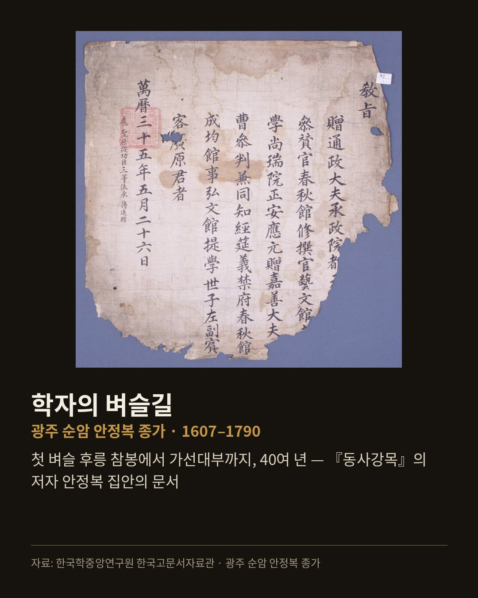

# EP.16 학자의 벼슬길

광주 순암 안정복 종가 (문중) · 첫 벼슬 후릉 참봉에서 가선대부까지, 40여 년 — 『동사강목』의 저자 안정복 집안의 문서

- 🌐 [전시 웹페이지](https://changgi.github.io/archive-tools/examples/anjeongbok/exhibit.html) · [수업 활동지](https://changgi.github.io/archive-tools/examples/anjeongbok/handout.html)
- 🎬 영상: [릴스 9:16](https://changgi.github.io/archive-tools/examples/media/ep16-anjeongbok_reel.mp4) · [가로 16:9](https://changgi.github.io/archive-tools/examples/media/ep16-anjeongbok_wide.mp4) · 홍보 글: [`promo.md`](promo.md)
- 카드뉴스: [`cards/`](cards/) · SNS 글: [`sns.txt`](sns.txt) · 에디팅 결과: [`selection.csv`](selection.csv)

## 이야기 (영상 내레이션)

> 『동사강목』을 쓴 학자는 어떤 벼슬길을 걸었을까요?
> 1749년, 그의 첫 벼슬은 후릉 참봉이었습니다.
> 1765년엔 제용감 주부,
> 1775년, 회인현감이던 그는 물러나기를 청하는 글을 올립니다.
> 1790년, 가선대부 동지중추부사.
> 같은 해, 아내 성씨도 정부인으로 높여집니다.
> 40여 년의 문서가, 한 학자의 시간을 증언합니다.

| 표지 | 1번 카드 | 마무리 |
|---|---|---|
|  |  |  |

<!-- DELIVERY -->
## 전달 에디팅 — 이 기록을 이렇게 전합니다

- **핵심 정서** — 성실
- **한 문장** — 위대한 역사서를 쓴 사람도 작은 벼슬에서 시작했다는 것.
- **열기** — 동사강목』을 쓴 학자는 어떤 벼슬길을 걸었을까요?
- **펼치기** — 안응원 추증교지 → 안정복 고신－1 → 안정복 고신 → 회인현감 안정복 정사 → 안정복 고신－2 → 안정복 녹패－1 → 안정복 처 성씨 추증교지 (1607–1790년) — 첫 벼슬(후릉 참봉)에서 마지막 품계까지, 임명장을 계단처럼 배치했습니다.
- **절정** — 1775년 회인현감 안정복이 물러나기를 청한 글 — 학자로 돌아가려는 마음 — 이 장면에서 멈추고 크게
- **여운** — 현감 자리를 내려놓고 그가 돌아가 하고 싶었던 일은 무엇이었을까요? — 질문으로 끝내고 답은 보는 사람에게
- **감각과 물질** — 임명장을 계단 단마다 놓아 위로 오르게 · 어보·관인 탁본 스탬프를 찍어 보는 체험
- **통로와 매개** — 온라인: 릴스(열기) → 카드뉴스(펼치기) → 전시 웹페이지(절정·원문) → 비하인드 카드(여운) / 오프라인: 원본 크기 복제·낭독·참여 벽 / 남기기: 활동지·질문 카드
- **여운 장치** — 『동사강목』 한 구절 필사
- **전달 에디팅 전** — 8건의 문서를 1607–1790년 연대순으로 놓고 문서명 · 유형 · 해설을 붙인다 — 정확하지만, 지나가면 잊힌다.
- **전달 에디팅 후** — 핵심 정서는 「성실」. 「동사강목』을 쓴 학자는 어떤 벼슬길을 걸었을까요?」로 열고, 문서를 대비와 순서로 펼친 뒤, 1775년 회인현감 안정복이 물러나기를 청한 글에서 멈춘다. 임명장을 계단 단마다 놓아 위로 오르게. 마지막엔 「『동사강목』 한 구절 필사」로 보는 사람이 자기 이야기를 남기고 떠나게 한다.

전문: [`delivery.md`](delivery.md)
<!-- /DELIVERY -->

<!-- CURATOR -->
## 비하인드 — 큐레이터 노트

- **왜 이 문서들인가** — 『동사강목』의 저자 안정복이 받은 임명장들이 차례로 남아, 학자의 벼슬길을 그대로 볼 수 있었습니다.
- **전하고 싶은 것** — 위대한 역사서를 쓴 사람도 작은 벼슬에서 시작했다는 것.
- **이렇게 보이길 바랐다** — 첫 벼슬(후릉 참봉)에서 마지막 품계까지, 임명장을 계단처럼 배치했습니다.
- **이렇게 써 주세요** — 실학자와 역사 편찬, 관직 체계 수업에 쓰세요.
- **만들며 있었던 일** — '이야기가 있는 기록(EP.07–16)' 묶음의 마지막 편입니다. 처음에는 문서명으로 캡션 초안만 만들었고, 뒤에 원문 전문 판독(v0.3.6)과 원문 해석(v0.4.0)을 더해 지금 모습이 되었습니다.
- **남겨 둔 질문** — 현감 자리를 내려놓고 그가 돌아가 하고 싶었던 일은 무엇이었을까요?
- **제작 기록** — 문서 8건 · 1607–1790년 · 원본 사진 22면(문서 전체) · 원문 판독 8건 · 번역 8건 · 못 읽은 글자 □ 7 · 불확실 (?) 1

전문: [`curator.md`](curator.md)
<!-- /CURATOR -->

## 선별 문서 (8점)

| # | 연도 | 유형 | 문서명 | 원본 |
|---|---|---|---|---|
| 1 | 1607 | 추증교지 | 1607년 안응원(安應元) 추증교지(追贈敎旨) | [원본 보기](https://archive.aks.ac.kr/viewer/viewer.do#imgnode.do?itemId=book&gubun=booktree&depth=6&upPath=01%5E0141%5EL014151%5EL014151F02%5EL014151F0201&dataId=G002%2BAKS%2BKSM-XA.1607.1111-20101008.B006a_008_00002_XXX&itemType=) |
| 2 | 1749 | 고신 | 1749년 안정복(安鼎福) 고신(告身)－1 | [원본 보기](https://archive.aks.ac.kr/viewer/viewer.do#imgnode.do?itemId=book&gubun=booktree&depth=6&upPath=01%5E0141%5EL014151%5EL014151F02%5EL014151F0201&dataId=G002%2BAKS%2BKSM-XA.1749.1111-20101008.B006a_008_00068_XXX&itemType=) |
| 3 | 1765 | 고신 | 1765년 안정복(安鼎福) 고신(告身) | [원본 보기](https://archive.aks.ac.kr/viewer/viewer.do#imgnode.do?itemId=book&gubun=booktree&depth=6&upPath=01%5E0141%5EL014151%5EL014151F02%5EL014151F0201&dataId=G002%2BAKS%2BKSM-XA.1765.1111-20101008.B006a_008_00025_XXX&itemType=) |
| 4 | 1775 | 정사 | 1775년 회인현감(懷仁縣監) 안정복(安鼎福) 정사(呈辭) | [원본 보기](https://archive.aks.ac.kr/viewer/viewer.do#imgnode.do?itemId=book&gubun=booktree&depth=6&upPath=01%5E0141%5EL014151%5EL014151F02%5EL014151F0202&dataId=G002%2BAKS%2BKSM-XB.1775.0000-20101008.B006a_008_00088_XXX&itemType=) |
| 5 | 1789 | 고신 | 1789년 안정복(安鼎福) 고신(告身)－1 | [원본 보기](https://archive.aks.ac.kr/viewer/viewer.do#imgnode.do?itemId=book&gubun=booktree&depth=6&upPath=01%5E0141%5EL014151%5EL014151F02%5EL014151F0201&dataId=G002%2BAKS%2BKSM-XA.1789.1111-20101008.B006a_008_00037_XXX&itemType=) |
| 6 | 1790 | 고신 | 1790년 안정복(安鼎福) 고신(告身)－2 | [원본 보기](https://archive.aks.ac.kr/viewer/viewer.do#imgnode.do?itemId=book&gubun=booktree&depth=6&upPath=01%5E0141%5EL014151%5EL014151F02%5EL014151F0201&dataId=G002%2BAKS%2BKSM-XA.1790.1111-20101008.B006a_008_00040_XXX&itemType=) |
| 7 | 1790 | 녹패 | 1790년 안정복(安鼎福) 녹패(祿牌)－1 | [원본 보기](https://archive.aks.ac.kr/viewer/viewer.do#imgnode.do?itemId=book&gubun=booktree&depth=6&upPath=01%5E0141%5EL014151%5EL014151F02%5EL014151F0201&dataId=G002%2BAKS%2BKSM-XA.1790.1111-20101008.B006a_008_00075_XXX&itemType=) |
| 8 | 1790 | 추증교지 | 1790년 안정복(安鼎福) 처(妻) 성씨(成氏) 추증교지(追贈敎旨) | [원본 보기](https://archive.aks.ac.kr/viewer/viewer.do#imgnode.do?itemId=book&gubun=booktree&depth=6&upPath=01%5E0141%5EL014151%5EL014151F02%5EL014151F0201&dataId=G002%2BAKS%2BKSM-XA.1790.1111-20101008.B006a_008_00042_XXX&itemType=) |

이야기는 문서명과 이미지에서 보이는 것에 근거한 초안이며(검토 전 "초안" 표시), 판독·해석은 원문 확인이 필요합니다.
이미지: 한국학중앙연구원 한국고문서자료관 소장·제공. "원본" 링크를 누르면 자료관 뷰어에서 그 문서가 열립니다. 재사용은 자료관에 문의하세요(소장처 동의 필요).
