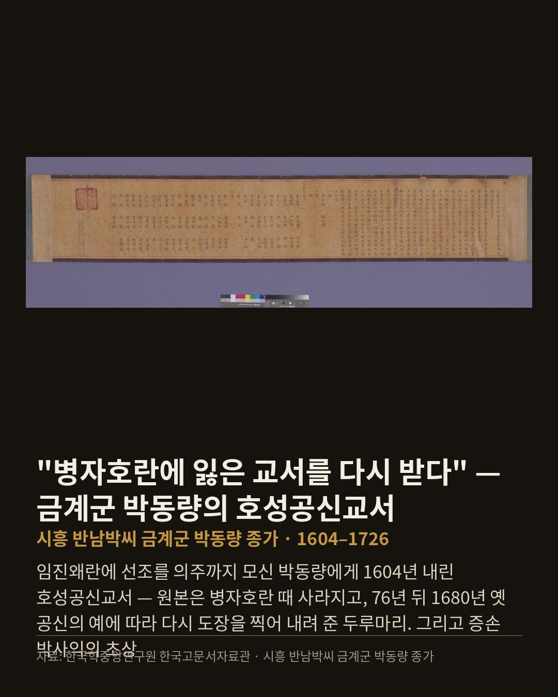
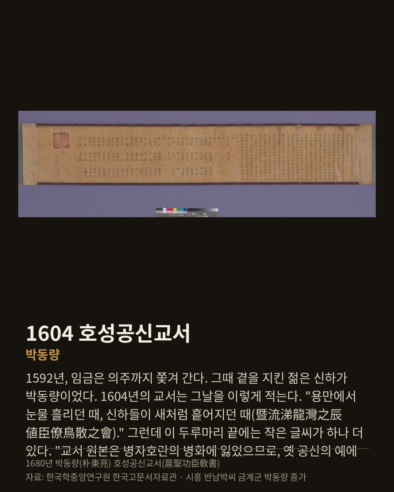
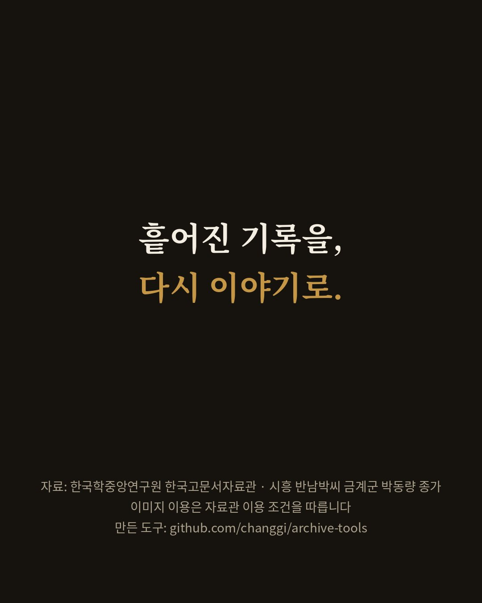

# EP.52 "병자호란에 잃은 교서를 다시 받다" — 금계군 박동량의 호성공신교서

시흥 반남박씨 금계군 박동량 종가 (문중) · 임진왜란에 선조를 의주까지 모신 박동량에게 1604년 내린 호성공신교서 — 원본은 병자호란 때 사라지고, 76년 뒤 1680년 옛 공신의 예에 따라 다시 도장을 찍어 내려 준 두루마리. 그리고 증손 박사익의 초상

- 🌐 [전시 웹페이지](https://changgi.github.io/archive-tools/examples/bakdongryang/exhibit.html) (한자 위 한글 독음 · 원문 해석) · [수업 활동지](https://changgi.github.io/archive-tools/examples/bakdongryang/handout.html)
- 🎬 영상: [릴스 9:16](https://changgi.github.io/archive-tools/examples/media/ep52-bakdongryang_reel.mp4) · [가로 16:9](https://changgi.github.io/archive-tools/examples/media/ep52-bakdongryang_wide.mp4) · 홍보 글: [`promo.md`](promo.md)
- 카드뉴스: [`cards/`](cards/) · SNS 글: [`sns.txt`](sns.txt) · 판독·해석 표: [`selection.csv`](selection.csv)


<!-- DELIVERY -->
## 전달 에디팅 — 이 기록을 이렇게 전합니다

- **핵심 정서** — 잃음과 되찾음
- **한 문장** — 국가는 공을 기억하기 위해 사라진 문서까지 다시 만들었다는 것.
- **열기** — 병자호란에 사라진 공신 교서. 76년 뒤, 다시 받았습니다.
- **펼치기** — 박동량 호성공신교서 → 박사익 초상－전신상 (1604–1726년) — 1604년의 공(의주 호종) → 1636년의 상실 → 1680년의 재발급 순으로, '잃음과 되찾음'을 축으로 엮었습니다.
- **절정** — "용만에서 눈물 흘리던 때, 신하들이 새처럼 흩어지던 때(暨流涕龍灣之辰 値臣僚鳥散之會)" — 화면·공간에서 이 한 줄만 크게, 소리를 줄여 집중
- **여운** — 다시 받은 교서는 원본과 같은 문서일까요, 다른 문서일까요? — 질문으로 끝내고 답은 보는 사람에게
- **감각과 물질** — 원본 자리에 빈 액자, 그 옆에 다시 받은 교서 · 두루마리를 실제 길이로 펼친 복제 · 여러 번 다시 그린 얼굴을 투명 레이어로 겹치기
- **통로와 매개** — 온라인: 릴스(열기) → 카드뉴스(펼치기) → 전시 웹페이지(절정·원문) → 비하인드 카드(여운) / 오프라인: 원본 크기 복제·낭독·참여 벽 / 남기기: 활동지·질문 카드
- **여운 장치** — "다시 받은 것도 원본인가" 토론
- **전달 에디팅 전** — 2건의 문서를 1604–1726년 연대순으로 놓고 문서명 · 유형 · 해설을 붙인다 — 정확하지만, 지나가면 잊힌다.
- **전달 에디팅 후** — 핵심 정서는 「잃음과 되찾음」. 「병자호란에 사라진 공신 교서. 76년 뒤, 다시 받았습니다.」로 열고, 문서를 대비와 순서로 펼친 뒤, "용만에서 눈물 흘리던 때, 신하들이 새처럼 흩어지던 때(暨流涕龍灣之辰 値臣僚鳥散之會)"에서 멈춘다. 원본 자리에 빈 액자, 그 옆에 다시 받은 교서. 마지막엔 「"다시 받은 것도 원본인가" 토론」로 보는 사람이 자기 이야기를 남기고 떠나게 한다.

전문: [`delivery.md`](delivery.md)
<!-- /DELIVERY -->

<!-- CURATOR -->
## 비하인드 — 큐레이터 노트

- **왜 이 문서들인가** — 병자호란 때 사라진 공신교서를 76년 뒤 '옛 예에 따라' 다시 받은 두루마리였기 때문입니다. 문서가 사라지고 되살아난 이야기 자체가 기록의 역사였습니다.
- **전하고 싶은 것** — 국가는 공을 기억하기 위해 사라진 문서까지 다시 만들었다는 것.
- **이렇게 보이길 바랐다** — 1604년의 공(의주 호종) → 1636년의 상실 → 1680년의 재발급 순으로, '잃음과 되찾음'을 축으로 엮었습니다.
- **이렇게 써 주세요** — 기록관리 교육에서 '원본이 사라지면 무엇으로 증명하나'를 묻는 사례, 임진·병자 두 전쟁을 잇는 수업에 쓰세요.
- **남겨 둔 질문** — 다시 받은 교서는 원본과 같은 문서일까요, 다른 문서일까요?
- **제작 기록** — 문서 2건 · 1604–1726년 · 원본 사진 8면(문서 전체) · 원문 판독 2건 · 번역 2건 · 못 읽은 글자 □ 2 · 불확실 (?) 2

전문: [`curator.md`](curator.md)
<!-- /CURATOR -->

## 이야기 — 사료가 말하는 대로

병자호란에 사라진 공신 교서. 76년 뒤, 다시 받았습니다.

> **1604 호성공신교서** — 1592년, 임금은 의주까지 쫓겨 간다. 그때 곁을 지킨 젊은 신하가 박동량이었다. 1604년의 교서는 그날을 이렇게 적는다. "용만에서 눈물 흘리던 때, 신하들이 새처럼 흩어지던 때(暨流涕龍灣之辰 値臣僚鳥散之會)." 그런데 이 두루마리 끝에는 작은 글씨가 하나 더 있다. "교서 원본은 병자호란의 병화에 잃었으므로, 옛 공신의 예에 따라 다시 내려 준다(敎書本軸佚於丙子兵燹)." 1680년, 76년 만에 다시 받은 교서였다.
> **1726 초상** — 같은 집안에는 한 장의 초상이 함께 전한다. 증손 박사익이다. 제목은 짧다. "금원옹 쉰두 살의 모습(錦原翁五十二歲像)." 교서가 약속한 대로, 이 집안은 얼굴을 그려 후세에 남겼다.

| 표지 | 1번 카드 | 마무리 |
|---|---|---|
|  |  |  |

## 선별 문서 (2점)

| # | 연도 | 유형 | 문서명 | 원본 |
|---|---|---|---|---|
| 1 | 1604 | 호성공신교서 | 1680년 박동량(朴東亮) 호성공신교서(扈聖功臣敎書) | [원본 보기](https://archive.aks.ac.kr/viewer/viewer.do#imgnode.do?itemId=book&gubun=booktree&depth=6&upPath=01%5E0141%5EL014163%5EL014163F02%5EL014163F0201&dataId=G002%2BAKS%2BKSM-XA.1680.4139-20250415.B070a_111_00503_YYY&itemType=) |
| 2 | 1726 | 초상 | 1726년 박사익(朴師益) 초상(肖像)－전신상 | [원본 보기](https://archive.aks.ac.kr/viewer/viewer.do#imgnode.do?itemId=book&gubun=booktree&depth=6&upPath=01%5E0141%5EL014163%5EL014163F02%5EL014163F0210&dataId=G002%2BAKS%2BKSM-XZ.1726.4139-20250415.B070a_111_00504_YYY&itemType=) |

## 원문 판독과 해석

### 1. 1680년 박동량(朴東亮) 호성공신교서(扈聖功臣敎書)

**원문 판독**

```
敎
忠勤貞亮効節協策扈聖功臣資憲大夫
錦溪君朴東亮書
王若曰 國運無常 陂方齊傾否之喜 邦典有不
廢 盍擧懋賞之規 玆率舊章 用頒□□
卿 潘南望族 海東名家 楊葉高才 早聞貫
笠 桂林上第 纔過弱冠 年齡雖妙 綽有老
成之風 官序猶卑 已負公輔之望 頃値播
越之際 克著修扞之勞 梁洋扈行 誰備內
相之職 盩厔失道 得辨中人之聲 不但贊(?)
力方強 獨賢王事 抑亦忠義奮發 誓雪國
羞 暨流涕龍灣之辰 値臣僚鳥散之會 左
右而酬衆務 敏手風生 夙夜以事一人 丹
誠日皦 周旋終始之旣久 險阻艱難之備
嘗 逮爵位之彌隆 小心匪懈 居寵祿而不
溢 謙德愈光 可謂藎臣 厥有成績 唐帝値
離宮之厄 先錄奉天之勤 楚子遭入郢之
災 亦賞雲中之烈 幸玆第功之下 竟可闕
褒忠之儀 肆策卿爲扈聖功臣二等 圖
形垂後 超二階 爵其父母妻子 亦超二階
無子則甥姪女婿超一階 嫡長世襲 不失
其祿 宥及永世 仍賜伴倘六人 奴婢九口
丘史四名 田八十結 銀子七兩 表裏一段
內廐馬一匹 至可領也 於戲 黃河如帶之
盟 旣稽舊典 白水投璧之誓 敢懷異心 益
堅彌諧之忠 共享升平之福 故玆敎示 想
宜知悉
一等
李恒福 鄭崐壽
二等
(元宗大王 諱) 李元翼 尹斗壽 沈友勝 李好閔 尹根壽 柳成龍 金應南 李山甫 柳根 李忠元 洪進 李國 柳永慶 李幼澄 朴東亮 沈岱 朴崇元 鄭姬藩 李光庭 崔興源 沈忠謙 尹自新 韓淵 景溫 景儉 申磼 安滉 具宬
三等
鄭琢 李憲國 柳希霖 李有中 任發英 奇孝福 崔應淑 崔賓 呂定邦 宋康 高曦 李應順 壽峴(?) 姜絪 許浚 崔彦俊 閔希騫 金起文 李延祿 金應壽 吳致雲 金鳳 金良輔 安彦鳳 朴忠敬 林祐 金禮禎 鄭漢璣 朴春成 金應昌 金秀源 申應瑞 辛大容 金重信 趙龜壽 李公沂 梁子儉 白應範 崔潤榮 金俊榮 鄭大吉 金繼韓 朴夢周 李士恭 柳肇生 楊舜民 慶宗智 崔世俊 洪澤 全龍 李春國 吳連 李希齡
萬曆三十二年十月 日 (도장)
(작은 글씨) 敎書本軸佚於丙子兵燹 今因保社功臣頒軸時 依他舊功臣例 安寶追給
```

**원문 해석** 교서. 충근정량효절협책 호성공신 자헌대부 금계군 박동량에게 내리는 글. 왕은 이르노라. 나라의 운수는 늘 같지 않아 막혔던 운이 바야흐로 풀리는 기쁨을 함께하고, 나라의 법에는 폐할 수 없는 것이 있으니 어찌 공을 힘써 상 주는 법을 행하지 않겠는가. 이에 옛 법을 따라 … 내린다. 경은 반남의 이름난 집안, 해동의 명가로, 버들잎을 꿰뚫는 높은 재주가 일찍 알려져 스무 살을 갓 넘어 과거에 높이 급제하였다. 나이는 젊으나 노성한 풍모가 넉넉하였고, 벼슬 차례는 낮았으나 이미 재상이 될 기대를 받았다. 지난번 [임금이] 피란하던 때에 지키고 막는 수고를 뚜렷이 세웠으니, 피란길에 누가 안에서 돕는 직분을 갖추었던가. … 왕사(王事)에 홀로 애썼을 뿐 아니라 충의가 떨쳐 일어나 나라의 치욕을 씻기로 맹세하였다. 용만(의주)에서 눈물 흘리던 때, 신하들이 새처럼 흩어지던 때를 만나, 곁에서 온갖 일을 처리하되 손이 빨라 바람이 일 듯하였고, 밤낮으로 한 사람(임금)을 섬기니 붉은 정성이 날로 밝았다. 처음부터 끝까지 따른 지 오래고 험난함을 두루 겪었으며, 벼슬이 높아져도 조심하여 게으르지 않았고, 총애와 녹을 받아도 넘치지 않아 겸손한 덕이 더욱 빛났으니 참된 신하라 할 만하다. … 이에 경을 호성공신 2등으로 책봉하여 초상을 그려 후세에 전하고, 품계를 두 단계 올리며, 그 부모와 처자에게도 두 단계를 올리고, 아들이 없으면 생질·조카·사위에게 한 단계를 올리며, 맏아들이 대대로 이어 녹을 잃지 않게 하고 죄를 영세토록 용서한다. 이어 반당 6인, 노비 9구, 구사 4명, 밭 80결, 은 7냥, 겉감·안감 1단, 내구마 1필을 내리니 받으라. 아아, 황하가 띠처럼 가늘어지도록(변치 않겠다는) 맹세는 이미 옛 법을 살폈으니, … 감히 딴마음을 품겠는가. 화합하는 충성을 더욱 굳게 하여 함께 태평의 복을 누리자. 이에 교시하니 잘 알리라 생각한다.
(이하 공신 명단: 1등 이항복·정곤수 / 2등 원종대왕(이름 휘), 이원익, 윤두수, 심우승, 이호민, 윤근수, 류성룡 … 박동량 … / 3등 정탁 … 허준 …)
만력 32년(1604) 10월 일.
(작은 글씨) 교서 원본 두루마리는 병자호란의 병화에 잃어버렸으므로, 이번 보사공신 두루마리를 내릴 때 다른 옛 공신의 예에 따라 어보를 찍어 추가로 내려 줌.

**해제** 1604년(선조 37) 10월, 임진왜란 때 선조를 의주(龍灣)까지 모신 공으로 박동량(朴東亮, 1569~1635)을 호성공신(扈聖功臣) 2등으로 책봉한 교서입니다. 문서명의 1680년은 왼쪽 끝 작은 글씨에 그 까닭이 적혀 있습니다. 원래 교서는 병자호란 때 잃어버려, 1680년(숙종 6) 보사공신(保社功臣) 교서를 내릴 때 다른 옛 공신의 예에 따라 어보를 찍어 다시 내려 준 것입니다. 공신 명단에는 이항복·이원익·류성룡과 의관 허준(許浚)도 보입니다. 해서로 정연하게 써서 전문을 판독했고, 앞부분 몇 글자는 불확실합니다.

### 2. 1726년 박사익(朴師益) 초상(肖像)－전신상

**원문 판독**

```
錦原翁五十二歲像
(전신 좌상 — 흑단령, 쌍학 흉배, 호피 깐 의자)
```

**원문 해석** 금원옹 쉰두 살 때의 초상.

**해제** 1726년(영조 2), 박동량의 증손 박사익(朴師益, 1675~1736)이 쉰두 살 때 그린 전신 초상입니다. 오른쪽 위 제목 '錦原翁五十二歲像'의 '錦原'은 그의 군호(錦原君)에서 온 것으로 보입니다. 흑단령에 문관 당상관을 뜻하는 쌍학 흉배를 달고, 호랑이 가죽을 깐 의자에 앉았습니다. 호성공신 교서에 '초상을 그려 후세에 전한다(圖形垂後)'고 한 집안에, 4대 뒤의 초상이 함께 전합니다.

판독·해석·이야기는 이미지에 근거한 초안이며(검토 전 "초안" 표시), 정확한 판독은 원문 확인이 필요합니다. □는 읽지 못한 글자, (?)는 불확실한 글자입니다.
이미지: 한국학중앙연구원 한국고문서자료관 소장·제공. "원본" 링크를 누르면 자료관 뷰어에서 그 문서가 열립니다. 재사용은 자료관에 문의하세요(소장처 동의 필요).
