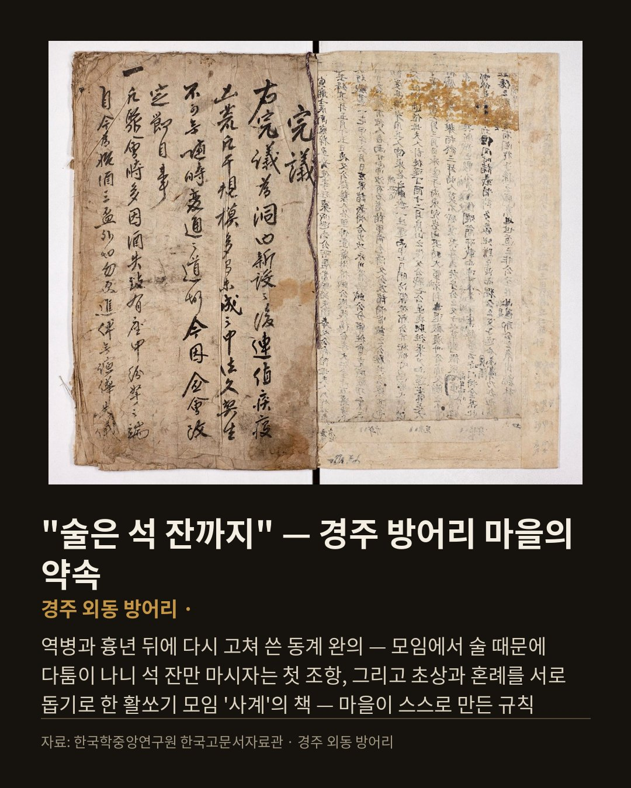
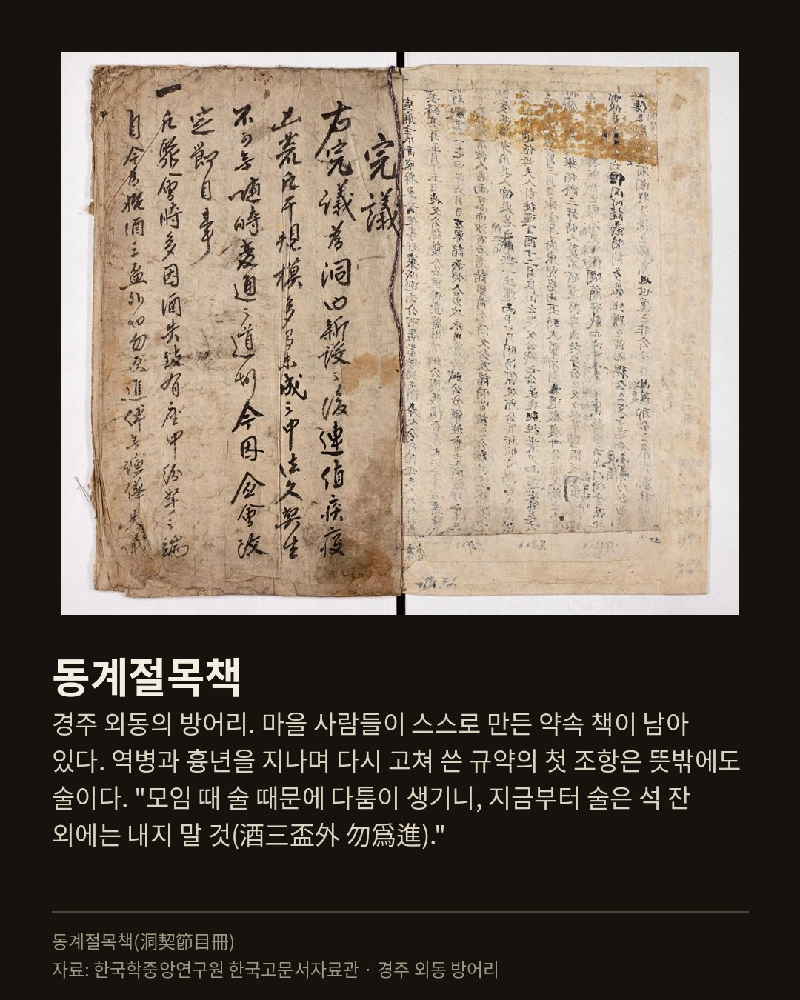
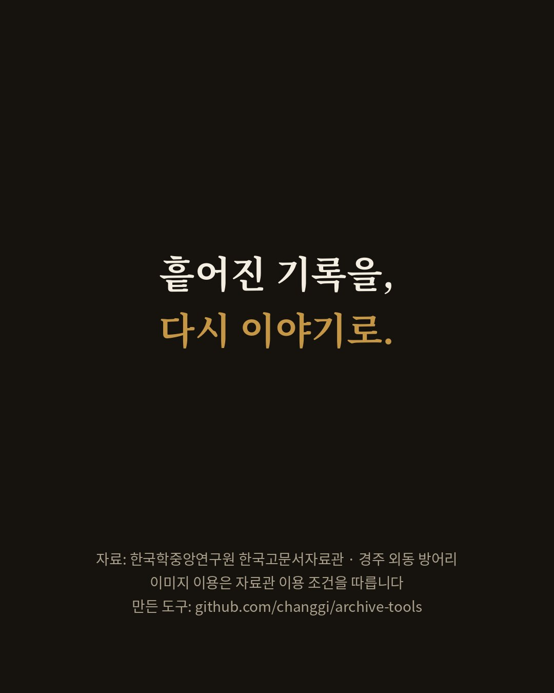

# EP.48 "술은 석 잔까지" — 경주 방어리 마을의 약속

경주 외동 방어리 (마을) · 역병과 흉년 뒤에 다시 고쳐 쓴 동계 완의 — 모임에서 술 때문에 다툼이 나니 석 잔만 마시자는 첫 조항, 그리고 초상과 혼례를 서로 돕기로 한 활쏘기 모임 '사계'의 책 — 마을이 스스로 만든 규칙

- 🌐 [전시 웹페이지](https://changgi.github.io/archive-tools/examples/bangeori/exhibit.html) (한자 위 한글 독음 · 원문 해석) · [수업 활동지](https://changgi.github.io/archive-tools/examples/bangeori/handout.html)
- 🎬 영상: [릴스 9:16](https://changgi.github.io/archive-tools/examples/media/ep48-bangeori_reel.mp4) · [가로 16:9](https://changgi.github.io/archive-tools/examples/media/ep48-bangeori_wide.mp4) · 홍보 글: [`promo.md`](promo.md)
- 카드뉴스: [`cards/`](cards/) · SNS 글: [`sns.txt`](sns.txt) · 판독·해석 표: [`selection.csv`](selection.csv)

## 이야기 — 사료가 말하는 대로

마을 규약의 첫 조항은 무엇이었을까요? '술은 석 잔까지'.

> ** 동계절목책** — 경주 외동의 방어리. 마을 사람들이 스스로 만든 약속 책이 남아 있다. 역병과 흉년을 지나며 다시 고쳐 쓴 규약의 첫 조항은 뜻밖에도 술이다. "모임 때 술 때문에 다툼이 생기니, 지금부터 술은 석 잔 외에는 내지 말 것(酒三盃外 勿爲進)."
> ** 사계고왕록** — 활쏘기 모임의 책도 있다. 표지에는 모임 이름 옆에 세 낱말이 적혀 있다. "초상, 혼례, 부조(喪事 延婚 扶助)." 마을의 활터는 서로의 기쁨과 슬픔을 함께 치르는 자리였다.

| 표지 | 1번 카드 | 마무리 |
|---|---|---|
|  |  |  |

## 선별 문서 (2점)

| # | 연도 | 유형 | 문서명 | 원본 |
|---|---|---|---|---|
| 1 | — | 동계절목책 | 동계절목책(洞契節目冊) | [원본 보기](https://archive.aks.ac.kr/viewer/viewer.do#imgnode.do?itemId=book&gubun=booktree&depth=6&upPath=07%5E0749%5EL074902%5EL074902F02%5EL074902F0207&dataId=G002%2BAKS%2BKSM-XG.0000.4713-20231108.F30701-01-W000006&itemType=) |
| 2 | — | 사계고왕록 | 사계고왕록(射契考往錄) | [원본 보기](https://archive.aks.ac.kr/viewer/viewer.do#imgnode.do?itemId=book&gubun=booktree&depth=6&upPath=07%5E0749%5EL074902%5EL074902F02%5EL074902F0207&dataId=G002%2BAKS%2BKSM-XG.0000.4713-20231108.F30701-01-W000001&itemType=) |

## 원문 판독과 해석

### 1. 동계절목책(洞契節目冊)

**원문 판독**

```
完議
右完議爲洞中新設之後 連値疾疫
凶荒 凡干規模 多有未成之中 法久弊生
不可無隨時變通之道 故今因會席 改
定節目事
一 凡講信會時 多因酒失 致有座中紛拏之端
自今爲始 酒三盃外 勿爲進(?) 俾無違悖失儀(?)
(오른쪽 면 — 뒷면 글씨가 비친 앞 장, 이하 조항은 다음 면 — 이미지 미수집)
```

**원문 해석** 완의. 이 완의는 마을[계]를 새로 만든 뒤로 잇달아 돌림병과 흉년을 만나, 무릇 여러 규모가 아직 이루어지지 못한 가운데 법이 오래되어 폐단이 생겼으니, 때에 따라 바꾸어 통하게 하는 방도가 없을 수 없으므로, 이제 모임 자리에서 절목을 고쳐 정하는 일이다.
하나. 무릇 강신회(講信會, 계원이 모여 약속을 다지는 모임) 때 술 때문에 실수가 많아 자리에서 어지럽게 다투는 일이 생기니, 지금부터 술은 석 잔 외에는 내지 말아서 어긋나고 예의를 잃는 일이 없게 할 것. (이하 다음 면)

**해제** 경주 외동 방어리 마을의 동계(洞契) 절목책 첫머리에 실린 완의(完議)입니다. 마을 계를 새로 만든 뒤 돌림병과 흉년이 잇달아 규약이 제대로 서지 못했으므로, 모임에서 절목을 고쳐 정한다는 서문과 첫 조항 '강신회 때 술은 석 잔까지'가 있습니다. 작성 연도는 문서에 보이지 않아(다음 면 확인 필요) 비워 두었습니다. 행서로 또렷하게 썼고, 오른쪽 면은 뒷장 글씨가 비친 것입니다.

### 2. 사계고왕록(射契考往錄)

**원문 판독**

```
(표지)
射契立議節目合部
喪事
延婚
扶助
(속표지 — 뒷면 글씨가 비침)
慶州郡外東面方於里
(같은 글씨를 한 번 더 적음)
```

**원문 해석** (표지) 사계(활쏘기 모임) 입의·절목을 합친 책. 초상(喪事), 혼례(延婚), 부조(扶助).
(속표지) 경주군 외동면 방어리.

**해제** 방어리의 활쏘기 모임인 사계(射契)의 입의(立議)와 절목을 한데 엮은 책의 표지입니다. 표지 옆에 '喪事 延婚 扶助'라고 적어, 이 모임이 활쏘기뿐 아니라 계원 집안의 초상과 혼례에 서로 부조하는 상부상조 조직이었음을 보여 줍니다. 속표지의 '慶州郡 外東面'이라는 행정 명칭으로 보아 1914년 군면 통폐합 이후에 정리된 책으로 보입니다(확인 필요). 본문은 다음 면부터라 판독이 필요합니다.

판독·해석·이야기는 이미지에 근거한 초안이며(검토 전 "초안" 표시), 정확한 판독은 원문 확인이 필요합니다. □는 읽지 못한 글자, (?)는 불확실한 글자입니다.
이미지: 한국학중앙연구원 한국고문서자료관 소장·제공. "원본" 링크를 누르면 자료관 뷰어에서 그 문서가 열립니다. 재사용은 자료관에 문의하세요(소장처 동의 필요).
