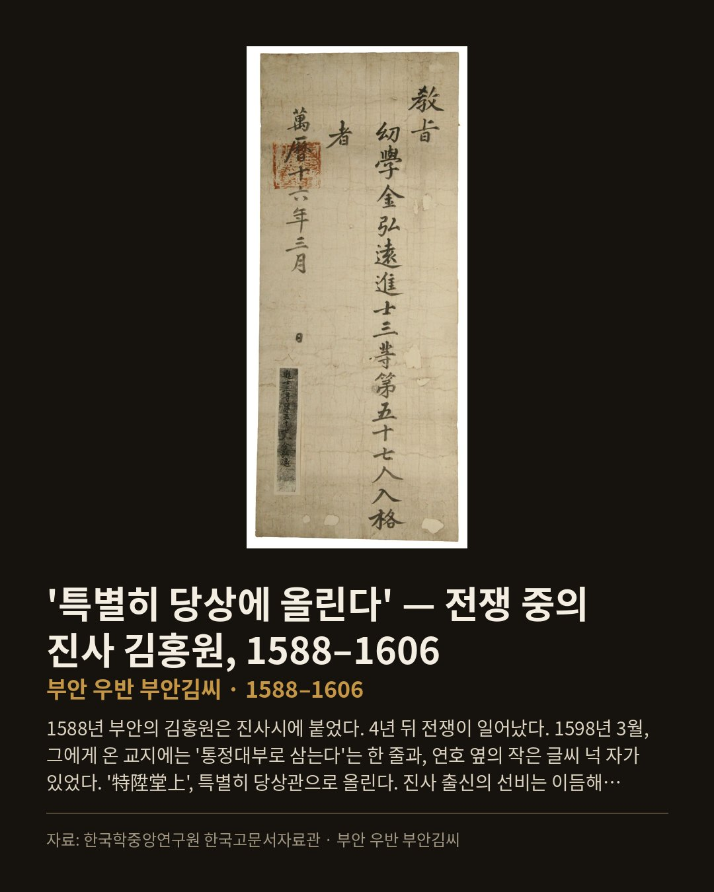
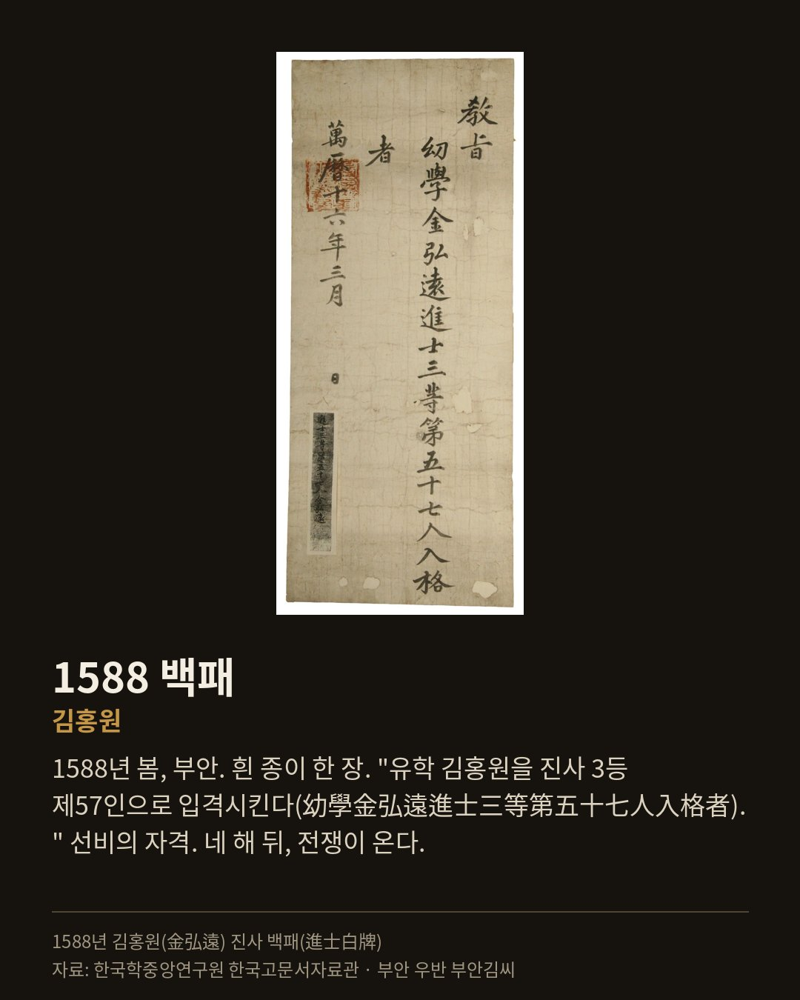
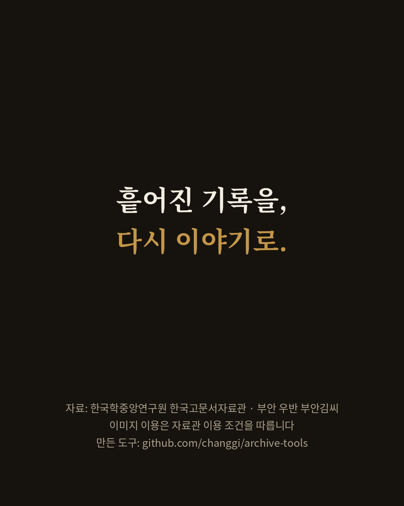

# EP.197 '특별히 당상에 올린다' — 전쟁 중의 진사 김홍원, 1588–1606

부안 우반 부안김씨 (문중) · 1588년 부안의 김홍원은 진사시에 붙었다. 4년 뒤 전쟁이 일어났다. 1598년 3월, 그에게 온 교지에는 '통정대부로 삼는다'는 한 줄과, 연호 옆의 작은 글씨 넉 자가 있었다. '特陞堂上', 특별히 당상관으로 올린다. 진사 출신의 선비는 이듬해 금산군수가 되었고, 1606년에는 원주목사가 되었다. 그 사이 1600년, 임금은 그에게 따로 명령서를 보냈다(EP.62)

- 🌐 [전시 웹페이지](https://changgi.github.io/archive-tools/examples/buan-kim-hongwon/exhibit.html) (한자 위 한글 독음 · 원문 해석) · [수업 활동지](https://changgi.github.io/archive-tools/examples/buan-kim-hongwon/handout.html)
- 🎬 영상: [릴스 9:16](https://changgi.github.io/archive-tools-next/media/ep197-buan-kim-hongwon_reel.mp4) · [가로 16:9](https://changgi.github.io/archive-tools-next/media/ep197-buan-kim-hongwon_wide.mp4) · 홍보 글: [`promo.md`](promo.md)
- 카드뉴스: [`cards/`](cards/) · SNS 글: [`sns.txt`](sns.txt) · 판독·해석 표: [`selection.csv`](selection.csv)

<!-- DELIVERY -->
## 전달 에디팅 — 이 기록을 이렇게 전합니다

- **핵심 정서** — 긴장과 자긍
- **한 문장** — 임진왜란은 문과를 거치지 않은 선비에게도 높은 품계의 길을 열었다 — 전쟁에서 공을 세운 이를 '특별히 당상에 올리는(特陞堂上)' 일이 있었고, 그렇게 오른 품계로 그는 고을 수령이 되었다.
- **열기** — 전쟁 중에 온 교지 옆에는, 작은 글씨 넉 자가 있었습니다. '특별히 당상에 올린다.'
- **펼치기** — 김홍원 진사 백패 → 김홍원 고신－1 → 김홍원 고신 (1588–1606년) — 1588 유학 김홍원 진사 백패 → 1598년 3월 통정대부(特陞堂上) → 1599 통정대부 행 금산군수 → 1606 통정대부 행 원주목사로 놓았습니다.
- **절정** — "김홍원을 통정대부로 삼는다(金弘遠爲通政大夫者)" — 화면·공간에서 이 한 줄만 크게, 소리를 줄여 집중
- **여운** — 진사 백패의 '유학'에서 열여덟 해 만에 '목사'가 된 사람에게, 전쟁은 무엇이었을까요? — 질문으로 끝내고 답은 보는 사람에게
- **감각과 물질** — 1598년 교지의 연호 옆 작은 글씨 '特陞堂上' · 흰 종이 한 장에 조명 하나 · 어보·관인 탁본 스탬프를 찍어 보는 체험
- **통로와 매개** — 온라인: 릴스(열기) → 카드뉴스(펼치기) → 전시 웹페이지(절정·원문) → 비하인드 카드(여운) / 오프라인: 원본 크기 복제·낭독·참여 벽 / 남기기: 활동지·질문 카드
- **여운 장치** — 위기 때 맡았던 역할 · 임시 직책이 이후 경력이 된 이야기 떠올리기
- **전달 에디팅 전** — 4건의 문서를 1588–1606년 연대순으로 놓고 문서명 · 유형 · 해설을 붙인다 — 정확하지만, 지나가면 잊힌다.
- **전달 에디팅 후** — 핵심 정서는 「긴장과 자긍」. 「전쟁 중에 온 교지 옆에는, 작은 글씨 넉 자가 있었습니다. '특별히 당상에 올린다.'」로 열고, 문서를 대비와 순서로 펼친 뒤, "김홍원을 통정대부로 삼는다(金弘遠爲通政大夫者)"에서 멈춘다. 1598년 교지의 연호 옆 작은 글씨 '特陞堂上'. 마지막엔 「위기 때 맡았던 역할 · 임시 직책이 이후 경력이 된 이야기 떠올리기」로 보는 사람이 자기 이야기를 남기고 떠나게 한다.

전문: [`delivery.md`](delivery.md)
<!-- /DELIVERY -->

<!-- CURATOR -->
## 비하인드 — 큐레이터 노트

- **왜 이 문서들인가** — EP.62에서 1600년 김홍원에게 내린 국왕의 명령서를 읽었습니다. 같은 집안에 그의 진사 백패와 1598년부터 1624년까지의 고신 서른 장 남짓이 이어져 있어, 전쟁을 지나며 길이 바뀐 네 장을 골랐습니다.
- **전하고 싶은 것** — 임진왜란은 문과를 거치지 않은 선비에게도 높은 품계의 길을 열었다 — 전쟁에서 공을 세운 이를 '특별히 당상에 올리는(特陞堂上)' 일이 있었고, 그렇게 오른 품계로 그는 고을 수령이 되었다.
- **이렇게 보이길 바랐다** — 1588 유학 김홍원 진사 백패 → 1598년 3월 통정대부(特陞堂上) → 1599 통정대부 행 금산군수 → 1606 통정대부 행 원주목사로 놓았습니다.
- **이렇게 써 주세요** — 임진 · 정유 전쟁기의 특진(特陞)과 당상관, 진사 출신의 수령 임명, '행(行)'과 '수(守)', 조선 중기 지방관 인사 수업에 쓰세요.
- **만들며 있었던 일** — 1598년 교지의 작은 글씨는 '特陞堂上'으로 읽었고, 어떤 공으로 특진했는지는 이 교지에 적혀 있지 않습니다. 1599 · 1606년 고신의 달 · 날 일부는 흘림이라 □로 두었습니다. 같은 해 3월에 그를 절충장군 행 용양위 부호군으로 삼은 고신과 1599년 금주진관 동첨절제도위 고신도 남아 있어, 무반 직함과 함께 받았음을 해제에서 다룹니다. 그가 의병으로 활동했다는 일반적 이해는 이 문서들로 확인하지 않았습니다.
- **남겨 둔 질문** — 진사 백패의 '유학'에서 열여덟 해 만에 '목사'가 된 사람에게, 전쟁은 무엇이었을까요?
- **제작 기록** — 문서 4건 · 1588–1606년 · 원본 사진 4면(문서 전체) · 원문 판독 4건 · 번역 4건 · 못 읽은 글자 □ 2 · 불확실 (?) 0

전문: [`curator.md`](curator.md) · 비하인드 카드: [`behind/`](behind/) · 채널별 홍보안: [`channels.md`](channels.md)
<!-- /CURATOR -->

## 이야기 — 사료가 말하는 대로

전쟁 중에 온 교지 옆에는, 작은 글씨 넉 자가 있었습니다. '특별히 당상에 올린다.'

> **1588 백패** — 1588년 봄, 부안. 흰 종이 한 장. "유학 김홍원을 진사 3등 제57인으로 입격시킨다(幼學金弘遠進士三等第五十七人入格者)." 선비의 자격. 네 해 뒤, 전쟁이 온다.
> **1598 고신** — 1598년 봄, 전쟁 일곱째 해. 교지가 온다. "김홍원을 통정대부로 삼는다(金弘遠爲通政大夫者)." 그리고 연호 옆, 작은 글씨 넉 자. "特陞堂上." 특별히, 당상관으로 올린다. 진사였던 선비가, 한 번에 당상이 되었다.
> **1599 고신** — 이듬해, 1599년. 전쟁이 끝났다. 이번 교지는 고을을 맡긴다. "통정대부 행 금산군수로 삼는다(爲通政大夫行錦山郡守者)." 칠 년 전 큰 싸움이 있었던 고을이다.
> **1606 고신** — 그리고 1606년 가을. 이번에는 큰 고을이다. "통정대부 행 원주목사로 삼는다(爲通政大夫行原州牧使者)." 열여덟 해 전 흰 종이 한 장의 진사가, 전쟁을 지나 목사가 되었다.

| 표지 | 1번 카드 | 마무리 |
|---|---|---|
|  |  |  |

## 선별 문서 (4점)

| # | 연도 | 유형 | 문서명 | 원본 |
|---|---|---|---|---|
| 1 | 1588 | 백패 | 1588년 김홍원(金弘遠) 진사 백패(進士白牌) | [원본 보기](https://archive.aks.ac.kr/viewer/viewer.do#imgnode.do?itemId=book&gubun=booktree&depth=6&upPath=01%5E0147%5EL014720%5EL014720F02%5EL014720F0201&dataId=G002%2BAKS%2BKSM-XA.1588.1111-20101008.B002a_002_00084_XXX&itemType=) |
| 2 | 1598 | 고신 | 1598년 김홍원(金弘遠) 고신(告身)－1 | [원본 보기](https://archive.aks.ac.kr/viewer/viewer.do#imgnode.do?itemId=book&gubun=booktree&depth=6&upPath=01%5E0147%5EL014720%5EL014720F02%5EL014720F0201&dataId=G002%2BAKS%2BKSM-XA.1598.1111-20101008.B002a_002_00023_XXX&itemType=) |
| 3 | 1599 | 고신 | 1599년 김홍원(金弘遠) 고신(告身) | [원본 보기](https://archive.aks.ac.kr/viewer/viewer.do#imgnode.do?itemId=book&gubun=booktree&depth=6&upPath=01%5E0147%5EL014720%5EL014720F02%5EL014720F0201&dataId=G002%2BAKS%2BKSM-XA.1599.1111-20101008.B002a_002_00026_XXX&itemType=) |
| 4 | 1606 | 고신 | 1606년 김홍원(金弘遠) 고신(告身)－1 | [원본 보기](https://archive.aks.ac.kr/viewer/viewer.do#imgnode.do?itemId=book&gubun=booktree&depth=6&upPath=01%5E0147%5EL014720%5EL014720F02%5EL014720F0201&dataId=G002%2BAKS%2BKSM-XA.1606.1111-20101008.B002a_002_00027_XXX&itemType=) |

## 원문 판독과 해석

### 1. 1588년 김홍원(金弘遠) 진사 백패(進士白牌)

**원문 판독**

```
敎旨
幼學金弘遠進士三等第五十七人入格
者
萬曆十六年三月 日
```

**원문 해석** 교지. 유학 김홍원을 진사 3등 제57인으로 입격시킨다. 만력 16년(1588) 3월 일.

**해제** 1588년(선조 21) 3월, 부안의 김홍원(金弘遠)이 진사시에 3등 제57인으로 입격하고 받은 백패입니다. 아래에 작은 쪽지가 덧붙어 있습니다. 이 집안 문서에는 그 뒤 문과 홍패가 없어, 김홍원은 문과를 거치지 않고 관직에 나간 것으로 보입니다. 4년 뒤인 1592년 임진왜란이 일어납니다.

### 2. 1598년 김홍원(金弘遠) 고신(告身)－1

**원문 판독**

```
敎旨
金弘遠爲通
政大夫者
萬曆二十六年三月二十二日
(작은 글씨) 特陞堂上
```

**원문 해석** 교지. 김홍원을 통정대부로 삼는다. 만력 26년(1598) 3월 22일. (작은 글씨) 특별히 당상으로 올림.

**해제** 정유재란 중인 1598년(선조 31) 3월, 김홍원을 통정대부(정3품 당상)로 삼은 교지입니다. 관직 없이 품계만 적었고, 연호 옆에 작은 글씨로 '特陞堂上', 곧 '특별히 당상관으로 올린다'를 적었습니다. 정해진 차례를 밟지 않고 공로 등을 이유로 한 번에 당상에 올린 특진입니다. 같은 3월에 그를 절충장군(무반 정3품 당상) 행 용양위 부호군으로 삼은 고신도 함께 남아 있습니다. 진사 출신의 선비가 전쟁 중에 문 · 무 당상의 품계를 함께 받은 것입니다.

### 3. 1599년 김홍원(金弘遠) 고신(告身)

**원문 판독**

```
敎旨
金弘遠爲
通政大夫
行錦山郡
守者
萬曆二十七年□月初十日
```

**원문 해석** 교지. 김홍원을 통정대부 행 금산군수로 삼는다. 만력 27년(1599) □월 10일.

**해제** 전쟁이 끝난 이듬해인 1599년(선조 32), 김홍원을 금산군수(종4품)로 삼은 교지입니다. 품계(통정대부, 정3품)가 관직(군수, 종4품)보다 높아 '행(行)'을 붙였습니다. 금산은 1592년 금산 전투로 큰 피해를 입은 고을로, 전쟁 뒤 고을을 다시 세우는 일을 맡은 셈입니다. 같은 해 금주진관 동첨절제도위로 삼은 고신도 남아 있어, 군수가 고을 군사 직함을 겸했음을 보여 줍니다. 달의 글자는 흘림이라 확정하지 못했습니다.

### 4. 1606년 김홍원(金弘遠) 고신(告身)－1

**원문 판독**

```
敎旨
金弘遠爲通
政大夫行原
州牧使者
萬曆三十四年八月初□日
```

**원문 해석** 교지. 김홍원을 통정대부 행 원주목사로 삼는다. 만력 34년(1606) 8월 초□일.

**해제** 1606년(선조 39) 8월, 김홍원을 원주목사(정3품)로 삼은 교지입니다. 목사는 큰 고을의 수령으로, 군수보다 높은 자리입니다. 1588년 진사가 된 지 18년, 1598년 특진으로 당상에 오른 지 8년 만입니다. 김홍원은 이후 1624년까지 여러 지방관과 무반 직함을 거쳤고, 그 고신 스무 장 남짓이 이 집안에 이어져 있습니다. 날짜의 끝 글자는 흘림이라 확정하지 못했습니다.

판독·해석·이야기는 이미지에 근거한 초안이며(검토 전 "초안" 표시), 정확한 판독은 원문 확인이 필요합니다. □는 읽지 못한 글자, (?)는 불확실한 글자입니다.
이미지: 한국학중앙연구원 한국고문서자료관 소장·제공. "원본" 링크를 누르면 자료관 뷰어에서 그 문서가 열립니다. 재사용은 자료관에 문의하세요(소장처 동의 필요).
