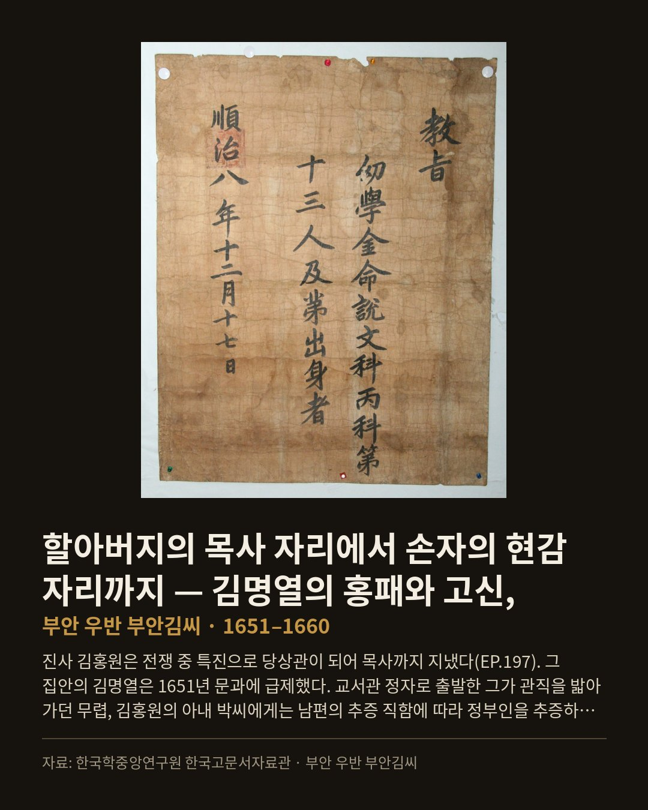
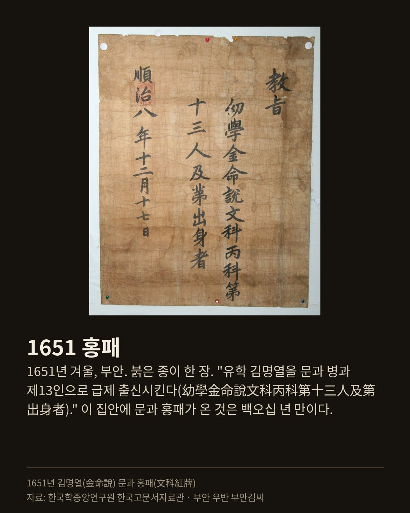
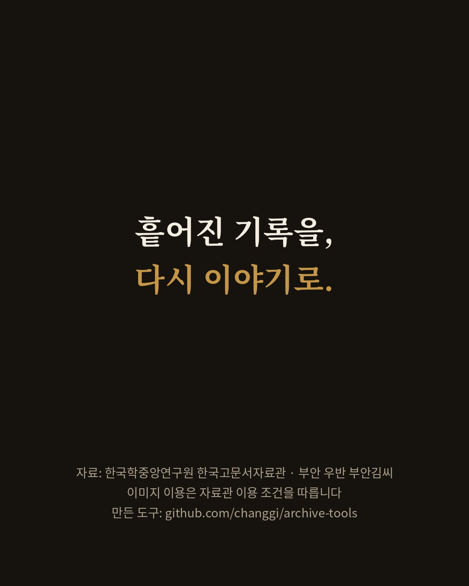

# EP.198 할아버지의 목사 자리에서 손자의 현감 자리까지 — 김명열의 홍패와 고신, 1651–1660

부안 우반 부안김씨 (문중) · 진사 김홍원은 전쟁 중 특진으로 당상관이 되어 목사까지 지냈다(EP.197). 그 집안의 김명열은 1651년 문과에 급제했다. 교서관 정자로 출발한 그가 관직을 밟아 가던 무렵, 김홍원의 아내 박씨에게는 남편의 추증 직함에 따라 정부인을 추증하는 교지가 왔다. 그리고 1660년, 김명열은 강진현감이 되었다. 한 집안의 종이가 대를 넘어 이어졌다

- 🌐 [전시 웹페이지](https://changgi.github.io/archive-tools/examples/buan-kim-myeongyeol/exhibit.html) (한자 위 한글 독음 · 원문 해석) · [수업 활동지](https://changgi.github.io/archive-tools/examples/buan-kim-myeongyeol/handout.html)
- 🎬 영상: [릴스 9:16](https://changgi.github.io/archive-tools-next/media/ep198-buan-kim-myeongyeol_reel.mp4) · [가로 16:9](https://changgi.github.io/archive-tools-next/media/ep198-buan-kim-myeongyeol_wide.mp4) · 홍보 글: [`promo.md`](promo.md)
- 카드뉴스: [`cards/`](cards/) · SNS 글: [`sns.txt`](sns.txt) · 판독·해석 표: [`selection.csv`](selection.csv)

<!-- DELIVERY -->
## 전달 에디팅 — 이 기록을 이렇게 전합니다

- **핵심 정서** — 잔잔한 이어짐
- **한 문장** — 한 집안의 문서는 사람 단위가 아니라 대(代) 단위로 쌓인다 — 할아버지 대의 추증교지와 손자 대의 홍패 · 고신이 같은 상자에 들어 있다는 것 자체가, 그 집안이 무엇을 '가문의 기록'으로 여겼는지를 보여 준다.
- **열기** — 할아버지 대의 교지 옆에, 손자 대의 붉은 종이가 놓였습니다.
- **펼치기** — 김명열 문과 홍패 → 김명열 고신－1 → 김홍원 처 박씨 추증교지 → 김명열 고신－3 (1651–1660년) — 1651 유학 김명열 문과 홍패 → 1654 조봉대부 행 교서관 정자 → 김홍원 처 박씨 정부인 추증 → 1660 통훈대부 행 강진현감으로 놓았습니다.
- **절정** — "김명열을 조봉대부 행 교서관 정자로 삼는다(金命說爲朝奉大夫行校書館正字者)" — 화면·공간에서 이 한 줄만 크게, 소리를 줄여 집중
- **여운** — 할아버지 대의 교지와 손자 대의 홍패를 함께 넣어 둔 사람은, 그 상자에 무엇을 담고 싶었을까요? — 질문으로 끝내고 답은 보는 사람에게
- **감각과 물질** — 박씨 교지 왼쪽 작은 글씨 '金弘遠妻 依大典從夫職' — EP.197의 그 이름 · 붉은 종이를 실물 크기로 복제해 벽에 거는 연출 · 어보·관인 탁본 스탬프를 찍어 보는 체험
- **통로와 매개** — 온라인: 릴스(열기) → 카드뉴스(펼치기) → 전시 웹페이지(절정·원문) → 비하인드 카드(여운) / 오프라인: 원본 크기 복제·낭독·참여 벽 / 남기기: 활동지·질문 카드
- **여운 장치** — 집안 서랍 속 여러 세대의 서류를 한데 펼쳐 보기
- **전달 에디팅 전** — 4건의 문서를 1651–1660년 연대순으로 놓고 문서명 · 유형 · 해설을 붙인다 — 정확하지만, 지나가면 잊힌다.
- **전달 에디팅 후** — 핵심 정서는 「잔잔한 이어짐」. 「할아버지 대의 교지 옆에, 손자 대의 붉은 종이가 놓였습니다.」로 열고, 문서를 대비와 순서로 펼친 뒤, "김명열을 조봉대부 행 교서관 정자로 삼는다(金命說爲朝奉大夫行校書館正字者)"에서 멈춘다. 박씨 교지 왼쪽 작은 글씨 '金弘遠妻 依大典從夫職' — EP.197의 그 이름. 마지막엔 「집안 서랍 속 여러 세대의 서류를 한데 펼쳐 보기」로 보는 사람이 자기 이야기를 남기고 떠나게 한다.

전문: [`delivery.md`](delivery.md)
<!-- /DELIVERY -->

<!-- CURATOR -->
## 비하인드 — 큐레이터 노트

- **왜 이 문서들인가** — EP.62 · EP.196 · EP.197에서 이 집안의 김석필 · 김홍원 문서를 읽었습니다. 같은 집안에 김명열(金命說)의 문과 홍패와 1654–1666년 고신 스무 장 남짓, 그리고 김홍원의 아내 박씨 추증교지가 함께 남아 있어 네 장을 골랐습니다.
- **전하고 싶은 것** — 한 집안의 문서는 사람 단위가 아니라 대(代) 단위로 쌓인다 — 할아버지 대의 추증교지와 손자 대의 홍패 · 고신이 같은 상자에 들어 있다는 것 자체가, 그 집안이 무엇을 '가문의 기록'으로 여겼는지를 보여 준다.
- **이렇게 보이길 바랐다** — 1651 유학 김명열 문과 홍패 → 1654 조봉대부 행 교서관 정자 → 김홍원 처 박씨 정부인 추증 → 1660 통훈대부 행 강진현감으로 놓았습니다.
- **이렇게 써 주세요** — 문과 급제자의 첫 관직(교서관 · 승문원 · 성균관 분관), 품계와 관직의 '행', 외명부 추증과 '종부직', 한 문중의 문서 보존 수업에 쓰세요.
- **만들며 있었던 일** — 박씨 추증교지는 자료관 목록에 1654년으로 되어 있으나, 연호의 숫자는 종이가 상해 '順治十□年'까지만 읽었습니다. 박씨의 남편 김홍원은 이 교지에서 '증 가선대부 병조참판'으로 적혀, 생전의 통정대부보다 높게 추증되어 있었습니다. 그 추증이 누구 덕인지, 김명열이 김홍원의 손자인지 증손인지는 이 문서들로 확인하지 않았습니다. 네 장 모두 가장자리가 물결 모양으로 떨어져 나갔습니다.
- **남겨 둔 질문** — 할아버지 대의 교지와 손자 대의 홍패를 함께 넣어 둔 사람은, 그 상자에 무엇을 담고 싶었을까요?
- **제작 기록** — 문서 4건 · 1651–1660년 · 원본 사진 4면(문서 전체) · 원문 판독 4건 · 번역 4건 · 못 읽은 글자 □ 1 · 불확실 (?) 0

전문: [`curator.md`](curator.md) · 비하인드 카드: [`behind/`](behind/) · 채널별 홍보안: [`channels.md`](channels.md)
<!-- /CURATOR -->

## 이야기 — 사료가 말하는 대로

할아버지 대의 교지 옆에, 손자 대의 붉은 종이가 놓였습니다.

> **1651 홍패** — 1651년 겨울, 부안. 붉은 종이 한 장. "유학 김명열을 문과 병과 제13인으로 급제 출신시킨다(幼學金命說文科丙科第十三人及第出身者)." 이 집안에 문과 홍패가 온 것은 백오십 년 만이다.
> **1654 고신** — 세 해 뒤, 1654년 가을. 첫 자리가 정해진다. "김명열을 조봉대부 행 교서관 정자로 삼는다(金命說爲朝奉大夫行校書館正字者)." 책을 찍고 바로잡는 관청이다.
> **1654 추증교지** — 그 무렵, 이 집안에는 한 세대 위의 교지도 왔다. "숙부인 박씨에게 정부인을 추증한다(淑夫人朴氏贈貞夫人者)." 왼쪽 작은 글씨의 남편 이름이 낯익다. "김홍원의 아내이므로(金弘遠妻)". 전쟁 중 당상에 오른 그 진사다.
> **1660 고신** — 그리고 1660년 가을. "김명열을 통훈대부 행 강진현감으로 삼는다(金命說爲通訓大夫行康津縣監者)." 남쪽 바닷가 고을이다. 육십 년 전 이 집안의 어른이 고을을 맡았듯, 이제 그가 고을을 맡는다.

| 표지 | 1번 카드 | 마무리 |
|---|---|---|
|  |  |  |

## 선별 문서 (4점)

| # | 연도 | 유형 | 문서명 | 원본 |
|---|---|---|---|---|
| 1 | 1651 | 홍패 | 1651년 김명열(金命說) 문과 홍패(文科紅牌) | [원본 보기](https://archive.aks.ac.kr/viewer/viewer.do#imgnode.do?itemId=book&gubun=booktree&depth=6&upPath=01%5E0147%5EL014720%5EL014720F02%5EL014720F0201&dataId=G002%2BAKS%2BKSM-XA.1651.1111-20101008.B002a_002_00085_XXX&itemType=) |
| 2 | 1654 | 고신 | 1654년 김명열(金命說) 고신(告身)－1 | [원본 보기](https://archive.aks.ac.kr/viewer/viewer.do#imgnode.do?itemId=book&gubun=booktree&depth=6&upPath=01%5E0147%5EL014720%5EL014720F02%5EL014720F0201&dataId=G002%2BAKS%2BKSM-XA.1654.1111-20101008.B002a_002_00057_XXX&itemType=) |
| 3 | 1654 | 추증교지 | 1654년 김홍원(金弘遠) 처(妻) 박씨(朴氏) 추증교지(追贈敎旨) | [원본 보기](https://archive.aks.ac.kr/viewer/viewer.do#imgnode.do?itemId=book&gubun=booktree&depth=6&upPath=01%5E0147%5EL014720%5EL014720F02%5EL014720F0201&dataId=G002%2BAKS%2BKSM-XA.1654.1111-20101008.B002a_002_00056_XXX&itemType=) |
| 4 | 1660 | 고신 | 1660년 김명열(金命說) 고신(告身)－3 | [원본 보기](https://archive.aks.ac.kr/viewer/viewer.do#imgnode.do?itemId=book&gubun=booktree&depth=6&upPath=01%5E0147%5EL014720%5EL014720F02%5EL014720F0201&dataId=G002%2BAKS%2BKSM-XA.1660.1111-20101008.B002a_002_00064_XXX&itemType=) |

## 원문 판독과 해석

### 1. 1651년 김명열(金命說) 문과 홍패(文科紅牌)

**원문 판독**

```
敎旨
幼學金命說文科丙科第
十三人及第出身者
順治八年十二月十七日
```

**원문 해석** 교지. 유학 김명열을 문과 병과 제13인으로 급제 출신시킨다. 순치 8년(1651) 12월 17일.

**해제** 1651년(효종 2) 12월, 부안김씨 집안의 김명열(金命說)이 문과 병과 제13인으로 급제하고 받은 홍패입니다. 이름 앞에 '유학'이 붙어, 소과 이력 없이 문과에 급제했습니다(EP.189 참조). 붉은 종이가 갈색으로 바랬고, 네 귀퉁이에 핀 자국이 있습니다. 연호는 청의 순치(順治)입니다. 이 집안의 문과 홍패는 1502년 김석필(EP.62) 이후 약 150년 만입니다.

### 2. 1654년 김명열(金命說) 고신(告身)－1

**원문 판독**

```
敎旨
金命說爲朝
奉大夫行校
書館正字者
順治十一年十月十三日
```

**원문 해석** 교지. 김명열을 조봉대부 행 교서관 정자로 삼는다. 순치 11년(1654) 10월 13일.

**해제** 1654년(효종 5) 10월, 김명열을 조봉대부(종4품) 행 교서관 정자(정9품)로 삼은 고신입니다. 문과 급제자는 승문원 · 성균관 · 교서관에 나뉘어 첫 관직을 받았는데(분관), 교서관은 서적의 인쇄와 교정을 맡은 관청입니다. 품계가 종4품으로 높은 데 비해 관직은 정9품이어서 '행(行)'이 붙었습니다. 급제자에게 공로나 가문에 따라 높은 품계를 먼저 주는 일이 있었습니다. 종이 위쪽이 물결 모양으로 떨어져 나갔습니다.

### 3. 1654년 김홍원(金弘遠) 처(妻) 박씨(朴氏) 추증교지(追贈敎旨)

**원문 판독**

```
敎旨
淑夫人朴氏
贈貞夫人
者
順治十□年正月十五日
(작은 글씨) 贈嘉善大夫兵曹參判兼同知義禁府事
五衛都摠府副摠管金弘遠妻依大典從夫職
```

**원문 해석** 교지. 숙부인 박씨에게 정부인을 추증한다. 순치 1□년 정월 15일. (작은 글씨) 증 가선대부 병조참판 겸 동지의금부사 오위도총부 부총관 김홍원의 아내이므로 『대전』에 따라 남편의 직에 따른다.

**해제** 김홍원(EP.197)의 아내 박씨에게 정부인(정 · 종2품 관원 아내의 칭호)을 추증한 교지입니다. 왼쪽 작은 글씨에 남편 김홍원이 '증 가선대부(종2품) 병조참판'으로 적혀, 생전 통정대부(정3품)였던 그가 세상을 떠난 뒤 한 단계 높게 추증되었고, 아내도 그에 따라 숙부인에서 정부인이 되었음을 알 수 있습니다. 자료관 목록에는 1654년으로 되어 있으나 연호 숫자 한 글자는 종이가 상해 확정하지 못했습니다. 교지 오른쪽 위가 크게 떨어져 나갔습니다.

### 4. 1660년 김명열(金命說) 고신(告身)－3

**원문 판독**

```
敎旨
金命說爲通
訓大夫行康
津縣監者
順治十七年八月十八日
```

**원문 해석** 교지. 김명열을 통훈대부 행 강진현감으로 삼는다. 순치 17년(1660) 8월 18일.

**해제** 1660년(현종 1) 8월, 김명열을 통훈대부(정3품 당하) 행 강진현감(종6품)으로 삼은 고신입니다. 그 사이 그는 봉상시 · 교서관 저작, 형조좌랑 등을 거쳤고(같은 집안 고신), 이번에 전라도 강진의 수령이 되었습니다. 60여 년 전 김홍원이 금산군수 · 원주목사로 고을을 맡았던 것처럼, 같은 집안의 다음 세대도 고을 수령이 되었습니다. 그는 이후 1666년까지 여러 자리를 거친 고신을 남겼습니다.

판독·해석·이야기는 이미지에 근거한 초안이며(검토 전 "초안" 표시), 정확한 판독은 원문 확인이 필요합니다. □는 읽지 못한 글자, (?)는 불확실한 글자입니다.
이미지: 한국학중앙연구원 한국고문서자료관 소장·제공. "원본" 링크를 누르면 자료관 뷰어에서 그 문서가 열립니다. 재사용은 자료관에 문의하세요(소장처 동의 필요).
