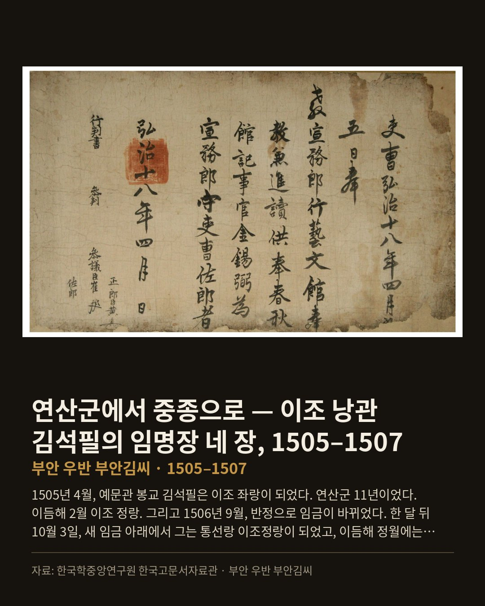
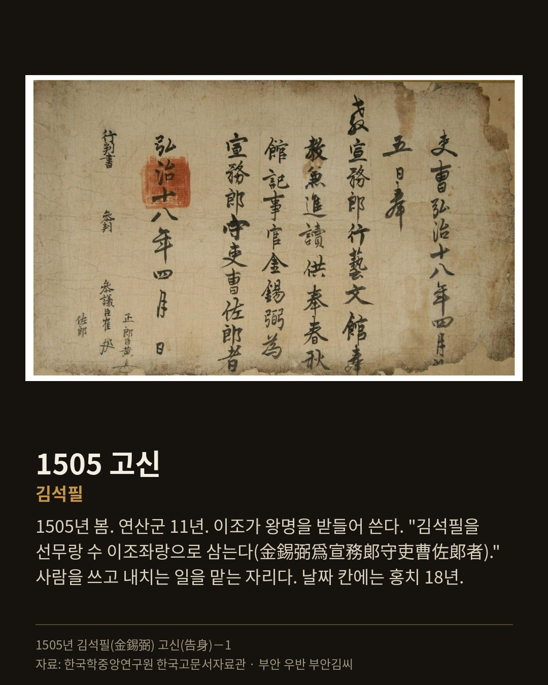
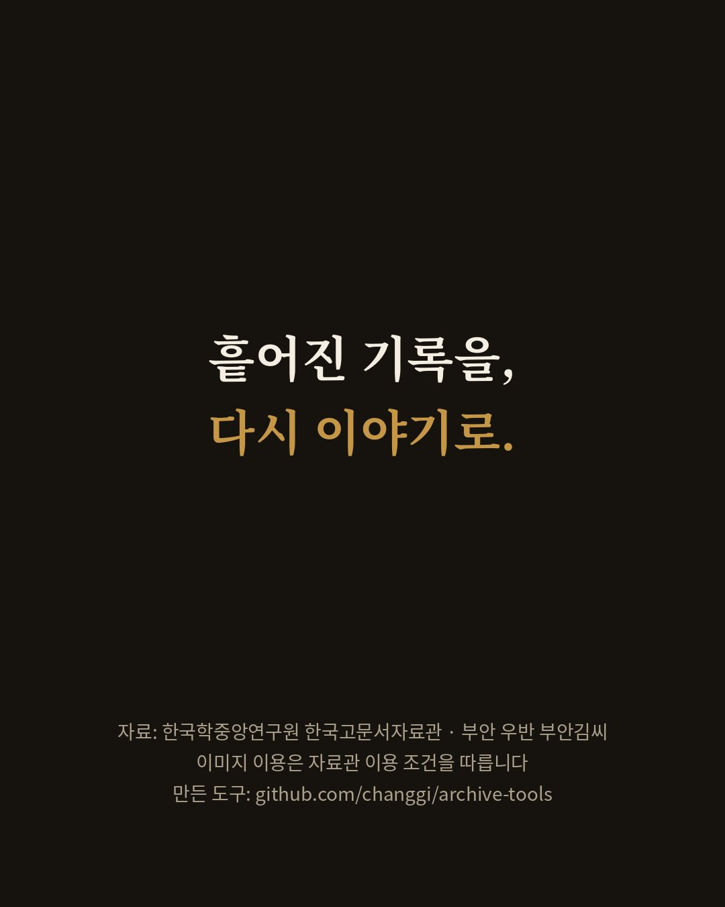

# EP.196 연산군에서 중종으로 — 이조 낭관 김석필의 임명장 네 장, 1505–1507

부안 우반 부안김씨 (문중) · 1505년 4월, 예문관 봉교 김석필은 이조 좌랑이 되었다. 연산군 11년이었다. 이듬해 2월 이조 정랑. 그리고 1506년 9월, 반정으로 임금이 바뀌었다. 한 달 뒤 10월 3일, 새 임금 아래에서 그는 통선랑 이조정랑이 되었고, 이듬해 정월에는 조산대부가 되었다. 그 마지막 종이는 '이조가 왕명을 받들어'가 아니라 '교지'로 시작했다

- 🌐 [전시 웹페이지](https://changgi.github.io/archive-tools/examples/buan-kim-seokpil/exhibit.html) (한자 위 한글 독음 · 원문 해석) · [수업 활동지](https://changgi.github.io/archive-tools/examples/buan-kim-seokpil/handout.html)
- 🎬 영상: [릴스 9:16](https://changgi.github.io/archive-tools-next/media/ep196-buan-kim-seokpil_reel.mp4) · [가로 16:9](https://changgi.github.io/archive-tools-next/media/ep196-buan-kim-seokpil_wide.mp4) · 홍보 글: [`promo.md`](promo.md)
- 카드뉴스: [`cards/`](cards/) · SNS 글: [`sns.txt`](sns.txt) · 판독·해석 표: [`selection.csv`](selection.csv)

<!-- DELIVERY -->
## 전달 에디팅 — 이 기록을 이렇게 전합니다

- **핵심 정서** — 긴장
- **한 문장** — 고신은 임금이 바뀌어도 같은 형식으로 이어졌다 — 그래서 날짜 칸의 연호(홍치 → 정덕)와 문서의 첫머리(이조 봉교 → 교지)가 바뀌는 순간이, 정변과 승진을 함께 보여 준다.
- **열기** — 임금이 바뀐 지 한 달 뒤, 같은 사람에게 같은 자리의 임명장이 왔습니다.
- **펼치기** — 김석필 고신－1 → 김석필 고신－3 (1505–1507년) — 1505년 4월 선무랑 이조좌랑(연산군) → 1506년 2월 승의랑 이조정랑 → 1506년 10월 통선랑 이조정랑(중종반정 한 달 뒤) → 1507년 정월 조산대부 행 이조정랑(교지 형식)으로 놓았습니다.
- **절정** — "김석필을 조산대부 행 이조정랑으로 삼는다(金錫弼爲朝散大夫行吏曹正郞者)" — 화면·공간에서 이 한 줄만 크게, 소리를 줄여 집중
- **여운** — 한 달 사이에 임금이 바뀐 조정에서, 이조의 낭관은 무엇을 잃고 무엇을 지켰을까요? — 질문으로 끝내고 답은 보는 사람에게
- **감각과 물질** — 날짜 칸의 '弘治十八年'과 '正德元年' — 그리고 첫머리가 '吏曹 … 奉 敎'에서 '敎旨'로 바뀌는 마지막 장 · 어보·관인 탁본 스탬프를 찍어 보는 체험
- **통로와 매개** — 온라인: 릴스(열기) → 카드뉴스(펼치기) → 전시 웹페이지(절정·원문) → 비하인드 카드(여운) / 오프라인: 원본 크기 복제·낭독·참여 벽 / 남기기: 활동지·질문 카드
- **여운 장치** — 회사 대표가 바뀐 뒤 받은 인사 발령 떠올리기
- **전달 에디팅 전** — 4건의 문서를 1505–1507년 연대순으로 놓고 문서명 · 유형 · 해설을 붙인다 — 정확하지만, 지나가면 잊힌다.
- **전달 에디팅 후** — 핵심 정서는 「긴장」. 「임금이 바뀐 지 한 달 뒤, 같은 사람에게 같은 자리의 임명장이 왔습니다.」로 열고, 문서를 대비와 순서로 펼친 뒤, "김석필을 조산대부 행 이조정랑으로 삼는다(金錫弼爲朝散大夫行吏曹正郞者)"에서 멈춘다. 날짜 칸의 '弘治十八年'과 '正德元年' — 그리고 첫머리가 '吏曹 … 奉 敎'에서 '敎旨'로 바뀌는 마지막 장. 마지막엔 「회사 대표가 바뀐 뒤 받은 인사 발령 떠올리기」로 보는 사람이 자기 이야기를 남기고 떠나게 한다.

전문: [`delivery.md`](delivery.md)
<!-- /DELIVERY -->

<!-- CURATOR -->
## 비하인드 — 큐레이터 노트

- **왜 이 문서들인가** — EP.62에서 김석필의 1502년 문과 홍패를 읽었습니다. 같은 집안에 그 뒤 1504년부터 1516년까지 받은 고신이 스무 장 넘게 이어져 있어, 연산군 말기와 중종반정 직후에 걸친 네 장을 골랐습니다.
- **전하고 싶은 것** — 고신은 임금이 바뀌어도 같은 형식으로 이어졌다 — 그래서 날짜 칸의 연호(홍치 → 정덕)와 문서의 첫머리(이조 봉교 → 교지)가 바뀌는 순간이, 정변과 승진을 함께 보여 준다.
- **이렇게 보이길 바랐다** — 1505년 4월 선무랑 이조좌랑(연산군) → 1506년 2월 승의랑 이조정랑 → 1506년 10월 통선랑 이조정랑(중종반정 한 달 뒤) → 1507년 정월 조산대부 행 이조정랑(교지 형식)으로 놓았습니다.
- **이렇게 써 주세요** — 조선 전기 고신의 두 형식(4품 이상 교지, 5품 이하 이조 · 병조 교첩), 문산계(선무랑 · 승의랑 · 통선랑 · 조산대부), 이조 낭관(전랑)의 자리, 연산군 대와 중종반정 수업에 쓰세요.
- **만들며 있었던 일** — 자료관 목록의 연도 분류와 달리 문서의 날짜(홍치 18년 = 1505, 정덕 원년 = 1506, 정덕 2년 = 1507)를 따랐습니다. 아래쪽 이조 관원의 성은 읽히는 것만 옮겼고 서명(押)은 판독하지 않았습니다. 이 임명들이 반정과 어떤 관계였는지는 문서에 적혀 있지 않습니다.
- **남겨 둔 질문** — 한 달 사이에 임금이 바뀐 조정에서, 이조의 낭관은 무엇을 잃고 무엇을 지켰을까요?
- **제작 기록** — 문서 4건 · 1505–1507년 · 원본 사진 4면(문서 전체) · 원문 판독 4건 · 번역 4건

전문: [`curator.md`](curator.md) · 비하인드 카드: [`behind/`](behind/) · 채널별 홍보안: [`channels.md`](channels.md)
<!-- /CURATOR -->

## 이야기 — 사료가 말하는 대로

임금이 바뀐 지 한 달 뒤, 같은 사람에게 같은 자리의 임명장이 왔습니다.

> **1505 고신** — 1505년 봄. 연산군 11년. 이조가 왕명을 받들어 쓴다. "김석필을 선무랑 수 이조좌랑으로 삼는다(金錫弼爲宣務郞守吏曹佐郞者)." 사람을 쓰고 내치는 일을 맡는 자리다. 날짜 칸에는 홍치 18년.
> **1506 고신** — 이듬해 봄, 1506년. 같은 이조, 한 칸 위. "승의랑 수 이조정랑으로 삼는다(爲承議郞守吏曹正郞)." 날짜 칸의 연호는 정덕 원년. 아직은 같은 임금의 해다. 일곱 달 뒤, 임금이 바뀐다.
> **1506 고신** — 1506년 가을. 한 달 전, 임금이 바뀌었다. 반정이었다. 그리고 10월 3일, 같은 사람에게 같은 자리의 종이가 온다. "통선랑 이조정랑으로 삼는다(爲通善郞吏曹正郞)." 자리는 그대로, 품계만 한 칸 올랐다. 서명한 참의의 성은 바뀌어 있었다.
> **1507 고신** — 그리고 1507년 정월. 이번 종이는 첫 글자가 다르다. "교지(敎旨)." 이조의 이름도, 관원들의 서명도 없다. "김석필을 조산대부 행 이조정랑으로 삼는다(金錫弼爲朝散大夫行吏曹正郞者)." 임금이 직접 내리는 종이. 같은 자리에서 세 해, 그 사이 임금도 종이의 모양도 바뀌었다.

| 표지 | 1번 카드 | 마무리 |
|---|---|---|
|  |  |  |

## 선별 문서 (4점)

| # | 연도 | 유형 | 문서명 | 원본 |
|---|---|---|---|---|
| 1 | 1505 | 고신 | 1505년 김석필(金錫弼) 고신(告身)－1 | [원본 보기](https://archive.aks.ac.kr/viewer/viewer.do#imgnode.do?itemId=book&gubun=booktree&depth=6&upPath=01%5E0147%5EL014720%5EL014720F02%5EL014720F0201&dataId=G002%2BAKS%2BKSM-XA.1505.1111-20101008.B002a_002_00003_XXX&itemType=) |
| 2 | 1506 | 고신 | 1506년 김석필(金錫弼) 고신(告身)－1 | [원본 보기](https://archive.aks.ac.kr/viewer/viewer.do#imgnode.do?itemId=book&gubun=booktree&depth=6&upPath=01%5E0147%5EL014720%5EL014720F02%5EL014720F0201&dataId=G002%2BAKS%2BKSM-XA.1506.1111-20101008.B002a_002_00007_XXX&itemType=) |
| 3 | 1506 | 고신 | 1506년 김석필(金錫弼) 고신(告身)－3 | [원본 보기](https://archive.aks.ac.kr/viewer/viewer.do#imgnode.do?itemId=book&gubun=booktree&depth=6&upPath=01%5E0147%5EL014720%5EL014720F02%5EL014720F0201&dataId=G002%2BAKS%2BKSM-XA.1506.1111-20101008.B002a_002_00009_XXX&itemType=) |
| 4 | 1507 | 고신 | 1507년 김석필(金錫弼) 고신(告身)－1 | [원본 보기](https://archive.aks.ac.kr/viewer/viewer.do#imgnode.do?itemId=book&gubun=booktree&depth=6&upPath=01%5E0147%5EL014720%5EL014720F02%5EL014720F0201&dataId=G002%2BAKS%2BKSM-XA.1507.1111-20101008.B002a_002_00010_XXX&itemType=) |

## 원문 판독과 해석

### 1. 1505년 김석필(金錫弼) 고신(告身)－1

**원문 판독**

```
吏曹弘治十八年四月二
十五日奉
敎宣務郞行藝文館奉
敎兼進讀供奉春秋
館記事官金錫弼爲
宣務郞守吏曹佐郞者
弘治十八年四月 日
行判書 參判 參議臣崔(서명) 正郞臣黃(서명) 佐郞
```

**원문 해석** 이조가 홍치 18년(1505) 4월 25일에 왕명을 받들어, 선무랑 행 예문관 봉교 겸 진독 공봉 춘추관 기사관 김석필을 선무랑 수 이조좌랑으로 삼는다. 홍치 18년 4월 일. 행판서 · 참판 · 참의 신 최(서명) · 정랑 신 황(서명) · 좌랑.

**해제** 1505년(연산군 11) 4월, 예문관 봉교였던 김석필(金錫弼)을 이조좌랑(정6품)으로 삼은 고신입니다. 5품 이하 문관의 고신은 '교지'로 시작하지 않고 '이조가 왕명을 받들어(吏曹 … 奉 敎)'로 시작하는 교첩(敎牒) 형식이었고, 아래에 이조 관원의 자리를 적고 서명했습니다. 품계(선무랑, 종6품)보다 관직(좌랑, 정6품)이 높아 '수(守)'를 붙였습니다. 이조좌랑 · 정랑은 인사를 맡은 '전랑(銓郞)'으로 요직이었습니다. 김석필은 1502년 문과에 급제했습니다(EP.62).

### 2. 1506년 김석필(金錫弼) 고신(告身)－1

**원문 판독**

```
吏曹正德元年二月十
一日奉
敎承議郞吏曹佐郞
金錫弼爲承議郞
守吏曹正郞兼春秋
館編撰官者
正德元年二月 日
判書 參判 參議臣崔(서명) 正郞 佐郞臣具(서명)
```

**원문 해석** 이조가 정덕 원년(1506) 2월 11일에 왕명을 받들어, 승의랑 이조좌랑 김석필을 승의랑 수 이조정랑 겸 춘추관 편찬관으로 삼는다. 정덕 원년 2월 일. 판서 · 참판 · 참의 신 최(서명) · 정랑 · 좌랑 신 구(서명).

**해제** 1506년(연산군 12) 2월, 이조좌랑 김석필을 이조정랑(정5품)으로 올린 교첩입니다. 앞 장 뒤 1505년 9월에 품계가 승의랑(정6품)으로 올랐고, 이번에 같은 이조 안에서 좌랑에서 정랑으로 올랐습니다. 품계보다 관직이 높아 '수(守)'가 붙었습니다. 날짜 칸의 연호가 명나라의 새 연호 정덕(正德) 원년으로 바뀌었습니다. 한 달 뒤인 3월 23일에는 그를 봉훈랑(종5품)으로 올린 교첩도 이 집안에 남아 있습니다.

### 3. 1506년 김석필(金錫弼) 고신(告身)－3

**원문 판독**

```
吏曹正德元年十月初
三日奉
敎奉直郞守吏曹正郞
金錫弼爲通善郞吏
曹正郞者
正德元年十月 日
行判書 參判 參議臣洪(서명) 正郞臣金 佐郞臣柳(서명)
```

**원문 해석** 이조가 정덕 원년(1506) 10월 3일에 왕명을 받들어, 봉직랑 수 이조정랑 김석필을 통선랑 이조정랑으로 삼는다. 정덕 원년 10월 일. 행판서 · 참판 · 참의 신 홍(서명) · 정랑 신 김 · 좌랑 신 류(서명).

**해제** 1506년 10월 3일의 교첩입니다. 한 달 전인 9월 2일, 중종반정으로 연산군이 물러나고 중종이 즉위했습니다. 이 교첩은 새 임금 아래에서 받은 고신으로, 자리는 그대로 이조정랑이고 품계가 봉직랑(종5품)에서 통선랑(정5품)으로 올라 '수(守)'가 빠졌습니다. 그해 3월 봉훈랑, 그 뒤 봉직랑을 거친 것입니다. 아래쪽 참의의 성이 최 · 조에서 홍으로, 좌랑은 구에서 류로 바뀌어, 이조의 관원들도 바뀌었음을 보여 줍니다. 반정과 이 임명의 관계는 문서에 적혀 있지 않습니다.

### 4. 1507년 김석필(金錫弼) 고신(告身)－1

**원문 판독**

```
敎旨
金錫弼爲朝
散大夫行吏曹
正郞者
正德二年正月 日
```

**원문 해석** 교지. 김석필을 조산대부 행 이조정랑으로 삼는다. 정덕 2년(1507) 정월 일.

**해제** 1507년(중종 2) 정월, 김석필을 조산대부(종4품)로 올린 고신입니다. 품계가 4품 이상이 되자 문서의 형식이 '이조가 왕명을 받들어'로 시작하는 교첩에서 '교지(敎旨)'로 시작하는 교지로 바뀌었습니다. 아래쪽 이조 관원의 서명 칸도 사라졌습니다. 관직은 여전히 이조정랑(정5품)이어서, 품계가 관직보다 높을 때 붙이는 '행(行)'이 들어갔습니다. 3년 사이 같은 이조 낭관 자리에서 품계가 종6품에서 종4품까지 오르는 동안, 임금이 바뀌고 문서의 모양도 바뀌었습니다.

판독·해석·이야기는 이미지에 근거한 초안이며(검토 전 "초안" 표시), 정확한 판독은 원문 확인이 필요합니다. □는 읽지 못한 글자, (?)는 불확실한 글자입니다.
이미지: 한국학중앙연구원 한국고문서자료관 소장·제공. "원본" 링크를 누르면 자료관 뷰어에서 그 문서가 열립니다. 재사용은 자료관에 문의하세요(소장처 동의 필요).
