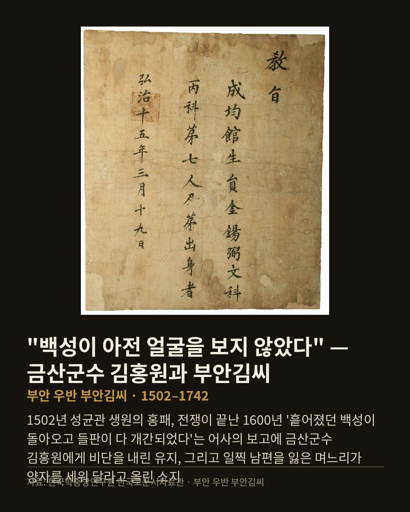
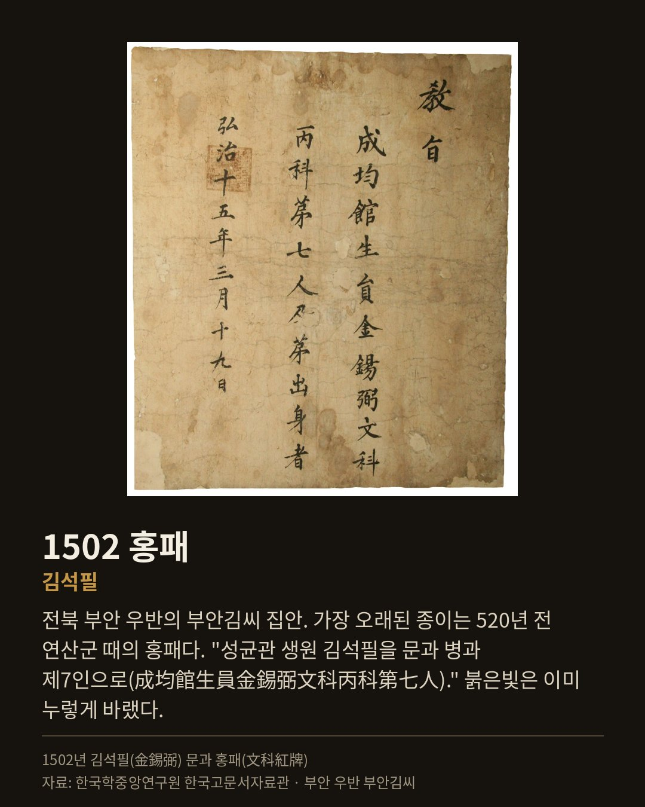
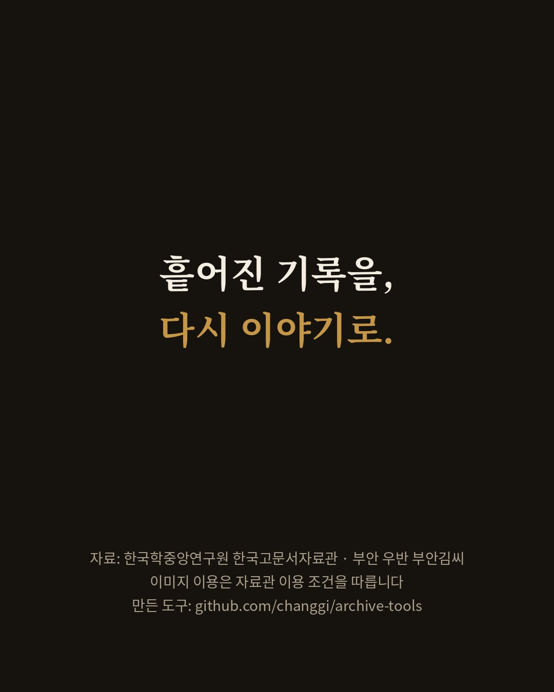

# EP.62 "백성이 아전 얼굴을 보지 않았다" — 금산군수 김홍원과 부안김씨

부안 우반 부안김씨 (문중) · 1502년 성균관 생원의 홍패, 전쟁이 끝난 1600년 '흩어졌던 백성이 돌아오고 들판이 다 개간되었다'는 어사의 보고에 금산군수 김홍원에게 비단을 내린 유지, 그리고 일찍 남편을 잃은 며느리가 양자를 세워 달라고 올린 소지

- 🌐 [전시 웹페이지](https://changgi.github.io/archive-tools/examples/buan-kim/exhibit.html) (한자 위 한글 독음 · 원문 해석) · [수업 활동지](https://changgi.github.io/archive-tools/examples/buan-kim/handout.html)
- 🎬 영상: [릴스 9:16](https://changgi.github.io/archive-tools/examples/media/ep62-buan-kim_reel.mp4) · [가로 16:9](https://changgi.github.io/archive-tools/examples/media/ep62-buan-kim_wide.mp4) · 홍보 글: [`promo.md`](promo.md)
- 카드뉴스: [`cards/`](cards/) · SNS 글: [`sns.txt`](sns.txt) · 판독·해석 표: [`selection.csv`](selection.csv)


<!-- CURATOR -->
## 비하인드 — 큐레이터 노트

- **왜 이 문서들인가** — 전쟁 직후 '흩어졌던 백성이 돌아오고 들판이 다 개간되었다'는 어사의 보고에 근거해 수령을 포상한 유지가 있었습니다.
- **전하고 싶은 것** — 좋은 행정은 '백성이 아전의 얼굴을 보지 않는 것'으로 기억되었다는 것.
- **이렇게 보이길 바랐다** — 생원 홍패 → 전쟁 뒤 포상 → 며느리의 소지까지, 남자의 벼슬과 여인의 생존을 함께 놓았습니다.
- **이렇게 써 주세요** — 전후 복구, 지방 행정, 여성의 법적 지위를 다루는 수업에 쓰세요.
- **남겨 둔 질문** — 오늘 '아전의 얼굴을 보지 않는' 행정은 어떤 모습일까요?
- **제작 기록** — 문서 3건 · 1502–1742년 · 원본 사진 3면(문서 전체) · 원문 판독 3건 · 번역 3건 · 못 읽은 글자 □ 0 · 불확실 (?) 2

전문: [`curator.md`](curator.md)
<!-- /CURATOR -->

## 이야기 — 사료가 말하는 대로

어사가 한 고을을 이렇게 보고했습니다. '백성이 아전의 얼굴을 보지 않는다.'

> **1502 홍패** — 전북 부안 우반의 부안김씨 집안. 가장 오래된 종이는 520년 전 연산군 때의 홍패다. "성균관 생원 김석필을 문과 병과 제7인으로(成均館生員金錫弼文科丙科第七人)." 붉은빛은 이미 누렇게 바랬다.
> **1600 명령서** — 1600년, 전쟁이 막 끝난 봄. 금산군수 김홍원에게 임금의 편지가 온다. 어사가 보고한 그 고을의 모습이 적혀 있다. "백성이 아전의 얼굴을 보지 않았고, 떠돌던 백성이 돌아오고 들판이 모두 개간되었다(民不見吏 流亡還集 田野盡闢)." 상은 옷감 한 벌이었다.
> **1742 소지** — 140년 뒤, 이 집안의 종가에 위기가 온다. 종손이 아들 없이 세상을 떠났다. 남은 아내 오씨가 직접 관에 글을 쓴다. "제 팔자가 기박하여 일찍 남편을 잃고 자식도 없습니다(女身命道奇薄 早失所天 且無子女)." 그리고 남편 사촌 형의 둘째 아들을 후사로 세우겠다고 청한다. 종가를 이은 것은 과부의 소지였다.

| 표지 | 1번 카드 | 마무리 |
|---|---|---|
|  |  |  |

## 선별 문서 (3점)

| # | 연도 | 유형 | 문서명 | 원본 |
|---|---|---|---|---|
| 1 | 1502 | 홍패 | 1502년 김석필(金錫弼) 문과 홍패(文科紅牌) | [원본 보기](https://archive.aks.ac.kr/viewer/viewer.do#imgnode.do?itemId=book&gubun=booktree&depth=6&upPath=01%5E0147%5EL014720%5EL014720F02%5EL014720F0201&dataId=G002%2BAKS%2BKSM-XA.1502.1111-20101008.B002a_002_00083_XXX&itemType=) |
| 2 | 1600 | 명령서 | 1600년 김홍원에게 내린 국왕의 명령서 | [원본 보기](https://archive.aks.ac.kr/viewer/viewer.do#imgnode.do?itemId=book&gubun=booktree&depth=6&upPath=01%5E0147%5EL014720%5EL014720F02%5EL014720F0201&dataId=G002%2BAKS%2BKSM-XA.1600.1111-20101008.B002a_002_00105_XXX&itemType=) |
| 3 | 1742 | 소지 | 1742년 이후 김방길(金邦佶) 처(妻) 오씨(吳氏) 소지(所志) | [원본 보기](https://archive.aks.ac.kr/viewer/viewer.do#imgnode.do?itemId=book&gubun=booktree&depth=6&upPath=01%5E0147%5EL014720%5EL014720F02%5EL014720F0202&dataId=G002%2BAKS%2BKSM-XB.0000.4580-20101008.B002a_002_00124_XXX&itemType=) |

## 원문 판독과 해석

### 1. 1502년 김석필(金錫弼) 문과 홍패(文科紅牌)

**원문 판독**

```
敎旨
成均館生員金錫弼文科
丙科第七人及第出身者
弘治十五年三月十九日 (도장)
```

**원문 해석** 교지. 성균관 생원 김석필을 문과 병과 제7인으로 급제하여 출신한 사람으로 삼는다. 홍치 15년(1502) 3월 19일.

**해제** 1502년(연산군 8) 3월, 성균관 생원 김석필(金錫弼)이 문과에 급제하고 받은 홍패입니다. 520년이 넘은 문서로, 이 집안 문서 가운데 가장 오래된 것입니다. 붉은빛이 바래 누렇게 되었습니다.

### 2. 1600년 김홍원에게 내린 국왕의 명령서

**원문 판독**

```
(겉) 錦山郡守金弘遠 開拆
同副承旨閔(押)
今見御史書啓 爾爲國誠深 莅民才
長 賦役平均 民不見吏 流亡還集
田野盡闢 不以自己私事及民 極爲
可嘉 玆賜表裏一襲 爾其領受事
有
旨
萬曆二十八年四月初六日 (도장)
```

**원문 해석** 금산군수 김홍원이 열어 볼 것. 동부승지 민(閔)이 씀. 이제 어사의 보고서를 보니, 너는 나라를 위하는 정성이 깊고 백성을 다스리는 재주가 뛰어나, 부역을 고르게 하여 백성이 아전의 얼굴을 보지 않았고, 떠돌던 백성이 돌아와 모이고 들판이 모두 개간되었으며, 자기의 사사로운 일로 백성에게 미치게 하지 않았다 하니 매우 가상하다. 이에 겉감과 안감 한 벌을 내리니 너는 받으라는 유지. 만력 28년(1600) 4월 6일.

**해제** 1600년(선조 33) 4월, 금산군수 김홍원(金弘遠)에게 내린 포상 유지입니다. 임진왜란·정유재란이 끝난 직후, 암행어사가 '부역이 고르고, 백성이 아전을 보지 않으며(民不見吏, 아전이 마을에 와서 괴롭히지 않음), 흩어진 백성이 돌아오고 들판이 다 개간되었다'고 보고하자 임금이 옷감을 상으로 내렸습니다. 같은 해 김홍원이 올린 소지도 함께 전합니다.

### 3. 1742년 이후 김방길(金邦佶) 처(妻) 오씨(吳氏) 소지(所志)

**원문 판독**

```
立下
故金邦佶妻吳氏
右謹言所志段 女身命道奇薄 早失所天 且無
子女 而家翁以累代宗孫 不可不立後 故門長及
兩家相議 家翁四寸兄邦係第二子賢得 以爲成
文立後之地 爲去乎(?) 告(?)
君父出禮斜之意 依例立旨題下 爲只爲
行下向敎是事 (작은 글씨 — 날짜 등, 판독 필요)
```

**원문 해석** 입안을 내려 주십시오. 돌아간 김방길의 아내 오씨. 삼가 아뢰는 소지. 저는 팔자가 기박하여 일찍 남편(所天, 하늘같이 여기는 사람)을 잃었고 자식도 없습니다. 그런데 남편은 여러 대 이어 온 종손이라 후사를 세우지 않을 수 없으므로, 문장(門長)과 두 집이 의논하여 남편의 사촌 형 방계의 둘째 아들 현득을 후사로 세우는 문서를 만들려 하오니, … 임금께 예조의 허가(禮斜)를 받는 뜻으로 예에 따라 입지를 내려 주시도록 처분해 주십시오.

**해제** 1742년 무렵, 남편 김방길(金邦佶)을 일찍 잃고 자식이 없는 아내 오씨(吳氏)가 관에 올린 소지입니다. 남편이 대대로 이어 온 종손이므로 문장과 양가가 의논해 남편의 사촌 형 김방계의 둘째 아들 현득(賢得)을 양자로 세우려 하니, 예조에 허가를 청하기 위한 입지(立旨)를 내 달라는 청원입니다. 여성이 직접 소지를 올려 종손 자리를 잇게 한 예입니다. 마이크로필름 복사본으로, 날짜 부분은 판독이 필요합니다.

판독·해석·이야기는 이미지에 근거한 초안이며(검토 전 "초안" 표시), 정확한 판독은 원문 확인이 필요합니다. □는 읽지 못한 글자, (?)는 불확실한 글자입니다.
이미지: 한국학중앙연구원 한국고문서자료관 소장·제공. "원본" 링크를 누르면 자료관 뷰어에서 그 문서가 열립니다. 재사용은 자료관에 문의하세요(소장처 동의 필요).
