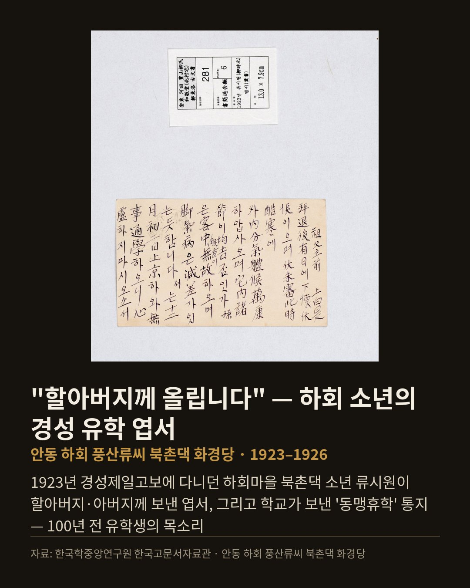
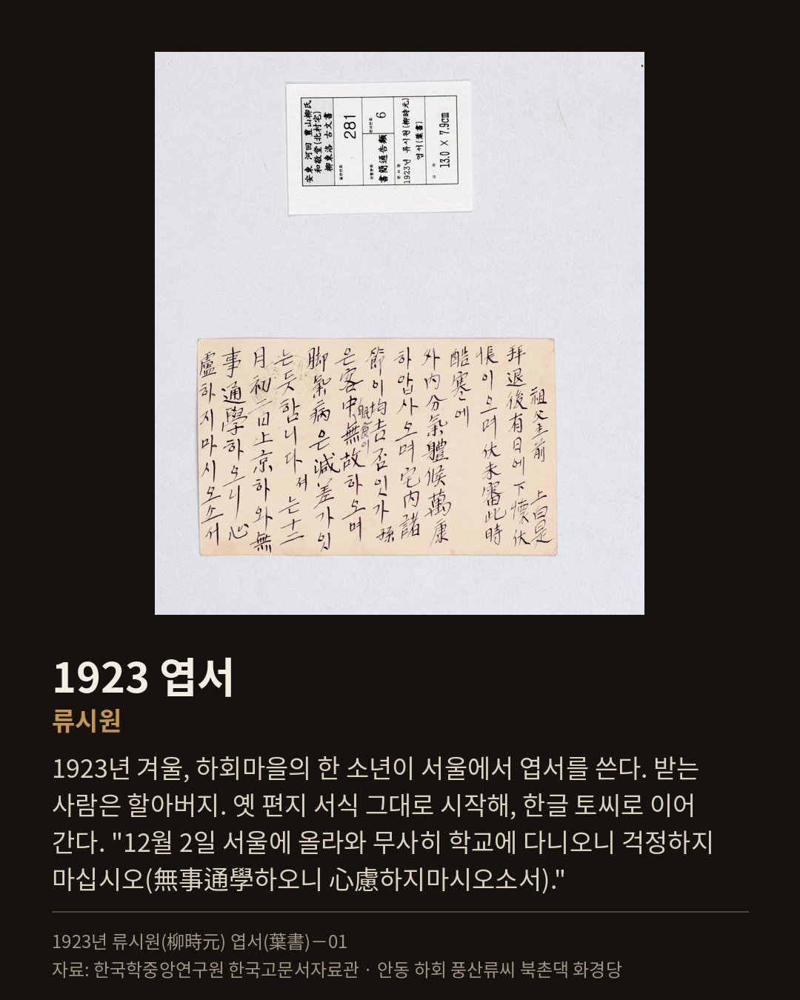
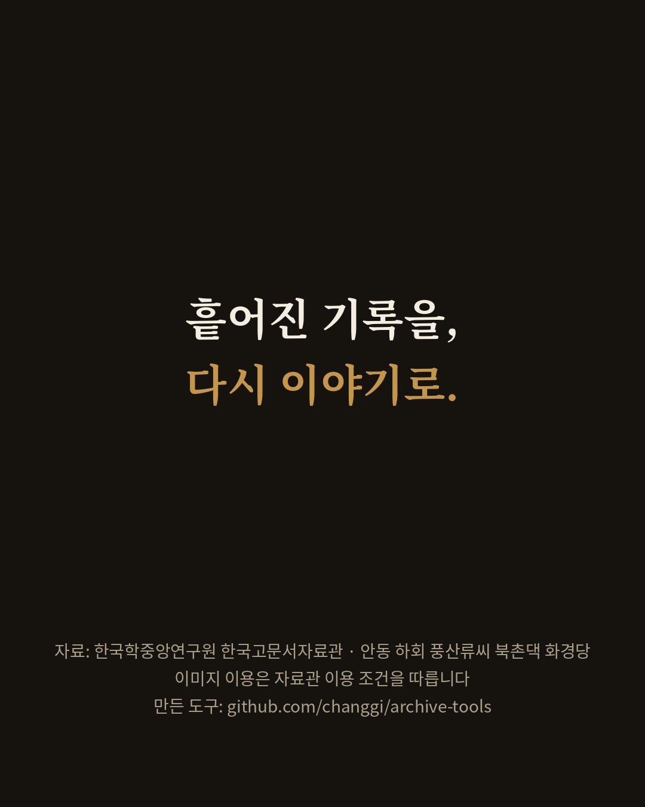

# EP.30 "할아버지께 올립니다" — 하회 소년의 경성 유학 엽서

안동 하회 풍산류씨 북촌댁 화경당 (문중) · 1923년 경성제일고보에 다니던 하회마을 북촌댁 소년 류시원이 할아버지·아버지께 보낸 엽서, 그리고 학교가 보낸 '동맹휴학' 통지 — 100년 전 유학생의 목소리

- 🌐 [전시 웹페이지](https://changgi.github.io/archive-tools/examples/bukchondaek/exhibit.html) (한자 위 한글 독음 · 원문 해석) · [수업 활동지](https://changgi.github.io/archive-tools/examples/bukchondaek/handout.html)
- 🎬 영상: [릴스 9:16](https://changgi.github.io/archive-tools/examples/media/ep30-bukchondaek_reel.mp4) · [가로 16:9](https://changgi.github.io/archive-tools/examples/media/ep30-bukchondaek_wide.mp4) · 홍보 글: [`promo.md`](promo.md)
- 카드뉴스: [`cards/`](cards/) · SNS 글: [`sns.txt`](sns.txt) · 판독·해석 표: [`selection.csv`](selection.csv)


<!-- DELIVERY -->
## 전달 에디팅 — 이 기록을 이렇게 전합니다

- **핵심 정서** — 그리움
- **한 문장** — 근대 교육으로 떠난 아이와 전통 속 할아버지를 잇는 것은 편지였다는 것.
- **열기** — 100년 전 서울로 유학 간 하회마을 소년은, 할아버지께 무엇을 썼을까요?
- **펼치기** — 류시원 엽서－01 → 경성제일고등보통학교 우편엽서－1 → 류시원 엽서－1 (1923–1926년) — 엽서 넉 장을 시간순으로 놓아 소년의 성장과 거리감이 느껴지게 했습니다.
- **절정** — "저의 병은 이미 다 나았습니다. … 책이 갖추어지지 않아 곤란합니다(冊이 不備되여 困難하옵니다)" — 화면·공간에서 이 한 줄만 크게, 소리를 줄여 집중
- **여운** — 할아버지는 손자의 엽서에 어떤 답장을 썼을까요? — 질문으로 끝내고 답은 보는 사람에게
- **감각과 물질** — 엽서를 우체통에서 꺼내 읽게, 경성의 전차 소리 · 손바닥 크기 복제를 직접 들고 읽기, 낭독 음성
- **통로와 매개** — 온라인: 릴스(열기) → 카드뉴스(펼치기) → 전시 웹페이지(절정·원문) → 비하인드 카드(여운) / 오프라인: 원본 크기 복제·낭독·참여 벽 / 남기기: 활동지·질문 카드
- **여운 장치** — 할아버지·할머니에게 엽서 보내기(실제 우편)
- **전달 에디팅 전** — 4건의 문서를 1923–1926년 연대순으로 놓고 문서명 · 유형 · 해설을 붙인다 — 정확하지만, 지나가면 잊힌다.
- **전달 에디팅 후** — 핵심 정서는 「그리움」. 「100년 전 서울로 유학 간 하회마을 소년은, 할아버지께 무엇을 썼을까요?」로 열고, 문서를 대비와 순서로 펼친 뒤, "저의 병은 이미 다 나았습니다. … 책이 갖추어지지 않아 곤란합니다(冊이 不備되여 困難하옵니다)"에서 멈춘다. 엽서를 우체통에서 꺼내 읽게, 경성의 전차 소리. 마지막엔 「할아버지·할머니에게 엽서 보내기(실제 우편)」로 보는 사람이 자기 이야기를 남기고 떠나게 한다.

전문: [`delivery.md`](delivery.md)
<!-- /DELIVERY -->

<!-- CURATOR -->
## 비하인드 — 큐레이터 노트

- **왜 이 문서들인가** — 100년 전 서울로 유학 간 하회마을 소년이 할아버지께 보낸 엽서가 옛 서식에 한글 토를 섞어 쓰여 있었습니다.
- **전하고 싶은 것** — 근대 교육으로 떠난 아이와 전통 속 할아버지를 잇는 것은 편지였다는 것.
- **이렇게 보이길 바랐다** — 엽서 넉 장을 시간순으로 놓아 소년의 성장과 거리감이 느껴지게 했습니다.
- **이렇게 써 주세요** — 근대 교육사, 세대 간 소통, 손편지 쓰기 활동에 쓰세요.
- **남겨 둔 질문** — 할아버지는 손자의 엽서에 어떤 답장을 썼을까요?
- **제작 기록** — 문서 4건 · 1923–1926년 · 원본 사진 8면(문서 전체) · 원문 판독 4건 · 번역 4건 · 못 읽은 글자 □ 0 · 불확실 (?) 5 · 해제에 "확인 필요"를 단 문서 2건

전문: [`curator.md`](curator.md)
<!-- /CURATOR -->

## 이야기 — 사료가 말하는 대로

100년 전 서울로 유학 간 하회마을 소년은, 할아버지께 무엇을 썼을까요?

> **1923 엽서** — 1923년 겨울, 하회마을의 한 소년이 서울에서 엽서를 쓴다. 받는 사람은 할아버지. 옛 편지 서식 그대로 시작해, 한글 토씨로 이어 간다. "12월 2일 서울에 올라와 무사히 학교에 다니오니 걱정하지 마십시오(無事通學하오니 心慮하지마시오소서)."
> **1924 우편엽서** — 그런데 1924년 6월, 이번에는 학교가 집으로 엽서를 보낸다. 일본어로 쓴 통지다. "류시원이 6월 20일부터 다른 학생들과 짜고 등교하지 않는 건에 대하여(他の生徒と申合せ登校せざる件)." 동맹휴학이었다. "다른 학부형은 다 왔는데, 귀하는 왜 아무 연락이 없습니까."
> **1924 엽서** — 이듬해 봄, 같은 소년이 또 엽서를 쓴다. 할아버지, 할머니, 어머니, 동생, 큰집 작은집 식구의 안부를 하나하나 묻고는 짧게 덧붙인다. "이른바 공부라는 것은 날마다 과정을 따를 뿐입니다(所謂學課 日課而已로소이다)."
> **1926 엽서** — 1926년 봄, 소년의 엽서는 붓이 아니라 푸른 잉크 펜으로 쓰여 있다. "저의 병은 이미 다 나았습니다. … 책이 갖추어지지 않아 곤란합니다(冊이 不備되여 困難하옵니다)." 400년 전 류성룡의 집안에서, 한 소년이 식민지의 학교를 다니고 있었다.

| 표지 | 1번 카드 | 마무리 |
|---|---|---|
|  |  |  |

## 선별 문서 (4점)

| # | 연도 | 유형 | 문서명 | 원본 |
|---|---|---|---|---|
| 1 | 1923 | 엽서 | 1923년 류시원(柳時元) 엽서(葉書)－01 | [원본 보기](https://archive.aks.ac.kr/viewer/viewer.do#imgnode.do?itemId=book&gubun=booktree&depth=6&upPath=01%5E0167%5EL016728%5EL016728F02%5EL016728F0206&dataId=G002%2BKHD%2BKSM-XF.1923.0000-20180523.C1002_002_00281_XXX&itemType=) |
| 2 | 1924 | 우편엽서 | 1924년 경성제일고등보통학교(京城第一高等普通學校) 우편엽서(郵便葉書)－1 | [원본 보기](https://archive.aks.ac.kr/viewer/viewer.do#imgnode.do?itemId=book&gubun=booktree&depth=6&upPath=01%5E0167%5EL016728%5EL016728F02%5EL016728F0206&dataId=G002%2BKHD%2BKSM-XF.1924.0000-20180523.C1002_002_00277_XXX&itemType=) |
| 3 | 1924 | 엽서 | 1924년 류시원(柳時元) 엽서(葉書)－01 | [원본 보기](https://archive.aks.ac.kr/viewer/viewer.do#imgnode.do?itemId=book&gubun=booktree&depth=6&upPath=01%5E0167%5EL016728%5EL016728F02%5EL016728F0206&dataId=G002%2BKHD%2BKSM-XF.1924.0000-20180523.C1002_002_00282_XXX&itemType=) |
| 4 | 1926 | 엽서 | 1926년 류시원(柳時元) 엽서(葉書)－1 | [원본 보기](https://archive.aks.ac.kr/viewer/viewer.do#imgnode.do?itemId=book&gubun=booktree&depth=6&upPath=01%5E0167%5EL016728%5EL016728F02%5EL016728F0206&dataId=G002%2BKHD%2BKSM-XF.1926.0000-20180523.C1002_002_00315_XXX&itemType=) |

## 원문 판독과 해석

### 1. 1923년 류시원(柳時元) 엽서(葉書)－01

**원문 판독**

```
祖父主前 上白是
拜退後有日에下懷伏
悵이오며伏未審此時
酷寒에
外內分氣體候萬康
하압사오며宅內諸
節이均吉否인가孫
은客中無故하오며(곁에 '眠食이')
脚氣病은減差가잇
는듯함니다 저(?)는十二
月初二日上京하와無
事通學하오니心
慮하지마시오소서
```

**원문 해석** 할아버지께 올립니다. 절하고 물러난 지 여러 날이 되니 그리운 마음이 서글프오며, 엎드려 여쭙건대 이 혹독한 추위에 할아버지·할머니 두 분 기체 평안하시옵고 댁내 여러분도 모두 잘 지내시는지요. 손자는 객지에서 탈 없이 지내오며 (잠자고 먹는 것도 괜찮고) 각기병은 좀 나은 듯합니다. 저는 12월 2일 서울에 올라와 무사히 학교에 다니오니 걱정하지 마십시오.

**해제** 1923년, 하회마을 북촌댁의 손자 류시원(柳時元)이 서울(경성)에서 고향의 할아버지께 보낸 엽서입니다. 문장은 '上白是(아뢰옵니다)', '伏未審(엎드려 여쭙건대)' 같은 옛 편지 서식을 따르면서 한글 토씨를 섞은 국한문입니다. '外內分'은 할아버지와 할머니 두 분, '客中'은 객지 생활입니다. 그는 경성제일고등보통학교(지금의 경기고등학교) 학생으로 보입니다.

### 2. 1924년 경성제일고등보통학교(京城第一高等普通學校) 우편엽서(郵便葉書)－1

**원문 판독**

```
拜啓 貴下の保証せらるゝ柳時元(?)六
月二十日より他の生徒と申合せ登校せざる件
に付今日まで學校より「至急本人を取調べ
可能處置決定の上、父兄自ら出校申出成度」
との通知をなし既に多數の父兄は自ら出校
又は代人を出校せしめ父兄としての意志を申
出られ候か貴下には何等の申出なきは如何
の御都合にや但し何等の御申出もなき
有之候ては … 一應學校主任と
(…)
(옆면 — 발신) 京城第一高等普通學校 (판독 불확실)
```

**원문 해석** 삼가 아룁니다. 귀하가 보증인으로 있는 류시원이 6월 20일부터 다른 학생들과 짜고 등교하지 않는 일에 대하여, 학교에서는 오늘까지 '급히 본인을 조사하여 처분을 결정할 것이니 학부형이 직접 학교에 와서 의견을 밝혀 달라'고 통지하였고, 이미 많은 학부형이 직접 오거나 대리인을 보내 학부형으로서의 뜻을 밝혔습니다. 그런데 귀하께서는 아무 연락이 없으니 어찌 된 사정입니까. 다만 아무 연락도 없을 경우에는 … 일단 학교 주임과 … (이하 판독 필요)

**해제** 1924년 6월, 경성제일고등보통학교가 류시원의 보증인(아버지 또는 할아버지)에게 보낸 일본어 엽서입니다. 6월 20일부터 학생들이 함께 등교를 거부한, 이른바 동맹휴학(同盟休學)에 대한 통지입니다. 1920년대에는 일본인 교사의 차별과 식민지 교육에 항의하는 동맹휴학이 전국 학교에서 잇따랐습니다. 행서체 일본어라 몇 글자는 판독이 불확실하며, 이 학교의 1924년 동맹휴학 경위는 별도 확인이 필요합니다.

### 3. 1924년 류시원(柳時元) 엽서(葉書)－01

**원문 판독**

```
祖父主前 上書
伏未審日來에
外內分氣體候萬康하옵
사오며 庭下慈主氣
力도安寧하옵잇가 用見도
亦安侍善課乎잇가 大小
宅家諸節도均吉否잇
가 伏慕區々無任下誠之
至이오며 孫은客中眠
食이無頉하오니 以是
伏幸々々이로소이다 所
謂學課日課而已로
소이다 柳龍岩歸家
하온디 一字上書치 못
하와罪悚々々이외다
甲子五月十一日
餘不備書
```

**원문 해석** 할아버지께 올리는 글. 엎드려 여쭙건대 요즈음 할아버지·할머니 기체 평안하시옵고, 어머니(慈主)의 기력도 안녕하십니까. 용견(동생?)도 잘 모시며 공부를 잘합니까. 큰댁·작은댁 여러분도 모두 잘 지내십니까. 엎드려 그리운 마음 이루 다할 수 없습니다. 손자는 객지에서 잠자고 먹는 것이 탈이 없으니 이것이 다행입니다. 이른바 공부라는 것은 날마다 과정을 따를 뿐입니다. 류용암이 집에 돌아가는데 한 글자 편지도 올리지 못해 죄송하고 죄송합니다. 갑자년(1924) 5월 11일. 나머지는 다 갖추지 못합니다.

**해제** 1924년(甲子) 5월 11일 류시원이 할아버지께 보낸 엽서입니다. 고향 사람 류용암이 돌아가는 편에 편지를 맡기지 못해 엽서로 대신 안부를 전한 것으로 보입니다. '用見'은 집안 아이(동생)의 이름이나 자로 보이며 확인이 필요합니다.

### 4. 1926년 류시원(柳時元) 엽서(葉書)－1

**원문 판독**

```
父主前 上白是
伏未審此辰에
堂上氣體候萬康하옵신잇가 伏
慕區々無任下誠之至로소이다 伏
子은眠食이無頉하오니以是伏
幸이로소이다 所謂工課은日
課而已로소이다 就白(?)저의 病
은이미完快되엿삽나다
下送하신金(?)은 …
은一週日假量을 …에서
要하야困難하게되는(?)데
冊이不備되여困
難하옵니다
四月廿六日
餘不備上書
(푸른 잉크 — 여러 곳 판독 불확실)
```

**원문 해석** 아버지께 올립니다. 엎드려 여쭙건대 요즈음 할아버지·할머니 기체 평안하십니까. 엎드려 그리운 마음 이루 다할 수 없습니다. 아들은 잠자고 먹는 것이 탈이 없으니 이것이 다행입니다. 이른바 공부는 날마다 과정을 따를 뿐입니다. 아뢸 것은, 저의 병은 이미 다 나았습니다. 내려보내 주신 돈은 … 일주일가량 … 책이 갖추어지지 않아 곤란합니다. 4월 26일. 나머지는 다 갖추지 못하고 올립니다. (판독 불확실 다수)

**해제** 1926년 4월 26일 류시원이 아버지께 푸른 잉크 펜으로 쓴 엽서입니다. 붓 대신 펜과 잉크를 쓴 점에서 생활의 변화가 보입니다. 아버지가 보낸 돈과 책값 사정을 이야기하는 것으로 보이나 흘림이 있어 가운데 부분은 판독이 불확실합니다.

판독·해석·이야기는 이미지에 근거한 초안이며(검토 전 "초안" 표시), 정확한 판독은 원문 확인이 필요합니다. □는 읽지 못한 글자, (?)는 불확실한 글자입니다.
이미지: 한국학중앙연구원 한국고문서자료관 소장·제공. "원본" 링크를 누르면 자료관 뷰어에서 그 문서가 열립니다. 재사용은 자료관에 문의하세요(소장처 동의 필요).
