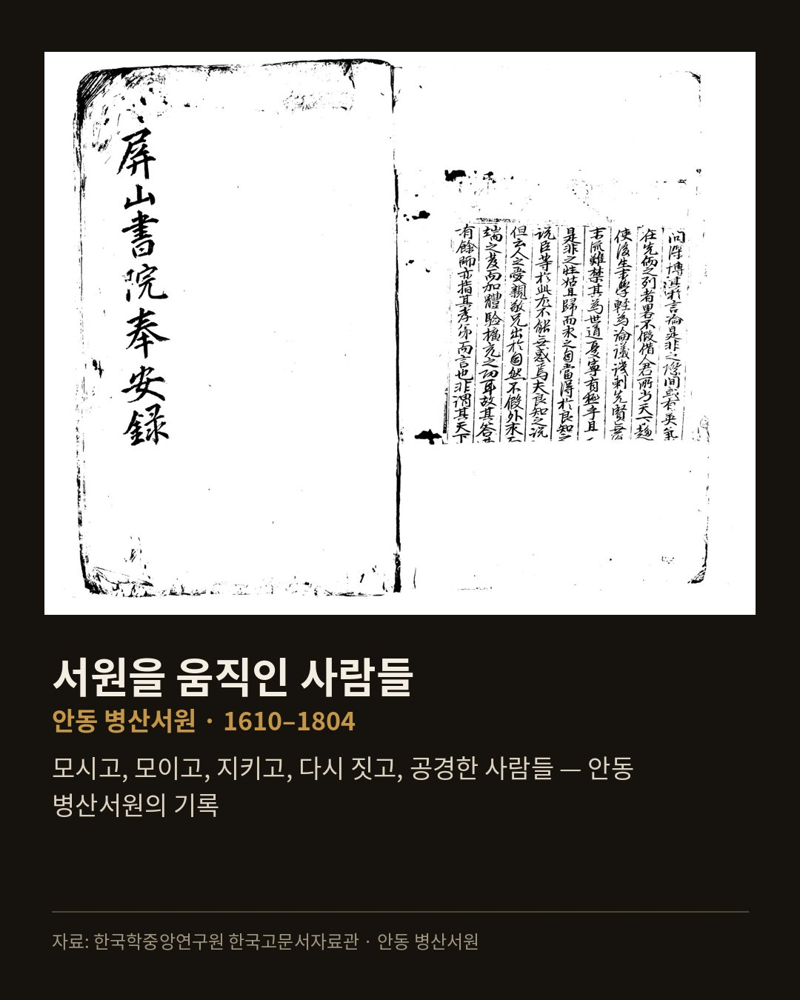
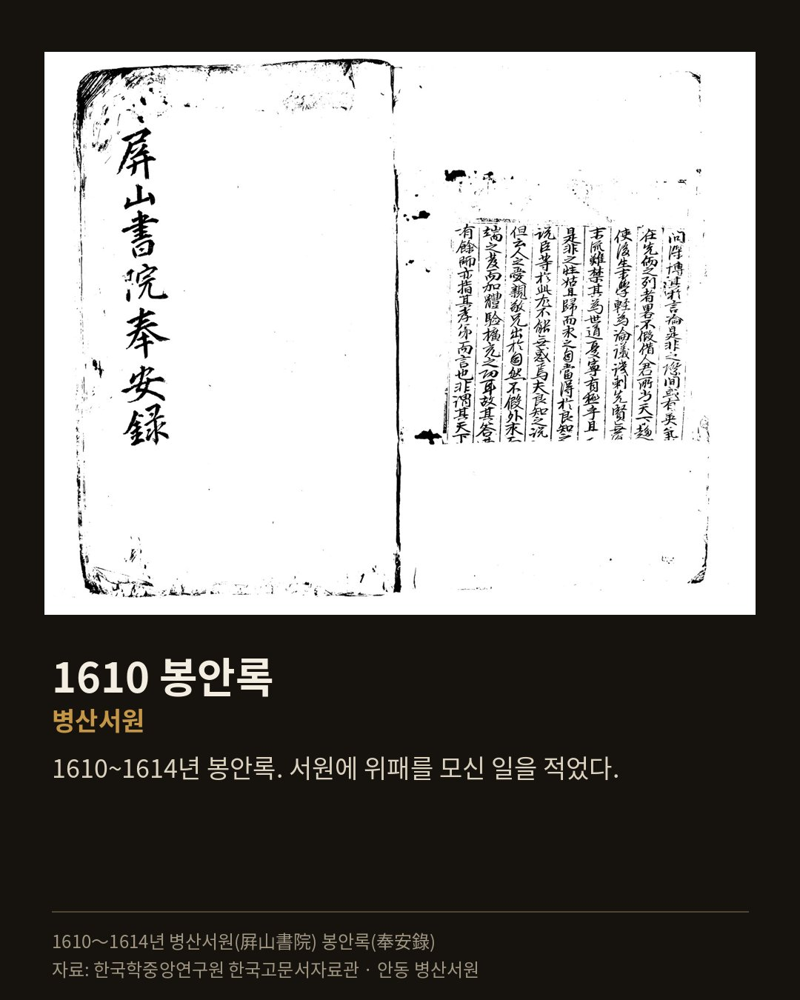

# EP.15 서원을 움직인 사람들

안동 병산서원 (서원) · 모시고, 모이고, 지키고, 다시 짓고, 공경한 사람들 — 안동 병산서원의 기록

- 🌐 [전시 웹페이지](https://changgi.github.io/archive-tools/examples/byeongsan/exhibit.html) · [수업 활동지](https://changgi.github.io/archive-tools/examples/byeongsan/handout.html)
- 🎬 영상: [릴스 9:16](https://changgi.github.io/archive-tools/examples/media/ep15-byeongsan_reel.mp4) · [가로 16:9](https://changgi.github.io/archive-tools/examples/media/ep15-byeongsan_wide.mp4) · 홍보 글: [`promo.md`](promo.md)
- 카드뉴스: [`cards/`](cards/) · SNS 글: [`sns.txt`](sns.txt) · 에디팅 결과: [`selection.csv`](selection.csv)

## 이야기 (영상 내레이션)

> 서원을 움직인 사람들은 누구였을까요?
> 1610년, 서원에 위패를 모신 일을 적은 봉안록.
> 서원의 일을 맡았던 노비들의 이름도 장부에 남았고,
> 1691년, 억울한 비방에 맞선 해명은 변무록이 되었습니다.
> 1771년, 건물을 다시 올리며 상량문을 짓고,
> 1804년부터는 어른을 공경하는 모임의 명단이 이어집니다.
> 모시고, 모이고, 지키고, 다시 짓고, 공경한 사람들. 서원은 사람으로 움직였습니다.

| 표지 | 1번 카드 | 마무리 |
|---|---|---|
|  |  |  |

## 선별 문서 (7점)

| # | 연도 | 유형 | 문서명 | 원본 |
|---|---|---|---|---|
| 1 | 1610 | 봉안록 | 1610〜1614년 병산서원(屛山書院) 봉안록(奉安錄) | [원본 보기](https://archive.aks.ac.kr/viewer/viewer.do#imgnode.do?itemId=book&gubun=booktree&depth=6&upPath=02%5E0247%5EL024710%5EL024710F02%5EL024710F0207&dataId=G002%2BAKS%2BKSM-XG.1610.4717-20101008.B011a_020_00016_YYY&itemType=) |
| 2 | 1634 | 상대계첩도 | 1634년 상대계첩도(霜臺契貼圖) | [원본 보기](https://archive.aks.ac.kr/viewer/viewer.do#imgnode.do?itemId=book&gubun=booktree&depth=6&upPath=02%5E0247%5EL024710%5EL024710F02%5EL024710F0207&dataId=G002%2BAKS%2BKSM-XG.0000.4717-20101008.B011a_020_00048_YYY&itemType=) |
| 3 | 1663 | 병산서원노비안 | 1663년 병산서원노비안(屛山書院奴婢案) | [원본 보기](https://archive.aks.ac.kr/viewer/viewer.do#imgnode.do?itemId=book&gubun=booktree&depth=6&upPath=02%5E0247%5EL024710%5EL024710F02%5EL024710F0207&dataId=G002%2BAKS%2BKSM-XG.1663.4717-20101008.B011a_020_00026_YYY&itemType=) |
| 4 | 1691 | 변무록 | 1691년 정무서(鄭武瑞) 등 변무록(辨誣錄) | [원본 보기](https://archive.aks.ac.kr/viewer/viewer.do#imgnode.do?itemId=book&gubun=booktree&depth=6&upPath=02%5E0247%5EL024710%5EL024710F02%5EL024710F0207&dataId=G002%2BAKS%2BKSM-XG.1691.4717-20101008.B011a_020_00053_YYY&itemType=) |
| 5 | 1718 | 병산서원기사 | 1718년 병산서원기사(屛山書院記事) | [원본 보기](https://archive.aks.ac.kr/viewer/viewer.do#imgnode.do?itemId=book&gubun=booktree&depth=6&upPath=02%5E0247%5EL024710%5EL024710F02%5EL024710F0207&dataId=G002%2BAKS%2BKSM-XG.1718.4717-20101008.B011a_020_00004_YYY&itemType=) |
| 6 | 1771 | 상량문 | 1771년 유규(柳{氵+奎}) 상량문(上樑文) | [원본 보기](https://archive.aks.ac.kr/viewer/viewer.do#imgnode.do?itemId=book&gubun=booktree&depth=6&upPath=02%5E0247%5EL024710%5EL024710F02%5EL024710F0208&dataId=G002%2BAKS%2BKSM-XI.1771.4717-20101008.B011a_020_00005_XXX&itemType=) |
| 7 | 1804 | 경로회안 | 1804〜1811년 병산서원(屛山書院) 경로회안(慶老會案) | [원본 보기](https://archive.aks.ac.kr/viewer/viewer.do#imgnode.do?itemId=book&gubun=booktree&depth=6&upPath=02%5E0247%5EL024710%5EL024710F02%5EL024710F0207&dataId=G002%2BAKS%2BKSM-XG.1804.4717-20101008.B011a_020_00041_YYY&itemType=) |

이야기는 문서명과 이미지에서 보이는 것에 근거한 초안이며(검토 전 "초안" 표시), 판독·해석은 원문 확인이 필요합니다.
이미지: 한국학중앙연구원 한국고문서자료관 소장·제공. "원본" 링크를 누르면 자료관 뷰어에서 그 문서가 열립니다. 재사용은 자료관에 문의하세요(소장처 동의 필요).
