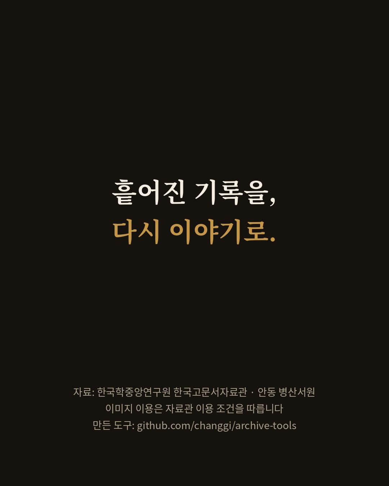

# EP.15 서원을 움직인 사람들

안동 병산서원 (서원) · 모시고, 모이고, 지키고, 다시 짓고, 공경한 사람들 — 안동 병산서원의 기록

- 🌐 [전시 웹페이지](https://changgi.github.io/archive-tools/examples/byeongsan/exhibit.html) · [수업 활동지](https://changgi.github.io/archive-tools/examples/byeongsan/handout.html)
- 🎬 영상: [릴스 9:16](https://changgi.github.io/archive-tools-next/media/ep15-byeongsan_reel.mp4) · [가로 16:9](https://changgi.github.io/archive-tools-next/media/ep15-byeongsan_wide.mp4) · 홍보 글: [`promo.md`](promo.md)
- 카드뉴스: [`cards/`](cards/) · SNS 글: [`sns.txt`](sns.txt) · 에디팅 결과: [`selection.csv`](selection.csv)

## 이야기 (영상 내레이션)

> 서원을 움직인 사람들은 누구였을까요?
> 1610년, 서원에 위패를 모신 일을 적은 봉안록.
> 서원의 일을 맡았던 노비들의 이름도 장부에 남았고,
> 1691년, 억울한 비방에 맞선 해명은 변무록이 되었습니다.
> 1771년, 건물을 다시 올리며 상량문을 짓고,
> 1804년부터는 어른을 공경하는 모임의 명단이 이어집니다.
> 모시고, 모이고, 지키고, 다시 짓고, 공경한 사람들. 서원은 사람으로 움직였습니다.

| 표지 | 1번 카드 | 마무리 |
|---|---|---|
|  |  |  |

<!-- DELIVERY -->
## 전달 에디팅 — 이 기록을 이렇게 전합니다

- **핵심 정서** — 이름 없는 손
- **한 문장** — 서원은 이름난 선비만이 아니라 이름 없는 사람들의 손으로도 움직였다는 것.
- **열기** — 서원을 움직인 사람들은 누구였을까요?
- **펼치기** — 병산서원 봉안록 → 상대계첩도 → 병산서원노비안 → 정무서 등 변무록 → 병산서원기사 → 유규 상량문 → 병산서원 경로회안 (1610–1804년) — 위패를 모신 기록에서 시작해, 노비의 이름과 건물 공사로 시선을 넓혔습니다.
- **절정** — 노비안의 이름들 — 서원을 움직인 이름 없는 손 — 이 장면에서 멈추고 크게
- **여운** — 노비안에 이름이 적힌 사람들은 서원을 어떻게 기억했을까요? — 질문으로 끝내고 답은 보는 사람에게
- **감각과 물질** — 노비안의 이름을 만대루 기둥 모형에 새기기 · 책장을 넘기는 소리, 확대 열람대
- **통로와 매개** — 온라인: 릴스(열기) → 카드뉴스(펼치기) → 전시 웹페이지(절정·원문) → 비하인드 카드(여운) / 오프라인: 원본 크기 복제·낭독·참여 벽 / 남기기: 활동지·질문 카드
- **여운 장치** — 이름 없이 일한 사람을 기억하는 묵념 30초
- **전달 에디팅 전** — 7건의 문서를 1610–1804년 연대순으로 놓고 문서명 · 유형 · 해설을 붙인다 — 정확하지만, 지나가면 잊힌다.
- **전달 에디팅 후** — 핵심 정서는 「이름 없는 손」. 「서원을 움직인 사람들은 누구였을까요?」로 열고, 문서를 대비와 순서로 펼친 뒤, 노비안의 이름들에서 멈춘다. 노비안의 이름을 만대루 기둥 모형에 새기기. 마지막엔 「이름 없이 일한 사람을 기억하는 묵념 30초」로 보는 사람이 자기 이야기를 남기고 떠나게 한다.

전문: [`delivery.md`](delivery.md)
<!-- /DELIVERY -->

<!-- CURATOR -->
## 비하인드 — 큐레이터 노트

- **왜 이 문서들인가** — 봉안록·노비안·변무록·상량문이 함께 있어, 서원을 움직인 사람들(유생과 노비)을 함께 볼 수 있었습니다.
- **전하고 싶은 것** — 서원은 이름난 선비만이 아니라 이름 없는 사람들의 손으로도 움직였다는 것.
- **이렇게 보이길 바랐다** — 위패를 모신 기록에서 시작해, 노비의 이름과 건물 공사로 시선을 넓혔습니다.
- **이렇게 써 주세요** — 서원 조직과 신분, 세계유산 교육에 쓰세요.
- **만들며 있었던 일** — 여러 면짜리 책은 앞 면만 판독했습니다(원본 묶음에는 전체 면, 서버에 없는 2면 제외). 처음에는 문서명으로 캡션 초안만 만들었고, 뒤에 원문 전문 판독(v0.3.6)과 원문 해석(v0.4.0)을 더해 지금 모습이 되었습니다.
- **남겨 둔 질문** — 노비안에 이름이 적힌 사람들은 서원을 어떻게 기억했을까요?
- **제작 기록** — 문서 7건 · 1610–1804년 · 원본 사진 115면(문서 전체) · 원문 판독 7건 · 번역 6건 · 못 읽은 글자 □ 2 · 불확실 (?) 3

전문: [`curator.md`](curator.md)
<!-- /CURATOR -->

## 선별 문서 (7점)

| # | 연도 | 유형 | 문서명 | 원본 |
|---|---|---|---|---|
| 1 | 1610 | 봉안록 | 1610〜1614년 병산서원(屛山書院) 봉안록(奉安錄) | [원본 보기](https://archive.aks.ac.kr/viewer/viewer.do#imgnode.do?itemId=book&gubun=booktree&depth=6&upPath=02%5E0247%5EL024710%5EL024710F02%5EL024710F0207&dataId=G002%2BAKS%2BKSM-XG.1610.4717-20101008.B011a_020_00016_YYY&itemType=) |
| 2 | 1634 | 상대계첩도 | 1634년 상대계첩도(霜臺契貼圖) | [원본 보기](https://archive.aks.ac.kr/viewer/viewer.do#imgnode.do?itemId=book&gubun=booktree&depth=6&upPath=02%5E0247%5EL024710%5EL024710F02%5EL024710F0207&dataId=G002%2BAKS%2BKSM-XG.0000.4717-20101008.B011a_020_00048_YYY&itemType=) |
| 3 | 1663 | 병산서원노비안 | 1663년 병산서원노비안(屛山書院奴婢案) | [원본 보기](https://archive.aks.ac.kr/viewer/viewer.do#imgnode.do?itemId=book&gubun=booktree&depth=6&upPath=02%5E0247%5EL024710%5EL024710F02%5EL024710F0207&dataId=G002%2BAKS%2BKSM-XG.1663.4717-20101008.B011a_020_00026_YYY&itemType=) |
| 4 | 1691 | 변무록 | 1691년 정무서(鄭武瑞) 등 변무록(辨誣錄) | [원본 보기](https://archive.aks.ac.kr/viewer/viewer.do#imgnode.do?itemId=book&gubun=booktree&depth=6&upPath=02%5E0247%5EL024710%5EL024710F02%5EL024710F0207&dataId=G002%2BAKS%2BKSM-XG.1691.4717-20101008.B011a_020_00053_YYY&itemType=) |
| 5 | 1718 | 병산서원기사 | 1718년 병산서원기사(屛山書院記事) | [원본 보기](https://archive.aks.ac.kr/viewer/viewer.do#imgnode.do?itemId=book&gubun=booktree&depth=6&upPath=02%5E0247%5EL024710%5EL024710F02%5EL024710F0207&dataId=G002%2BAKS%2BKSM-XG.1718.4717-20101008.B011a_020_00004_YYY&itemType=) |
| 6 | 1771 | 상량문 | 1771년 유규(柳{氵+奎}) 상량문(上樑文) | [원본 보기](https://archive.aks.ac.kr/viewer/viewer.do#imgnode.do?itemId=book&gubun=booktree&depth=6&upPath=02%5E0247%5EL024710%5EL024710F02%5EL024710F0208&dataId=G002%2BAKS%2BKSM-XI.1771.4717-20101008.B011a_020_00005_XXX&itemType=) |
| 7 | 1804 | 경로회안 | 1804〜1811년 병산서원(屛山書院) 경로회안(慶老會案) | [원본 보기](https://archive.aks.ac.kr/viewer/viewer.do#imgnode.do?itemId=book&gubun=booktree&depth=6&upPath=02%5E0247%5EL024710%5EL024710F02%5EL024710F0207&dataId=G002%2BAKS%2BKSM-XG.1804.4717-20101008.B011a_020_00041_YYY&itemType=) |

이야기는 문서명과 이미지에서 보이는 것에 근거한 초안이며(검토 전 "초안" 표시), 판독·해석은 원문 확인이 필요합니다.
이미지: 한국학중앙연구원 한국고문서자료관 소장·제공. "원본" 링크를 누르면 자료관 뷰어에서 그 문서가 열립니다. 재사용은 자료관에 문의하세요(소장처 동의 필요).
