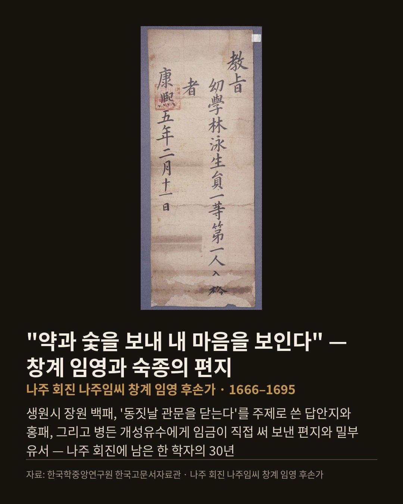
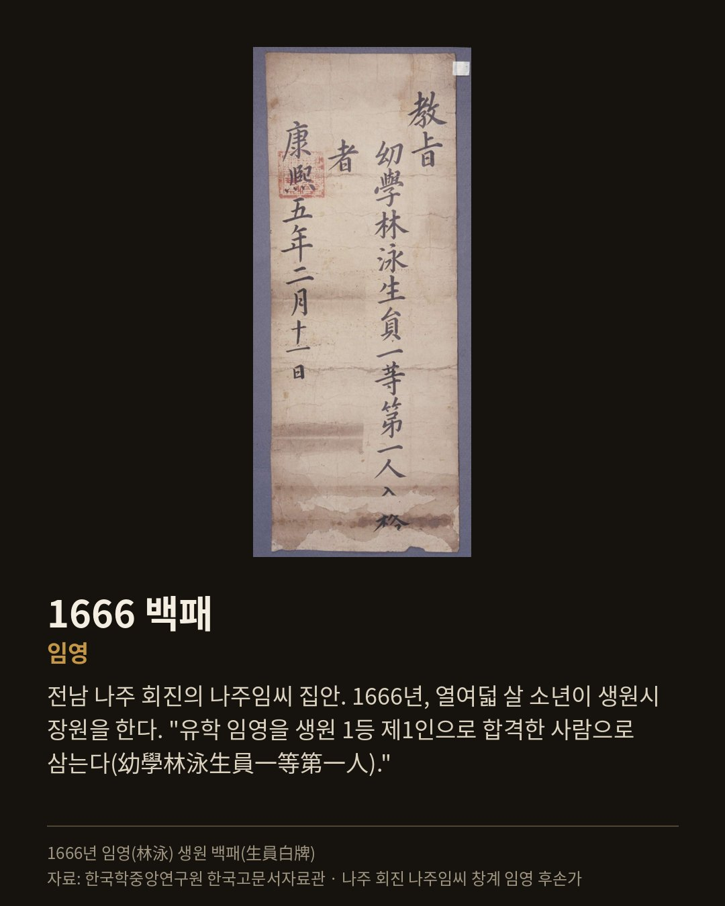
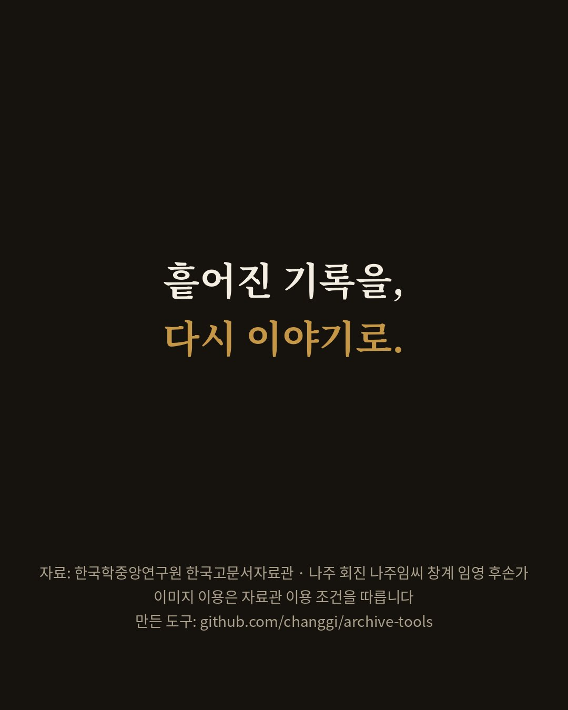

# EP.41 "약과 숯을 보내 내 마음을 보인다" — 창계 임영과 숙종의 편지

나주 회진 나주임씨 창계 임영 후손가 (문중) · 생원시 장원 백패, '동짓날 관문을 닫는다'를 주제로 쓴 답안지와 홍패, 그리고 병든 개성유수에게 임금이 직접 써 보낸 편지와 밀부 유서 — 나주 회진에 남은 한 학자의 30년

- 🌐 [전시 웹페이지](https://changgi.github.io/archive-tools/examples/changgye/exhibit.html) (한자 위 한글 독음 · 원문 해석) · [수업 활동지](https://changgi.github.io/archive-tools/examples/changgye/handout.html)
- 🎬 영상: [릴스 9:16](https://changgi.github.io/archive-tools/examples/media/ep41-changgye_reel.mp4) · [가로 16:9](https://changgi.github.io/archive-tools/examples/media/ep41-changgye_wide.mp4) · 홍보 글: [`promo.md`](promo.md)
- 카드뉴스: [`cards/`](cards/) · SNS 글: [`sns.txt`](sns.txt) · 판독·해석 표: [`selection.csv`](selection.csv)


<!-- DELIVERY -->
## 전달 에디팅 — 이 기록을 이렇게 전합니다

- **핵심 정서** — 따뜻함
- **한 문장** — 임금의 마음이 물건(약과 숯)과 편지로 전해졌다는 것.
- **열기** — 임금이 신하에게 숯을 보냈습니다. 편지 한 장과 함께.
- **펼치기** — 임영 생원 백패 → 생원 임영 시권 → 임영 문과 홍패 → 임영 어찰유서첩 (1666–1695년) — 열여덟 소년의 장원 백패 → 답안지의 '三中' → 임금의 어찰로, 한 사람의 생애를 따뜻하게 마무리했습니다.
- **절정** — "약을 대기 어려울 것이니, 몇 가지 약과 약간의 숯을 내려 나의 걱정하는 마음을 보인다(特賜數種臘劑 如干紫炭 以表予軫念之意)" — 화면·공간에서 이 한 줄만 크게, 소리를 줄여 집중
- **여운** — 숯을 받은 겨울, 임영은 무엇을 썼을까요? — 질문으로 끝내고 답은 보는 사람에게
- **감각과 물질** — 숯과 약재 실물(냄새), 어찰은 따뜻한 조명 · 흰 종이 한 장에 조명 하나 · 시험장 책상과 답안지 체험 · 붉은 종이를 실물 크기로 복제해 벽에 거는 연출
- **통로와 매개** — 온라인: 릴스(열기) → 카드뉴스(펼치기) → 전시 웹페이지(절정·원문) → 비하인드 카드(여운) / 오프라인: 원본 크기 복제·낭독·참여 벽 / 남기기: 활동지·질문 카드
- **여운 장치** — 아픈 사람에게 보낼 물건과 한 줄
- **전달 에디팅 전** — 4건의 문서를 1666–1695년 연대순으로 놓고 문서명 · 유형 · 해설을 붙인다 — 정확하지만, 지나가면 잊힌다.
- **전달 에디팅 후** — 핵심 정서는 「따뜻함」. 「임금이 신하에게 숯을 보냈습니다. 편지 한 장과 함께.」로 열고, 문서를 대비와 순서로 펼친 뒤, "약을 대기 어려울 것이니, 몇 가지 약과 약간의 숯을 내려 나의 걱정하는 마음을 보인다(特賜數種臘劑 如干紫炭 以表予軫念之意)"에서 멈춘다. 숯과 약재 실물(냄새), 어찰은 따뜻한 조명. 마지막엔 「아픈 사람에게 보낼 물건과 한 줄」로 보는 사람이 자기 이야기를 남기고 떠나게 한다.

전문: [`delivery.md`](delivery.md)
<!-- /DELIVERY -->

<!-- CURATOR -->
## 비하인드 — 큐레이터 노트

- **왜 이 문서들인가** — 숙종이 병든 신하에게 약과 숯을 보내며 직접 쓴 어찰이 남아 있었습니다.
- **전하고 싶은 것** — 임금의 마음이 물건(약과 숯)과 편지로 전해졌다는 것.
- **이렇게 보이길 바랐다** — 열여덟 소년의 장원 백패 → 답안지의 '三中' → 임금의 어찰로, 한 사람의 생애를 따뜻하게 마무리했습니다.
- **이렇게 써 주세요** — 군신 관계, 어찰 문화 수업에 쓰세요.
- **남겨 둔 질문** — 숯을 받은 겨울, 임영은 무엇을 썼을까요?
- **제작 기록** — 문서 4건 · 1666–1695년 · 원본 사진 9면(문서 전체) · 원문 판독 4건 · 번역 4건 · 못 읽은 글자 □ 1 · 불확실 (?) 1 · 해제에 "확인 필요"를 단 문서 1건

전문: [`curator.md`](curator.md)
<!-- /CURATOR -->

## 이야기 — 사료가 말하는 대로

임금이 신하에게 숯을 보냈습니다. 편지 한 장과 함께.

> **1666 백패** — 전남 나주 회진의 나주임씨 집안. 1666년, 열여덟 살 소년이 생원시 장원을 한다. "유학 임영을 생원 1등 제1인으로 합격한 사람으로 삼는다(幼學林泳生員一等第一人)."
> **1671 시권** — 5년 뒤 1671년, 그는 문과 시험장에 앉는다. 시제는 『주역』의 한 구절이었다. "동짓날 관문을 닫는다(至日閉關)." 채점관은 '三中'을 적었다.
> **1671 홍패** — 그리고 12월 7일, 동지 무렵. 붉은 종이가 내려온다. "생원 임영을 문과 을과 제1인으로 급제한 사람으로 삼는다(生員林泳文科乙科第一人)."
> **1695 어찰유서첩** — 24년 뒤 1695년, 개성유수 임영은 깊은 병에 들었다. 임금이 직접 붓을 든다. "약을 대기 어려울 것이니, 몇 가지 약과 약간의 숯을 내려 나의 걱정하는 마음을 보인다(特賜數種臘劑 如干紫炭 以表予軫念之意)." 장원 소년은 임금이 숯을 걱정해 주는 신하가 되었다.

| 표지 | 1번 카드 | 마무리 |
|---|---|---|
|  |  |  |

## 선별 문서 (4점)

| # | 연도 | 유형 | 문서명 | 원본 |
|---|---|---|---|---|
| 1 | 1666 | 백패 | 1666년 임영(林泳) 생원 백패(生員白牌) | [원본 보기](https://archive.aks.ac.kr/viewer/viewer.do#imgnode.do?itemId=book&gubun=booktree&depth=6&upPath=01%5E0148%5EL014803%5EL014803F02%5EL014803F0201&dataId=G002%2BAKS%2BKSM-XA.1666.1111-20101008.B044a_067_00099_XXX&itemType=) |
| 2 | 1671 | 시권 | 1671년 생원(生員) 임영(林泳) 시권(試券) | [원본 보기](https://archive.aks.ac.kr/viewer/viewer.do#imgnode.do?itemId=book&gubun=booktree&depth=6&upPath=01%5E0148%5EL014803%5EL014803F02%5EL014803F0204&dataId=G002%2BAKS%2BKSM-XD.1671.0000-20101008.B044a_067_00294_XXX&itemType=) |
| 3 | 1671 | 홍패 | 1671년 임영(林泳) 문과 홍패(文科紅牌) | [원본 보기](https://archive.aks.ac.kr/viewer/viewer.do#imgnode.do?itemId=book&gubun=booktree&depth=6&upPath=01%5E0148%5EL014803%5EL014803F02%5EL014803F0201&dataId=G002%2BAKS%2BKSM-XA.1671.1111-20101008.B044a_067_00098_XXX&itemType=) |
| 4 | 1695 | 어찰유서첩 | 1695년 임영(林泳) 어찰유서첩(御札諭書帖) | [원본 보기](https://archive.aks.ac.kr/viewer/viewer.do#imgnode.do?itemId=book&gubun=booktree&depth=6&upPath=01%5E0148%5EL014803%5EL014803F02%5EL014803F0201&dataId=G002%2BAKS%2BKSM-XA.1695.1111-20101008.B044a_067_00004_YYY&itemType=) |

## 원문 판독과 해석

### 1. 1666년 임영(林泳) 생원 백패(生員白牌)

**원문 판독**

```
敎旨
幼學林泳生員一等第一人入格
者
康熙五年二月十一日 (도장)
```

**원문 해석** 교지. 유학 임영을 생원시 1등 제1인으로 합격한 사람으로 삼는다. 강희 5년(1666) 2월 11일.

**해제** 1666년(현종 7) 2월, 창계 임영(林泳, 1649~1696)이 열여덟 살에 생원시에 1등 1인, 곧 장원으로 합격하고 받은 백패입니다.

### 2. 1671년 생원(生員) 임영(林泳) 시권(試券)

**원문 판독**

```
(붉은 종이 띠) 文科□試乙科第一人 (판독 불확실)
(시제) 至日閉關 賦
(채점, 큰 붓) 三中 / (작은 글씨) 二之一(?)
(답안 본문 — 열 단으로 나누어 쓴 해서, 판독 필요)
```

**원문 해석** (붉은 띠) 문과 [별시?] 을과 제1인. (시제) '동짓날 관문을 닫는다'를 부(賦)로 지어라. (채점) 삼중(三中).

**해제** 1671년(현종 12), 생원 임영이 문과에서 써 낸 시권(답안지)입니다. 시제 '至日閉關(동짓날 관문을 닫는다)'은 『주역』 복괘(復卦)의 '선왕은 동짓날 관문을 닫아 장사꾼과 나그네가 다니지 않게 했다'는 구절에서 나온 것으로, 동지 무렵 양기가 처음 돌아오는 때 몸가짐을 조심한다는 뜻을 묻는 문제입니다. 채점자가 '三中' 등급을 매겼고, 붉은 띠에 '을과 제1인'이 붙어 있습니다. 답안 본문은 판독이 필요합니다.

### 3. 1671년 임영(林泳) 문과 홍패(文科紅牌)

**원문 판독**

```
敎旨
生員林泳文科乙科第
一人及第出身者
康熙十年十二月初七日 (도장)
```

**원문 해석** 교지. 생원 임영을 문과 을과 제1인으로 급제하여 출신한 사람으로 삼는다. 강희 10년(1671) 12월 7일.

**해제** 같은 1671년 12월 7일, 임영이 받은 문과 홍패입니다. 앞의 시권 붉은 띠와 같은 '을과 제1인'이 적혀 있습니다. 동지 무렵의 시제와 12월의 날짜가 맞물립니다.

### 4. 1695년 임영(林泳) 어찰유서첩(御札諭書帖)

**원문 판독**

```
(어찰)
卿之膏肓之疾 展轉
沉篤 豈但卿之不幸而
已也 雲裡旅寓 藥必難
繼 特賜數種臘劑 如干
紫炭 以表予軫念之
意
(유서)
諭開城府留守林泳 (도장)
卿受委一方 體任非輕
凡發兵應機 安民制敵
一應常事 自有舊章
慮或有予與卿獨斷處
置事 非密符莫可施爲
(이하 다음 면 — 이미지 미수집)
```

**원문 해석** (어찰) 경의 고질병이 이리저리 깊어져 위중하다 하니, 어찌 경 한 사람의 불행일 뿐이겠는가. 구름 속 객지살이에 약을 대기 어려울 것이니, 특별히 몇 가지 납제(섣달에 지은 약)와 약간의 숯을 내려 나의 걱정하는 마음을 보이노라.
(유서) 개성부 유수 임영에게 이른다. 경은 한 지방을 맡았으니 그 소임이 가볍지 않다. 무릇 군사를 일으켜 기회에 대응하고 백성을 편안히 하며 적을 제압하는 모든 일상적인 일은 이미 옛 규정이 있다. 다만 혹시 나와 경만이 홀로 결단하여 처리할 일이 있으면, 밀부(密符)가 아니면 시행할 수 없다. … (이하 다음 면)

**해제** 1695년(숙종 21), 개성유수 임영이 받은 숙종의 어찰(임금이 직접 쓴 편지)과 유서를 엮은 첩입니다. 어찰에서 숙종은 임영의 병을 '고황(膏肓)의 병'이라 걱정하며 약과 숯(紫炭)을 보냈습니다. 유서는 지방 장관에게 밀부를 맡기며 주는 정해진 서식인데, EP.31 박의장 유서(1612)에서 훼손으로 사라졌던 '非密符莫可施爲(밀부가 아니면 시행할 수 없다)' 구절이 여기 온전히 남아 있습니다. 임영은 이듬해 1696년 세상을 떠난 것으로 알려져 있습니다(확인 필요).

판독·해석·이야기는 이미지에 근거한 초안이며(검토 전 "초안" 표시), 정확한 판독은 원문 확인이 필요합니다. □는 읽지 못한 글자, (?)는 불확실한 글자입니다.
이미지: 한국학중앙연구원 한국고문서자료관 소장·제공. "원본" 링크를 누르면 자료관 뷰어에서 그 문서가 열립니다. 재사용은 자료관에 문의하세요(소장처 동의 필요).
