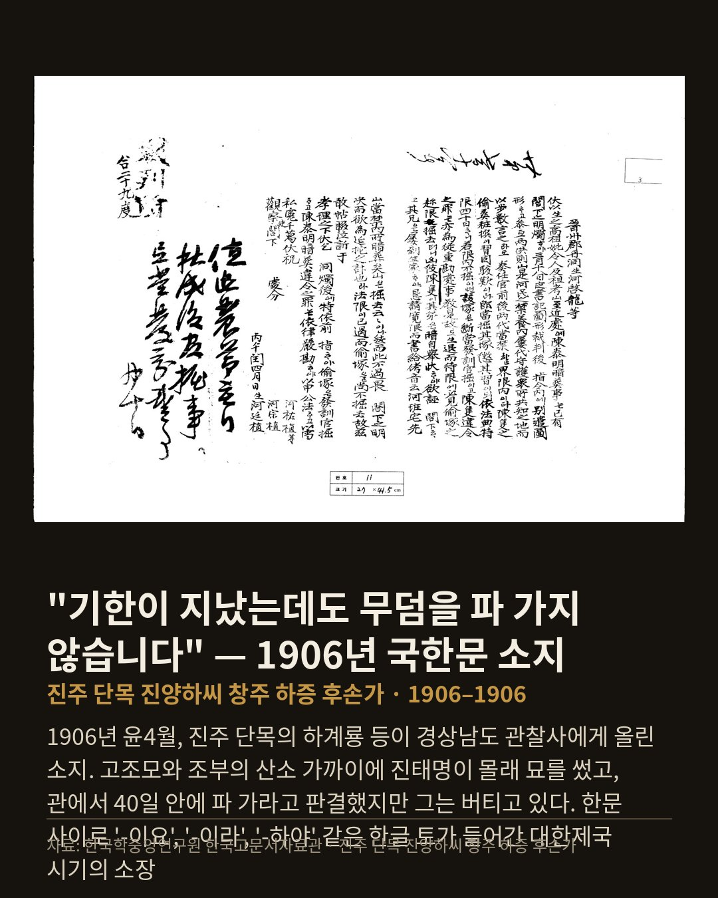
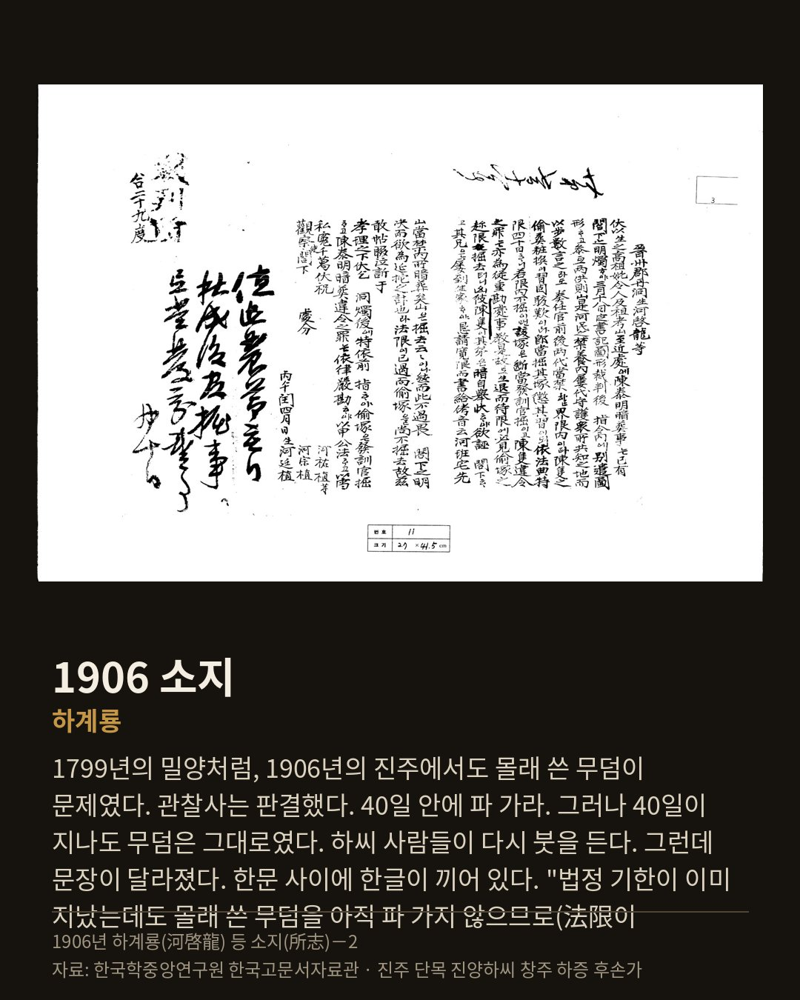
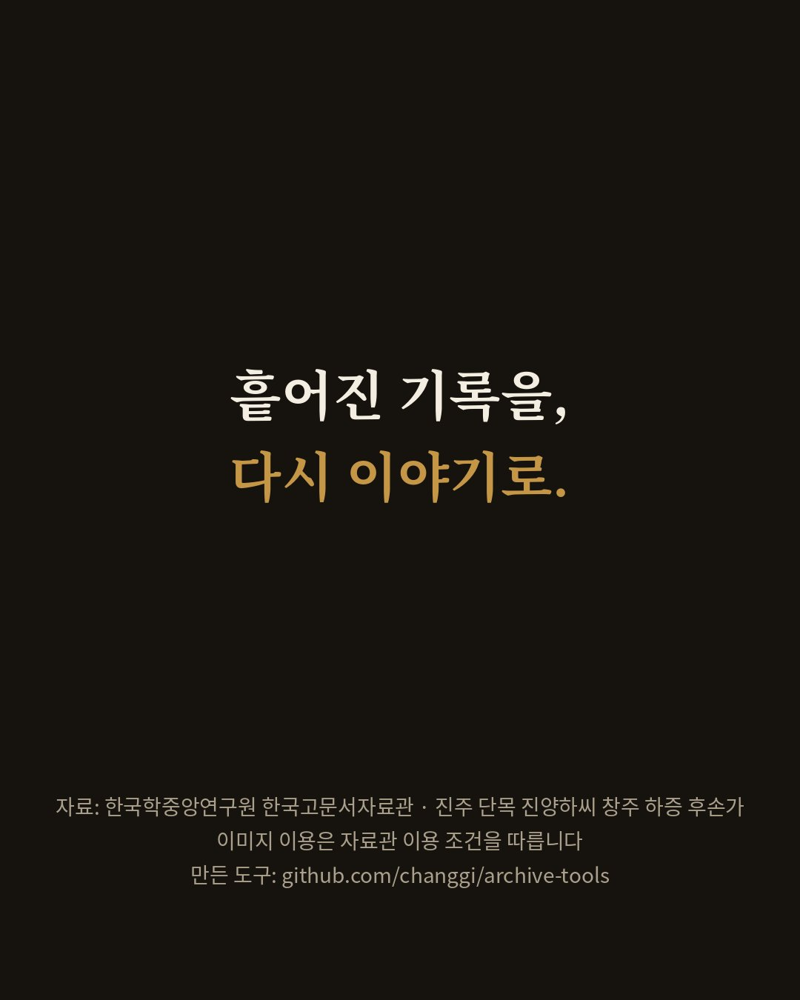

# EP.99 "기한이 지났는데도 무덤을 파 가지 않습니다" — 1906년 국한문 소지

진주 단목 진양하씨 창주 하증 후손가 (문중) · 1906년 윤4월, 진주 단목의 하계룡 등이 경상남도 관찰사에게 올린 소지. 고조모와 조부의 산소 가까이에 진태명이 몰래 묘를 썼고, 관에서 40일 안에 파 가라고 판결했지만 그는 버티고 있다. 한문 사이로 '-이요', '-이라', '-하야' 같은 한글 토가 들어간 대한제국 시기의 소장

- 🌐 [전시 웹페이지](https://changgi.github.io/archive-tools/examples/changju/exhibit.html) (한자 위 한글 독음 · 원문 해석) · [수업 활동지](https://changgi.github.io/archive-tools/examples/changju/handout.html)
- 🎬 영상: [릴스 9:16](https://changgi.github.io/archive-tools/examples/media/ep99-changju_reel.mp4) · [가로 16:9](https://changgi.github.io/archive-tools/examples/media/ep99-changju_wide.mp4) · 홍보 글: [`promo.md`](promo.md)
- 카드뉴스: [`cards/`](cards/) · SNS 글: [`sns.txt`](sns.txt) · 판독·해석 표: [`selection.csv`](selection.csv)


<!-- CURATOR -->
## 비하인드 — 큐레이터 노트

- **왜 이 문서들인가** — 판결이 나고 40일이 지났는데도 몰래 쓴 묘를 파 가지 않아 다시 올린 1906년 소지가, 한문 사이에 한글 토가 섞인 국한문이었습니다.
- **전하고 싶은 것** — 107년 사이(EP.96 → EP.99) 소송은 그대로였지만, 글은 우리말 쪽으로 한 걸음 다가왔다는 것.
- **이렇게 보이길 바랐다** — EP.96의 이두 등장과 짝을 이루도록, 같은 산송을 다른 문체로 보여 주었습니다.
- **이렇게 써 주세요** — 이두에서 국한문으로의 문체 변화, 대한제국기 사법 절차를 다루는 수업에 쓰세요.
- **만들며 있었던 일** — 관찰사의 처분(제사) 초서는 일부만 읽었습니다.
- **남겨 둔 질문** — 판결이 지켜지지 않을 때, 그 시대 사람들에게 남은 방법은 무엇이었을까요?
- **제작 기록** — 문서 1건 · 1906년 · 원본 사진 1면(문서 전체) · 원문 판독 1건 · 번역 1건

전문: [`curator.md`](curator.md)
<!-- /CURATOR -->

## 이야기 — 사료가 말하는 대로

판결은 40일 안에 파 가라는 것. 그러나 무덤은 그대로였습니다.

> **1906 소지** — 1799년의 밀양처럼, 1906년의 진주에서도 몰래 쓴 무덤이 문제였다. 관찰사는 판결했다. 40일 안에 파 가라. 그러나 40일이 지나도 무덤은 그대로였다. 하씨 사람들이 다시 붓을 든다. 그런데 문장이 달라졌다. 한문 사이에 한글이 끼어 있다. "법정 기한이 이미 지났는데도 몰래 쓴 무덤을 아직 파 가지 않으므로(法限이 已過而偸塚을 尙不掘去故로)." 107년 사이, 소송은 그대로였지만 글은 우리말 쪽으로 한 걸음 다가와 있었다.

| 표지 | 1번 카드 | 마무리 |
|---|---|---|
|  |  |  |

## 선별 문서 (1점)

| # | 연도 | 유형 | 문서명 | 원본 |
|---|---|---|---|---|
| 1 | 1906 | 소지 | 1906년 하계룡(河啓龍) 등 소지(所志)－2 | [원본 보기](https://archive.aks.ac.kr/viewer/viewer.do#imgnode.do?itemId=book&gubun=booktree&depth=6&upPath=01%5E0150%5EL015004%5EL015004F02%5EL015004F0202&dataId=G002%2BAKS%2BKSM-XB.1906.4817-20101008.B031a_047_00059_XXX&itemType=) |

## 원문 판독과 해석

### 1. 1906년 하계룡(河啓龍) 등 소지(所志)－2

**원문 판독**

```
晉州郡丹洞生河啓龍等
伏以生之高祖妣令人及祖考山至近處에 陳泰明暗葬事로 已有
閤下之明燭ᄒᆞ와 三月十八日에 書記圖形裁判後 指令內에 別遣圖
形ᄒᆞ고 參互兩供則 山是河氏之禁養 內屢代守護 衆所共知之地而
以步數言之라도 奏任官前後兩代當禁之界限內이라 陳㚇之
偸葬柱換之習 固駭歎이라 卽當掘其塚 懲其習이되 依法典特
限四十日ᄒᆞ니 若限內不掘이어든 該塚은 斷當發訓官掘이고 陳㚇違令
之罪도 亦爲從重勘處事 敎是故로 生退而待限이온바 偸塚之
跡限內掘去터니 彼陳㚇이 其兄을 暗自擧狀ᄒᆞ야 欲誣 閤下ᄒᆞ
고 其兄은 委到生家ᄒᆞ야 懇請寬限 而書給侤音云 河班宅先
山當禁內 所暗葬矣山은 掘去云云이라 然而此不過畏 閤下之明
決 而欲爲延拖之計也라 法限이 已過而偸塚을 尙不掘去故로 玆
敢帖聯泣訴于
孝理之下伏乞 洞燭後에 特依前 指令ᄒᆞ야 偸塚을 發訓官掘
ᄒᆞ고 陳泰明暗葬違令之罪를 依律嚴勘ᄒᆞ야 申公法ᄒᆞ고
洩私冤 千萬伏祝
觀察使閤下　處分
丙午閏四月　日　生 河廷植 河宗植 河祐植 等
(좌측 제사 초서) 依此遵前題 … 掘事 … / (좌상) 印 二十九度
```

**원문 해석** 진주군 단동의 생(生) 하계룡 등. 엎드려 아뢰옵건대, 저희 고조모 영인과 조부의 산소 바로 가까운 곳에 진태명이 몰래 장사 지낸 일로, 이미 합하(관찰사)께서 밝게 살피시어 3월 18일 서기에게 도형을 그리게 하여 재판하신 뒤 지령하시기를 '따로 도형을 보내 양쪽 진술을 대조하니, 이 산은 하씨가 대대로 금양(禁養)하고 수호해 온 것을 모두가 아는 땅이요, 걸음 수로 따져도 주임관 전후 2대가 금할 수 있는 경계 안이다. 진가가 몰래 묻고 바꿔치기하는 버릇은 참으로 놀랍다. 마땅히 그 무덤을 파서 버릇을 징계해야 하되, 법전에 따라 특별히 40일의 기한을 준다. 기한 안에 파지 않으면 그 무덤은 반드시 훈령을 내려 관에서 파낼 것이고, 진가가 명령을 어긴 죄도 무겁게 다스릴 것'이라 하셨기에 저희는 물러나 기한을 기다렸습니다. 기한 안에 무덤을 파 갈 줄 알았더니, 저 진가는 그 형을 시켜 몰래 소장을 내어 합하를 속이려 하고, 그 형은 저희 집에 찾아와 기한을 늦춰 달라고 간청하며 다짐(侤音)을 써 주기를 '하 양반댁 선산 금양 안에 몰래 묻은 무덤은 파 가겠다' 하였습니다. 그러나 이는 합하의 밝은 판결을 두려워해 시간을 끌려는 꾀에 지나지 않습니다. 법정 기한이 이미 지났는데도 몰래 쓴 무덤을 아직 파 가지 않으므로, 감히 연명하여 울며 호소합니다. 효로 다스리시는 아래 엎드려 비오니, 살피신 뒤 특별히 앞의 지령대로 투총을 훈령을 내려 관에서 파내게 하시고, 진태명의 암장과 명령 위반의 죄를 법에 따라 엄히 다스려 공법을 펴고 사사로운 원통함을 풀어 주시기를 천만 번 엎드려 빕니다. 관찰사 합하 처분. 병오년(1906) 윤4월 일. 생 하정식, 하종식, 하우식 등. (제사) 이에 따라 앞의 판결을 지켜 … 파낼 일.

**해제** 대한제국기인 1906년(광무 10), 진주 단목의 진양하씨 문중이 경상남도 관찰사에게 올린 산송 소지입니다. 진태명이 하씨 선산의 금양 구역 안에 몰래 묘를 쓰자, 관찰사가 도형(현장 지도)을 그려 조사한 뒤 40일 안에 파 가라고 판결했는데, 상대가 기한을 넘기고 버티자 다시 호소한 것입니다. 본문은 한문을 바탕으로 '-에', '-ᄒᆞ와', '-이라', '-ᄒᆞ야', '-이어든', '-은' 같은 한글 토를 섞은 국한문체로, 이두에서 국한문으로 넘어가는 공문서 문체의 변화를 보여 줍니다(앞의 EP.96 1799년 이두 등장과 비교해 보세요). '주임관 전후 2대가 금할 수 있는 경계'는 품계에 따라 묘역 보호 범위(보수)를 달리 정한 법규를 가리킵니다. 왼쪽 초서는 관찰사의 처분(제사)으로 일부만 읽었습니다.

판독·해석·이야기는 이미지에 근거한 초안이며(검토 전 "초안" 표시), 정확한 판독은 원문 확인이 필요합니다. □는 읽지 못한 글자, (?)는 불확실한 글자입니다.
이미지: 한국학중앙연구원 한국고문서자료관 소장·제공. "원본" 링크를 누르면 자료관 뷰어에서 그 문서가 열립니다. 재사용은 자료관에 문의하세요(소장처 동의 필요).
