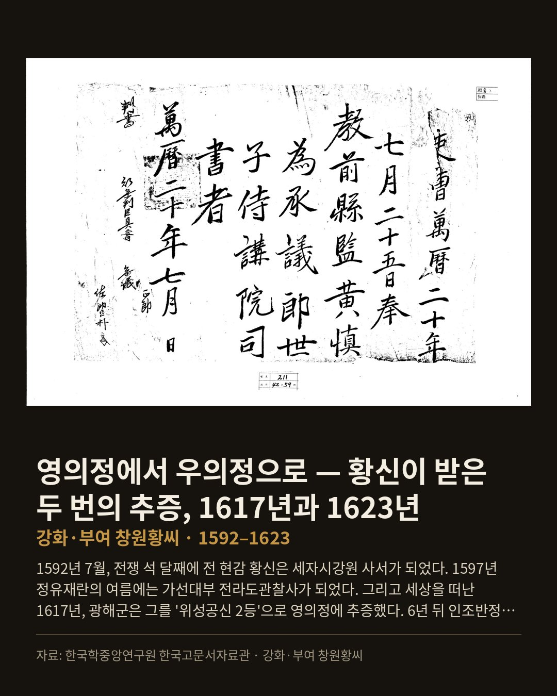
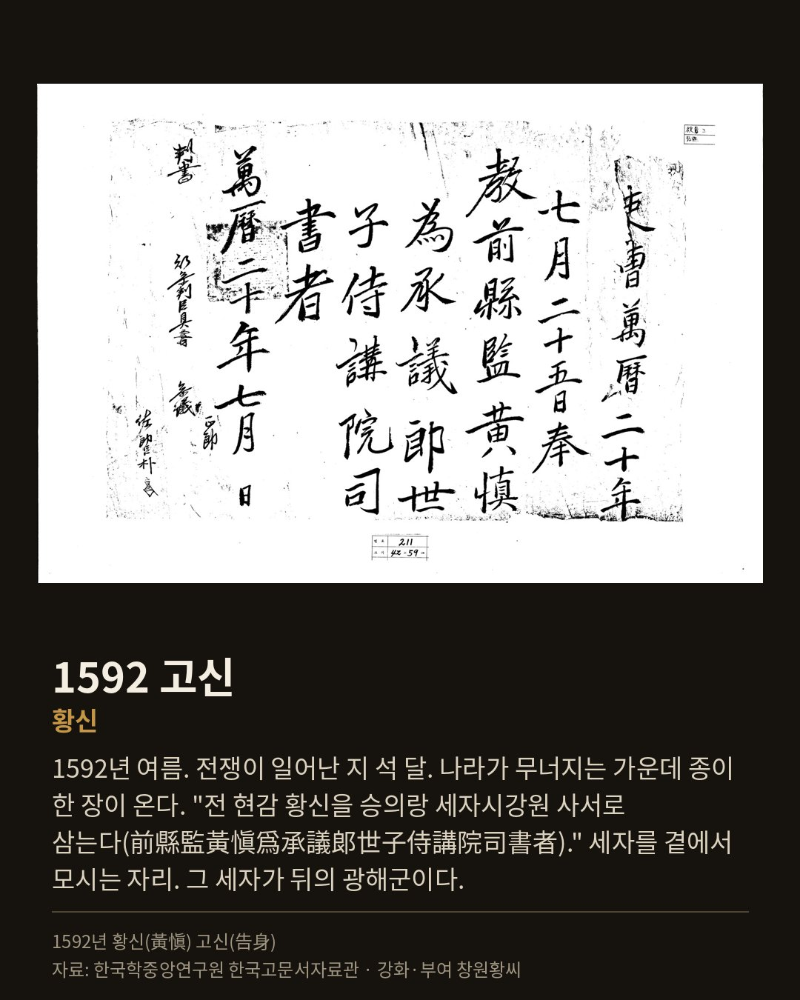
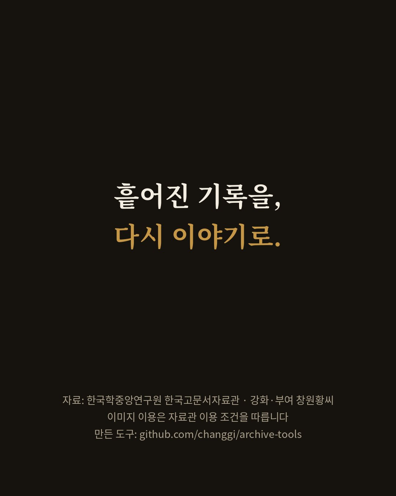

# EP.192 영의정에서 우의정으로 — 황신이 받은 두 번의 추증, 1617년과 1623년

강화·부여 창원황씨 (문중) · 1592년 7월, 전쟁 석 달째에 전 현감 황신은 세자시강원 사서가 되었다. 1597년 정유재란의 여름에는 가선대부 전라도관찰사가 되었다. 그리고 세상을 떠난 1617년, 광해군은 그를 '위성공신 2등'으로 영의정에 추증했다. 6년 뒤 인조반정이 일어났고, 1623년 7월 그에게 새 교지가 왔다. 이번에는 공신 칭호가 사라지고, 우의정이었다

- 🌐 [전시 웹페이지](https://changgi.github.io/archive-tools/examples/changwon-hwang-hwangsin/exhibit.html) (한자 위 한글 독음 · 원문 해석) · [수업 활동지](https://changgi.github.io/archive-tools/examples/changwon-hwang-hwangsin/handout.html)
- 🎬 영상: [릴스 9:16](https://changgi.github.io/archive-tools-next/media/ep192-changwon-hwang-hwangsin_reel.mp4) · [가로 16:9](https://changgi.github.io/archive-tools-next/media/ep192-changwon-hwang-hwangsin_wide.mp4) · 홍보 글: [`promo.md`](promo.md)
- 카드뉴스: [`cards/`](cards/) · SNS 글: [`sns.txt`](sns.txt) · 판독·해석 표: [`selection.csv`](selection.csv)

<!-- DELIVERY -->
## 전달 에디팅 — 이 기록을 이렇게 전합니다

- **핵심 정서** — 씁쓸함
- **한 문장** — 추증은 한 번 받으면 끝이 아니었다 — 광해군 때 '위성공신'으로 받은 영의정 추증은 인조반정 뒤 공신이 삭제되며 거두어졌고, 새 정권은 그의 생전 직함에서 다시 계산해 우의정을 추증했다. 두 장의 교지가 정변의 흔적이다.
- **열기** — 죽은 뒤 영의정이 된 사람이, 6년 뒤 우의정으로 다시 추증되었습니다.
- **펼치기** — 황신 고신 → 황신 고신－1 → 황신 추증교지 (1592–1623년) — 1592년 7월 임진왜란 중 세자시강원 사서 → 1597년 7월 정유재란 중 전라도관찰사 → 1617년 4월 위성공신 2등으로 영의정 추증 → 1623년 7월 인조반정 뒤 우의정 추증으로 놓았습니다.
- **절정** — "황신을 가선대부 전라도 관찰사로 삼는다(黃愼爲嘉善大夫全羅道觀察使者)" — 화면·공간에서 이 한 줄만 크게, 소리를 줄여 집중
- **여운** — 같은 사람에게 내려진 두 개의 '마지막 벼슬' — 어느 쪽이 그를 더 정확히 기억할까요? — 질문으로 끝내고 답은 보는 사람에게
- **감각과 물질** — 1617년 교지 첫머리의 긴 공신 칭호 '竭忠盡誠同德贊謨衛聖功臣'과, 그것이 사라진 1623년 교지 · 어보·관인 탁본 스탬프를 찍어 보는 체험
- **통로와 매개** — 온라인: 릴스(열기) → 카드뉴스(펼치기) → 전시 웹페이지(절정·원문) → 비하인드 카드(여운) / 오프라인: 원본 크기 복제·낭독·참여 벽 / 남기기: 활동지·질문 카드
- **여운 장치** — 기념비 · 표창이 나중에 바뀌거나 취소된 사례 떠올리기
- **전달 에디팅 전** — 4건의 문서를 1592–1623년 연대순으로 놓고 문서명 · 유형 · 해설을 붙인다 — 정확하지만, 지나가면 잊힌다.
- **전달 에디팅 후** — 핵심 정서는 「씁쓸함」. 「죽은 뒤 영의정이 된 사람이, 6년 뒤 우의정으로 다시 추증되었습니다.」로 열고, 문서를 대비와 순서로 펼친 뒤, "황신을 가선대부 전라도 관찰사로 삼는다(黃愼爲嘉善大夫全羅道觀察使者)"에서 멈춘다. 1617년 교지 첫머리의 긴 공신 칭호 '竭忠盡誠同德贊謨衛聖功臣'과, 그것이 사라진 1623년 교지. 마지막엔 「기념비 · 표창이 나중에 바뀌거나 취소된 사례 떠올리기」로 보는 사람이 자기 이야기를 남기고 떠나게 한다.

전문: [`delivery.md`](delivery.md)
<!-- /DELIVERY -->

<!-- CURATOR -->
## 비하인드 — 큐레이터 노트

- **왜 이 문서들인가** — EP.82 · EP.190에서 이 집안의 문서를 읽었습니다. 같은 집안에 황신(黃愼, 1560–1617)이 1589년부터 받은 고신 열여섯 장과 추증교지 두 장이 남아 있어, 전쟁과 정변이 겹친 네 장을 골랐습니다.
- **전하고 싶은 것** — 추증은 한 번 받으면 끝이 아니었다 — 광해군 때 '위성공신'으로 받은 영의정 추증은 인조반정 뒤 공신이 삭제되며 거두어졌고, 새 정권은 그의 생전 직함에서 다시 계산해 우의정을 추증했다. 두 장의 교지가 정변의 흔적이다.
- **이렇게 보이길 바랐다** — 1592년 7월 임진왜란 중 세자시강원 사서 → 1597년 7월 정유재란 중 전라도관찰사 → 1617년 4월 위성공신 2등으로 영의정 추증 → 1623년 7월 인조반정 뒤 우의정 추증으로 놓았습니다.
- **이렇게 써 주세요** — 임진 · 정유 전쟁기의 관직 임명, 이조 교첩(吏曹 奉敎)과 교지의 차이, 위성공신과 인조반정 뒤의 공신 삭훈, 추증의 근거와 재추증, 정치 변동이 개인 문서에 남는 방식 수업에 쓰세요.
- **만들며 있었던 일** — 네 장 모두 흑백 복사본입니다. 1617년 교지 왼쪽 작은 글씨는 '衛聖功臣二等 … 贈職事 忠勳府 …'까지 읽었고, 1623년 교지 왼쪽 작은 글씨는 일부만 읽었습니다. 1623년 추증이 위성공신 삭훈 때문이라는 설명은 두 교지의 차이(공신 칭호 · 품계의 출발점)와 1623년 인조반정의 일반적 사실에서 끌어낸 해석이며, 교지에 그 이유가 직접 적혀 있지는 않습니다.
- **남겨 둔 질문** — 같은 사람에게 내려진 두 개의 '마지막 벼슬' — 어느 쪽이 그를 더 정확히 기억할까요?
- **제작 기록** — 문서 4건 · 1592–1623년 · 원본 사진 4면(문서 전체) · 원문 판독 4건 · 번역 4건

전문: [`curator.md`](curator.md) · 비하인드 카드: [`behind/`](behind/) · 채널별 홍보안: [`channels.md`](channels.md)
<!-- /CURATOR -->

## 이야기 — 사료가 말하는 대로

죽은 뒤 영의정이 된 사람이, 6년 뒤 우의정으로 다시 추증되었습니다.

> **1592 고신** — 1592년 여름. 전쟁이 일어난 지 석 달. 나라가 무너지는 가운데 종이 한 장이 온다. "전 현감 황신을 승의랑 세자시강원 사서로 삼는다(前縣監黃愼爲承議郞世子侍講院司書者)." 세자를 곁에서 모시는 자리. 그 세자가 뒤의 광해군이다.
> **1597 고신** — 다섯 해 뒤, 1597년 여름. 전쟁이 다시 왔다. 이번 싸움터는 남쪽이다. "황신을 가선대부 전라도 관찰사로 삼는다(黃愼爲嘉善大夫全羅道觀察使者)." 이 종이는 '교지'로 시작한다. 이제 그는 한 도를 맡은 사람이다.
> **1617 추증교지** — 스무 해 뒤, 1617년 봄. 황신이 세상을 떠났다. 교지가 온다. 이름 앞에 긴 칭호가 붙어 있다. "갈충진성동덕찬모 위성공신(竭忠盡誠同德贊謨衛聖功臣)". 전쟁 때 모셨던 세자가 임금이 되어 내린 이름이다. 그리고 추증. "영의정(領議政)".
> **1623 추증교지** — 그리고 여섯 해 뒤, 1623년 여름. 임금이 바뀌었다. 같은 사람에게 교지가 또 온다. 이번에는 긴 공신 칭호가 없다. "숭정대부 행 호조판서 황신(崇政大夫行戶曹判書黃愼)". 그리고 추증. "우의정(右議政)". 세상을 떠난 뒤에도, 그의 마지막 벼슬은 한 번 더 바뀌었다.

| 표지 | 1번 카드 | 마무리 |
|---|---|---|
|  |  |  |

## 선별 문서 (4점)

| # | 연도 | 유형 | 문서명 | 원본 |
|---|---|---|---|---|
| 1 | 1592 | 고신 | 1592년 황신(黃愼) 고신(告身) | [원본 보기](https://archive.aks.ac.kr/viewer/viewer.do#imgnode.do?itemId=book&gubun=booktree&depth=6&upPath=01%5E0172%5EL017201%5EL017201F02%5EL017201F0201&dataId=G002%2BAKS%2BKSM-XA.1592.1111-20101008.B008a_009_00120_XXX&itemType=) |
| 2 | 1597 | 고신 | 1597년 황신(黃愼) 고신(告身)－1 | [원본 보기](https://archive.aks.ac.kr/viewer/viewer.do#imgnode.do?itemId=book&gubun=booktree&depth=6&upPath=01%5E0172%5EL017201%5EL017201F02%5EL017201F0201&dataId=G002%2BAKS%2BKSM-XA.1597.1111-20101008.B008a_009_00006_XXX&itemType=) |
| 3 | 1617 | 추증교지 | 1617년 황신(黃愼) 추증교지(追贈敎旨) | [원본 보기](https://archive.aks.ac.kr/viewer/viewer.do#imgnode.do?itemId=book&gubun=booktree&depth=6&upPath=01%5E0172%5EL017201%5EL017201F02%5EL017201F0201&dataId=G002%2BAKS%2BKSM-XA.1617.1111-20101008.B008a_009_00015_XXX&itemType=) |
| 4 | 1623 | 추증교지 | 1623년 황신(黃愼) 추증교지(追贈敎旨) | [원본 보기](https://archive.aks.ac.kr/viewer/viewer.do#imgnode.do?itemId=book&gubun=booktree&depth=6&upPath=01%5E0172%5EL017201%5EL017201F02%5EL017201F0201&dataId=G002%2BAKS%2BKSM-XA.1623.1111-20101008.B008a_009_00014_XXX&itemType=) |

## 원문 판독과 해석

### 1. 1592년 황신(黃愼) 고신(告身)

**원문 판독**

```
吏曹萬曆二十年
七月二十五日奉
敎前縣監黃愼
爲承議郞世
子侍講院司
書者
萬曆二十年七月 日
判書 參判 參議 正郞 佐郞朴(서명)
```

**원문 해석** 이조가 만력 20년(1592) 7월 25일에 왕명을 받들어, 전 현감 황신을 승의랑 세자시강원 사서로 삼는다. 만력 20년 7월 일. 판서 · 참판 · 참의 · 정랑 · 좌랑 박(서명).

**해제** 1592년(선조 25) 7월, 임진왜란이 일어난 지 석 달 만에 '전 현감' 황신을 승의랑(정6품) 세자시강원 사서(司書)로 삼은 고신입니다. 세자시강원은 세자를 가르치는 기관으로, 전쟁 중 분조(分朝)를 이끈 세자 광해군을 곁에서 모시는 자리였습니다. 문서는 '敎旨'로 시작하지 않고 '吏曹 … 奉敎'로 시작하는데, 4품 이하는 이조가 왕명을 받들어 내는 교첩(敎牒) 형식을 썼기 때문입니다. 아래쪽에 이조 관원의 자리가 적혔고 좌랑 박씨가 서명했습니다.

### 2. 1597년 황신(黃愼) 고신(告身)－1

**원문 판독**

```
敎旨
黃愼爲嘉善大
夫全羅道觀察
使者
萬曆二十五年七月初三日
```

**원문 해석** 교지. 황신을 가선대부 전라도 관찰사로 삼는다. 만력 25년(1597) 7월 3일.

**해제** 5년 뒤인 1597년(선조 30) 7월 3일, 황신을 가선대부(종2품) 전라도 관찰사로 삼은 고신입니다. 이해 정월 일본군이 다시 쳐들어와 정유재란이 일어났고, 전라도는 그 주된 싸움터가 되었습니다. 황신은 앞서 1596년 일본에 통신사로 다녀왔습니다. 같은 달 그는 '전라도 겸 병마수군절도사'도 겸하는 고신을 받아(같은 집안 문서), 관찰사가 도의 군사까지 맡았음을 보여 줍니다. 종2품부터는 '교지(敎旨)'로 시작하는 형식이 쓰였습니다.

### 3. 1617년 황신(黃愼) 추증교지(追贈敎旨)

**원문 판독**

```
敎旨
竭忠盡誠同德贊謨衛聖功臣輔國崇
祿大夫檜原府院君兼戶曹判書同知
春秋館事黃愼贈大匡輔國崇祿大夫
議政府領議政兼領經筵弘文館藝文館
春秋館觀象監事世子師者
萬曆四十五年四月十三日
(작은 글씨) 衛聖功臣二等 … 贈職事 忠勳府 …
```

**원문 해석** 교지. 갈충진성동덕찬모 위성공신 보국숭록대부 회원부원군 겸 호조판서 동지춘추관사 황신에게 대광보국숭록대부 의정부 영의정 겸 영경연 · 홍문관 · 예문관 · 춘추관 · 관상감사 세자사를 추증한다. 만력 45년(1617) 4월 13일. (작은 글씨) 위성공신 2등 … 증직하는 일 … 충훈부 ….

**해제** 황신이 세상을 떠난 1617년(광해군 9) 4월, 그에게 영의정을 추증한 교지입니다. 첫머리의 긴 칭호 '갈충진성동덕찬모 위성공신(衛聖功臣)'은 임진왜란 때 세자였던 광해군을 모신 공으로 광해군이 내린 공신 칭호이고, '회원부원군(檜原府院君)'은 공신에게 주는 봉군 칭호입니다. 생전 품계 보국숭록대부(정1품)에서 대광보국숭록대부(정1품 상) 영의정으로 올렸습니다. 왼쪽 작은 글씨는 '위성공신 2등'에 따라 충훈부가 증직을 맡았음을 적었습니다. 1592년 세자시강원 사서로 세자를 모셨던 일이, 25년 뒤 이 공신 칭호로 돌아왔습니다.

### 4. 1623년 황신(黃愼) 추증교지(追贈敎旨)

**원문 판독**

```
敎旨
崇政大夫行戶曹判書黃愼贈大匡
輔國崇祿大夫議政府右議政兼領
經筵事監春秋館事者
天啓三年七月初六日
(작은 글씨) … 贈 …
```

**원문 해석** 교지. 숭정대부 행 호조판서 황신에게 대광보국숭록대부 의정부 우의정 겸 영경연사 감춘추관사를 추증한다. 천계 3년(1623) 7월 6일.

**해제** 6년 뒤인 1623년(인조 1) 7월, 황신에게 다시 내린 추증교지입니다. 그해 3월 인조반정으로 광해군이 물러났고, 광해군 때의 공신 책봉은 거두어졌습니다. 이 교지에는 1617년 교지의 '위성공신'과 '회원부원군' 칭호가 없고, 생전 직함이 '숭정대부(종1품) 행 호조판서'로 다시 적혔습니다. 추증된 자리도 영의정이 아니라 우의정입니다. 교지에 그 이유가 적혀 있지는 않지만, 두 장을 나란히 놓으면 정변 뒤 공신 칭호가 사라지고 추증이 새로 계산된 모습이 보입니다.

판독·해석·이야기는 이미지에 근거한 초안이며(검토 전 "초안" 표시), 정확한 판독은 원문 확인이 필요합니다. □는 읽지 못한 글자, (?)는 불확실한 글자입니다.
이미지: 한국학중앙연구원 한국고문서자료관 소장·제공. "원본" 링크를 누르면 자료관 뷰어에서 그 문서가 열립니다. 재사용은 자료관에 문의하세요(소장처 동의 필요).
