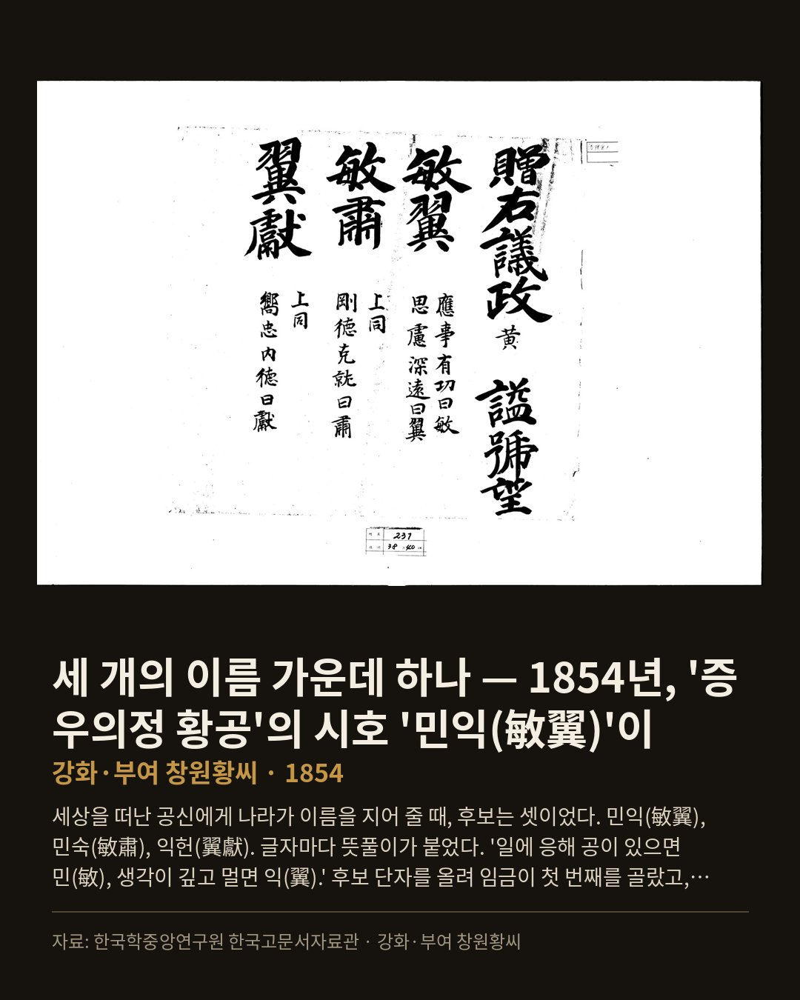
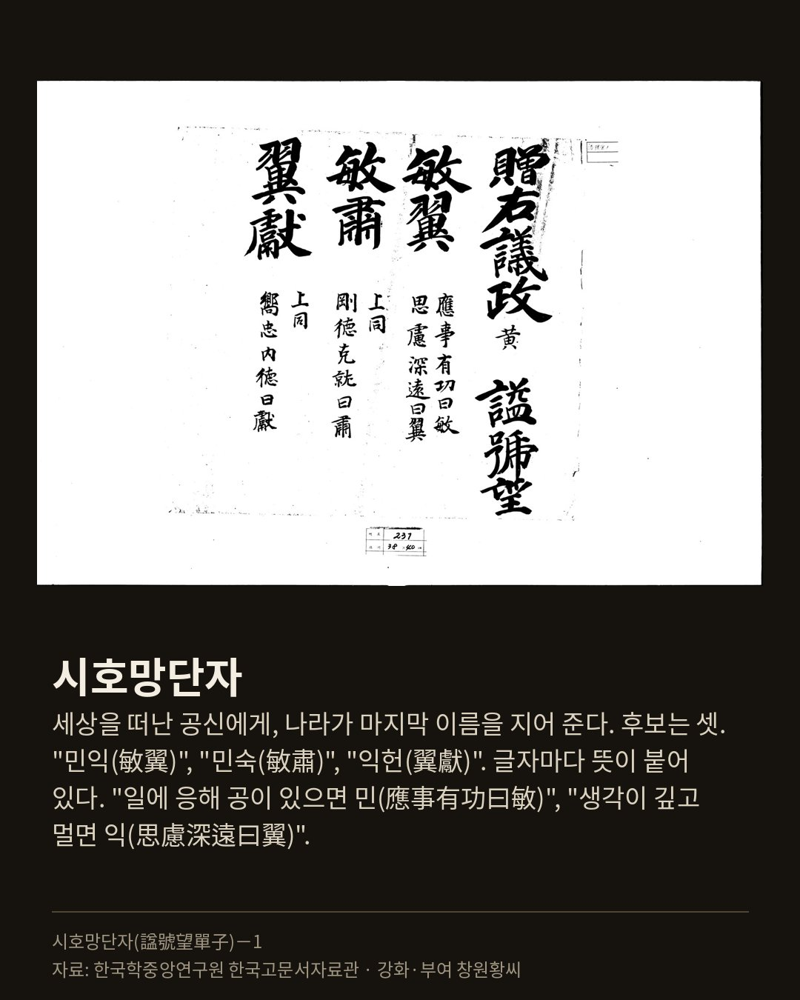
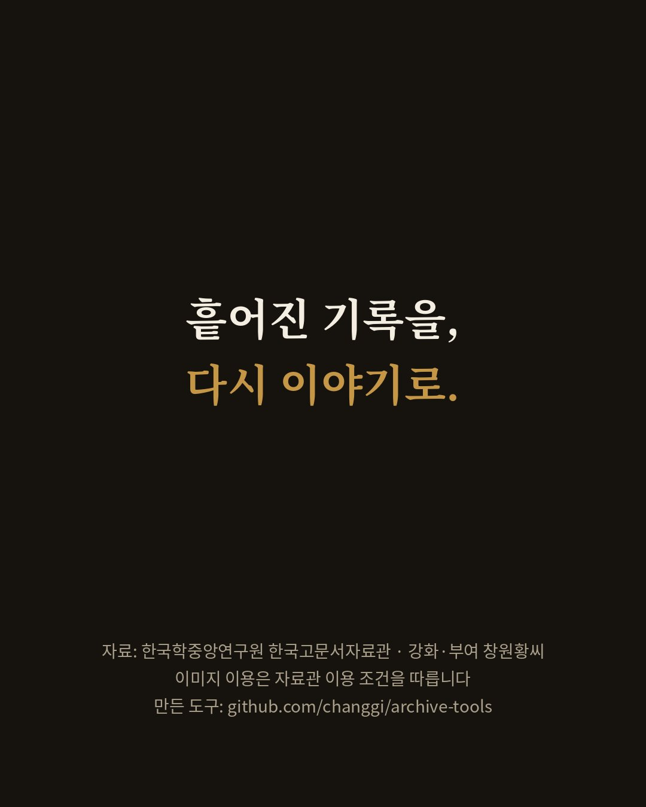

# EP.190 세 개의 이름 가운데 하나 — 1854년, '증 우의정 황공'의 시호 '민익(敏翼)'이 정해지기까지

강화·부여 창원황씨 (문중) · 세상을 떠난 공신에게 나라가 이름을 지어 줄 때, 후보는 셋이었다. 민익(敏翼), 민숙(敏肅), 익헌(翼獻). 글자마다 뜻풀이가 붙었다. '일에 응해 공이 있으면 민(敏), 생각이 깊고 멀면 익(翼).' 후보 단자를 올려 임금이 첫 번째를 골랐고, 1854년 11월과 12월, 사간원과 사헌부의 대간들이 차례로 그 이름에 서명했다. 이름 하나가 정해지는 데 종이가 네 장 들었다

- 🌐 [전시 웹페이지](https://changgi.github.io/archive-tools/examples/changwon-hwang-siho/exhibit.html) (한자 위 한글 독음 · 원문 해석) · [수업 활동지](https://changgi.github.io/archive-tools/examples/changwon-hwang-siho/handout.html)
- 🎬 영상: [릴스 9:16](https://changgi.github.io/archive-tools-next/media/ep190-changwon-hwang-siho_reel.mp4) · [가로 16:9](https://changgi.github.io/archive-tools-next/media/ep190-changwon-hwang-siho_wide.mp4) · 홍보 글: [`promo.md`](promo.md)
- 카드뉴스: [`cards/`](cards/) · SNS 글: [`sns.txt`](sns.txt) · 판독·해석 표: [`selection.csv`](selection.csv)

<!-- DELIVERY -->
## 전달 에디팅 — 이 기록을 이렇게 전합니다

- **핵심 정서** — 경건함
- **한 문장** — 시호(諡號)는 공이 있는 이가 세상을 떠난 뒤 나라가 지어 주는 이름이다 — 봉상시가 후보 셋을 뜻풀이와 함께 올리면(망단자) 임금이 하나를 고르고(낙점), 사간원 · 사헌부의 대간이 서명해야(서경) 확정되었다.
- **열기** — 나라가 지어 준 마지막 이름에는, 후보가 세 개 있었습니다.
- **펼치기** — 시호망단자－1 → 시호망단자－2 → 사간원대사간 시호서경완의 → 사헌부집의 시호서경완의 (1854년) — 시호 후보 망단자(큰 글씨) → 같은 내용의 초본 → 1854년 11월 사간원의 서경 → 12월 16일 사헌부의 서경으로, 이름이 정해지는 순서대로 놓았습니다.
- **절정** — "일에 응해 공이 있으면 민(應事有功曰敏)" — 화면·공간에서 이 한 줄만 크게, 소리를 줄여 집중
- **여운** — 후보 셋 가운데 첫 번째가 골라졌을 때, 나머지 두 이름은 어디로 갔을까요? — 질문으로 끝내고 답은 보는 사람에게
- **감각과 물질** — 망단자의 큰 글자 敏翼 · 敏肅 · 翼獻과 그 아래 작은 뜻풀이 '應事有功曰敏'
- **통로와 매개** — 온라인: 릴스(열기) → 카드뉴스(펼치기) → 전시 웹페이지(절정·원문) → 비하인드 카드(여운) / 오프라인: 원본 크기 복제·낭독·참여 벽 / 남기기: 활동지·질문 카드
- **여운 장치** — 이름 · 별명 · 호에 담긴 뜻 찾아보기
- **전달 에디팅 전** — 4건의 문서를 1854년 연대순으로 놓고 문서명 · 유형 · 해설을 붙인다 — 정확하지만, 지나가면 잊힌다.
- **전달 에디팅 후** — 핵심 정서는 「경건함」. 「나라가 지어 준 마지막 이름에는, 후보가 세 개 있었습니다.」로 열고, 문서를 대비와 순서로 펼친 뒤, "일에 응해 공이 있으면 민(應事有功曰敏)"에서 멈춘다. 망단자의 큰 글자 敏翼 · 敏肅 · 翼獻과 그 아래 작은 뜻풀이 '應事有功曰敏'. 마지막엔 「이름 · 별명 · 호에 담긴 뜻 찾아보기」로 보는 사람이 자기 이야기를 남기고 떠나게 한다.

전문: [`delivery.md`](delivery.md)
<!-- /DELIVERY -->

<!-- CURATOR -->
## 비하인드 — 큐레이터 노트

- **왜 이 문서들인가** — EP.82에서 이 집안의 문서를 처음 읽었습니다. 같은 집안에 '증 우의정 황공'의 시호를 정할 때 쓰인 망단자 두 장과, 1854년 대간의 서경 문서 두 장이 함께 남아 있어 한 묶음으로 놓았습니다.
- **전하고 싶은 것** — 시호(諡號)는 공이 있는 이가 세상을 떠난 뒤 나라가 지어 주는 이름이다 — 봉상시가 후보 셋을 뜻풀이와 함께 올리면(망단자) 임금이 하나를 고르고(낙점), 사간원 · 사헌부의 대간이 서명해야(서경) 확정되었다.
- **이렇게 보이길 바랐다** — 시호 후보 망단자(큰 글씨) → 같은 내용의 초본 → 1854년 11월 사간원의 서경 → 12월 16일 사헌부의 서경으로, 이름이 정해지는 순서대로 놓았습니다.
- **이렇게 써 주세요** — 조선의 시호 제도와 시법(諡法), 봉상시의 망단자와 낙점, 대간의 서경(署經), 한자 한 글자에 담긴 평가 기준, 증직(우의정 추증)과 시호의 관계 수업에 쓰세요.
- **만들며 있었던 일** — 망단자 두 장에는 날짜가 없어 연도를 비워 두었습니다. 받는 이는 문서에 '증 우의정 황(黃)'으로만 적혀 있고, 서경 문서의 이름 옆 작은 글씨는 '黃大受'로 읽히나 이것이 이름인지 다른 표시인지 확정하지 못했습니다. 이 집안에서 우의정에 추증된 인물로는 1623년 추증교지의 황신(EP.192)이 있지만, 같은 사람인지는 이 문서들로 확인하지 않았습니다. 서경 문서의 대간 이름은 성만 적혀 있어 성까지만 옮겼습니다. 흑백 복사본입니다.
- **남겨 둔 질문** — 후보 셋 가운데 첫 번째가 골라졌을 때, 나머지 두 이름은 어디로 갔을까요?
- **제작 기록** — 문서 4건 · 1854년 · 원본 사진 4면(문서 전체) · 원문 판독 4건 · 번역 4건

전문: [`curator.md`](curator.md) · 비하인드 카드: [`behind/`](behind/) · 채널별 홍보안: [`channels.md`](channels.md)
<!-- /CURATOR -->

## 이야기 — 사료가 말하는 대로

나라가 지어 준 마지막 이름에는, 후보가 세 개 있었습니다.

> ** 시호망단자** — 세상을 떠난 공신에게, 나라가 마지막 이름을 지어 준다. 후보는 셋. "민익(敏翼)", "민숙(敏肅)", "익헌(翼獻)". 글자마다 뜻이 붙어 있다. "일에 응해 공이 있으면 민(應事有功曰敏)", "생각이 깊고 멀면 익(思慮深遠曰翼)".
> ** 시호망단자** — 같은 세 이름을 다시 쓴 종이 한 장. 이번에는 줄임말 없이 모두 풀어 썼다. 집안사람이 베껴 두었을까. 세 이름 가운데 무엇이 될지, 아직 아무도 모른다.
> **1854 시호서경완의** — 1854년 겨울. 이름이 정해졌다. "증 우의정 황공, 민익공(敏翼公)". 세 후보 가운데 첫 번째. 이제 대간이 서명할 차례다. 사간원의 자리 다섯, 그 가운데 두 자리에 성이 적힌다.
> **1854 시호서경완의** — 그리고 섣달 열엿새. 이번에는 사헌부다. 같은 이름, 같은 뜻풀이. "민익공(敏翼公). 일에 응해 공이 있고(應事有功), 생각이 깊고 멀다(思慮深遠)." 두 기관의 서명이 모였다. 종이 네 장 끝에, 그는 마지막 이름을 얻었다.

| 표지 | 1번 카드 | 마무리 |
|---|---|---|
|  |  |  |

## 선별 문서 (4점)

| # | 연도 | 유형 | 문서명 | 원본 |
|---|---|---|---|---|
| 1 | — | 시호망단자 | 시호망단자(諡號望單子)－1 | [원본 보기](https://archive.aks.ac.kr/viewer/viewer.do#imgnode.do?itemId=book&gubun=booktree&depth=6&upPath=01%5E0172%5EL017201%5EL017201F02%5EL017201F0202&dataId=G002%2BAKS%2BKSM-XB.0000.1100-20101008.B008a_009_00262_XXX&itemType=) |
| 2 | — | 시호망단자 | 시호망단자(諡號望單子)－2 | [원본 보기](https://archive.aks.ac.kr/viewer/viewer.do#imgnode.do?itemId=book&gubun=booktree&depth=6&upPath=01%5E0172%5EL017201%5EL017201F02%5EL017201F0202&dataId=G002%2BAKS%2BKSM-XB.0000.1100-20101008.B008a_009_00263_XXX&itemType=) |
| 3 | 1854 | 시호서경완의 | 1854년 사간원대사간(司諫院大司諫) 시호서경완의(諡號署經完議) | [원본 보기](https://archive.aks.ac.kr/viewer/viewer.do#imgnode.do?itemId=book&gubun=booktree&depth=6&upPath=01%5E0172%5EL017201%5EL017201F02%5EL017201F0204&dataId=G002%2BAKS%2BKSM-XD.1854.1100-20101008.B008a_009_00264_XXX&itemType=) |
| 4 | 1854 | 시호서경완의 | 1854년 사헌부집의(司憲府執義) 시호서경완의(諡號署經完議) | [원본 보기](https://archive.aks.ac.kr/viewer/viewer.do#imgnode.do?itemId=book&gubun=booktree&depth=6&upPath=01%5E0172%5EL017201%5EL017201F02%5EL017201F0204&dataId=G002%2BAKS%2BKSM-XD.1854.1100-20101008.B008a_009_00265_XXX&itemType=) |

## 원문 판독과 해석

### 1. 시호망단자(諡號望單子)－1

**원문 판독**

```
贈右議政 黃 諡號望
敏翼 應事有功曰敏 思慮深遠曰翼
敏肅 上同 剛德克就曰肅
翼獻 上同 嚮忠內德曰獻
```

**원문 해석** 증 우의정 황공의 시호 후보. 민익(敏翼) — 일에 응해 공이 있으면 민(敏)이라 하고, 생각이 깊고 멀면 익(翼)이라 한다. 민숙(敏肅) — (민은) 위와 같고, 굳센 덕으로 능히 이루면 숙(肅)이라 한다. 익헌(翼獻) — (익은) 위와 같고, 충성을 향하고 안으로 덕이 있으면 헌(獻)이라 한다.

**해제** 우의정으로 추증된 황(黃)씨에게 시호를 정하려고 올린 후보 목록, 시호망단자(諡號望單子)입니다. 시호를 맡은 봉상시가 세 후보를 큰 글씨로 쓰고, 각 글자 아래에 시법(諡法)의 뜻풀이를 작게 달았습니다. '민(敏)'은 일에 응해 공이 있음, '익(翼)'은 생각이 깊고 멂, '숙(肅)'은 굳센 덕으로 이룸, '헌(獻)'은 충성을 향하고 안으로 덕이 있음입니다. 같은 글자가 다른 후보에 다시 나오면 '上同(위와 같다)'으로 줄였습니다. 임금은 이 가운데 하나에 점을 찍어(낙점) 골랐습니다. 날짜는 없습니다.

### 2. 시호망단자(諡號望單子)－2

**원문 판독**

```
敏翼 應事有功曰敏 思慮深遠曰翼
敏肅 應事有功曰敏 剛德克就曰肅
翼獻 思慮深遠曰翼 嚮忠內德曰獻
```

**원문 해석** 민익 — 일에 응해 공이 있으면 민, 생각이 깊고 멀면 익. 민숙 — 일에 응해 공이 있으면 민, 굳센 덕으로 능히 이루면 숙. 익헌 — 생각이 깊고 멀면 익, 충성을 향하고 안으로 덕이 있으면 헌.

**해제** 같은 세 후보를 작은 종이에 다시 쓴 망단자입니다. 앞 장이 '증 우의정 황 시호망'이라는 제목과 큰 글씨로 정식 형태를 갖췄다면, 이 장은 제목 없이 후보와 뜻풀이만 적었고, '上同'으로 줄이지 않고 뜻풀이를 모두 풀어 썼습니다. 집안에서 베껴 둔 사본이거나 올리기 전의 초본으로 보입니다. 두 장을 비교하면 시호 후보를 어떻게 정리해 올렸는지 알 수 있습니다.

### 3. 1854년 사간원대사간(司諫院大司諫) 시호서경완의(諡號署經完議)

**원문 판독**

```
諡號
贈右議政 黃(小字 大受) 敏翼公 應事有功 思慮深遠
咸豐四年十一月 日
大司諫金 司諫 獻納兪 正言 正言
```

**원문 해석** 시호. 증 우의정 황공(작은 글씨 大受), 민익공. 일에 응해 공이 있고, 생각이 깊고 멀다. 함풍 4년(1854) 11월 일. 대사간 김 · 사간 · 헌납 유 · 정언 · 정언.

**해제** 1854년(철종 5) 11월, 사간원이 '증 우의정 황공'의 시호 '민익공(敏翼公)'에 서경(署經)한 문서입니다. 세 후보 가운데 첫 번째 '민익'이 골라졌음을 보여 줍니다. 서경은 임명 · 시호 등을 대간이 심사해 서명하는 절차로, 사간원의 대사간 · 사간 · 헌납 · 정언 두 명의 자리를 적고 그날 참여한 이가 성을 써넣었습니다. 대사간 김씨와 헌납 유씨만 성이 적혀 있습니다. 연호 위의 도장은 검게 찍혔습니다. 흑백 복사본입니다. 이름 옆의 작은 글씨는 '大受'로 읽히나, 이름인지 다른 표시인지 확정하지 못했습니다.

### 4. 1854년 사헌부집의(司憲府執義) 시호서경완의(諡號署經完議)

**원문 판독**

```
諡號
贈右議政 黃(小字 大受) 敏翼公 應事有功 思慮深遠
咸豐四年十二月十六日
大司憲 執義韓 掌令 掌令 持平洪 持平
```

**원문 해석** 시호. 증 우의정 황공(작은 글씨 大受), 민익공. 일에 응해 공이 있고, 생각이 깊고 멀다. 함풍 4년(1854) 12월 16일. 대사헌 · 집의 한 · 장령 · 장령 · 지평 홍 · 지평.

**해제** 한 달 뒤인 1854년 12월 16일, 사헌부가 같은 시호에 서경한 문서입니다. 사헌부의 대사헌 · 집의 · 장령 두 명 · 지평 두 명의 자리를 적었고, 집의 한씨와 지평 홍씨가 성을 써넣었습니다. 사간원과 사헌부, 두 대간 기관의 서경을 모두 거쳐야 시호가 확정되었습니다. 이 문서는 날짜까지 적어, 1854년 12월 16일에 '증 우의정 황공'의 시호 '민익'이 최종 확정되었음을 보여 줍니다. 시호망단자부터 서경까지 네 장이 한 집안에 함께 남아, 이름 하나가 정해지는 과정을 처음부터 끝까지 보여 줍니다.

판독·해석·이야기는 이미지에 근거한 초안이며(검토 전 "초안" 표시), 정확한 판독은 원문 확인이 필요합니다. □는 읽지 못한 글자, (?)는 불확실한 글자입니다.
이미지: 한국학중앙연구원 한국고문서자료관 소장·제공. "원본" 링크를 누르면 자료관 뷰어에서 그 문서가 열립니다. 재사용은 자료관에 문의하세요(소장처 동의 필요).
