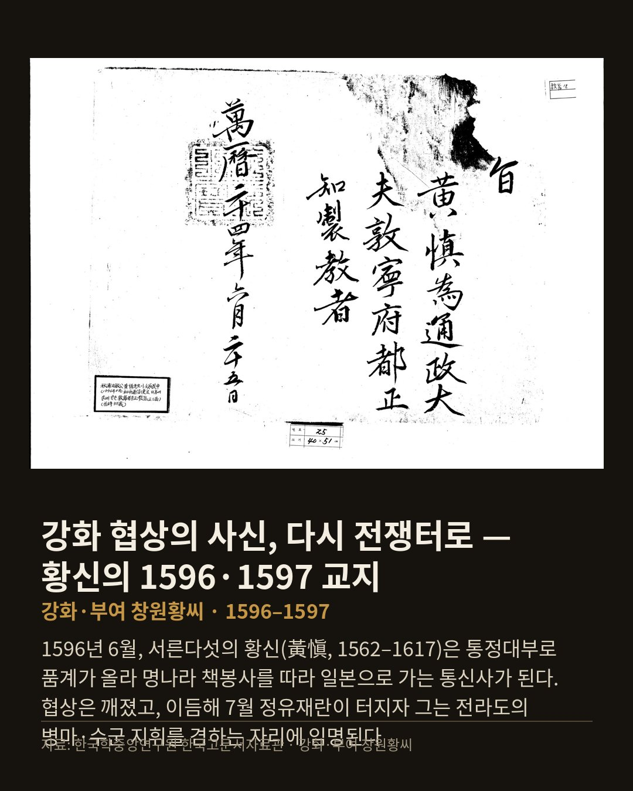
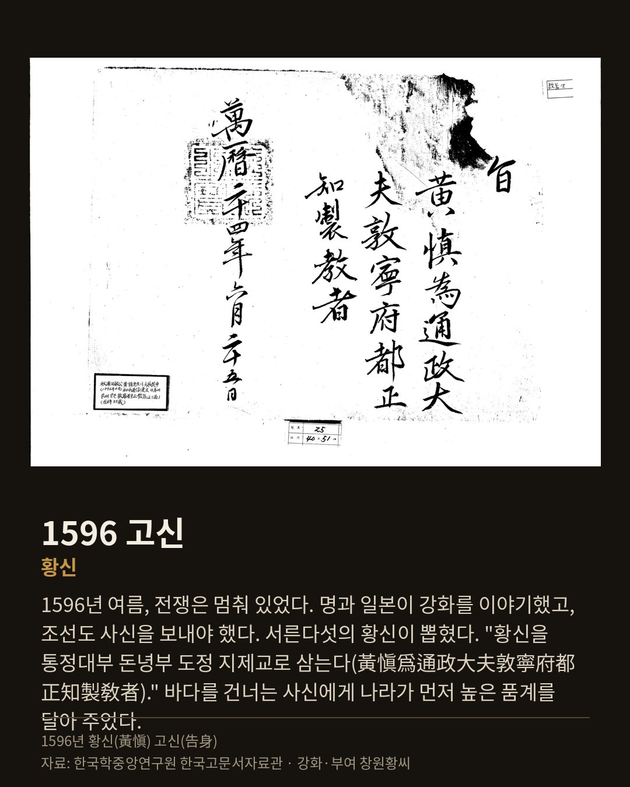
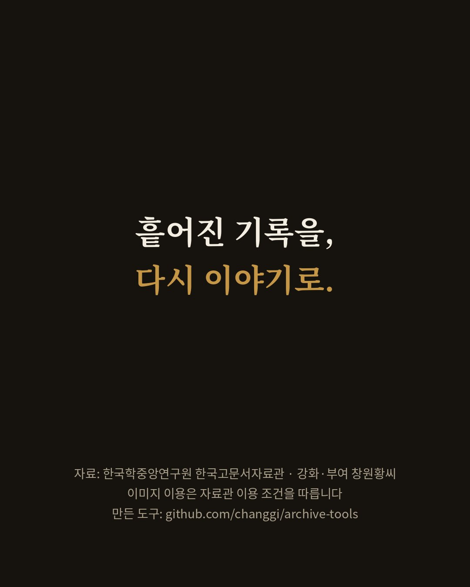

# EP.82 강화 협상의 사신, 다시 전쟁터로 — 황신의 1596·1597 교지

강화·부여 창원황씨 (문중) · 1596년 6월, 서른다섯의 황신(黃愼, 1562–1617)은 통정대부로 품계가 올라 명나라 책봉사를 따라 일본으로 가는 통신사가 된다. 협상은 깨졌고, 이듬해 7월 정유재란이 터지자 그는 전라도의 병마·수군 지휘를 겸하는 자리에 임명된다

- 🌐 [전시 웹페이지](https://changgi.github.io/archive-tools/examples/changwon-hwang/exhibit.html) (한자 위 한글 독음 · 원문 해석) · [수업 활동지](https://changgi.github.io/archive-tools/examples/changwon-hwang/handout.html)
- 🎬 영상: [릴스 9:16](https://changgi.github.io/archive-tools/examples/media/ep82-changwon-hwang_reel.mp4) · [가로 16:9](https://changgi.github.io/archive-tools/examples/media/ep82-changwon-hwang_wide.mp4) · 홍보 글: [`promo.md`](promo.md)
- 카드뉴스: [`cards/`](cards/) · SNS 글: [`sns.txt`](sns.txt) · 판독·해석 표: [`selection.csv`](selection.csv)

## 이야기 — 사료가 말하는 대로

평화를 말하러 갔던 사신에게, 1년 뒤 군대가 맡겨졌습니다.

> **1596 고신** — 1596년 여름, 전쟁은 멈춰 있었다. 명과 일본이 강화를 이야기했고, 조선도 사신을 보내야 했다. 서른다섯의 황신이 뽑혔다. "황신을 통정대부 돈녕부 도정 지제교로 삼는다(黃愼爲通政大夫敦寧府都正知製敎者)." 바다를 건너는 사신에게 나라가 먼저 높은 품계를 달아 주었다.
> **1597 고신** — 이듬해 여름, 협상은 실패로 끝났다. 왜군이 다시 왔고, 칠천량에서 조선 수군이 무너졌다. 일주일 뒤, 평화를 말하러 갔던 사신에게 새 교지가 내려온다. "황신을 전라도 겸 병마·수군절도사로 삼는다(黃愼爲全羅道兼兵馬水軍節度使者)." 붓을 들었던 손에 이번에는 군대가 맡겨졌다.

| 표지 | 1번 카드 | 마무리 |
|---|---|---|
|  |  |  |

## 선별 문서 (2점)

| # | 연도 | 유형 | 문서명 | 원본 |
|---|---|---|---|---|
| 1 | 1596 | 고신 | 1596년 황신(黃愼) 고신(告身) | [원본 보기](https://archive.aks.ac.kr/viewer/viewer.do#imgnode.do?itemId=book&gubun=booktree&depth=6&upPath=01%5E0172%5EL017201%5EL017201F02%5EL017201F0201&dataId=G002%2BAKS%2BKSM-XA.1596.1111-20101008.B008a_009_00005_XXX&itemType=) |
| 2 | 1597 | 고신 | 1597년 황신(黃愼) 고신(告身)－2 | [원본 보기](https://archive.aks.ac.kr/viewer/viewer.do#imgnode.do?itemId=book&gubun=booktree&depth=6&upPath=01%5E0172%5EL017201%5EL017201F02%5EL017201F0201&dataId=G002%2BAKS%2BKSM-XA.1597.1111-20101008.B008a_009_00007_XXX&itemType=) |

## 원문 판독과 해석

### 1. 1596년 황신(黃愼) 고신(告身)

**원문 판독**

```
[敎]旨
黃愼爲通政大
夫敦寧府都正
知製敎者
萬曆二十四年六月二十五日
(시명지보 1과)
(후대 부전지) 秋浦文敏公黃愼先生이 壬辰亂中(1596年 6月) 和平通信使로 日本에 갈 때 받은 敦寧府都正 敎旨(正三品)(當時 35歲)
```

**원문 해석** 교지. 황신을 통정대부(정3품 당상) 돈녕부 도정 지제교로 삼는다. 만력 24년(1596) 6월 25일.

**해제** 임진왜란의 강화 협상이 진행되던 1596년, 명나라 책봉사를 따라 일본에 갈 조선 통신사로 황신(黃愼)이 정해지면서 정3품 당상관인 통정대부로 올려 돈녕부 도정에 임명한 교지입니다. 지제교(知製敎)는 왕의 교서를 짓는 일을 겸한다는 뜻입니다. 왼쪽 아래에 후손이 붙인 부전지가 '화평 통신사로 일본에 갈 때 받은 교지(당시 35세)'라고 설명합니다. 이해 9월 오사카에서 도요토미 히데요시가 책봉을 받았으나 협상은 결렬되었습니다. 위쪽 일부가 떨어져 '敎' 자는 보충했습니다.

### 2. 1597년 황신(黃愼) 고신(告身)－2

**원문 판독**

```
敎旨
黃愼爲全羅
道兼兵馬水
軍節度使者
萬曆二十五年七月二十三日
(시명지보 1과)
```

**원문 해석** 교지. 황신을 전라도 겸 병마·수군절도사로 삼는다. 만력 25년(1597) 7월 23일.

**해제** 강화 협상이 깨지고 정유재란이 시작된 1597년 7월, 황신을 전라도의 병마절도사와 수군절도사를 겸하는 직임에 임명한 교지입니다(관찰사가 겸직하는 형식으로 보이나 문서에는 '全羅道兼兵馬水軍節度使'만 적혀 있습니다). 이달 중순 칠천량 해전에서 조선 수군이 크게 패하여 전라도가 직접 위협받던 때입니다. 일자의 끝 글자는 흐려 확인이 필요합니다. 마이크로필름 흑백 이미지입니다.

판독·해석·이야기는 이미지에 근거한 초안이며(검토 전 "초안" 표시), 정확한 판독은 원문 확인이 필요합니다. □는 읽지 못한 글자, (?)는 불확실한 글자입니다.
이미지: 한국학중앙연구원 한국고문서자료관 소장·제공. "원본" 링크를 누르면 자료관 뷰어에서 그 문서가 열립니다. 재사용은 자료관에 문의하세요(소장처 동의 필요).
