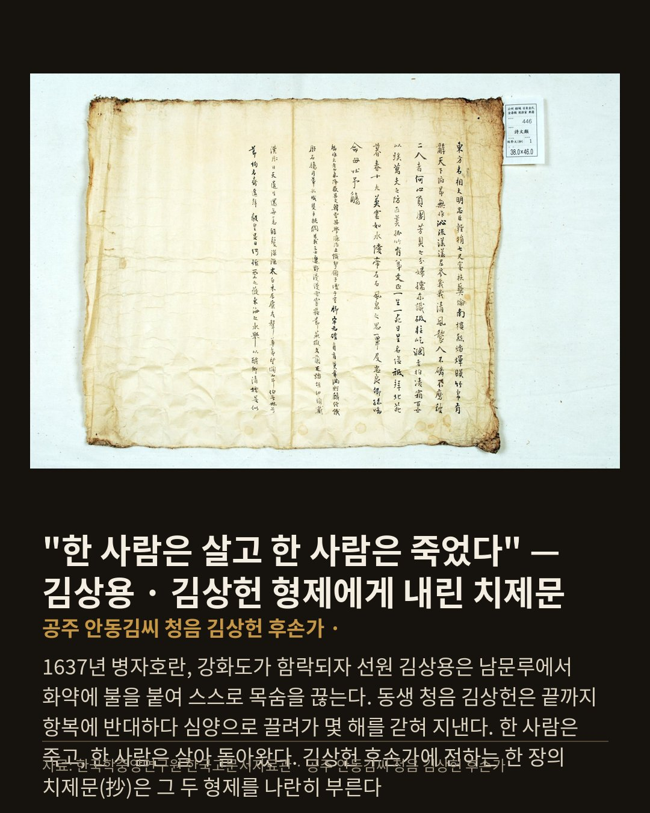
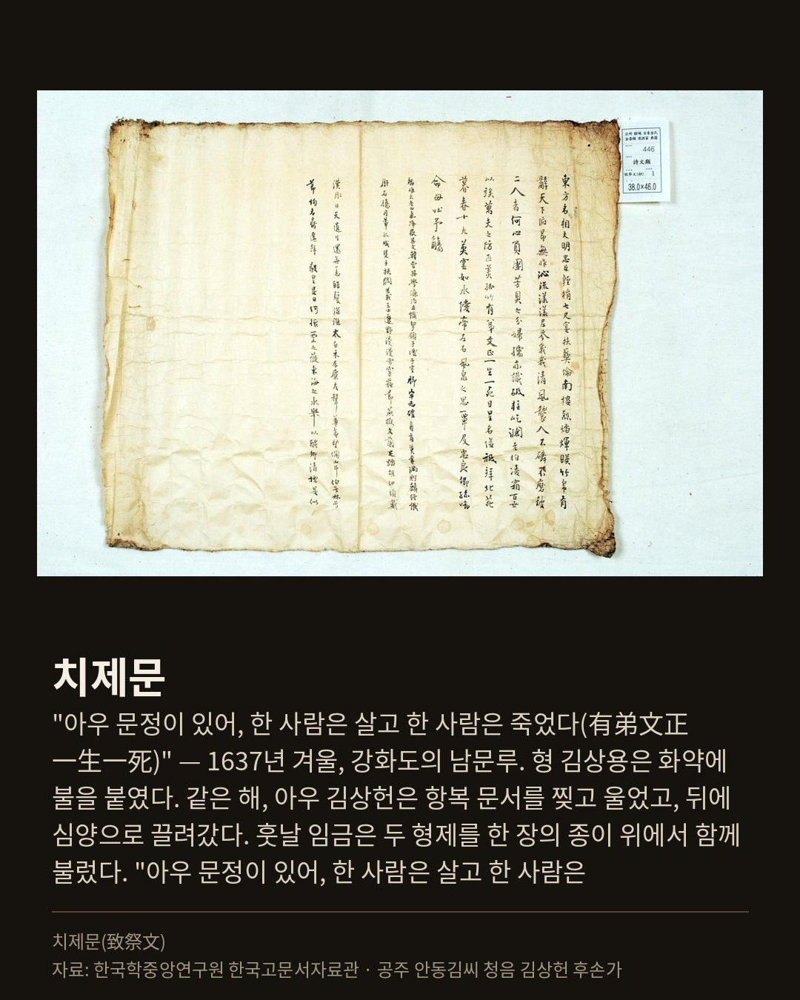
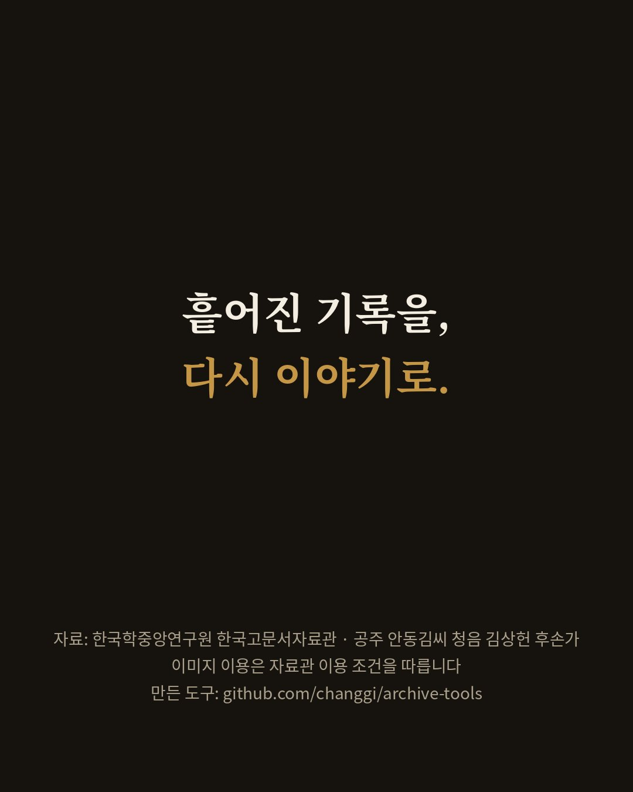

# EP.112 "한 사람은 살고 한 사람은 죽었다" — 김상용 · 김상헌 형제에게 내린 치제문

공주 안동김씨 청음 김상헌 후손가 (문중) · 1637년 병자호란, 강화도가 함락되자 선원 김상용은 남문루에서 화약에 불을 붙여 스스로 목숨을 끊는다. 동생 청음 김상헌은 끝까지 항복에 반대하다 심양으로 끌려가 몇 해를 갇혀 지낸다. 한 사람은 죽고, 한 사람은 살아 돌아왔다. 김상헌 후손가에 전하는 한 장의 치제문(抄)은 그 두 형제를 나란히 부른다

- 🌐 [전시 웹페이지](https://changgi.github.io/archive-tools/examples/cheongeum/exhibit.html) (한자 위 한글 독음 · 원문 해석) · [수업 활동지](https://changgi.github.io/archive-tools/examples/cheongeum/handout.html)
- 🎬 영상: [릴스 9:16](https://changgi.github.io/archive-tools/examples/media/ep112-cheongeum_reel.mp4) · [가로 16:9](https://changgi.github.io/archive-tools/examples/media/ep112-cheongeum_wide.mp4) · 홍보 글: [`promo.md`](promo.md)
- 카드뉴스: [`cards/`](cards/) · SNS 글: [`sns.txt`](sns.txt) · 판독·해석 표: [`selection.csv`](selection.csv)

<!-- DELIVERY -->
## 전달 에디팅 — 이 기록을 이렇게 전합니다

- **핵심 정서** — 숙연함
- **한 문장** — 죽음과 생존, 두 갈래의 충절 — 임금은 다른 길을 간 형제를 같은 무게로 기렸다.
- **열기** — 한 사람은 불꽃 속에 죽고, 한 사람은 끌려갔다 살아 돌아왔습니다. 임금은 두 형제를 한 장에 불렀습니다.
- **펼치기** — 치제문 (연대 미상) — 김상용의 '남루의 불꽃' → '한 사람은 살고 한 사람은 죽었다' → 김상헌의 '머리에는 한의 달을 이었다'로, 형에서 아우로 시선을 옮기게 구성했습니다.
- **절정** — "아우 문정이 있어, 한 사람은 살고 한 사람은 죽었다(有弟文正 一生一死)" — 화면·공간에서 이 한 줄만 크게, 소리를 줄여 집중
- **여운** — 살아남은 아우는 형의 죽음을 어떻게 기억했을까요? — 질문으로 끝내고 답은 보는 사람에게
- **감각과 물질** — 남문루의 불꽃과 심양의 눈 덮인 움집, 한 장에 나란한 두 제문 · 조명을 낮추고 낭독, 촛불
- **통로와 매개** — 온라인: 릴스(열기) → 카드뉴스(펼치기) → 전시 웹페이지(절정·원문) → 비하인드 카드(여운) / 오프라인: 원본 크기 복제·낭독·참여 벽 / 남기기: 활동지·질문 카드
- **여운 장치** — 다른 길을 간 두 사람을 함께 기억해 보기
- **전달 에디팅 전** — 1건의 문서를 연대 미상 연대순으로 놓고 문서명 · 유형 · 해설을 붙인다 — 정확하지만, 지나가면 잊힌다.
- **전달 에디팅 후** — 핵심 정서는 「숙연함」. 「한 사람은 불꽃 속에 죽고, 한 사람은 끌려갔다 살아 돌아왔습니다. 임금은 두 형제를 한 장에 불렀습니다.」로 열고, 문서를 한 장의 집중로 펼친 뒤, "아우 문정이 있어, 한 사람은 살고 한 사람은 죽었다(有弟文正 一生一死)"에서 멈춘다. 남문루의 불꽃과 심양의 눈 덮인 움집, 한 장에 나란한 두 제문. 마지막엔 「다른 길을 간 두 사람을 함께 기억해 보기」로 보는 사람이 자기 이야기를 남기고 떠나게 한다.

전문: [`delivery.md`](delivery.md)
<!-- /DELIVERY -->

<!-- CURATOR -->
## 비하인드 — 큐레이터 노트

- **왜 이 문서들인가** — 한 장 안에 두 편의 제문이 나란히 적혀 있고, 첫 편에 '아우 문정이 있어 한 사람은 살고 한 사람은 죽었다'는 구절이 있는 것을 보고 이 형제를 함께 다루기로 했습니다.
- **전하고 싶은 것** — 죽음과 생존, 두 갈래의 충절 — 임금은 다른 길을 간 형제를 같은 무게로 기렸다.
- **이렇게 보이길 바랐다** — 김상용의 '남루의 불꽃' → '한 사람은 살고 한 사람은 죽었다' → 김상헌의 '머리에는 한의 달을 이었다'로, 형에서 아우로 시선을 옮기게 구성했습니다.
- **이렇게 써 주세요** — 병자호란과 척화론, 대보단과 조선 후기의 명나라 인식, 역사 속 형제 이야기에 쓰세요. 척화의 평가는 관점에 따라 다르다는 점도 함께 다루세요.
- **만들며 있었던 일** — 이 문서는 베낌본(抄)이고 날짜와 내린 임금이 적혀 있지 않습니다. 첫 편은 대체로 읽히나 몇 글자가 불확실하고, 둘째 편은 잔글씨라 (?)가 많습니다. 대보단 제사와의 관련은 구절에 근거한 추정입니다.
- **남겨 둔 질문** — 살아남은 아우는 형의 죽음을 어떻게 기억했을까요?
- **제작 기록** — 문서 1건 · 원본 사진 1면(문서 전체) · 원문 판독 1건 · 번역 1건 · 못 읽은 글자 □ 0 · 불확실 (?) 23

전문: [`curator.md`](curator.md) · 비하인드 카드: [`behind/`](behind/) · 채널별 홍보안: [`channels.md`](channels.md)
<!-- /CURATOR -->

## 이야기 — 사료가 말하는 대로

한 사람은 불꽃 속에 죽고, 한 사람은 끌려갔다 살아 돌아왔습니다. 임금은 두 형제를 한 장에 불렀습니다.

> ** 치제문** — 1637년 겨울, 강화도의 남문루. 형 김상용은 화약에 불을 붙였다. 같은 해, 아우 김상헌은 항복 문서를 찢고 울었고, 뒤에 심양으로 끌려갔다. 훗날 임금은 두 형제를 한 장의 종이 위에서 함께 불렀다. "아우 문정이 있어, 한 사람은 살고 한 사람은 죽었다(有弟文正 一生一死)." 그리고 아우에게는 이렇게 썼다. "발은 오랑캐 땅을 밟았으나, 머리에는 한의 달을 이었다(足踏胡地 頭戴漢月)."

| 표지 | 1번 카드 | 마무리 |
|---|---|---|
|  |  |  |

## 선별 문서 (1점)

| # | 연도 | 유형 | 문서명 | 원본 |
|---|---|---|---|---|
| 1 | — | 치제문 | 치제문(致祭文) | [원본 보기](https://archive.aks.ac.kr/viewer/viewer.do#imgnode.do?itemId=book&gubun=booktree&depth=6&upPath=01%5E0144%5EL014423%5EL014423F02%5EL014423F0208&dataId=G002%2BAKS%2BKSM-XI.9999.4415-20211130.B075a_105_00205_XXX&itemType=) |

## 원문 판독과 해석

### 1. 치제문(致祭文)

**원문 판독**

```
東方名相 大明忠臣 輕捐七尺 寔扶彝倫 南樓烈焰 煇暎竹帛 有髯(?)
天下 俯仰無怍 沁流漾漾 居(?)冬(?)峩峩(?) 淸風襲人 不磷不磨 彼
二人者 何心負國 芳臭之分 婦孺亦識 砥柱屹瀾 老柏凌霜 百世
以俟 萬夫之防 匹美孤竹 有弟文正 一生一死 日星名位(?) 祇拜北苑
暮春十九 英靈如水 優(?)帝左右 風泉之思 曷(?)及忠良 卿孫啣
命 毋吐予觴

卿惟大老 正氣降嶽 其文韓曾 其學濂洛 立幟挈領 于壇于室 帥(?)牢志確 肓肓(?)莫奪 滿腔(?)麟經(?)鐵(?)
肝石膽月 單(?)孤城 隻手扶綱 嗟(?)哉三士 遼野漫漫 雪窖蘇節 燕獄文(?)蘭(?) 足踏胡地 頭戴
漢月 日天遺(?)生 還無恙志(?) 皓髮蕭蕭(?) 太白木居 康(?)友(?)聲華 帝望傾山斗 伯兮叔兮(?)
節均名齊 遙拜毅皇 是日何懷(?) 西山之薇 東海之水 擧以酹卿 淸標是似
```

**원문 해석** [첫째 글 — 김상용에게] 동방의 이름난 재상이요 대명(大明)의 충신이여, 일곱 자 몸을 가벼이 버려 참으로 인륜을 붙들었도다. 남쪽 누각의 맹렬한 불꽃은 역사(竹帛)에 환히 빛나니, 천하에 … 굽어보고 우러러보아도 부끄러움이 없도다. 강화(沁)의 물결은 넘실거리고 … 맑은 바람은 사람에게 스며드니, 갈아도 얇아지지 않고 닳지도 않는도다. 저 두 사람은 무슨 마음으로 나라를 저버렸는가. 향기와 악취의 구분은 아낙과 아이도 안다. 거센 물결 속에 우뚝 선 지주(砥柱)요 서리를 이기는 늙은 측백이니, 백세 뒤를 기다리고 만 사람의 방패가 되리라. 고죽(백이 · 숙제)과 아름다움을 나란히 하니, 문정(文正)이라는 아우가 있어 한 사람은 살고 한 사람은 죽었으되 해와 별처럼 이름이 자리하였다. 삼가 북원(北苑)에서 절하는 늦봄 열아흐레, 영령은 물처럼 맑아 황제의 곁에 계시리라. 풍천(風泉)의 생각이 어찌 충량한 신하에게 미치지 않으랴. 경의 자손이 명을 받들었으니, 나의 잔을 뱉지 말라. [둘째 글 — 김상헌에게] 경은 큰 원로이니, 바른 기운이 산악에서 내려왔도다. 그 글은 한유 · 증공 같고 그 학문은 주돈이 · 정호 · 정이(濂洛)를 이었다. … 요동 들판은 아득한데, 눈 덮인 움집에서 소무(蘇武)의 절개를 지키고 연경의 감옥에서 문천상(文天祥)처럼 … 발은 오랑캐 땅을 밟았으나 머리에는 한(漢)의 달을 이었도다. … 멀리 의종 황제(毅皇)께 절하는 오늘, 어찌 그리운 마음이 없으랴. 서산의 고사리와 동해의 물을 들어 경에게 술 대신 붓노니, 맑은 기상이 이와 같도다.

**해제** 청음 김상헌(金尙憲, 1570–1652) 후손가에 전하는 치제문(致祭文)의 베낌본(抄)입니다. 치제문은 임금이 신하의 제사에 관원을 보내 내리는 제문입니다. 한 장에 두 편이 실렸습니다. 첫 편은 '남루의 불꽃(南樓烈焰)', '강화의 물결(沁流)', '아우 문정(有弟文正)'이라는 구절로 보아, 1637년 강화도 함락 때 남문루에서 순절한 선원 김상용(金尙容, 1561–1637)에게 내린 것입니다(문정은 김상헌의 시호). 같은 편의 '저 두 사람은 무슨 마음으로 나라를 저버렸는가'는 강화도 방어를 맡았다가 지키지 못한 이들을 가리키는 것으로 보입니다(추정). 둘째 편은 '눈 덮인 움집의 소무 절개(雪窖蘇節)', '발은 오랑캐 땅을 밟고 머리에는 한의 달을 이었다'로 보아 심양에 억류되었던 김상헌에게 내린 것으로 보입니다. '북원에서 늦봄 열아흐레에 절한다', '의종 황제께 멀리 절한다'는 구절은 명나라 마지막 황제 의종(崇禎帝)이 죽은 3월 19일 무렵, 창덕궁 후원의 대보단 제사와 함께 이 제문이 내려졌음을 시사합니다(추정). 어느 임금 때의 것인지는 이 면에 적혀 있지 않습니다. 둘째 편은 글씨가 잘아 판독이 불확실한 글자가 많습니다.

판독·해석·이야기는 이미지에 근거한 초안이며(검토 전 "초안" 표시), 정확한 판독은 원문 확인이 필요합니다. □는 읽지 못한 글자, (?)는 불확실한 글자입니다.
이미지: 한국학중앙연구원 한국고문서자료관 소장·제공. "원본" 링크를 누르면 자료관 뷰어에서 그 문서가 열립니다. 재사용은 자료관에 문의하세요(소장처 동의 필요).
