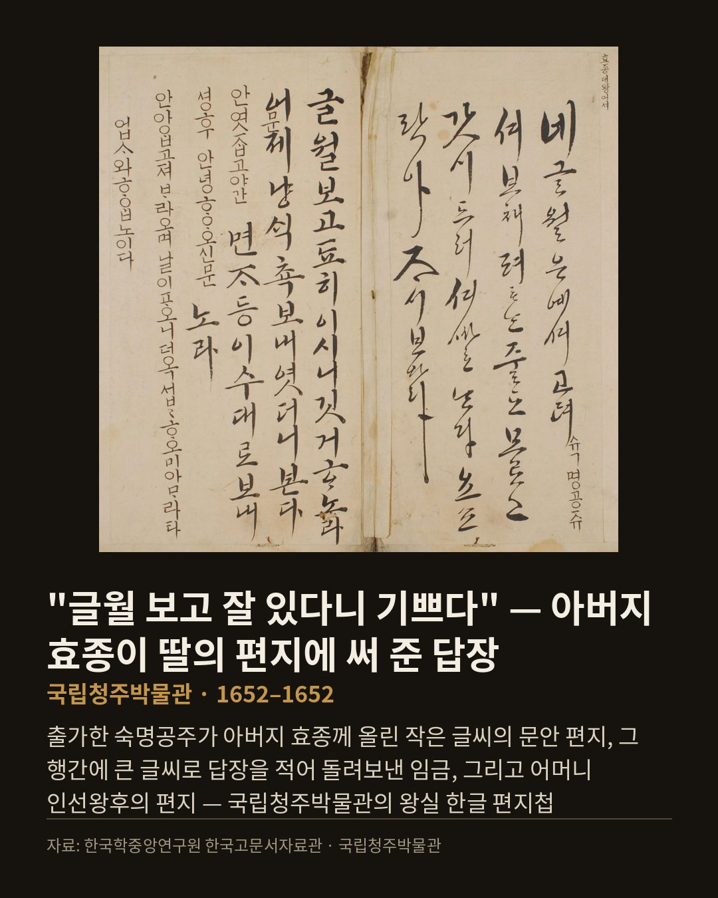
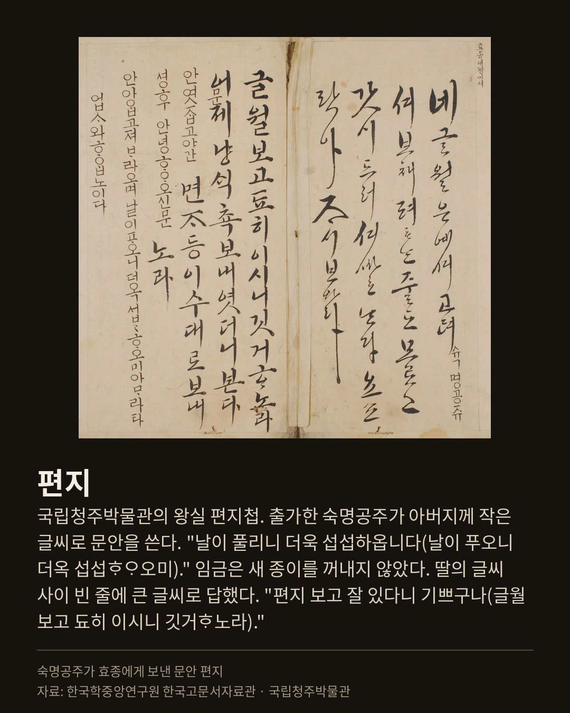
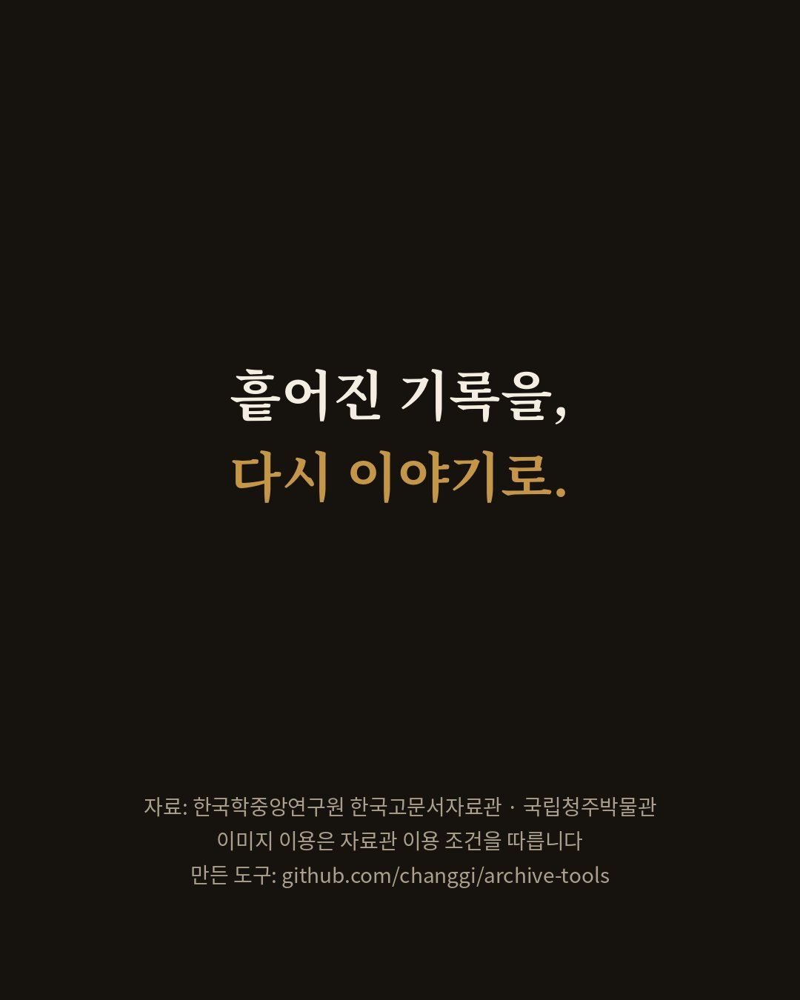

# EP.49 "글월 보고 잘 있다니 기쁘다" — 아버지 효종이 딸의 편지에 써 준 답장

국립청주박물관 (박물관) · 출가한 숙명공주가 아버지 효종께 올린 작은 글씨의 문안 편지, 그 행간에 큰 글씨로 답장을 적어 돌려보낸 임금, 그리고 어머니 인선왕후의 편지 — 국립청주박물관의 왕실 한글 편지첩

- 🌐 [전시 웹페이지](https://changgi.github.io/archive-tools/examples/cheongju-museum/exhibit.html) (한자 위 한글 독음 · 원문 해석) · [수업 활동지](https://changgi.github.io/archive-tools/examples/cheongju-museum/handout.html)
- 🎬 영상: [릴스 9:16](https://changgi.github.io/archive-tools/examples/media/ep49-cheongju-museum_reel.mp4) · [가로 16:9](https://changgi.github.io/archive-tools/examples/media/ep49-cheongju-museum_wide.mp4) · 홍보 글: [`promo.md`](promo.md)
- 카드뉴스: [`cards/`](cards/) · SNS 글: [`sns.txt`](sns.txt) · 판독·해석 표: [`selection.csv`](selection.csv)


<!-- CURATOR -->
## 비하인드 — 큐레이터 노트

- **왜 이 문서들인가** — 효종이 딸의 편지 빈 줄에 큰 글씨로 답장을 써 준 편지첩이 있었습니다.
- **전하고 싶은 것** — 임금도 딸의 편지에 새 종이를 쓰지 않고 바로 답할 만큼 다정한 아버지였다는 것.
- **이렇게 보이길 바랐다** — 딸의 작은 글씨와 아버지의 큰 글씨를 한 화면에 보여 주는 데 집중했습니다.
- **이렇게 써 주세요** — 왕실 가족사, 한글 편지 읽기 수업에 쓰세요.
- **만들며 있었던 일** — 옛 한글 표기는 고치지 않았습니다.
- **남겨 둔 질문** — 딸은 아버지의 큰 글씨를 몇 번이나 다시 읽었을까요?
- **제작 기록** — 문서 2건 · 1652년 · 원본 사진 2면(문서 전체) · 원문 판독 2건 · 번역 2건 · 못 읽은 글자 □ 0 · 불확실 (?) 13

전문: [`curator.md`](curator.md)
<!-- /CURATOR -->

## 이야기 — 사료가 말하는 대로

임금은 딸의 편지에 새 종이를 쓰지 않았습니다. 딸의 글씨 사이에 답을 썼습니다.

> ** 편지** — 국립청주박물관의 왕실 편지첩. 출가한 숙명공주가 아버지께 작은 글씨로 문안을 쓴다. "날이 풀리니 더욱 섭섭하옵니다(날이 푸오니 더옥 섭섭ᄒᆞᄋᆞ오미)." 임금은 새 종이를 꺼내지 않았다. 딸의 글씨 사이 빈 줄에 큰 글씨로 답했다. "편지 보고 잘 있다니 기쁘구나(글월 보고 됴히 이시니 깃거ᄒᆞ노라)."
> **1652 편지** — 어머니 인선왕후의 편지도 같은 첩에 남아 있다. 흘림은 빠르고, 한쪽은 불에 그을렸다. 그래도 첫 줄은 또렷하다. "편지 보고 무사히 있다니 기쁘고, 보는 듯 반갑구나(글월 보고 무ᄉᆞ히 이시니 깃거 ᄒᆞ며 보ᄂᆞᆫ 듯 반기나)." 임금과 왕비도, 딸에게는 그냥 부모였다.

| 표지 | 1번 카드 | 마무리 |
|---|---|---|
|  |  |  |

## 선별 문서 (2점)

| # | 연도 | 유형 | 문서명 | 원본 |
|---|---|---|---|---|
| 1 | — | 편지 | 숙명공주가 효종에게 보낸 문안 편지 | [원본 보기](https://archive.aks.ac.kr/viewer/viewer.do#imgnode.do?itemId=book&gubun=booktree&depth=6&upPath=03%5E0375%5EL037502%5EL037502F02%5EL037502F0206&dataId=G002%2BLET%2BKSM-XF.0000.0000-20140430.A0001_05_1&itemType=) |
| 2 | 1652 | 편지 | 1652년 인선왕후가 숙명공주에게 보낸 편지 | [원본 보기](https://archive.aks.ac.kr/viewer/viewer.do#imgnode.do?itemId=book&gubun=booktree&depth=6&upPath=03%5E0375%5EL037502%5EL037502F02%5EL037502F0206&dataId=G002%2BLET%2BKSM-XF.1652.0000-20140430.A0001_61&itemType=) |

## 원문 판독과 해석

### 1. 숙명공주가 효종에게 보낸 문안 편지

**원문 판독**

```
(오른쪽 면 — 효종의 큰 글씨, 이어 쓴 것)
네 글월은 예셔 고텨 (작은 글씨: 슉명공쥬)
셔 보내려 ᄒᆞᆫ 줄은 몰ᄂᆞᆫ(?)다
갓시 ᄃᆞ려 셔ᄉᆞᆯ(?) 나ᄒᆞ(?) 쓰라(?)
라(?) 하 조셔 보와라
(왼쪽 면 — 공주의 작은 글씨 사이에 효종이 큰 글씨로 답장)
[효종] 글월 보고 됴히 이시니 깃거ᄒᆞ노라
[효종] 어제 냥식 혹 보내엿더니 본다
[공주] 문안 엳ᄌᆞᆸ고 야간
[효종] 면조 등 이 수대로 보내
[공주] 셩후 안녕ᄒᆞᄋᆞ오신 문
[효종] 노라
[공주] 안 아ᄋᆞᆸ고져 ᄇᆞ라오며 날이 푸오니 더옥 섭섭ᄒᆞᄋᆞ오미 아므라타
[공주] 업ᄉᆞ와 ᄒᆞᄋᆞᆸᄂᆞ이다
(오른쪽 위 작은 글씨 — 뒷날 붙인 제목: 효종대왕어셔)
```

**원문 해석** [숙명공주의 문안] 문안 여쭙고, 밤사이 아바마마의 옥체가 안녕하신지 알고자 바라오며, 날이 풀리니 더욱 섭섭한 마음이 이루 말할 수 없사옵니다.
[효종의 답장] 편지 보고 잘 있다니 기쁘구나. 어제 양식을 [보내 달라기에] 보냈더니 받았느냐. 면조(?) 등을 이 수대로 보낸다.
[오른쪽 면, 효종] 네 편지는 여기서 고쳐 써서 보내려 하는 줄은 몰랐느냐(?) … 다시 써서 보아라(?). (오른쪽 면은 판독 불확실)

**해제** 효종(재위 1649~1659)의 딸 숙명공주가 아버지께 올린 문안 편지와, 그 편지의 빈 줄 사이에 효종이 큰 글씨로 답장을 써서 돌려보낸 것입니다. 왕실 한글 편지첩 『숙명신한첩』(국립청주박물관 소장)에 실린 것으로 알려져 있습니다. 공주의 작은 글씨와 임금의 큰 글씨가 한 장에 번갈아 적혀 있어, 편지지를 아끼고 바로 답하던 모습이 보입니다. '셩후(聖候)'는 임금의 안부, '엳ᄌᆞᆸ고'는 '여쭙고'입니다. 왼쪽 면은 거의 다 판독했고, 오른쪽 면 효종의 흘림은 판독 불확실합니다.

### 2. 1652년 인선왕후가 숙명공주에게 보낸 편지

**원문 판독**

```
(오른쪽 위 작은 글씨 — 뒷날 붙인 제목: 인션왕후어셔)
글월 보고 무ᄉᆞ히 ᄃᆞᆯ(?) 이시니 깃거 ᄒᆞ며 보ᄂᆞᆫ 듯 반기나 ᄉᆞ연(?)
을 보니 더옥 ᄀᆞ업(?)ᄉᆞ 혼다 ᄆᆞᄋᆞᆷ이야 서ᄃᆡ기(?) ᄒᆞ니(?) 이(?)
업서 니ᄅᆞ(?) … (흘림 — 판독 불확실)
… (이하 여러 줄 흘림, 판독 필요)
경이 머ᄋᆡ라(?)
(왼쪽 면) 글월 보니 무양히 ᄃᆞᆯ 이시니 깃거 ᄒᆞ며 친히 보ᄂᆞᆫ ᄃᆞᆺ … (흘림·훼손 — 판독 필요)
```

**원문 해석** 편지 보고 무사히 [잘] 있다니 기쁘고 보는 듯 반가우나, 사연을 보니 더욱 끝이 없구나. … (흘림이라 대부분 판독이 필요합니다)

**해제** 1652년(효종 3), 인선왕후(효종의 왕비)가 딸 숙명공주에게 보낸 한글 편지입니다. 첫머리 '글월 보고 무사히 있으니 기뻐하며 보는 듯 반기나'는 왕실 편지의 정해진 안부 첫머리입니다. 어머니의 흘림 글씨가 빠르고 이어져 있어 첫 두 줄 정도만 읽었고 나머지는 판독이 필요합니다. 오른쪽 아래에 불에 탄 듯한 훼손이 있습니다.

판독·해석·이야기는 이미지에 근거한 초안이며(검토 전 "초안" 표시), 정확한 판독은 원문 확인이 필요합니다. □는 읽지 못한 글자, (?)는 불확실한 글자입니다.
이미지: 한국학중앙연구원 한국고문서자료관 소장·제공. "원본" 링크를 누르면 자료관 뷰어에서 그 문서가 열립니다. 재사용은 자료관에 문의하세요(소장처 동의 필요).
