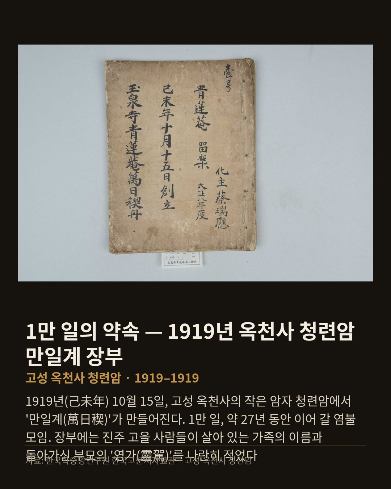
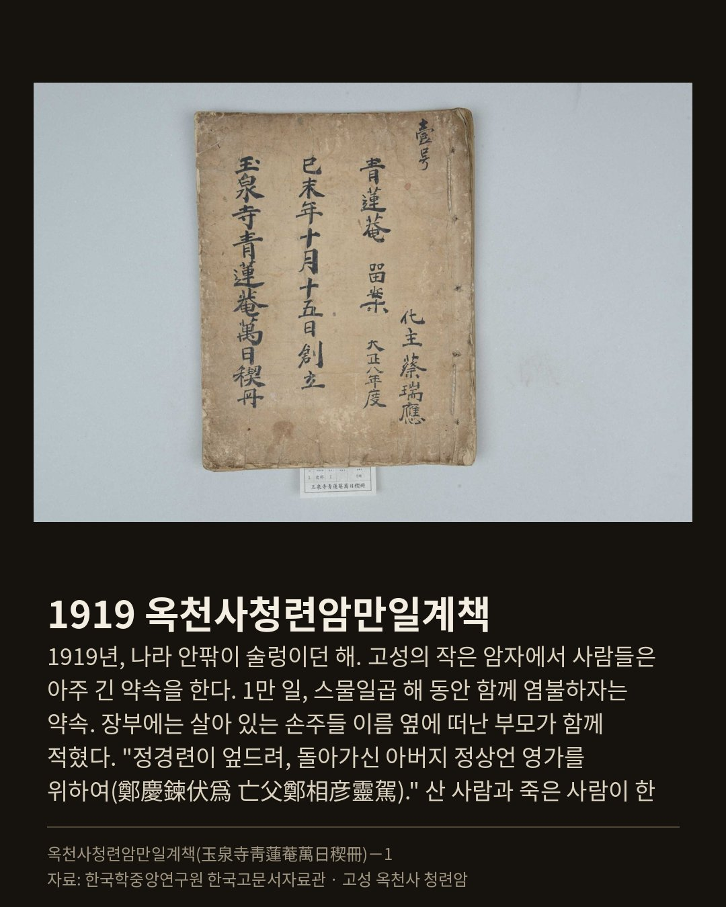
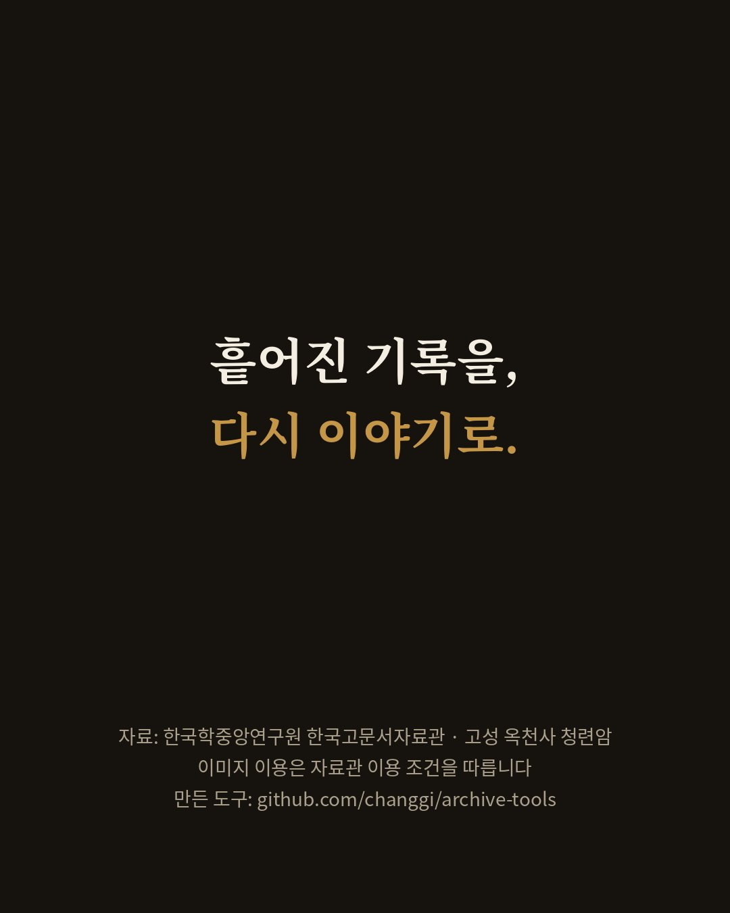

# EP.87 1만 일의 약속 — 1919년 옥천사 청련암 만일계 장부

고성 옥천사 청련암 (사찰) · 1919년(己未年) 10월 15일, 고성 옥천사의 작은 암자 청련암에서 '만일계(萬日稧)'가 만들어진다. 1만 일, 약 27년 동안 이어 갈 염불 모임. 장부에는 진주 고을 사람들이 살아 있는 가족의 이름과 돌아가신 부모의 '영가(靈駕)'를 나란히 적었다

- 🌐 [전시 웹페이지](https://changgi.github.io/archive-tools/examples/cheongnyeonam/exhibit.html) (한자 위 한글 독음 · 원문 해석) · [수업 활동지](https://changgi.github.io/archive-tools/examples/cheongnyeonam/handout.html)
- 🎬 영상: [릴스 9:16](https://changgi.github.io/archive-tools-next/media/ep87-cheongnyeonam_reel.mp4) · [가로 16:9](https://changgi.github.io/archive-tools-next/media/ep87-cheongnyeonam_wide.mp4) · 홍보 글: [`promo.md`](promo.md)
- 카드뉴스: [`cards/`](cards/) · SNS 글: [`sns.txt`](sns.txt) · 판독·해석 표: [`selection.csv`](selection.csv)


<!-- DELIVERY -->
## 전달 에디팅 — 이 기록을 이렇게 전합니다

- **핵심 정서** — 긴 약속
- **한 문장** — 격동의 해에도 사람들은 긴 약속으로 서로를 붙잡았다는 것.
- **열기** — 1919년, 사람들은 1만 일 동안의 약속을 했습니다.
- **펼치기** — 옥천사청련암만일계책－1 (1919년) — 만일계의 '1만 일'이라는 시간을 표지에 세우고, 산 자와 죽은 자가 나란히 적힌 장부의 모습을 보여 주었습니다.
- **절정** — "정경련이 엎드려, 돌아가신 아버지 정상언 영가를 위하여(鄭慶鍊伏爲 亡父鄭相彦靈駕)" — 화면·공간에서 이 한 줄만 크게, 소리를 줄여 집중
- **여운** — 1919년에 시작한 1만 일은 1946년에 끝났을 텐데, 그때 그들은 어떤 세상을 보았을까요? — 질문으로 끝내고 답은 보는 사람에게
- **감각과 물질** — 1만 개의 점을 찍는 참여 벽 — 하루 한 점 · 책장을 넘기는 소리, 확대 열람대
- **통로와 매개** — 온라인: 릴스(열기) → 카드뉴스(펼치기) → 전시 웹페이지(절정·원문) → 비하인드 카드(여운) / 오프라인: 원본 크기 복제·낭독·참여 벽 / 남기기: 활동지·질문 카드
- **여운 장치** — "1만 일 동안 하고 싶은 일"
- **전달 에디팅 전** — 1건의 문서를 1919년 연대순으로 놓고 문서명 · 유형 · 해설을 붙인다 — 정확하지만, 지나가면 잊힌다.
- **전달 에디팅 후** — 핵심 정서는 「긴 약속」. 「1919년, 사람들은 1만 일 동안의 약속을 했습니다.」로 열고, 문서를 한 장의 집중로 펼친 뒤, "정경련이 엎드려, 돌아가신 아버지 정상언 영가를 위하여(鄭慶鍊伏爲 亡父鄭相彦靈駕)"에서 멈춘다. 1만 개의 점을 찍는 참여 벽 — 하루 한 점. 마지막엔 「"1만 일 동안 하고 싶은 일"」로 보는 사람이 자기 이야기를 남기고 떠나게 한다.

전문: [`delivery.md`](delivery.md)
<!-- /DELIVERY -->

<!-- CURATOR -->
## 비하인드 — 큐레이터 노트

- **왜 이 문서들인가** — 1919년 작은 암자에서 '1만 일(27년)' 동안 염불하자는 약속을 하고, 산 가족과 돌아가신 부모를 한 장부에 적었습니다.
- **전하고 싶은 것** — 격동의 해에도 사람들은 긴 약속으로 서로를 붙잡았다는 것.
- **이렇게 보이길 바랐다** — 만일계의 '1만 일'이라는 시간을 표지에 세우고, 산 자와 죽은 자가 나란히 적힌 장부의 모습을 보여 주었습니다.
- **이렇게 써 주세요** — 근대 불교 신앙 결사, 지역 공동체 기록 수업에 쓰세요.
- **만들며 있었던 일** — 5책 가운데 1책만 다뤘습니다. 실제 이름이 적힌 명부라 개인 정보에 유의해 이용하세요.
- **남겨 둔 질문** — 1919년에 시작한 1만 일은 1946년에 끝났을 텐데, 그때 그들은 어떤 세상을 보았을까요?
- **제작 기록** — 문서 1건 · 1919년 · 원본 사진 3면(문서 전체) · 원문 판독 1건 · 번역 1건

전문: [`curator.md`](curator.md)
<!-- /CURATOR -->

## 이야기 — 사료가 말하는 대로

1919년, 사람들은 1만 일 동안의 약속을 했습니다.

> **1919 옥천사청련암만일계책** — 1919년, 나라 안팎이 술렁이던 해. 고성의 작은 암자에서 사람들은 아주 긴 약속을 한다. 1만 일, 스물일곱 해 동안 함께 염불하자는 약속. 장부에는 살아 있는 손주들 이름 옆에 떠난 부모가 함께 적혔다. "정경련이 엎드려, 돌아가신 아버지 정상언 영가를 위하여(鄭慶鍊伏爲 亡父鄭相彦靈駕)." 산 사람과 죽은 사람이 한 장부에 나란히 앉았다.

| 표지 | 1번 카드 | 마무리 |
|---|---|---|
|  |  |  |

## 선별 문서 (1점)

| # | 연도 | 유형 | 문서명 | 원본 |
|---|---|---|---|---|
| 1 | 1919 | 옥천사청련암만일계책 | 옥천사청련암만일계책(玉泉寺靑蓮菴萬日稧冊)－1 | [원본 보기](https://archive.aks.ac.kr/viewer/viewer.do#imgnode.do?itemId=book&gubun=booktree&depth=6&upPath=05%5E0547%5EL054702%5EL054702F01%5EL054702F0102&dataId=G002%2BKHD%2BKSM-WZ.0000.0000-20160507.C0705_001_00001_XXX&itemType=) |

## 원문 판독과 해석

### 1. 옥천사청련암만일계책(玉泉寺靑蓮菴萬日稧冊)－1

**원문 판독**

```
(표지)
壹號
靑蓮菴　留案
化主 蔡瑞應　大正八年度
己未年十月十五日創立
玉泉寺靑蓮菴萬日稧冊

(본문 · 부분)
晉州郡飛鳳洞居住
乙卯生 李氏 安樂行
辛亥生 鄭慶鍊　(兩主)
子婦 癸卯生 李氏
次子 辛巳生 慶敏　庚辰生 金氏
孫子 癸丑生 亨圭　次孫 乙卯生 甲圭
三孫 己未生 奉圭　甲寅生 鎭圭
鄭慶鍊 伏爲　亡父 鄭相彦 靈駕　亡弟 鄭慶俊 靈駕

晉州郡平安洞居住
坤命 辛未生 宋氏 德雲華 伏爲
亡父 宋達悟　亡母 密陽朴氏　兩位靈駕
率子 丙申生 徐相鄕　次子 乙巳生 徐相提
三子 庚戌生 徐相贊現　孫子 壬子生 徐丙鈺 …
徐相鄕 伏爲　亡父 嘉善大夫中樞府使兼同知 徐仁伊　兩位靈駕
```

**원문 해석** (표지) 1호. 청련암 보관본. 화주 채서응, 다이쇼 8년(1919)도. 기미년 10월 15일 창립. 옥천사 청련암 만일계 책. (본문) 진주군 비봉동 거주: 을묘생 이씨(법명 안락행), 신해생 정경련 [부부], 며느리 계묘생 이씨, 둘째 아들 신사생 경민, 경진생 김씨, 손자 계축생 형규, 둘째 손자 을묘생 갑규, 셋째 손자 기미생 봉규, 갑인생 진규. 정경련이 엎드려 돌아가신 아버지 정상언 영가, 돌아가신 아우 정경준 영가를 위하여. / 진주군 평안동 거주: 곤명(여성) 신미생 송씨(법명 덕운화)가 엎드려 돌아가신 아버지 송달오, 어머니 밀양박씨 두 분 영가를 위하여. 거느린 아들 병신생 서상향, 둘째 아들 을사생 서상제, 셋째 아들 경술생 서상찬 … 서상향이 엎드려 돌아가신 아버지 가선대부 중추부사 겸 동지 서인이 [내외] 두 분 영가를 위하여.

**해제** 1919년 10월 경남 고성 옥천사의 부속 암자 청련암에서 만든 만일계(萬日稧)의 계원 명부입니다. 만일계는 1만 일(약 27년) 동안 염불·기도를 이어 가기로 하고 신도들이 곡식이나 돈을 모아 운영한 불교 신앙 결사입니다. 화주(化主, 모금 책임 승려)는 채서응. 명부에는 가구별로 거주지, 살아 있는 가족의 생년(간지)과 이름, 그리고 '伏爲(엎드려 ~를 위하여)' 아래 돌아가신 조상의 영가(靈駕)를 적어, 산 자와 죽은 자의 복을 함께 빌었습니다. 여성은 '곤명(坤命)'이라 하고 법명을 함께 썼습니다. 3·1운동이 일어난 해의 지역 신앙 공동체를 보여 주는 자료입니다. 이 책은 5책 가운데 1책입니다.

판독·해석·이야기는 이미지에 근거한 초안이며(검토 전 "초안" 표시), 정확한 판독은 원문 확인이 필요합니다. □는 읽지 못한 글자, (?)는 불확실한 글자입니다.
이미지: 한국학중앙연구원 한국고문서자료관 소장·제공. "원본" 링크를 누르면 자료관 뷰어에서 그 문서가 열립니다. 재사용은 자료관에 문의하세요(소장처 동의 필요).
