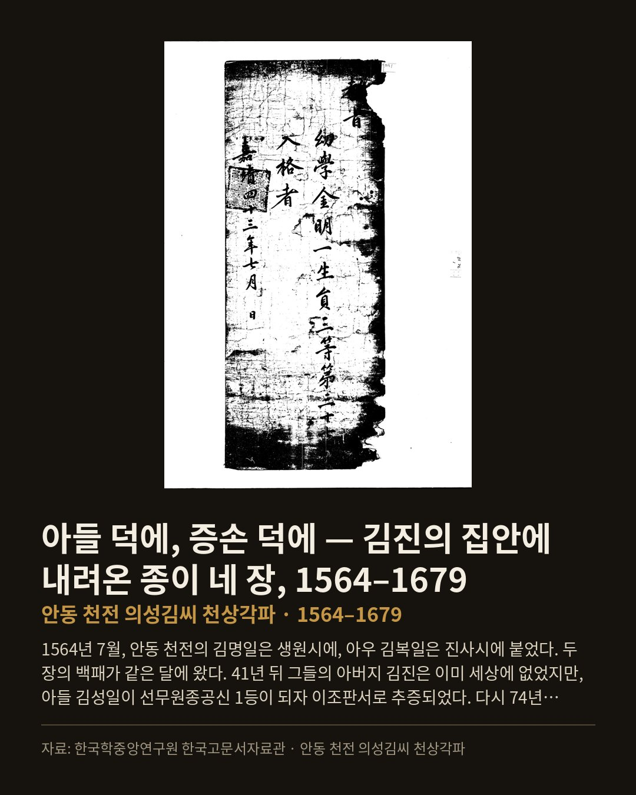
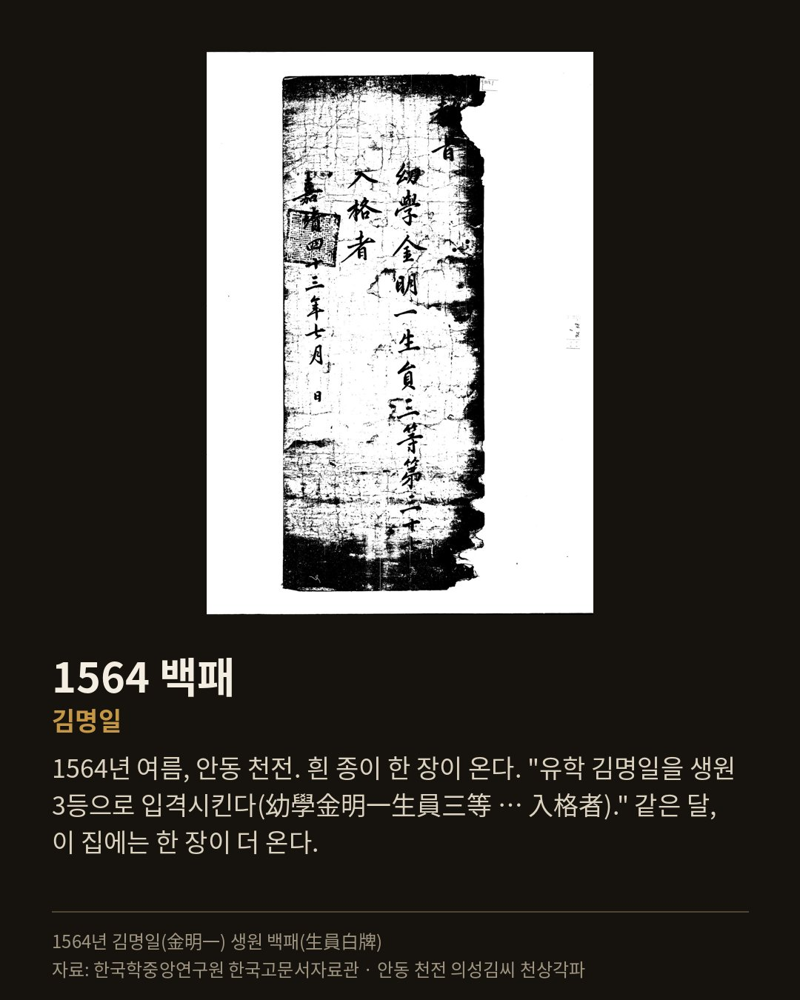

# EP.185 아들 덕에, 증손 덕에 — 김진의 집안에 내려온 종이 네 장, 1564–1679

안동 천전 의성김씨 천상각파 (문중) · 1564년 7월, 안동 천전의 김명일은 생원시에, 아우 김복일은 진사시에 붙었다. 두 장의 백패가 같은 달에 왔다. 41년 뒤 그들의 아버지 김진은 이미 세상에 없었지만, 아들 김성일이 선무원종공신 1등이 되자 이조판서로 추증되었다. 다시 74년 뒤에는 김복일이 증손 덕에 종부시정으로 추증되었다. 한 집안에서, 명예는 아래에서 위로도 올라갔다

- 🌐 [전시 웹페이지](https://changgi.github.io/archive-tools/examples/cheonsang-baekpae/exhibit.html) (한자 위 한글 독음 · 원문 해석) · [수업 활동지](https://changgi.github.io/archive-tools/examples/cheonsang-baekpae/handout.html)
- 🎬 영상: [릴스 9:16](https://changgi.github.io/archive-tools-next/media/ep185-cheonsang-baekpae_reel.mp4) · [가로 16:9](https://changgi.github.io/archive-tools-next/media/ep185-cheonsang-baekpae_wide.mp4) · 홍보 글: [`promo.md`](promo.md)
- 카드뉴스: [`cards/`](cards/) · SNS 글: [`sns.txt`](sns.txt) · 판독·해석 표: [`selection.csv`](selection.csv)

<!-- DELIVERY -->
## 전달 에디팅 — 이 기록을 이렇게 전합니다

- **핵심 정서** — 뿌듯함
- **한 문장** — 조선의 명예는 위에서 아래로만 내려가지 않았다 — 아들이 공신이 되면 아버지가, 증손이 높은 벼슬에 오르면 증조가 벼슬을 받았다. 추증교지 왼쪽의 작은 글씨는 '누구 덕인지'를 적은 영수증이다.
- **열기** — 아들이 공을 세우자, 세상을 떠난 아버지가 판서가 되었습니다.
- **펼치기** — 김명일 생원 백패 → 김복일 진사 백패 → 김진 추증교지 → 김복일 추증교지 (1564–1679년) — 1564년 7월 형 김명일의 생원 백패 → 같은 달 아우 김복일의 진사 백패 → 1605년 아들 김성일의 공신 책훈으로 아버지 김진이 받은 추증 → 1679년 증손의 벼슬로 김복일이 받은 추증으로, 연도 순서대로 놓았습니다.
- **절정** — "김성일의 아버지이므로(金誠一考)" — 화면·공간에서 이 한 줄만 크게, 소리를 줄여 집중
- **여운** — 같은 달 붙은 두 형제는, 백패를 나란히 펼쳐 놓고 무슨 이야기를 했을까요? — 질문으로 끝내고 답은 보는 사람에게
- **감각과 물질** — 1605년 교지 왼쪽 작은 글씨 '金誠一 考 宣武原從功臣一等 依承傳追贈' · 흰 종이 한 장에 조명 하나 · 어보·관인 탁본 스탬프를 찍어 보는 체험
- **통로와 매개** — 온라인: 릴스(열기) → 카드뉴스(펼치기) → 전시 웹페이지(절정·원문) → 비하인드 카드(여운) / 오프라인: 원본 크기 복제·낭독·참여 벽 / 남기기: 활동지·질문 카드
- **여운 장치** — 집안 어른의 상장 · 졸업장을 나란히 놓아 보기
- **전달 에디팅 전** — 4건의 문서를 1564–1679년 연대순으로 놓고 문서명 · 유형 · 해설을 붙인다 — 정확하지만, 지나가면 잊힌다.
- **전달 에디팅 후** — 핵심 정서는 「뿌듯함」. 「아들이 공을 세우자, 세상을 떠난 아버지가 판서가 되었습니다.」로 열고, 문서를 대비와 순서로 펼친 뒤, "김성일의 아버지이므로(金誠一考)"에서 멈춘다. 1605년 교지 왼쪽 작은 글씨 '金誠一 考 宣武原從功臣一等 依承傳追贈'. 마지막엔 「집안 어른의 상장 · 졸업장을 나란히 놓아 보기」로 보는 사람이 자기 이야기를 남기고 떠나게 한다.

전문: [`delivery.md`](delivery.md)
<!-- /DELIVERY -->

<!-- CURATOR -->
## 비하인드 — 큐레이터 노트

- **왜 이 문서들인가** — EP.71 · EP.183에서 이 집안의 홍패 · 유지 · 계후입안을 읽었습니다. 같은 집안에 1564년 형제의 백패와, 그 아버지 · 형제가 뒤에 받은 추증교지가 함께 남아 있어, 한 집안의 4대를 잇는 네 장을 골랐습니다.
- **전하고 싶은 것** — 조선의 명예는 위에서 아래로만 내려가지 않았다 — 아들이 공신이 되면 아버지가, 증손이 높은 벼슬에 오르면 증조가 벼슬을 받았다. 추증교지 왼쪽의 작은 글씨는 '누구 덕인지'를 적은 영수증이다.
- **이렇게 보이길 바랐다** — 1564년 7월 형 김명일의 생원 백패 → 같은 달 아우 김복일의 진사 백패 → 1605년 아들 김성일의 공신 책훈으로 아버지 김진이 받은 추증 → 1679년 증손의 벼슬로 김복일이 받은 추증으로, 연도 순서대로 놓았습니다.
- **이렇게 써 주세요** — 생원 · 진사시(사마시)와 백패, 등수 표기, 선무원종공신과 추증, 『경국대전』의 3대 추증 규정, 한 문중 안의 형제 · 부자 · 증손 관계 수업에 쓰세요.
- **만들며 있었던 일** — 1564년 두 백패는 흑백 복사본이라, 김명일 백패의 등수는 '第二十□人'까지만 읽었습니다. 1679년 추증교지 왼쪽의 작은 글씨 가운데 증손의 이름 끝 글자는 확정하지 못했습니다. 김명일 · 김복일이 김진의 아들이고 김성일과 형제라는 것은 이 집안의 잘 알려진 계보를 따랐으며, 1605년 교지의 작은 글씨 '金誠一 考'로 김진과 김성일의 관계를 확인했습니다.
- **남겨 둔 질문** — 같은 달 붙은 두 형제는, 백패를 나란히 펼쳐 놓고 무슨 이야기를 했을까요?
- **제작 기록** — 문서 4건 · 1564–1679년 · 원본 사진 4면(문서 전체) · 원문 판독 4건 · 번역 4건 · 못 읽은 글자 □ 2 · 불확실 (?) 0

전문: [`curator.md`](curator.md) · 비하인드 카드: [`behind/`](behind/) · 채널별 홍보안: [`channels.md`](channels.md)
<!-- /CURATOR -->

## 이야기 — 사료가 말하는 대로

아들이 공을 세우자, 세상을 떠난 아버지가 판서가 되었습니다.

> **1564 백패** — 1564년 여름, 안동 천전. 흰 종이 한 장이 온다. "유학 김명일을 생원 3등으로 입격시킨다(幼學金明一生員三等 … 入格者)." 같은 달, 이 집에는 한 장이 더 온다.
> **1564 백패** — 둘째 장. 이번에는 아우다. "유학 김복일을 진사 3등 제48인으로 입격시킨다(幼學金復一進士三等第四十八人入格者)." 형은 생원, 아우는 진사. 같은 달, 같은 집에 흰 종이가 두 장.
> **1605 추증교지** — 마흔한 해 뒤, 1605년 가을. 아버지 김진에게 교지가 온다. 그는 이미 세상에 없다. "자헌대부 이조판서를 추증한다." 왜일까. 왼쪽 작은 글씨가 답한다. "김성일의 아버지이므로(金誠一考)", 임진왜란의 공신 1등. 그 아들도 이미 세상에 없다. 떠난 아들의 공이, 떠난 아버지를 판서로 만들었다.
> **1679 추증교지** — 그리고 1679년 정월. 115년 전 진사가 되었던 김복일에게 또 한 장의 교지가 온다. "종부시정을 추증한다." 이번에는 증손 덕이다. "경주부윤 김□의 증조할아버지이므로(曾祖考) 『대전』에 따라 추증한다." 아들 덕에 아버지가, 증손 덕에 증조가. 이 집안의 명예는 아래에서 위로도 올라갔다.

| 표지 | 1번 카드 | 마무리 |
|---|---|---|
|  |  |  |

## 선별 문서 (4점)

| # | 연도 | 유형 | 문서명 | 원본 |
|---|---|---|---|---|
| 1 | 1564 | 백패 | 1564년 김명일(金明一) 생원 백패(生員白牌) | [원본 보기](https://archive.aks.ac.kr/viewer/viewer.do#imgnode.do?itemId=book&gubun=booktree&depth=6&upPath=01%5E0167%5EL016707%5EL016707F02%5EL016707F0201&dataId=G002%2BAKS%2BKSM-XA.1564.1111-20101008.B005p_005_00080_XXX&itemType=) |
| 2 | 1564 | 백패 | 1564년 김복일(金復一) 진사 백패(進士白牌) | [원본 보기](https://archive.aks.ac.kr/viewer/viewer.do#imgnode.do?itemId=book&gubun=booktree&depth=6&upPath=01%5E0167%5EL016707%5EL016707F02%5EL016707F0201&dataId=G002%2BAKS%2BKSM-XA.1564.1111-20101008.B005w_005_00211_XXX&itemType=) |
| 3 | 1605 | 추증교지 | 1605년 김진(金璡) 추증교지(追贈敎旨) | [원본 보기](https://archive.aks.ac.kr/viewer/viewer.do#imgnode.do?itemId=book&gubun=booktree&depth=6&upPath=01%5E0167%5EL016707%5EL016707F02%5EL016707F0201&dataId=G002%2BAKS%2BKSM-XA.1605.1111-20101008.B005a_005_00002_XXX&itemType=) |
| 4 | 1679 | 추증교지 | 1679년 김복일(金復一) 추증교지(追贈敎旨) | [원본 보기](https://archive.aks.ac.kr/viewer/viewer.do#imgnode.do?itemId=book&gubun=booktree&depth=6&upPath=01%5E0167%5EL016707%5EL016707F02%5EL016707F0201&dataId=G002%2BAKS%2BKSM-XA.1679.1111-20101008.B005x_005_00220_XXX&itemType=) |

## 원문 판독과 해석

### 1. 1564년 김명일(金明一) 생원 백패(生員白牌)

**원문 판독**

```
敎旨
幼學金明一生員三等第二十□
人入格者
嘉靖四十三年七月 日
```

**원문 해석** 교지. 유학 김명일을 생원 3등 제2□인으로 입격시킨다. 가정 43년(1564) 7월 일.

**해제** 1564년(명종 19) 7월, 김명일(金明一)이 생원시에 입격하고 받은 백패(白牌)입니다. 생원시와 진사시를 합쳐 사마시(司馬試) 또는 소과라 하며, 합격자에게는 흰 종이에 쓴 백패를 주었습니다. 생원은 경학(經學), 진사는 시문(詩文)으로 뽑았습니다. 성적은 1등 5명, 2등 25명, 3등 70명으로 나눠 적었는데, 김명일은 3등이었습니다. 등수 숫자의 끝 글자는 종이가 상해 읽지 못했습니다. 이 사진은 흑백으로 대비를 높인 복사본이라 종이의 실제 색은 볼 수 없습니다.

### 2. 1564년 김복일(金復一) 진사 백패(進士白牌)

**원문 판독**

```
敎旨
幼學金復一進士三等第四十八人入格
者
嘉靖四十三年七月 日
```

**원문 해석** 교지. 유학 김복일을 진사 3등 제48인으로 입격시킨다. 가정 43년(1564) 7월 일.

**해제** 같은 1564년 7월, 김명일의 아우 김복일(金復一)이 진사시에 입격하고 받은 백패입니다. 형은 생원시, 아우는 진사시로 같은 해 같은 달의 사마시에 함께 붙었습니다. 진사 3등 제48인입니다. 두 백패는 크기와 글씨 배치, 날짜가 같아 한 묶음으로 보관되어 왔습니다. 이 형제의 아버지가 김진(金璡)이고, 형제 가운데 한 사람이 뒤에 임진왜란 때 경상도 초유사로 활약한 김성일(金誠一)입니다.

### 3. 1605년 김진(金璡) 추증교지(追贈敎旨)

**원문 판독**

```
敎旨
贈嘉善大夫吏曹參判兼同知
義禁府事金璡贈資憲大夫
吏曹判書兼知義禁府事者
萬曆三十三年九月三十日
(작은 글씨) 贈嘉義大夫吏曹參判兼同知經筵義禁府春秋館成均館
事弘文館提學藝文館提學世子左副賓客金誠一考宣武
原從功臣一等依承 傳追贈
```

**원문 해석** 교지. 증 가선대부 이조참판 겸 동지의금부사 김진에게 자헌대부 이조판서 겸 지의금부사를 추증한다. 만력 33년(1605) 9월 30일. (작은 글씨) 증 가의대부 이조참판 … 세자좌부빈객 김성일의 아버지이므로, 선무원종공신 1등에 따라 전교를 받들어 추증한다.

**해제** 41년 뒤인 1605년(선조 38) 9월, 형제의 아버지 김진(金璡)에게 자헌대부(정2품) 이조판서를 추증한 교지입니다. 김진은 이미 가선대부(종2품) 이조참판으로 추증되어 있었는데, 한 단계 더 올랐습니다. 이유는 왼쪽 작은 글씨에 있습니다. '김성일의 아버지이므로(金誠一考), 선무원종공신 1등에 따라(宣武原從功臣一等) 전교를 받들어 추증한다.' 선무원종공신은 임진왜란에 공을 세운 사람들에게 내린 공신 칭호로, 1605년에 책훈되었습니다. 김성일은 1593년 진주에서 세상을 떠났으므로, 이 교지는 세상을 떠난 아들의 공으로 세상을 떠난 아버지가 벼슬을 받은 문서입니다. 김성일 자신도 '증 가의대부'로 적혀 있습니다.

### 4. 1679년 김복일(金復一) 추증교지(追贈敎旨)

**원문 판독**

```
敎旨
通訓大夫行成均館
司成兼春秋館編修
官金復一贈通訓大
夫宗簿寺正兼春秋
館編修官者
康熙十八年正月十一日
(작은 글씨) 通政大夫行慶州府尹慶州鎭兵馬節制使金□曾祖考依大典追贈
```

**원문 해석** 교지. 통훈대부 행 성균관 사성 겸 춘추관 편수관 김복일에게 통훈대부 종부시정 겸 춘추관 편수관을 추증한다. 강희 18년(1679) 정월 11일. (작은 글씨) 통정대부 행 경주부윤 경주진 병마절제사 김□의 증조할아버지이므로 『대전』에 따라 추증한다.

**해제** 다시 74년 뒤인 1679년(숙종 5) 정월, 1564년 진사 백패를 받았던 김복일에게 종부시정(정3품)을 추증한 교지입니다. 김복일은 생전에 문과에 급제해 성균관 사성(종3품)까지 올랐습니다. 이번 추증의 근거는 왼쪽 작은 글씨 '경주부윤 김□의 증조할아버지이므로(曾祖考) 『대전』에 따라 추증한다'입니다. 증손이 정3품 당상 통정대부의 경주부윤이 되자, 『경국대전』의 3대 추증 규정에 따라 증조에게도 벼슬이 내려간 것입니다(EP.156 · EP.168 참조). 증손 이름의 끝 글자는 확정하지 못했습니다. 같은 날 같은 이유로 김지(金潪) · 채씨(蔡氏)에게 내린 추증교지도 함께 남아 있습니다.

판독·해석·이야기는 이미지에 근거한 초안이며(검토 전 "초안" 표시), 정확한 판독은 원문 확인이 필요합니다. □는 읽지 못한 글자, (?)는 불확실한 글자입니다.
이미지: 한국학중앙연구원 한국고문서자료관 소장·제공. "원본" 링크를 누르면 자료관 뷰어에서 그 문서가 열립니다. 재사용은 자료관에 문의하세요(소장처 동의 필요).
