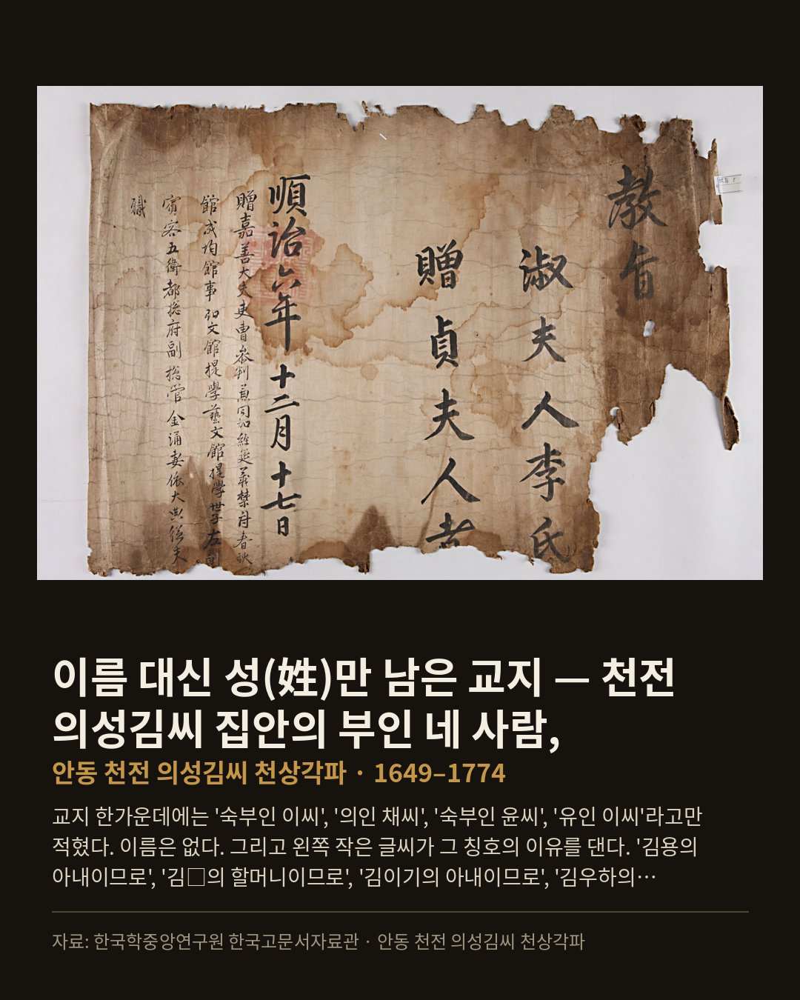
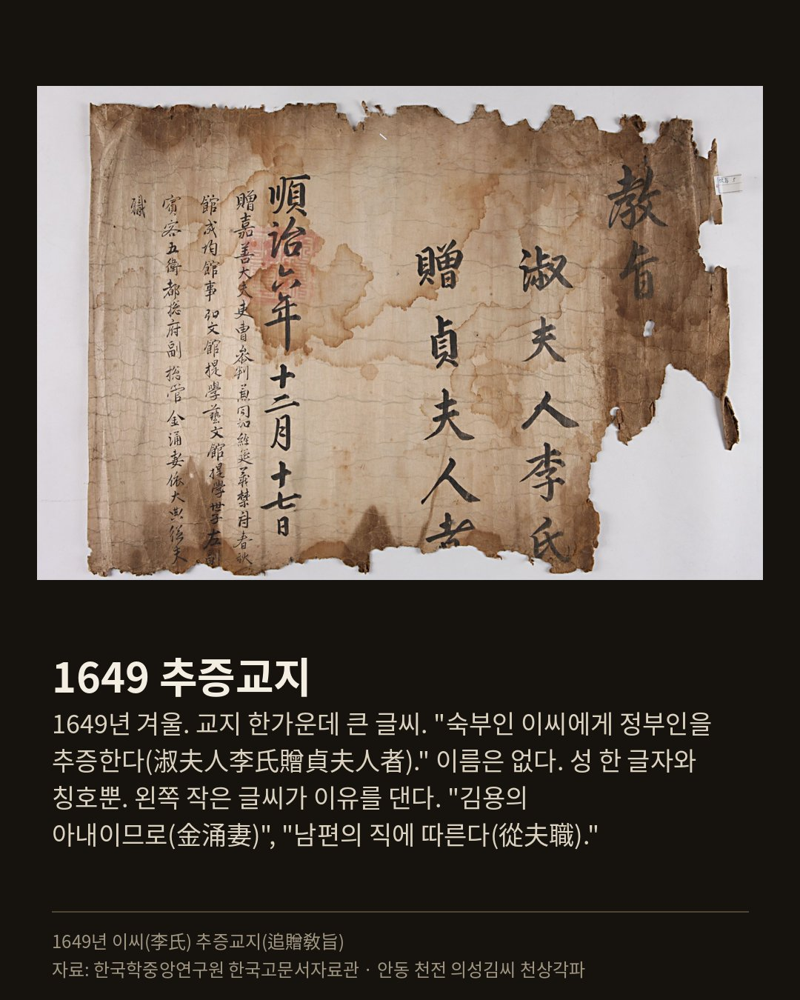

# EP.188 이름 대신 성(姓)만 남은 교지 — 천전 의성김씨 집안의 부인 네 사람, 1649–1774

안동 천전 의성김씨 천상각파 (문중) · 교지 한가운데에는 '숙부인 이씨', '의인 채씨', '숙부인 윤씨', '유인 이씨'라고만 적혔다. 이름은 없다. 그리고 왼쪽 작은 글씨가 그 칭호의 이유를 댄다. '김용의 아내이므로', '김□의 할머니이므로', '김이기의 아내이므로', '김우하의 아내이므로'. 125년 동안 이 집안 여성들이 받은 정부인 · 숙부인의 칭호는, 언제나 다른 사람의 이름 옆에 있었다

- 🌐 [전시 웹페이지](https://changgi.github.io/archive-tools/examples/cheonsang-buin/exhibit.html) (한자 위 한글 독음 · 원문 해석) · [수업 활동지](https://changgi.github.io/archive-tools/examples/cheonsang-buin/handout.html)
- 🎬 영상: [릴스 9:16](https://changgi.github.io/archive-tools-next/media/ep188-cheonsang-buin_reel.mp4) · [가로 16:9](https://changgi.github.io/archive-tools-next/media/ep188-cheonsang-buin_wide.mp4) · 홍보 글: [`promo.md`](promo.md)
- 카드뉴스: [`cards/`](cards/) · SNS 글: [`sns.txt`](sns.txt) · 판독·해석 표: [`selection.csv`](selection.csv)

<!-- DELIVERY -->
## 전달 에디팅 — 이 기록을 이렇게 전합니다

- **핵심 정서** — 애잔함
- **한 문장** — 조선의 여성 칭호(외명부)는 남편 · 아들 · 손자의 품계를 따라 정해졌다 — 그래서 교지 본문에는 성(姓)과 칭호만 남고, 왼쪽 작은 글씨에 '누구의 아내 · 할머니이므로'라는 근거가 적혔다.
- **열기** — 교지에 적힌 것은 그녀의 이름이 아니라, 성(姓) 한 글자였습니다.
- **펼치기** — 이씨 추증교지 → 채씨 추증교지 → 윤씨 추증교지 (1649–1774년) — 1649 숙부인 이씨 → 정부인(남편 김용) → 1679 의인 채씨 → 숙부인(손자 김□) → 1708 숙부인 윤씨 → 정부인(남편 김이기) → 1774 유인 이씨 → 숙부인(남편 김우하)으로 놓았습니다.
- **절정** — "남편의 직에 따른다(從夫職)" — 화면·공간에서 이 한 줄만 크게, 소리를 줄여 집중
- **여운** — 성 한 글자로만 남은 네 사람, 그들의 이름은 무엇이었을까요? — 질문으로 끝내고 답은 보는 사람에게
- **감각과 물질** — 본문 '淑夫人李氏'와 왼쪽 작은 글씨 '金涌妻 依大典從夫職' · 어보·관인 탁본 스탬프를 찍어 보는 체험
- **통로와 매개** — 온라인: 릴스(열기) → 카드뉴스(펼치기) → 전시 웹페이지(절정·원문) → 비하인드 카드(여운) / 오프라인: 원본 크기 복제·낭독·참여 벽 / 남기기: 활동지·질문 카드
- **여운 장치** — 족보에서 할머니 · 증조할머니의 이름 칸 찾아보기
- **전달 에디팅 전** — 4건의 문서를 1649–1774년 연대순으로 놓고 문서명 · 유형 · 해설을 붙인다 — 정확하지만, 지나가면 잊힌다.
- **전달 에디팅 후** — 핵심 정서는 「애잔함」. 「교지에 적힌 것은 그녀의 이름이 아니라, 성(姓) 한 글자였습니다.」로 열고, 문서를 대비와 순서로 펼친 뒤, "남편의 직에 따른다(從夫職)"에서 멈춘다. 본문 '淑夫人李氏'와 왼쪽 작은 글씨 '金涌妻 依大典從夫職'. 마지막엔 「족보에서 할머니 · 증조할머니의 이름 칸 찾아보기」로 보는 사람이 자기 이야기를 남기고 떠나게 한다.

전문: [`delivery.md`](delivery.md)
<!-- /DELIVERY -->

<!-- CURATOR -->
## 비하인드 — 큐레이터 노트

- **왜 이 문서들인가** — EP.178에서 오경덕의 두 아내가 같은 날 받은 교지를 읽었습니다. 안동 천전 의성김씨 집안에도 125년에 걸쳐 부인들의 추증교지가 남아 있어, 근거가 서로 다른 네 장을 골랐습니다.
- **전하고 싶은 것** — 조선의 여성 칭호(외명부)는 남편 · 아들 · 손자의 품계를 따라 정해졌다 — 그래서 교지 본문에는 성(姓)과 칭호만 남고, 왼쪽 작은 글씨에 '누구의 아내 · 할머니이므로'라는 근거가 적혔다.
- **이렇게 보이길 바랐다** — 1649 숙부인 이씨 → 정부인(남편 김용) → 1679 의인 채씨 → 숙부인(손자 김□) → 1708 숙부인 윤씨 → 정부인(남편 김이기) → 1774 유인 이씨 → 숙부인(남편 김우하)으로 놓았습니다.
- **이렇게 써 주세요** — 외명부 칭호(정부인 · 숙부인 · 숙인 · 의인 · 유인)와 품계의 대응, '종부직(從夫職)'과 3대 추증, 조선 문서에 여성 이름이 남지 않는 방식, 여성사 자료로서의 교지 수업에 쓰세요.
- **만들며 있었던 일** — 1679 · 1708 · 1774년 교지는 흑백 복사본이라, 작은 글씨의 일부 이름과 관직 글자는 비교적 선명한 것만 옮기고 흐린 글자는 □로 두었습니다. 1649년 교지는 오른쪽 위가 떨어져 나갔습니다. 네 부인이 언제 세상을 떠났는지, 친정이 어디였는지는 이 교지들로 알 수 없습니다.
- **남겨 둔 질문** — 성 한 글자로만 남은 네 사람, 그들의 이름은 무엇이었을까요?
- **제작 기록** — 문서 4건 · 1649–1774년 · 원본 사진 4면(문서 전체) · 원문 판독 4건 · 번역 4건 · 못 읽은 글자 □ 1 · 불확실 (?) 0 · 해제에 "확인 필요"를 단 문서 1건

전문: [`curator.md`](curator.md) · 비하인드 카드: [`behind/`](behind/) · 채널별 홍보안: [`channels.md`](channels.md)
<!-- /CURATOR -->

## 이야기 — 사료가 말하는 대로

교지에 적힌 것은 그녀의 이름이 아니라, 성(姓) 한 글자였습니다.

> **1649 추증교지** — 1649년 겨울. 교지 한가운데 큰 글씨. "숙부인 이씨에게 정부인을 추증한다(淑夫人李氏贈貞夫人者)." 이름은 없다. 성 한 글자와 칭호뿐. 왼쪽 작은 글씨가 이유를 댄다. "김용의 아내이므로(金涌妻)", "남편의 직에 따른다(從夫職)."
> **1679 추증교지** — 서른 해 뒤, 1679년 정월. 이번 교지는 "의인 채씨(宜人蔡氏)"에게 온다. 그녀를 높인 사람은 남편이 아니라 손자다. "경주부윤 김□의 할머니이므로(祖妣)". 같은 날, 같은 집에 교지가 세 장 왔다. 할아버지, 증조할아버지, 그리고 그녀.
> **1708 추증교지** — 1708년 여름. "숙부인 윤씨에게 정부인을 추증한다(淑夫人尹氏贈貞夫人者)." 작은 글씨의 남편 이름이 낯익다. "김이기의 아내이므로(金履基妻)". 다섯 해 전, 집안의 양자를 확인해 주던 그 어른이다. 남편이 오르자, 먼저 떠난 아내도 함께 올랐다.
> **1774 추증교지** — 그리고 1774년 봄. "유인 이씨에게 숙부인을 추증한다(孺人李氏贈淑夫人者)." 가장 낮은 칭호에서 단번에 올랐다. 이유는 같다. "김우하의 아내이므로", "남편의 직에 따른다." 백스물다섯 해, 네 사람. 교지에 남은 것은 성 한 글자와, 다른 사람의 이름이었다.

| 표지 | 1번 카드 | 마무리 |
|---|---|---|
|  |  |  |

## 선별 문서 (4점)

| # | 연도 | 유형 | 문서명 | 원본 |
|---|---|---|---|---|
| 1 | 1649 | 추증교지 | 1649년 이씨(李氏) 추증교지(追贈敎旨) | [원본 보기](https://archive.aks.ac.kr/viewer/viewer.do#imgnode.do?itemId=book&gubun=booktree&depth=6&upPath=01%5E0167%5EL016707%5EL016707F02%5EL016707F0201&dataId=G002%2BAKS%2BKSM-XA.1649.1111-20101008.B005j_005_00056_XXX&itemType=) |
| 2 | 1679 | 추증교지 | 1679년 채씨(蔡氏) 추증교지(追贈敎旨) | [원본 보기](https://archive.aks.ac.kr/viewer/viewer.do#imgnode.do?itemId=book&gubun=booktree&depth=6&upPath=01%5E0167%5EL016707%5EL016707F02%5EL016707F0201&dataId=G002%2BAKS%2BKSM-XA.1679.1111-20101008.B005x_005_00222_XXX&itemType=) |
| 3 | 1708 | 추증교지 | 1708년 윤씨(尹氏) 추증교지(追贈敎旨) | [원본 보기](https://archive.aks.ac.kr/viewer/viewer.do#imgnode.do?itemId=book&gubun=booktree&depth=6&upPath=01%5E0167%5EL016707%5EL016707F02%5EL016707F0201&dataId=G002%2BAKS%2BKSM-XA.1708.1111-20101008.B005l_005_00065_XXX&itemType=) |
| 4 | 1774 | 추증교지 | 1774년 이씨(李氏) 추증교지(追贈敎旨) | [원본 보기](https://archive.aks.ac.kr/viewer/viewer.do#imgnode.do?itemId=book&gubun=booktree&depth=6&upPath=01%5E0167%5EL016707%5EL016707F02%5EL016707F0201&dataId=G002%2BAKS%2BKSM-XA.1774.1111-20101008.B005m_005_00074_XXX&itemType=) |

## 원문 판독과 해석

### 1. 1649년 이씨(李氏) 추증교지(追贈敎旨)

**원문 판독**

```
敎旨
淑夫人李氏
贈貞夫人者
順治六年十二月十七日
(작은 글씨) 贈嘉善大夫吏曹參判兼同知經筵義禁府春秋
館成均館事弘文館提學藝文館提學世子左副
賓客五衛都摠府副摠管金涌妻依大典從夫職
```

**원문 해석** 교지. 숙부인 이씨에게 정부인을 추증한다. 순치 6년(1649) 12월 17일. (작은 글씨) 증 가선대부 이조참판 … 오위도총부 부총관 김용의 아내이므로 『대전』에 따라 남편의 직에 따른다.

**해제** 1649년(인조 27) 12월, 김용(金涌)의 아내 이씨에게 정부인(貞夫人)을 추증한 교지입니다. 김용은 EP.71에서 1590년 문과 홍패를 본 인물로, 임진왜란 때 의병으로 활약했고 세상을 떠난 뒤 가선대부(종2품) 이조참판으로 추증되었습니다. 남편이 종2품이 되었으니 아내도 정 · 종2품 관원 아내의 칭호인 정부인이 되었습니다. 그 전 칭호 숙부인(淑夫人)은 정3품 당상관의 아내 칭호입니다. 왼쪽 작은 글씨 '김용의 아내이므로(金涌妻) 『대전』에 따라 남편의 직에 따른다(從夫職)'가 근거입니다. 오른쪽 위가 떨어져 나갔습니다.

### 2. 1679년 채씨(蔡氏) 추증교지(追贈敎旨)

**원문 판독**

```
敎旨
宜人蔡氏
贈淑夫人
者
康熙十八年正月十一日
(작은 글씨) 通政大夫行慶州府尹慶州鎭兵馬節制使金□祖妣依大典追贈
```

**원문 해석** 교지. 의인 채씨에게 숙부인을 추증한다. 강희 18년(1679) 정월 11일. (작은 글씨) 통정대부 행 경주부윤 경주진 병마절제사 김□의 할머니이므로 『대전』에 따라 추증한다.

**해제** 1679년(숙종 5) 정월 11일, 의인(宜人, 정 · 종6품 관원의 아내 칭호) 채씨에게 숙부인(정3품 당상관 아내의 칭호)을 추증한 교지입니다. 이번 근거는 남편이 아니라 손자입니다. 왼쪽 작은 글씨가 '경주부윤 김□의 할머니이므로(祖妣)'라고 밝혀, 손자가 통정대부(정3품 당상)에 오르자 『경국대전』의 3대 추증 규정에 따라 할아버지 · 할머니가 함께 추증되었음을 보여 줍니다. 같은 날 같은 손자 덕에 김복일(증조, EP.185) · 김지(할아버지)도 추증되었습니다. 흑백 복사본입니다.

### 3. 1708년 윤씨(尹氏) 추증교지(追贈敎旨)

**원문 판독**

```
敎旨
淑夫人尹
氏贈貞夫
人者
康熙四十七年五月十四日
(작은 글씨) 嘉善大夫同知中樞府事金履基妻依法典從夫職
```

**원문 해석** 교지. 숙부인 윤씨에게 정부인을 추증한다. 강희 47년(1708) 5월 14일. (작은 글씨) 가선대부 동지중추부사 김이기의 아내이므로 법전에 따라 남편의 직에 따른다.

**해제** 1708년(숙종 34) 5월, 가선대부(종2품) 동지중추부사 김이기(金履基)의 아내 윤씨에게 정부인을 추증한 교지입니다. 김이기는 EP.183의 1703년 계후입안에서 '문장(門長) 부호군 김이기'로 나와 집안의 양자를 확인해 준 바로 그 사람입니다. 그 뒤 가선대부로 올랐고, 먼저 세상을 떠난 아내 윤씨에게도 정부인이 추증되었습니다. 남편은 살아서 오르고 아내는 세상을 떠난 뒤 '추증(贈)'으로 따라 오른 경우입니다. 흑백 복사본입니다.

### 4. 1774년 이씨(李氏) 추증교지(追贈敎旨)

**원문 판독**

```
敎旨
孺人李氏
贈淑夫人
者
乾隆三十九年二月十七日
(작은 글씨) 折衝將軍僉知中樞府事金禹河妻
依法典從夫職
```

**원문 해석** 교지. 유인 이씨에게 숙부인을 추증한다. 건륭 39년(1774) 2월 17일. (작은 글씨) 절충장군 첨지중추부사 김우하의 아내이므로 법전에 따라 남편의 직에 따른다.

**해제** 1774년(영조 50) 2월, 절충장군(정3품 당상) 첨지중추부사 김우하(金禹河)의 아내 이씨에게 숙부인을 추증한 교지입니다. 그 전 칭호 유인(孺人)은 정 · 종9품 관원의 아내 칭호이자, 벼슬 없는 선비의 아내를 높여 부르는 말로도 쓰였습니다. 유인에서 숙부인으로 단번에 여러 등을 건너뛴 것은, 남편이 정3품 당상의 품계(첨지중추부사는 실무 없는 명예직)에 올랐기 때문입니다. 1649년부터 125년 동안 네 장 모두 '누구의 아내 · 할머니이므로'라는 근거가 왼쪽 작은 글씨에 붙어 있습니다.

판독·해석·이야기는 이미지에 근거한 초안이며(검토 전 "초안" 표시), 정확한 판독은 원문 확인이 필요합니다. □는 읽지 못한 글자, (?)는 불확실한 글자입니다.
이미지: 한국학중앙연구원 한국고문서자료관 소장·제공. "원본" 링크를 누르면 자료관 뷰어에서 그 문서가 열립니다. 재사용은 자료관에 문의하세요(소장처 동의 필요).
