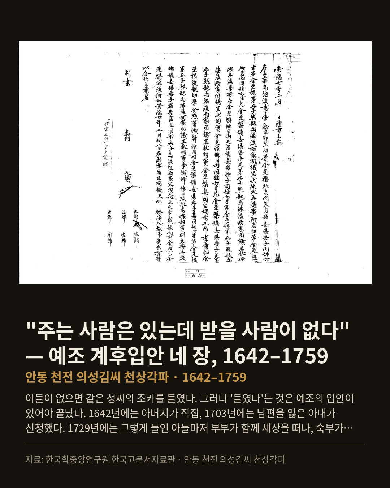
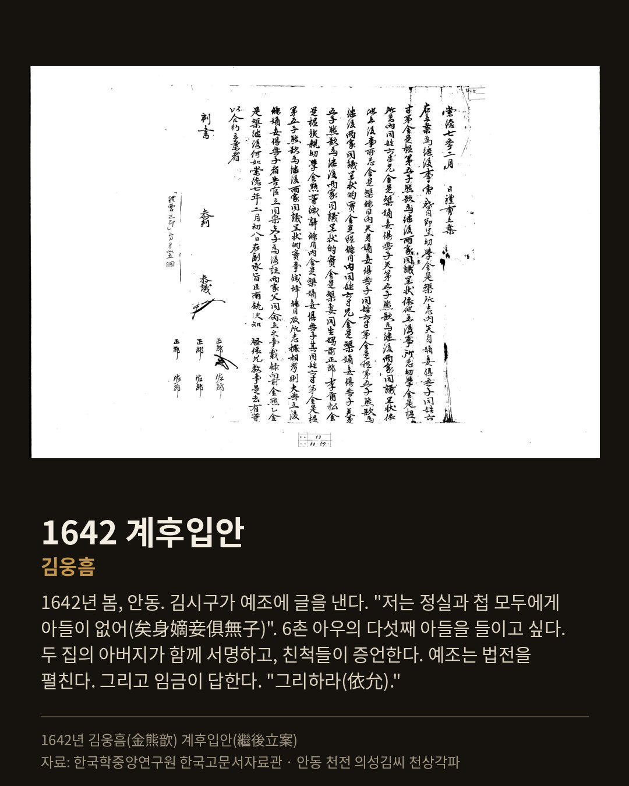

# EP.183 "주는 사람은 있는데 받을 사람이 없다" — 예조 계후입안 네 장, 1642–1759

안동 천전 의성김씨 천상각파 (문중) · 아들이 없으면 같은 성씨의 조카를 들였다. 그러나 '들였다'는 것은 예조의 입안이 있어야 끝났다. 1642년에는 아버지가 직접, 1703년에는 남편을 잃은 아내가 신청했다. 1729년에는 그렇게 들인 아들마저 부부가 함께 세상을 떠나, 숙부가 임금에게 글을 올렸다. 1759년에는 열두 촌 조카를 찾아냈지만, 받을 사람이 이미 없었다. '주는 사람은 있는데 받을 사람이 없다'

- 🌐 [전시 웹페이지](https://changgi.github.io/archive-tools/examples/cheonsang-gyehu/exhibit.html) (한자 위 한글 독음 · 원문 해석) · [수업 활동지](https://changgi.github.io/archive-tools/examples/cheonsang-gyehu/handout.html)
- 🎬 영상: [릴스 9:16](https://changgi.github.io/archive-tools-next/media/ep183-cheonsang-gyehu_reel.mp4) · [가로 16:9](https://changgi.github.io/archive-tools-next/media/ep183-cheonsang-gyehu_wide.mp4) · 홍보 글: [`promo.md`](promo.md)
- 카드뉴스: [`cards/`](cards/) · SNS 글: [`sns.txt`](sns.txt) · 판독·해석 표: [`selection.csv`](selection.csv)

<!-- DELIVERY -->
## 전달 에디팅 — 이 기록을 이렇게 전합니다

- **핵심 정서** — 애틋함과 절실함
- **한 문장** — 조선의 양자(입후)는 집안끼리 정하는 일이 아니라 예조가 증명해야 끝나는 일이었다 — 『경국대전』은 '양가 아버지가 함께 명하라'고 정했고, 그 틀에 맞지 않는 사정이 생길 때마다 아내 · 숙부 · 동생이 대신 나서거나 임금에게 직접 호소했다.
- **열기** — 아들을 들이려 했지만, 받을 사람이 이미 세상에 없었습니다.
- **펼치기** — 김웅흠 계후입안 → 김정하 계후입안 → 김상열 계후입안 → 김범남 계후입안 (1642–1759년) — 1642 아버지 김시구가 직접 신청 → 1703 남편을 잃은 노씨가 신청(아버지가 죽으면 어머니가 관에 고한다) → 1729 양자 김정하 부부가 입안 전에 죽어 숙부가 임금에게 상언 → 1759 형 부부가 함께 죽어 동생이 12촌 조카를 찾아 상언으로 놓았습니다.
- **절정** — "주는 사람은 있는데 받을 사람이 없어(與者有之而受者無人)" — 화면·공간에서 이 한 줄만 크게, 소리를 줄여 집중
- **여운** — 법이 정한 '가족이 되는 길'에서 벗어난 사람들은, 무엇으로 가족이 되었을까요? — 질문으로 끝내고 답은 보는 사람에게
- **감각과 물질** — 네 장 모두에 되풀이되는 '嫡妾俱無子' 그리고 1759년의 '與者有之而受者無人'
- **통로와 매개** — 온라인: 릴스(열기) → 카드뉴스(펼치기) → 전시 웹페이지(절정·원문) → 비하인드 카드(여운) / 오프라인: 원본 크기 복제·낭독·참여 벽 / 남기기: 활동지·질문 카드
- **여운 장치** — 가족관계 서류(입양 · 개명 · 후견)가 필요했던 순간 떠올리기
- **전달 에디팅 전** — 4건의 문서를 1642–1759년 연대순으로 놓고 문서명 · 유형 · 해설을 붙인다 — 정확하지만, 지나가면 잊힌다.
- **전달 에디팅 후** — 핵심 정서는 「애틋함과 절실함」. 「아들을 들이려 했지만, 받을 사람이 이미 세상에 없었습니다.」로 열고, 문서를 대비와 순서로 펼친 뒤, "주는 사람은 있는데 받을 사람이 없어(與者有之而受者無人)"에서 멈춘다. 네 장 모두에 되풀이되는 '嫡妾俱無子' 그리고 1759년의 '與者有之而受者無人'. 마지막엔 「가족관계 서류(입양 · 개명 · 후견)가 필요했던 순간 떠올리기」로 보는 사람이 자기 이야기를 남기고 떠나게 한다.

전문: [`delivery.md`](delivery.md)
<!-- /DELIVERY -->

<!-- CURATOR -->
## 비하인드 — 큐레이터 노트

- **왜 이 문서들인가** — EP.71에서 이 집안의 김용 홍패와 김성탁의 백패 · 홍패 · 유지를 읽었습니다. 같은 집안에 예조가 내린 계후입안(繼後立案)이 117년에 걸쳐 네 장 남아 있어, 누가 신청했는지가 달라지는 순서로 놓았습니다.
- **전하고 싶은 것** — 조선의 양자(입후)는 집안끼리 정하는 일이 아니라 예조가 증명해야 끝나는 일이었다 — 『경국대전』은 '양가 아버지가 함께 명하라'고 정했고, 그 틀에 맞지 않는 사정이 생길 때마다 아내 · 숙부 · 동생이 대신 나서거나 임금에게 직접 호소했다.
- **이렇게 보이길 바랐다** — 1642 아버지 김시구가 직접 신청 → 1703 남편을 잃은 노씨가 신청(아버지가 죽으면 어머니가 관에 고한다) → 1729 양자 김정하 부부가 입안 전에 죽어 숙부가 임금에게 상언 → 1759 형 부부가 함께 죽어 동생이 12촌 조카를 찾아 상언으로 놓았습니다.
- **이렇게 써 주세요** — 조선 후기 입후(立後) 제도와 『경국대전』 입후조, 예조 입안의 형식(소지 · 조목 · 함사 · 계목), 상언(上言)과 특명, 가계 계승과 종법, 기록이 만드는 '법적 가족' 수업에 쓰세요.
- **만들며 있었던 일** — 1642년 입안은 흑백 복사본이고 행서라, 생부의 이름 끝 글자(榅)와 증인들의 이름 일부는 확정하지 못해 □로 두었습니다. 1729년 김정하는 1703년에 입후된 바로 그 인물로 보았습니다(두 입안 모두 생부 김세호 · 김세일과 '정하'라는 이름이 같은 항렬). 1759년 김용하 · 김숙하와 앞의 사람들의 관계는 이 문서들로 확인하지 않았습니다.
- **남겨 둔 질문** — 법이 정한 '가족이 되는 길'에서 벗어난 사람들은, 무엇으로 가족이 되었을까요?
- **제작 기록** — 문서 4건 · 1642–1759년 · 원본 사진 4면(문서 전체) · 원문 판독 4건 · 번역 4건 · 못 읽은 글자 □ 3 · 불확실 (?) 0 · 해제에 "확인 필요"를 단 문서 2건

전문: [`curator.md`](curator.md) · 비하인드 카드: [`behind/`](behind/) · 채널별 홍보안: [`channels.md`](channels.md)
<!-- /CURATOR -->

## 이야기 — 사료가 말하는 대로

아들을 들이려 했지만, 받을 사람이 이미 세상에 없었습니다.

> **1642 계후입안** — 1642년 봄, 안동. 김시구가 예조에 글을 낸다. "저는 정실과 첩 모두에게 아들이 없어(矣身嫡妾俱無子)". 6촌 아우의 다섯째 아들을 들이고 싶다. 두 집의 아버지가 함께 서명하고, 친척들이 증언한다. 예조는 법전을 펼친다. 그리고 임금이 답한다. "그리하라(依允)."
> **1703 계후입안** — 예순한 해 뒤, 1703년. 이번에는 아버지가 없다. 남편을 먼저 보낸 노씨가 붓을 든다. "남편이 정실과 첩 모두에게 아들 없이 죽었으니(家翁嫡妾俱無子身死)". 예조는 법전의 작은 글씨를 찾아 읽는다. "아버지가 죽었으면 어머니가 관에 고한다(父歿則母告官)." 예조의 붉은 도장이 문서 곳곳에 찍힌다.
> **1729 계후입안** — 스물여섯 해 뒤, 1729년. 그때 들어온 아들 정하도 아들이 없었다. 조카를 데려다 길렀다. 그런데 허락이 나기 전에 부부가 모두 떠났다. 숙부가 임금의 행차 앞에 엎드린다. "정하 부부가 잇달아 세상을 떠나, 받을 사람이 없어(挺河夫妻相繼俱歿受者無人)". 임금이 답한다. "특별히 입후를 허락하라(特許立後)."
> **1759 계후입안** — 그리고 1759년. 맏형 부부가 한꺼번에 떠났다. 아들도 딸도 없다. 동생도 자식이 없다. 일가가 모여 열두 촌 형의 둘째 아들을 찾아낸다. 그런데 이번에도 문제는 같다. "주는 사람은 있는데 받을 사람이 없어(與者有之而受者無人)". 동생은 "만 번 죽음을 무릅쓰고" 임금에게 호소한다. 그렇게, 떠난 사람에게도 아들이 생긴다.

| 표지 | 1번 카드 | 마무리 |
|---|---|---|
|  |  |  |

## 선별 문서 (4점)

| # | 연도 | 유형 | 문서명 | 원본 |
|---|---|---|---|---|
| 1 | 1642 | 계후입안 | 1642년 김웅흠(金熊歆) 계후입안(繼後立案) | [원본 보기](https://archive.aks.ac.kr/viewer/viewer.do#imgnode.do?itemId=book&gubun=booktree&depth=6&upPath=01%5E0167%5EL016707%5EL016707F02%5EL016707F0204&dataId=G002%2BAKS%2BKSM-XD.1642.1111-20101008.B005o_006_00011_XXX&itemType=) |
| 2 | 1703 | 계후입안 | 1703년 김정하(金挺河) 계후입안(繼後立案) | [원본 보기](https://archive.aks.ac.kr/viewer/viewer.do#imgnode.do?itemId=book&gubun=booktree&depth=6&upPath=01%5E0167%5EL016707%5EL016707F02%5EL016707F0204&dataId=G002%2BAKS%2BKSM-XD.1703.1111-20101008.B005j_006_00008_XXX&itemType=) |
| 3 | 1729 | 계후입안 | 1729년 김상열(金相悅) 계후입안(繼後立案) | [원본 보기](https://archive.aks.ac.kr/viewer/viewer.do#imgnode.do?itemId=book&gubun=booktree&depth=6&upPath=01%5E0167%5EL016707%5EL016707F02%5EL016707F0204&dataId=G002%2BAKS%2BKSM-XD.1729.1111-20101008.B005j_006_00009_XXX&itemType=) |
| 4 | 1759 | 계후입안 | 1759년 김범남(金範南) 계후입안(繼後立案) | [원본 보기](https://archive.aks.ac.kr/viewer/viewer.do#imgnode.do?itemId=book&gubun=booktree&depth=6&upPath=01%5E0167%5EL016707%5EL016707F02%5EL016707F0204&dataId=G002%2BAKS%2BKSM-XD.1759.1111-20101008.B005k_006_00010_XXX&itemType=) |

## 원문 판독과 해석

### 1. 1642년 김웅흠(金熊歆) 계후입안(繼後立案)

**원문 판독**

```
崇德七年二月 日禮曹立案
右立案爲繼後事曹啓目節呈幼學金是榘所志內矣身嫡妾俱無
子同姓六寸弟金是榅第五子熊歆爲繼後兩家同議呈狀依他立後事所志 …
… 金是榘妻同生娚前正郞李□□ 金是榅族親幼學金□等緘辭條目內 …
… 相考則大典立後條嫡妾俱無子者告官立同宗支子爲後註兩家父同命立之事載錄向前金熊歆乙
金是榘繼後何如崇德七年二月初八日右副承旨臣南銑次知 啓依允敎事是去有等
以合行立案者
判書 參判 參議 正郞 佐郞
```

**원문 해석** 숭덕 7년(1642) 2월 일, 예조 입안. 위 입안은 계후하는 일이다. 예조의 계목에 이르기를, 유학 김시구의 소지에 '저는 정실과 첩 모두에게 아들이 없어, 같은 성씨 6촌 아우 김시온의 다섯째 아들 웅흠을 후사로 삼고자 두 집이 함께 의논해 청원하니, 다른 예에 따라 입후해 달라'고 했다. … 김시구 아내의 친동기 전 정랑 이□□, 김시온의 족친 유학 김□ 등의 진술에도 … 살펴보니 『경국대전』 입후조에 '정실과 첩 모두 아들이 없는 사람은 관에 고하여 같은 종중의 지자(支子)를 후사로 세운다'고 하고 주에 '두 집의 아버지가 함께 명하여 세운다'고 실려 있으니, 김웅흠을 김시구의 후사로 삼는 것이 어떻겠는가. 숭덕 7년 2월 초8일 우부승지 신 남선이 맡아 아뢰니 '그리하라'는 하교가 있었으므로 입안을 내준다. 판서 · 참판 · 참의 · 정랑 · 좌랑.

**해제** 1642년(인조 20) 2월, 예조가 유학 김시구(金是榘)의 후사로 6촌 아우 김시온(金是榅)의 다섯째 아들 김웅흠(金熊歆)을 세우도록 증명한 계후입안(繼後立案)입니다. 『경국대전』 예전 입후조는 '정실과 첩 모두 아들이 없으면 관에 고해 같은 종중의 지자(맏아들이 아닌 아들)를 세우되, 두 집의 아버지가 함께 명한다'고 정했습니다. 그래서 입안에는 양부의 소지, 생부의 소지, 두 사람의 확인(條目), 친척들의 진술(緘辭)이 차례로 인용되고, 예조가 법조문을 확인해 임금에게 아뢴 뒤 허락을 받았습니다. 연호 '숭덕(崇德)'은 병자호란 뒤 조선이 쓰게 된 청나라 연호입니다. 흑백 복사본이고 행서라 일부 이름은 □로 두었습니다.

### 2. 1703년 김정하(金挺河) 계후입안(繼後立案)

**원문 판독**

```
康熙四十二年六月 日禮曹立案
右立案爲繼後事曹 啓目節呈故從仕郞金世鍵無後其妻盧氏亦以其家翁同姓六寸弟世鎬
第二子挺河立後爲良結呈狀爲白有去乙取考兩邊戶口則入籍的宗是白在果盧氏所志內家翁嫡妾
俱無子身死家翁同姓六寸弟世鎬第二子挺河欲爲繼後兩家同議呈狀依他立後事所志前監察金
世鎬所志內 …
金世鍵等門長副護軍金履基條目內 …
… 相考則大典立後條嫡妾俱無
子者告官立同宗支子爲後註兩家父同命立之父歿則母告官事載錄向前金挺河乙金世鍵繼後何
如康熙四十二年六月初八日右副承旨臣李震壽次知 啓依允敎事是去有等以合行立案者
行判書 參判 參議 正郞 佐郞
```

**원문 해석** 강희 42년(1703) 6월 일, 예조 입안. 위 입안은 계후하는 일이다. 예조의 계목에 이르기를, 고 종사랑 김세건이 후사 없이 죽어 그 아내 노씨가 남편의 같은 성씨 6촌 아우 세호의 둘째 아들 정하를 후사로 세우겠다고 청원하였으므로, 양쪽 호구를 살펴보니 같은 종중이 맞다. 노씨의 소지에 '남편이 정실과 첩 모두에게 아들 없이 죽었으니, 남편의 6촌 아우 세호의 둘째 아들 정하를 후사로 삼고자 두 집이 함께 의논해 청원한다'고 했다. 전 감찰 김세호의 소지에도 … 김세건 집안의 문장(門長) 부호군 김이기의 확인에도 … 살펴보니 『경국대전』 입후조에 '정실과 첩 모두 아들이 없는 사람은 관에 고해 같은 종중의 지자를 후사로 세운다'고 하고 주에 '두 집의 아버지가 함께 명하여 세우되, 아버지가 죽었으면 어머니가 관에 고한다'고 실려 있으니, 김정하를 김세건의 후사로 삼는 것이 어떻겠는가. 강희 42년 6월 초8일 우부승지 신 이진수가 맡아 아뢰니 '그리하라'는 하교가 있었으므로 입안을 내준다. 행판서 · 참판 · 참의 · 정랑 · 좌랑.

**해제** 61년 뒤인 1703년(숙종 29) 6월의 계후입안으로, 이번에는 양아버지가 될 김세건(金世鍵)이 이미 세상을 떠난 뒤 그 아내 노씨(盧氏)가 신청했습니다. 예조는 『경국대전』 주의 '아버지가 죽었으면 어머니가 관에 고한다(父歿則母告官)'를 근거로 들어, 남편의 6촌 아우 김세호(金世鎬)의 둘째 아들 김정하(金挺河)를 후사로 인정했습니다. 양쪽 호적을 대조해 같은 종중임을 확인하고, 집안의 어른인 문장(門長)의 확인까지 받았습니다. 예조 관인이 문서 전체에 찍힌 원본입니다. 26년 뒤, 이 김정하의 후사 문제가 다시 입안으로 남습니다.

### 3. 1729년 김상열(金相悅) 계후입안(繼後立案)

**원문 판독**

```
雍正七年閏七月 日禮曹立案
右立案爲繼後事慶尙道安東居幼學臣金世鎰 駕前上言內右謹啓臣矣段臣矣身敢將
哀矜之情仰瀆於 天聽爲白齊臣矣身同姓五寸姪挺河卽故 贈吏曹參判宣武功臣金涌之奉
祀孫嫡妾俱無子同姓六寸弟福河第二子相悅欲爲繼後兩家相議率來養育而兩家在遠方未
及禮斜之前挺河夫妻相繼俱歿受者無人不得循例立後是白乎等以 …
… 特令該曹依他已行之例以相悅身立爲挺河之
後 …
雍正七年閏七月初九日同副承旨臣申致雲次知 啓特許立後爲良如敎事是去有等以合行
立案者
行判書 參判 參議 正郞 佐郞
```

**원문 해석** 옹정 7년(1729) 윤7월 일, 예조 입안. 위 입안은 계후하는 일이다. 경상도 안동에 사는 유학 신 김세일이 어가 앞에서 올린 상언에 이르기를, '신은 감히 애처로운 사정을 임금께 아룁니다. 신의 같은 성씨 5촌 조카 정하는 고 증 이조참판 선무공신 김용의 제사를 받드는 손자인데, 정실과 첩 모두에게 아들이 없어 같은 성씨 6촌 아우 복하의 둘째 아들 상열을 후사로 삼고자 두 집이 의논해 데려다 길렀습니다. 그러나 두 집이 먼 곳에 있어 예조의 허락을 받기 전에 정하 부부가 잇달아 세상을 떠나, 받을 사람이 없어 관례대로 입후하지 못했습니다. … 특별히 예조로 하여금 이미 행한 예에 따라 상열을 정하의 후사로 세우게 해 주십시오' 했다. … 옹정 7년 윤7월 초9일 동부승지 신 신치운이 맡아 아뢰니 '특별히 입후를 허락하라'는 하교가 있었으므로 입안을 내준다.

**해제** 1729년(영조 5) 윤7월의 계후입안입니다. 1703년에 김세건의 후사로 들어간 김정하(金挺河)가, 이번에는 자신도 아들이 없어 6촌 아우 김복하(金福河)의 둘째 아들 김상열(金相悅)을 데려다 기르고 있었습니다. 그런데 예조의 허락(禮斜)을 받기 전에 정하 부부가 잇달아 세상을 떠나, 법이 정한 대로 '양가 아버지가 함께 명할' 수 없게 되었습니다. 그래서 정하의 5촌 숙부 김세일(金世鎰)이 임금의 행차 앞에서 상언(上言)을 올려 특별한 허락을 청했고, 영조가 '특별히 입후를 허락하라(特許立後)'고 했습니다. 정하가 임진왜란 공신 김용(金涌, EP.71)의 제사를 받드는 종손이었기에 대를 잇는 일이 더 절실했습니다.

### 4. 1759년 김범남(金範南) 계후입안(繼後立案)

**원문 판독**

```
乾隆二十四年九月 日禮曹立案
右立案爲繼後事節 啓下敎慶尙道安東居幼學金淑河 駕前上言內右謹 啓臣矣段
臣矣身伯兄故學生臣用河不幸嫡妾俱無子女與其妻內外一時俱歿無後身死誠可矜憐臣矣身亦無
子女果代奉祀主托無人乙仍于門族齊會相議臣矣身同姓十二寸兄幼學臣金章漢第二子範男身
以爲臣矣伯兄繼嗣是白乎矣與者有之而受者無人不得循例呈狀立後是白乎等以冒萬死敢此呼籲
爲白去乎伏乞 天恩父母 特令該曹依他例上項金範男身乙臣矣伯兄用河立後事伏蒙 天恩爲
白良結望良白去乎 …
… 乾隆二十四年九月十六日左副承旨臣金光國次知 … 特許立後事 判
下爲有等以合行立案者
行判書 參判 參議 正郞 佐郞
```

**원문 해석** 건륭 24년(1759) 9월 일, 예조 입안. 위 입안은 계후하는 일이다. 임금께서 내리신 것은, 경상도 안동에 사는 유학 김숙하가 어가 앞에서 올린 상언에 이르기를, '신의 맏형 고 학생 용하는 불행히도 정실과 첩 모두에게 아들딸이 없고, 아내와 함께 한꺼번에 세상을 떠나 후사 없이 죽었으니 참으로 가엾습니다. 신 또한 아들딸이 없어 제사를 대신 맡길 사람이 없으므로, 일가가 모두 모여 의논해 신의 같은 성씨 12촌 형 유학 김장한의 둘째 아들 범남을 맏형의 후사로 삼기로 했습니다. 그러나 주는 사람은 있는데 받을 사람이 없어 관례대로 청원해 입후하지 못하므로, 만 번 죽음을 무릅쓰고 호소합니다. 엎드려 바라건대 … 특별히 예조로 하여금 다른 예에 따라 김범남을 신의 맏형 용하의 후사로 세우게 해 주십시오' 했다. … 건륭 24년 9월 16일 좌부승지 신 김광국이 맡아 … 특별히 입후를 허락하라고 판하하였으므로 입안을 내준다.

**해제** 1759년(영조 35) 9월의 계후입안입니다. 김숙하(金淑河)의 맏형 김용하(金用河)가 아들딸 없이 아내와 함께 세상을 떠났고, 동생 숙하 자신도 자녀가 없었습니다. 일가가 모여 의논해 12촌 형 김장한(金章漢)의 둘째 아들 김범남(金範男)을 후사로 정했지만, 양아버지가 될 사람이 이미 없었습니다. 숙하는 이를 '주는 사람은 있는데 받을 사람이 없다(與者有之而受者無人)'고 표현하며 임금에게 상언했고, 특별한 허락을 받았습니다. 12촌은 같은 고조의 후손보다 먼 사이로, 가까운 친척 가운데 보낼 아들이 없었음을 보여 줍니다. 1729년 입안과 같은 방식(상언 → 특허)입니다.

판독·해석·이야기는 이미지에 근거한 초안이며(검토 전 "초안" 표시), 정확한 판독은 원문 확인이 필요합니다. □는 읽지 못한 글자, (?)는 불확실한 글자입니다.
이미지: 한국학중앙연구원 한국고문서자료관 소장·제공. "원본" 링크를 누르면 자료관 뷰어에서 그 문서가 열립니다. 재사용은 자료관에 문의하세요(소장처 동의 필요).
