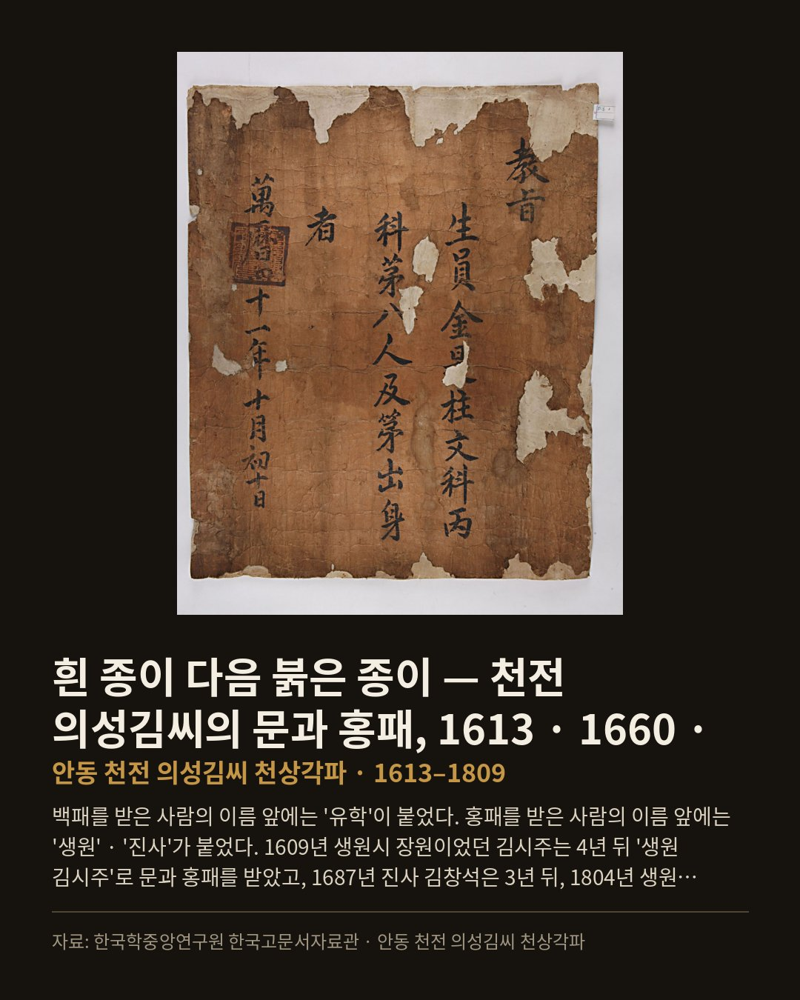
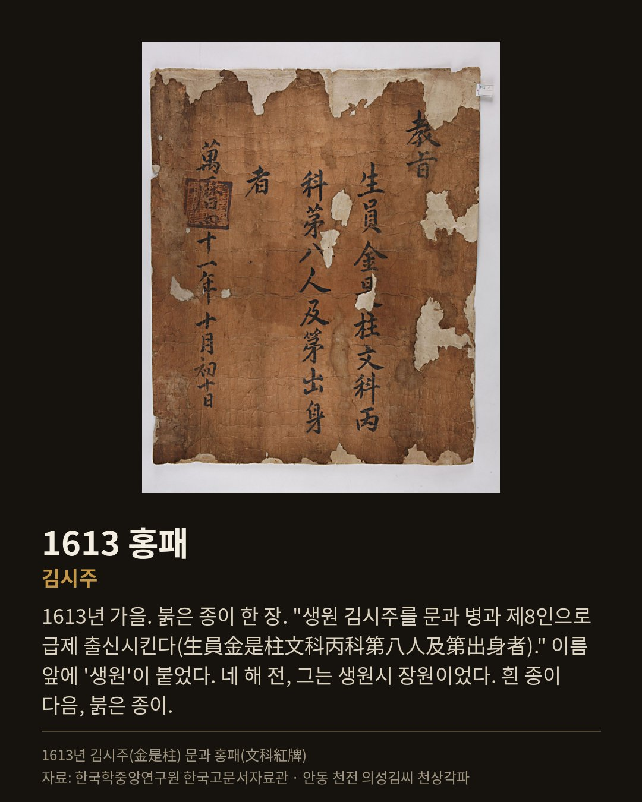
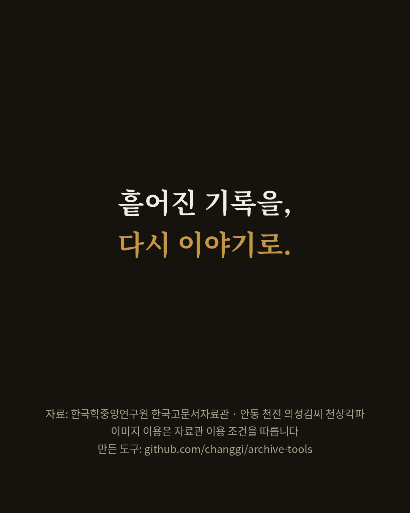

# EP.189 흰 종이 다음 붉은 종이 — 천전 의성김씨의 문과 홍패, 1613 · 1660 · 1690 · 1809

안동 천전 의성김씨 천상각파 (문중) · 백패를 받은 사람의 이름 앞에는 '유학'이 붙었다. 홍패를 받은 사람의 이름 앞에는 '생원' · '진사'가 붙었다. 1609년 생원시 장원이었던 김시주는 4년 뒤 '생원 김시주'로 문과 홍패를 받았고, 1687년 진사 김창석은 3년 뒤, 1804년 생원 김호운은 5년 뒤였다. 흰 종이를 받은 이가 몇 해 뒤 붉은 종이를 받으면, 이름 앞의 두 글자가 그 사이를 말해 준다

- 🌐 [전시 웹페이지](https://changgi.github.io/archive-tools/examples/cheonsang-hongpae/exhibit.html) (한자 위 한글 독음 · 원문 해석) · [수업 활동지](https://changgi.github.io/archive-tools/examples/cheonsang-hongpae/handout.html)
- 🎬 영상: [릴스 9:16](https://changgi.github.io/archive-tools-next/media/ep189-cheonsang-hongpae_reel.mp4) · [가로 16:9](https://changgi.github.io/archive-tools-next/media/ep189-cheonsang-hongpae_wide.mp4) · 홍보 글: [`promo.md`](promo.md)
- 카드뉴스: [`cards/`](cards/) · SNS 글: [`sns.txt`](sns.txt) · 판독·해석 표: [`selection.csv`](selection.csv)

<!-- DELIVERY -->
## 전달 에디팅 — 이 기록을 이렇게 전합니다

- **핵심 정서** — 뿌듯함
- **한 문장** — 백패(소과)는 '선비'의 자격, 홍패(대과 · 문과)는 '관리'의 자격이었다 — 그래서 홍패의 이름 앞 두 글자(유학 · 생원 · 진사)는 그 사람이 소과를 거쳤는지를, 백패와 홍패 사이의 햇수는 그 사이의 공부를 말해 준다.
- **열기** — 흰 종이를 받은 지 몇 해 뒤, 같은 사람에게 붉은 종이가 왔습니다.
- **펼치기** — 김시주 문과 홍패 → 김방걸 문과 홍패 → 김창석 문과 홍패 → 김호운 문과 홍패 (1613–1809년) — 1613 생원 김시주(1609 생원 1등 1인) → 1660 유학 김방걸 → 1690 진사 김창석(1687 진사) → 1809 생원 김호운(1804 생원)으로 놓았습니다.
- **절정** — "생원 김시주를 문과 병과 제8인으로 급제 출신시킨다(生員金是柱文科丙科第八人及第出身者)" — 화면·공간에서 이 한 줄만 크게, 소리를 줄여 집중
- **여운** — 흰 종이 한 장과 붉은 종이 한 장 사이, 그들은 몇 번이나 시험장에 갔을까요? — 질문으로 끝내고 답은 보는 사람에게
- **감각과 물질** — 이름 앞 두 글자 — 生員 · 幼學 · 進士 · 生員 · 붉은 종이를 실물 크기로 복제해 벽에 거는 연출
- **통로와 매개** — 온라인: 릴스(열기) → 카드뉴스(펼치기) → 전시 웹페이지(절정·원문) → 비하인드 카드(여운) / 오프라인: 원본 크기 복제·낭독·참여 벽 / 남기기: 활동지·질문 카드
- **여운 장치** — 졸업장과 자격증을 나란히 놓고 그 사이의 시간 떠올려 보기
- **전달 에디팅 전** — 4건의 문서를 1613–1809년 연대순으로 놓고 문서명 · 유형 · 해설을 붙인다 — 정확하지만, 지나가면 잊힌다.
- **전달 에디팅 후** — 핵심 정서는 「뿌듯함」. 「흰 종이를 받은 지 몇 해 뒤, 같은 사람에게 붉은 종이가 왔습니다.」로 열고, 문서를 대비와 순서로 펼친 뒤, "생원 김시주를 문과 병과 제8인으로 급제 출신시킨다(生員金是柱文科丙科第八人及第出身者)"에서 멈춘다. 이름 앞 두 글자 — 生員 · 幼學 · 進士 · 生員. 마지막엔 「졸업장과 자격증을 나란히 놓고 그 사이의 시간 떠올려 보기」로 보는 사람이 자기 이야기를 남기고 떠나게 한다.

전문: [`delivery.md`](delivery.md)
<!-- /DELIVERY -->

<!-- CURATOR -->
## 비하인드 — 큐레이터 노트

- **왜 이 문서들인가** — EP.186에서 이 집안의 백패 222년을 읽었습니다. 같은 집안에 문과 홍패도 여섯 장 남아 있는데, EP.71에서 다룬 1590 · 1735년을 뺀 네 장을 골랐습니다. 그 가운데 세 사람은 이 집안의 백패에도 이름이 있습니다.
- **전하고 싶은 것** — 백패(소과)는 '선비'의 자격, 홍패(대과 · 문과)는 '관리'의 자격이었다 — 그래서 홍패의 이름 앞 두 글자(유학 · 생원 · 진사)는 그 사람이 소과를 거쳤는지를, 백패와 홍패 사이의 햇수는 그 사이의 공부를 말해 준다.
- **이렇게 보이길 바랐다** — 1613 생원 김시주(1609 생원 1등 1인) → 1660 유학 김방걸 → 1690 진사 김창석(1687 진사) → 1809 생원 김호운(1804 생원)으로 놓았습니다.
- **이렇게 써 주세요** — 문과(대과)와 홍패, 갑과 · 을과 · 병과의 등급, 소과(생원 · 진사)와 대과의 관계, 이름 앞 신분 표기(유학 · 생원 · 진사)의 뜻, 한 문중의 과거 이력 수업에 쓰세요.
- **만들며 있었던 일** — 1690년 홍패는 오른쪽 아래가 잘려 등수가 '第十□人'까지만 남았습니다. 1613년 홍패의 연호 '萬曆四十一年'은 관인에 가린 글자를 자료관 목록 연도에 맞춰 읽었습니다. 1660 · 1690 · 1809년 홍패는 흑백 복사본이라 붉은 종이의 색은 1613년 장에서만 볼 수 있습니다. 김시주 · 김창석 · 김호운의 백패는 이 집안 문서에서 확인했고(EP.186 및 자료관 목록), 네 사람의 혈연 관계는 확인하지 않았습니다.
- **남겨 둔 질문** — 흰 종이 한 장과 붉은 종이 한 장 사이, 그들은 몇 번이나 시험장에 갔을까요?
- **제작 기록** — 문서 4건 · 1613–1809년 · 원본 사진 5면(문서 전체) · 원문 판독 4건 · 번역 4건 · 못 읽은 글자 □ 1 · 불확실 (?) 0

전문: [`curator.md`](curator.md) · 비하인드 카드: [`behind/`](behind/) · 채널별 홍보안: [`channels.md`](channels.md)
<!-- /CURATOR -->

## 이야기 — 사료가 말하는 대로

흰 종이를 받은 지 몇 해 뒤, 같은 사람에게 붉은 종이가 왔습니다.

> **1613 홍패** — 1613년 가을. 붉은 종이 한 장. "생원 김시주를 문과 병과 제8인으로 급제 출신시킨다(生員金是柱文科丙科第八人及第出身者)." 이름 앞에 '생원'이 붙었다. 네 해 전, 그는 생원시 장원이었다. 흰 종이 다음, 붉은 종이.
> **1660 홍패** — 마흔일곱 해 뒤, 1660년 섣달. 이번 이름 앞에는 '유학'이 붙었다. "유학 김방걸을 문과 병과 제15인으로 급제 출신시킨다(幼學金邦杰文科丙科第十五人及第出身者)." 흰 종이 없이, 곧장 붉은 종이.
> **1690 홍패** — 1690년 봄. 세 해 전 흰 종이를 받았던 김창석에게 붉은 종이가 온다. "진사 김창석을 문과 병과로 급제 출신시킨다(進士金昌錫文科丙科 … 及第出身者)." 이름 앞의 두 글자, '진사'. 세 해 전의 그 흰 종이다.
> **1809 홍패** — 그리고 1809년 겨울. 다섯 해 전 생원시 55등이었던 김호운. 이번에는 다르다. "생원 김호운을 문과 을과 제1인으로 급제 출신시킨다(生員金虎運文科乙科第一人及第出身者)." 을과 1등, 전체 4등. 흰 종이에서 붉은 종이까지, 다섯 해.

| 표지 | 1번 카드 | 마무리 |
|---|---|---|
|  |  |  |

## 선별 문서 (4점)

| # | 연도 | 유형 | 문서명 | 원본 |
|---|---|---|---|---|
| 1 | 1613 | 홍패 | 1613년 김시주(金是柱) 문과 홍패(文科紅牌) | [원본 보기](https://archive.aks.ac.kr/viewer/viewer.do#imgnode.do?itemId=book&gubun=booktree&depth=6&upPath=01%5E0167%5EL016707%5EL016707F02%5EL016707F0201&dataId=G002%2BAKS%2BKSM-XA.1613.1111-20101008.B005j_005_00055_XXX&itemType=) |
| 2 | 1660 | 홍패 | 1660년 김방걸(金邦杰) 문과 홍패(文科紅牌) | [원본 보기](https://archive.aks.ac.kr/viewer/viewer.do#imgnode.do?itemId=book&gubun=booktree&depth=6&upPath=01%5E0167%5EL016707%5EL016707F02%5EL016707F0201&dataId=G002%2BAKS%2BKSM-XA.1660.1111-20101008.B005c_005_00021_XXX&itemType=) |
| 3 | 1690 | 홍패 | 1690년 김창석(金昌錫) 문과 홍패(文科紅牌) | [원본 보기](https://archive.aks.ac.kr/viewer/viewer.do#imgnode.do?itemId=book&gubun=booktree&depth=6&upPath=01%5E0167%5EL016707%5EL016707F02%5EL016707F0201&dataId=G002%2BAKS%2BKSM-XA.1690.1111-20101008.B005m_005_00070_XXX&itemType=) |
| 4 | 1809 | 홍패 | 1809년 김호운(金虎運) 문과 홍패(文科紅牌) | [원본 보기](https://archive.aks.ac.kr/viewer/viewer.do#imgnode.do?itemId=book&gubun=booktree&depth=6&upPath=01%5E0167%5EL016707%5EL016707F02%5EL016707F0201&dataId=G002%2BAKS%2BKSM-XA.1809.1111-20101008.B005k_005_00059_XXX&itemType=) |

## 원문 판독과 해석

### 1. 1613년 김시주(金是柱) 문과 홍패(文科紅牌)

**원문 판독**

```
敎旨
生員金是柱文科丙
科第八人及第出身
者
萬曆四十一年十月初十日
```

**원문 해석** 교지. 생원 김시주를 문과 병과 제8인으로 급제 출신시킨다. 만력 41년(1613) 10월 10일.

**해제** 1613년(광해군 5) 10월, 김시주(金是柱)가 문과에 병과 제8인으로 급제하고 받은 홍패(紅牌)입니다. 붉은 종이가 지금은 갈색으로 바랬고 군데군데 떨어져 나갔습니다. 이름 앞의 '생원(生員)'은 그가 이미 소과에 붙었음을 뜻합니다. 이 집안에는 4년 전인 1609년 그가 생원시에서 1등 제1인, 곧 장원으로 입격한 백패도 남아 있습니다. 문과 합격자 33명은 갑과 3명 · 을과 7명 · 병과 23명으로 나뉘었고, 병과 제8인은 전체 18등입니다. 1615년 그를 승정원 주서로 부른 유지도 이 집안에 전합니다.

### 2. 1660년 김방걸(金邦杰) 문과 홍패(文科紅牌)

**원문 판독**

```
敎旨
幼學金邦杰文科丙科
第十五人及第出身者
順治十七年十二月二十五日
```

**원문 해석** 교지. 유학 김방걸을 문과 병과 제15인으로 급제 출신시킨다. 순치 17년(1660) 12월 25일.

**해제** 1660년(현종 1) 12월, 김방걸(金邦杰)이 문과 병과 제15인으로 급제하고 받은 홍패입니다. 이름 앞에는 '생원 · 진사'가 아니라 '유학(幼學)'이 붙었습니다. 소과 입격의 이력 없이 문과에 급제한 경우입니다. 문과는 소과 입격자가 아니어도 응시할 수 있었습니다. 김방걸은 뒤에 사간원 대사간까지 올랐고, 1692년 그를 대사간으로 부른 유지가 이 집안에 전합니다. 흑백 복사본입니다.

### 3. 1690년 김창석(金昌錫) 문과 홍패(文科紅牌)

**원문 판독**

```
敎旨
進士金昌錫文科丙科第十□
人及第出身者
康熙二十九年四月初二日
```

**원문 해석** 교지. 진사 김창석을 문과 병과 제1□인으로 급제 출신시킨다. 강희 29년(1690) 4월 2일.

**해제** 1690년(숙종 16) 4월, 진사 김창석(金昌錫)이 문과 병과로 급제하고 받은 홍패입니다. 3년 전인 1687년 그는 진사시에 2등으로 입격해 백패를 받았습니다(EP.186). 그래서 이번 홍패에는 이름 앞에 '진사(進士)'가 붙었습니다. 오른쪽 아래가 잘려 등수의 끝 글자가 남지 않았습니다. 흑백 복사본입니다.

### 4. 1809년 김호운(金虎運) 문과 홍패(文科紅牌)

**원문 판독**

```
敎旨
生員金虎運文科乙科
第一人及第出身者
嘉慶十四年十二月初一日
```

**원문 해석** 교지. 생원 김호운을 문과 을과 제1인으로 급제 출신시킨다. 가경 14년(1809) 12월 1일.

**해제** 1809년(순조 9) 12월, 생원 김호운(金虎運)이 문과 을과 제1인으로 급제하고 받은 홍패입니다. 을과 제1인은 갑과 3명 바로 다음, 전체 4등에 해당하는 높은 성적입니다. 5년 전인 1804년 그는 생원시 3등 제55인으로 입격해 백패를 받았습니다. 네 장 가운데 가장 높은 등수로, 이 집안의 문과 홍패 가운데 가장 늦은 것입니다. 흑백 복사본입니다.

판독·해석·이야기는 이미지에 근거한 초안이며(검토 전 "초안" 표시), 정확한 판독은 원문 확인이 필요합니다. □는 읽지 못한 글자, (?)는 불확실한 글자입니다.
이미지: 한국학중앙연구원 한국고문서자료관 소장·제공. "원본" 링크를 누르면 자료관 뷰어에서 그 문서가 열립니다. 재사용은 자료관에 문의하세요(소장처 동의 필요).
