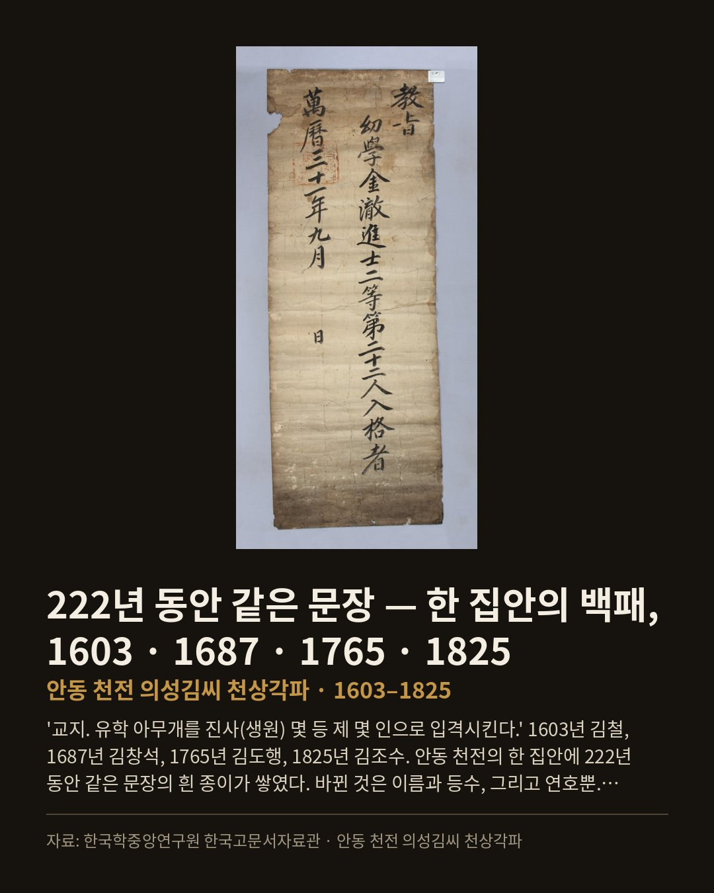
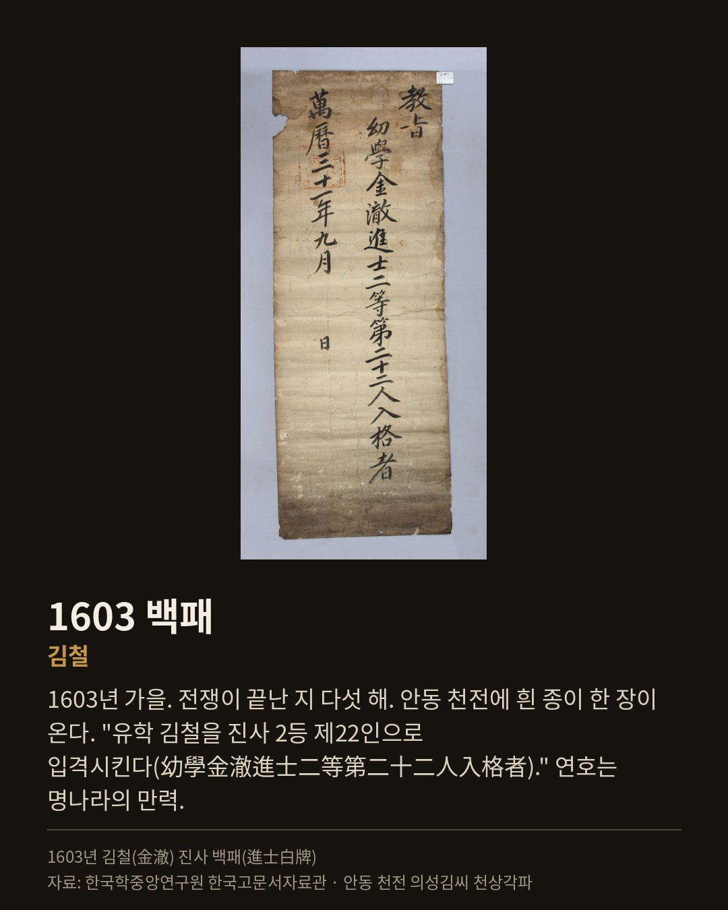

# EP.186 222년 동안 같은 문장 — 한 집안의 백패, 1603 · 1687 · 1765 · 1825

안동 천전 의성김씨 천상각파 (문중) · '교지. 유학 아무개를 진사(생원) 몇 등 제 몇 인으로 입격시킨다.' 1603년 김철, 1687년 김창석, 1765년 김도행, 1825년 김조수. 안동 천전의 한 집안에 222년 동안 같은 문장의 흰 종이가 쌓였다. 바뀐 것은 이름과 등수, 그리고 연호뿐. 만력에서 강희, 건륭, 도광으로. 명나라 연호가 청나라 연호로 바뀌는 사이에도, 시험의 문장은 그대로였다

- 🌐 [전시 웹페이지](https://changgi.github.io/archive-tools/examples/cheonsang-samaa/exhibit.html) (한자 위 한글 독음 · 원문 해석) · [수업 활동지](https://changgi.github.io/archive-tools/examples/cheonsang-samaa/handout.html)
- 🎬 영상: [릴스 9:16](https://changgi.github.io/archive-tools-next/media/ep186-cheonsang-samaa_reel.mp4) · [가로 16:9](https://changgi.github.io/archive-tools-next/media/ep186-cheonsang-samaa_wide.mp4) · 홍보 글: [`promo.md`](promo.md)
- 카드뉴스: [`cards/`](cards/) · SNS 글: [`sns.txt`](sns.txt) · 판독·해석 표: [`selection.csv`](selection.csv)

<!-- DELIVERY -->
## 전달 에디팅 — 이 기록을 이렇게 전합니다

- **핵심 정서** — 잔잔한 자부심
- **한 문장** — 백패는 서식이 거의 바뀌지 않는 문서다 — 그래서 한 집안의 백패를 나란히 놓으면, 바뀐 몇 글자(연호 · 이름 · 등수)가 곧 그 집안과 나라의 시간표가 된다.
- **열기** — 222년 동안, 이 집안에는 같은 문장의 합격증이 왔습니다.
- **펼치기** — 김철 진사 백패 → 김창석 진사 백패 → 김도행 생원 백패 → 김조수 생원 백패 (1603–1825년) — 1603 김철 진사 2등(만력) → 1687 김창석 진사 2등(강희) → 1765 김도행 생원 3등(건륭) → 1825 김조수 생원 3등(도광)으로, 연도 순서대로 놓았습니다.
- **절정** — "유학 김철을 진사 2등 제22인으로 입격시킨다(幼學金澈進士二等第二十二人入格者)" — 화면·공간에서 이 한 줄만 크게, 소리를 줄여 집중
- **여운** — 같은 문장을 네 번 받은 집안에게, 백패는 '합격증'이었을까 '가문의 이력서'였을까요? — 질문으로 끝내고 답은 보는 사람에게
- **감각과 물질** — 네 장 모두 같은 자리의 '入格者' — 그리고 맨 왼쪽 연호 萬曆 · 康熙 · 乾隆 · 道光 · 흰 종이 한 장에 조명 하나
- **통로와 매개** — 온라인: 릴스(열기) → 카드뉴스(펼치기) → 전시 웹페이지(절정·원문) → 비하인드 카드(여운) / 오프라인: 원본 크기 복제·낭독·참여 벽 / 남기기: 활동지·질문 카드
- **여운 장치** — 집안 졸업장 · 자격증을 연도순으로 늘어놓아 보기
- **전달 에디팅 전** — 4건의 문서를 1603–1825년 연대순으로 놓고 문서명 · 유형 · 해설을 붙인다 — 정확하지만, 지나가면 잊힌다.
- **전달 에디팅 후** — 핵심 정서는 「잔잔한 자부심」. 「222년 동안, 이 집안에는 같은 문장의 합격증이 왔습니다.」로 열고, 문서를 대비와 순서로 펼친 뒤, "유학 김철을 진사 2등 제22인으로 입격시킨다(幼學金澈進士二等第二十二人入格者)"에서 멈춘다. 네 장 모두 같은 자리의 '入格者' — 그리고 맨 왼쪽 연호 萬曆 · 康熙 · 乾隆 · 道光. 마지막엔 「집안 졸업장 · 자격증을 연도순으로 늘어놓아 보기」로 보는 사람이 자기 이야기를 남기고 떠나게 한다.

전문: [`delivery.md`](delivery.md)
<!-- /DELIVERY -->

<!-- CURATOR -->
## 비하인드 — 큐레이터 노트

- **왜 이 문서들인가** — EP.185에서 1564년 김명일 · 김복일 형제의 백패를 읽었습니다. 같은 집안에는 그 뒤로도 1825년까지 백패가 열 장 넘게 이어져 있어, 약 70–80년 간격으로 네 장을 골랐습니다.
- **전하고 싶은 것** — 백패는 서식이 거의 바뀌지 않는 문서다 — 그래서 한 집안의 백패를 나란히 놓으면, 바뀐 몇 글자(연호 · 이름 · 등수)가 곧 그 집안과 나라의 시간표가 된다.
- **이렇게 보이길 바랐다** — 1603 김철 진사 2등(만력) → 1687 김창석 진사 2등(강희) → 1765 김도행 생원 3등(건륭) → 1825 김조수 생원 3등(도광)으로, 연도 순서대로 놓았습니다.
- **이렇게 써 주세요** — 사마시(생원 · 진사시)와 백패의 서식, 등수 체계(1등 5 · 2등 25 · 3등 70), 조선이 쓴 연호의 변화(명 → 청), 한 문중의 과거 합격 이력과 지역 사족의 지위 수업에 쓰세요.
- **만들며 있었던 일** — 네 사람의 관계(부자 · 형제 · 숙질 등)는 이 백패들로 확인하지 않았습니다. 1687년 백패의 등수는 아래쪽이 어둡게 찍혀 '第十二人'으로 읽었으나 앞자리 글자가 더 있었을 수 있습니다. 1765년 백패의 등수는 '第五十三人'으로, 줄이 바뀌는 자리에서 이어 읽었습니다. 1603 · 1825년은 컬러, 1687 · 1765년은 흑백 복사본입니다.
- **남겨 둔 질문** — 같은 문장을 네 번 받은 집안에게, 백패는 '합격증'이었을까 '가문의 이력서'였을까요?
- **제작 기록** — 문서 4건 · 1603–1825년 · 원본 사진 6면(문서 전체) · 원문 판독 4건 · 번역 4건

전문: [`curator.md`](curator.md) · 비하인드 카드: [`behind/`](behind/) · 채널별 홍보안: [`channels.md`](channels.md)
<!-- /CURATOR -->

## 이야기 — 사료가 말하는 대로

222년 동안, 이 집안에는 같은 문장의 합격증이 왔습니다.

> **1603 백패** — 1603년 가을. 전쟁이 끝난 지 다섯 해. 안동 천전에 흰 종이 한 장이 온다. "유학 김철을 진사 2등 제22인으로 입격시킨다(幼學金澈進士二等第二十二人入格者)." 연호는 명나라의 만력.
> **1687 백패** — 여든네 해 뒤, 1687년. 같은 문장. "유학 김창석을 진사 2등으로 입격시킨다(幼學金昌錫進士二等 … 入格者)." 바뀐 것은 맨 왼쪽 두 글자다. 만력이 아니라 강희. 명나라가 아니라 청나라의 연호.
> **1765 백패** — 다시 일흔여덟 해. 1765년 봄. 이번에는 생원이다. "유학 김도행을 생원 3등 제53인으로 입격시킨다(幼學金道行生員三等第五十三人入格者)." 연호는 건륭. 문장은 여전히 같다.
> **1825 백패** — 그리고 1825년 봄, 마지막 장. "유학 김조수를 생원 3등 제7인으로 입격시킨다(幼學金祖壽生員三等第七人入格者)." 연호는 도광. 만력, 강희, 건륭, 도광. 이백스물두 해 동안 연호는 네 번 바뀌었고, 문장은 한 번도 바뀌지 않았다.

| 표지 | 1번 카드 | 마무리 |
|---|---|---|
|  |  |  |

## 선별 문서 (4점)

| # | 연도 | 유형 | 문서명 | 원본 |
|---|---|---|---|---|
| 1 | 1603 | 백패 | 1603년 김철(金澈) 진사 백패(進士白牌) | [원본 보기](https://archive.aks.ac.kr/viewer/viewer.do#imgnode.do?itemId=book&gubun=booktree&depth=6&upPath=01%5E0167%5EL016707%5EL016707F02%5EL016707F0201&dataId=G002%2BAKS%2BKSM-XA.1603.1111-20101008.B005a_005_00001_XXX&itemType=) |
| 2 | 1687 | 백패 | 1687년 김창석(金昌錫) 진사 백패(進士白牌) | [원본 보기](https://archive.aks.ac.kr/viewer/viewer.do#imgnode.do?itemId=book&gubun=booktree&depth=6&upPath=01%5E0167%5EL016707%5EL016707F02%5EL016707F0201&dataId=G002%2BAKS%2BKSM-XA.1687.1111-20101008.B005m_005_00069_XXX&itemType=) |
| 3 | 1765 | 백패 | 1765년 김도행(金道行) 생원 백패(生員白牌) | [원본 보기](https://archive.aks.ac.kr/viewer/viewer.do#imgnode.do?itemId=book&gubun=booktree&depth=6&upPath=01%5E0167%5EL016707%5EL016707F02%5EL016707F0201&dataId=G002%2BAKS%2BKSM-XA.1765.1111-20101008.B005d_005_00052_XXX&itemType=) |
| 4 | 1825 | 백패 | 1825년 김조수(金祖壽) 생원 백패(生員白牌) | [원본 보기](https://archive.aks.ac.kr/viewer/viewer.do#imgnode.do?itemId=book&gubun=booktree&depth=6&upPath=01%5E0167%5EL016707%5EL016707F02%5EL016707F0201&dataId=G002%2BAKS%2BKSM-XA.1825.1111-20101008.B005j_005_00057_XXX&itemType=) |

## 원문 판독과 해석

### 1. 1603년 김철(金澈) 진사 백패(進士白牌)

**원문 판독**

```
敎旨
幼學金澈進士二等第二十二人入格者
萬曆三十一年九月 日
```

**원문 해석** 교지. 유학 김철을 진사 2등 제22인으로 입격시킨다. 만력 31년(1603) 9월 일.

**해제** 1603년(선조 36) 9월, 김철(金澈)이 진사시에 2등 제22인으로 입격하고 받은 백패입니다. 임진왜란이 끝나고 5년 뒤입니다. 진사 2등은 25명 안이므로 상위권 성적입니다. 명나라 연호 만력(萬曆)을 썼고, 연호 위에 붉은 과거 관인(科擧之寶)이 찍혔습니다. EP.185의 1564년 형제 백패와 글자 배치가 같습니다.

### 2. 1687년 김창석(金昌錫) 진사 백패(進士白牌)

**원문 판독**

```
敎旨
幼學金昌錫進士二等第十二人
入格者
康熙二十六年九月十五日
```

**원문 해석** 교지. 유학 김창석을 진사 2등 제12인으로 입격시킨다. 강희 26년(1687) 9월 15일.

**해제** 84년 뒤인 1687년(숙종 13) 9월, 김창석(金昌錫)이 진사시에 2등으로 입격하고 받은 백패입니다. 문장은 1603년과 똑같고, 연호만 청나라의 강희(康熙)로 바뀌었습니다. 병자호란(1636–1637) 뒤 조선은 공식 문서에 청 연호를 썼습니다. 이번에는 날짜(十五日)까지 적었습니다. 김창석은 3년 뒤인 1690년 문과에도 급제해 홍패를 받았고, 그 홍패도 이 집안에 남아 있습니다. 같은 해 같은 집안의 김세중(金世重)도 진사 백패를 받았습니다.

### 3. 1765년 김도행(金道行) 생원 백패(生員白牌)

**원문 판독**

```
敎旨
幼學金道行生員三等第五十
三人入格者
乾隆三十年閏二月初八日
```

**원문 해석** 교지. 유학 김도행을 생원 3등 제53인으로 입격시킨다. 건륭 30년(1765) 윤2월 8일.

**해제** 1765년(영조 41) 윤2월, 김도행(金道行)이 생원시에 3등 제53인으로 입격하고 받은 백패입니다. 앞의 두 사람은 진사였고 이번에는 생원입니다. 생원시는 사서오경의 뜻을, 진사시는 시와 부를 지어 뽑았습니다. 3등 제53인은 3등 70명 가운데 53번째, 전체 100명 가운데 83번째입니다. 건륭(乾隆) 연호를 썼고, 흑백 복사본입니다.

### 4. 1825년 김조수(金祖壽) 생원 백패(生員白牌)

**원문 판독**

```
敎旨
幼學金祖壽生員三等
第七人入格者
道光五年三月 日
```

**원문 해석** 교지. 유학 김조수를 생원 3등 제7인으로 입격시킨다. 도광 5년(1825) 3월 일.

**해제** 1825년(순조 25) 3월, 김조수(金祖壽)가 생원시에 3등 제7인으로 입격하고 받은 백패로, 이 집안 백패 가운데 가장 늦은 것입니다. 1564년 김명일 · 김복일(EP.185)부터 셈하면 261년, 1603년 김철부터 222년 동안 같은 문장의 백패가 이어졌습니다. 그 사이 이 집안에는 1804년 김호운의 생원 백패와 1809년 그의 문과 홍패도 들어왔습니다. 도광(道光) 연호 위에 붉은 관인이 선명합니다.

판독·해석·이야기는 이미지에 근거한 초안이며(검토 전 "초안" 표시), 정확한 판독은 원문 확인이 필요합니다. □는 읽지 못한 글자, (?)는 불확실한 글자입니다.
이미지: 한국학중앙연구원 한국고문서자료관 소장·제공. "원본" 링크를 누르면 자료관 뷰어에서 그 문서가 열립니다. 재사용은 자료관에 문의하세요(소장처 동의 필요).
