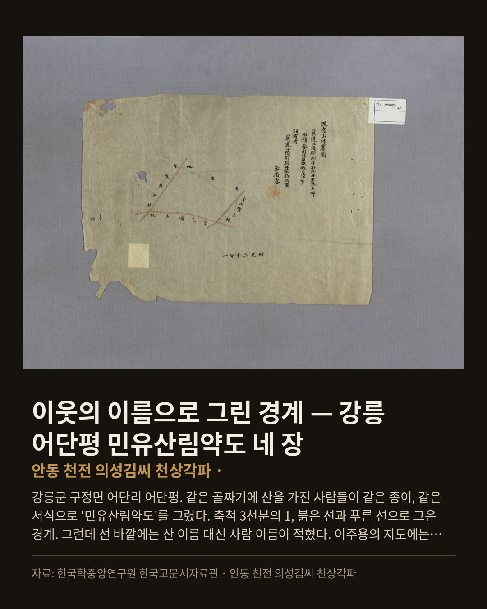
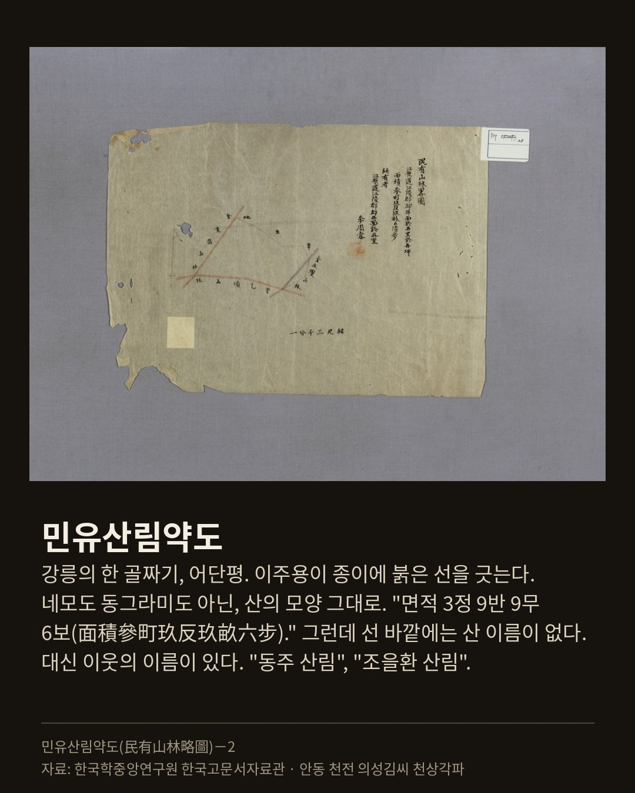

# EP.184 이웃의 이름으로 그린 경계 — 강릉 어단평 민유산림약도 네 장

안동 천전 의성김씨 천상각파 (문중) · 강릉군 구정면 어단리 어단평. 같은 골짜기에 산을 가진 사람들이 같은 종이, 같은 서식으로 '민유산림약도'를 그렸다. 축척 3천분의 1, 붉은 선과 푸른 선으로 그은 경계. 그런데 선 바깥에는 산 이름 대신 사람 이름이 적혔다. 이주용의 지도에는 '김동주 산림', 김동주의 지도에는 '이주용 산림', 조을환의 지도에는 둘 다. 네 장을 맞대면, 한 골짜기가 이웃의 이름으로 나뉜다

- 🌐 [전시 웹페이지](https://changgi.github.io/archive-tools/examples/cheonsang-sanrim/exhibit.html) (한자 위 한글 독음 · 원문 해석) · [수업 활동지](https://changgi.github.io/archive-tools/examples/cheonsang-sanrim/handout.html)
- 🎬 영상: [릴스 9:16](https://changgi.github.io/archive-tools-next/media/ep184-cheonsang-sanrim_reel.mp4) · [가로 16:9](https://changgi.github.io/archive-tools-next/media/ep184-cheonsang-sanrim_wide.mp4) · 홍보 글: [`promo.md`](promo.md)
- 카드뉴스: [`cards/`](cards/) · SNS 글: [`sns.txt`](sns.txt) · 판독·해석 표: [`selection.csv`](selection.csv)

<!-- DELIVERY -->
## 전달 에디팅 — 이 기록을 이렇게 전합니다

- **핵심 정서** — 호기심
- **한 문장** — 1908년 삼림법은 산 주인에게 면적과 약도를 신고하게 했다 — 측량 기술도 지번도 없던 골짜기에서, 사람들은 경계 바깥에 이웃의 이름을 적는 것으로 '내 산'의 테두리를 증명했다.
- **열기** — 산의 경계를 그리는데, 선 바깥에 적힌 것은 이웃의 이름이었습니다.
- **펼치기** — 민유산림약도－2 → 민유산림약도－3 → 민유산림약도－7 → 민유산림약도－4 (연대 미상) — 이주용(3정 9반) → 그를 이웃으로 적은 김동주(4정 6반) → 두 사람을 모두 적은 조을환(4정 5반) → 김동주를 이웃으로 적은 송인학(7정 2반)으로, 지도가 서로를 가리키는 순서대로 놓았습니다.
- **절정** — "김동주 산림(金東周山林)" — 화면·공간에서 이 한 줄만 크게, 소리를 줄여 집중
- **여운** — 이웃의 이름이 곧 경계였던 골짜기에서, '내 산'은 혼자 증명할 수 있는 것이었을까요? — 질문으로 끝내고 답은 보는 사람에게
- **감각과 물질** — 붉은 경계선 바깥의 작은 글씨 '金東周山林 · 李周容山林 · 曺乙煥山林'
- **통로와 매개** — 온라인: 릴스(열기) → 카드뉴스(펼치기) → 전시 웹페이지(절정·원문) → 비하인드 카드(여운) / 오프라인: 원본 크기 복제·낭독·참여 벽 / 남기기: 활동지·질문 카드
- **여운 장치** — 우리 집 등기부 · 지적도에서 이웃 땅 번지 찾아보기
- **전달 에디팅 전** — 4건의 문서를 연대 미상 연대순으로 놓고 문서명 · 유형 · 해설을 붙인다 — 정확하지만, 지나가면 잊힌다.
- **전달 에디팅 후** — 핵심 정서는 「호기심」. 「산의 경계를 그리는데, 선 바깥에 적힌 것은 이웃의 이름이었습니다.」로 열고, 문서를 대비와 순서로 펼친 뒤, "김동주 산림(金東周山林)"에서 멈춘다. 붉은 경계선 바깥의 작은 글씨 '金東周山林 · 李周容山林 · 曺乙煥山林'. 마지막엔 「우리 집 등기부 · 지적도에서 이웃 땅 번지 찾아보기」로 보는 사람이 자기 이야기를 남기고 떠나게 한다.

전문: [`delivery.md`](delivery.md)
<!-- /DELIVERY -->

<!-- CURATOR -->
## 비하인드 — 큐레이터 노트

- **왜 이 문서들인가** — EP.180에서 영해 박재호가 삼림법에 따라 산을 신고한 지적보고를 읽었습니다. 안동 의성김씨 천상각파 문서 안에 강릉 어단평의 민유산림약도 일곱 장이 함께 들어 있어, 서로의 이름이 경계에 적힌 네 장을 골랐습니다.
- **전하고 싶은 것** — 1908년 삼림법은 산 주인에게 면적과 약도를 신고하게 했다 — 측량 기술도 지번도 없던 골짜기에서, 사람들은 경계 바깥에 이웃의 이름을 적는 것으로 '내 산'의 테두리를 증명했다.
- **이렇게 보이길 바랐다** — 이주용(3정 9반) → 그를 이웃으로 적은 김동주(4정 6반) → 두 사람을 모두 적은 조을환(4정 5반) → 김동주를 이웃으로 적은 송인학(7정 2반)으로, 지도가 서로를 가리키는 순서대로 놓았습니다.
- **이렇게 써 주세요** — 1908년 삼림법과 민유림 신고, 1910년대 임야조사, 약도(略圖)라는 증거, 축척과 면적 단위(정 · 반 · 무 · 보), 이웃을 기준으로 경계를 정하는 사표(四標)의 전통 수업에 쓰세요.
- **만들며 있었던 일** — 네 장 모두 날짜가 없어 연도를 비워 두었습니다. 서식과 면적 단위로 보아 1908년 삼림법에 따른 신고(1911년 1월 기한) 때의 약도로 짐작하지만 확정하지 않았습니다. 지도 안 이웃 이름 가운데 '최찬징(?)'처럼 흘림이 섞인 이름은 확정하지 못해 해제에서만 다뤘습니다. 강릉의 약도가 왜 안동 의성김씨 집안 문서에 들어 있는지는 확인하지 않았습니다.
- **남겨 둔 질문** — 이웃의 이름이 곧 경계였던 골짜기에서, '내 산'은 혼자 증명할 수 있는 것이었을까요?
- **제작 기록** — 문서 4건 · 원본 사진 4면(문서 전체) · 원문 판독 4건 · 번역 4건 · 못 읽은 글자 □ 7 · 불확실 (?) 0

전문: [`curator.md`](curator.md) · 비하인드 카드: [`behind/`](behind/) · 채널별 홍보안: [`channels.md`](channels.md)
<!-- /CURATOR -->

## 이야기 — 사료가 말하는 대로

산의 경계를 그리는데, 선 바깥에 적힌 것은 이웃의 이름이었습니다.

> ** 민유산림약도** — 강릉의 한 골짜기, 어단평. 이주용이 종이에 붉은 선을 긋는다. 네모도 동그라미도 아닌, 산의 모양 그대로. "면적 3정 9반 9무 6보(面積參町玖反玖畝六步)." 그런데 선 바깥에는 산 이름이 없다. 대신 이웃의 이름이 있다. "동주 산림", "조을환 산림".
> ** 민유산림약도** — 그 '동주'가 그린 지도도 있다. 김동주. 그의 붉은 선 바깥에는 이렇게 적혀 있다. "이주용 산림(李周容山林)." 이주용의 지도에서는 김동주가 이웃이었고, 김동주의 지도에서는 이주용이 이웃이다. 경계는 둘이 함께 그린 것이었다.
> ** 민유산림약도** — 그리고 앞의 두 장에 이웃으로 나왔던 이름. 조을환. 그는 옆 마을 금광리에 산다. 그의 지도에는 이웃이 셋이다. "김동주 산림(金東周山林)", "이주용 산림(李周容山林)", 그리고 송인학. 한 골짜기의 퍼즐이 조금씩 맞춰진다.
> ** 민유산림약도** — 마지막은 송인학. 네 사람 가운데 가장 넓은 산이다. 일곱 정 남짓. 그의 경계에도 같은 이름이 있다. "김동주 산림." 네 장을 나란히 놓으면, 지번도 측량 기계도 없던 골짜기가 이웃의 이름으로 나뉜다. 내 산의 테두리는, 언제나 남의 산이었다.

| 표지 | 1번 카드 | 마무리 |
|---|---|---|
|  |  |  |

## 선별 문서 (4점)

| # | 연도 | 유형 | 문서명 | 원본 |
|---|---|---|---|---|
| 1 | — | 민유산림약도 | 민유산림약도(民有山林略圖)－2 | [원본 보기](https://archive.aks.ac.kr/viewer/viewer.do#imgnode.do?itemId=book&gubun=booktree&depth=6&upPath=01%5E0167%5EL016707%5EL016707F02%5EL016707F0207&dataId=G002%2BAKS%2BKSM-XG.0000.0000-20101008.B005a_006_00179_XXX&itemType=) |
| 2 | — | 민유산림약도 | 민유산림약도(民有山林略圖)－3 | [원본 보기](https://archive.aks.ac.kr/viewer/viewer.do#imgnode.do?itemId=book&gubun=booktree&depth=6&upPath=01%5E0167%5EL016707%5EL016707F02%5EL016707F0207&dataId=G002%2BAKS%2BKSM-XG.0000.0000-20101008.B005a_006_00180_XXX&itemType=) |
| 3 | — | 민유산림약도 | 민유산림약도(民有山林略圖)－7 | [원본 보기](https://archive.aks.ac.kr/viewer/viewer.do#imgnode.do?itemId=book&gubun=booktree&depth=6&upPath=01%5E0167%5EL016707%5EL016707F02%5EL016707F0207&dataId=G002%2BAKS%2BKSM-XG.0000.0000-20101008.B005a_006_00184_XXX&itemType=) |
| 4 | — | 민유산림약도 | 민유산림약도(民有山林略圖)－4 | [원본 보기](https://archive.aks.ac.kr/viewer/viewer.do#imgnode.do?itemId=book&gubun=booktree&depth=6&upPath=01%5E0167%5EL016707%5EL016707F02%5EL016707F0207&dataId=G002%2BAKS%2BKSM-XG.0000.0000-20101008.B005a_006_00181_XXX&itemType=) |

## 원문 판독과 해석

### 1. 민유산림약도(民有山林略圖)－2

**원문 판독**

```
民有山林畧圖
江原道江陵郡邱井面於丹里於丹坪
面積參町玖反玖畝六步
所有者
江原道江陵郡邱井面於丹里
李周容 (인)
縮尺三千分一
(지도 안) 金地生 · 草 · 東周山林 · 曺乙煥山林 · 金□□山林
```

**원문 해석** 민유산림 약도. 강원도 강릉군 구정면 어단리 어단평, 면적 3정 9반 9무 6보. 소유자 강원도 강릉군 구정면 어단리 이주용 (도장). 축척 3천분의 1. (지도 안) 김지생 · 풀밭 · 동주 산림 · 조을환 산림 · 김□□ 산림.

**해제** 강릉군 구정면 어단리 어단평에 산을 가진 이주용(李周容)의 민유산림약도(民有山林略圖)입니다. 1908년 공포된 삼림법은 개인 산림의 주인에게 3년 안에 면적과 약도를 신고하게 했고, 신고하지 않은 산은 국유로 보았습니다(EP.180). 이 약도는 그 신고에 붙이는 그림으로, 오른쪽에 '민유산림약도', 위치, 면적, 소유자를 쓰고 가운데에 산의 경계를 붉은 선으로 그렸습니다. 면적 3정 9반 9무 6보는 약 3.9정보(약 3만 9천 ㎡)입니다. 경계선 바깥에는 산 이름이 아니라 '동주 산림', '조을환 산림'처럼 이웃 산 주인의 이름을 적었습니다. 땅의 네 방향 이웃을 적어 위치를 정하던 조선의 사표(四標) 방식이 근대 서식 안으로 들어온 모습입니다. 날짜는 적혀 있지 않습니다.

### 2. 민유산림약도(民有山林略圖)－3

**원문 판독**

```
民有山林畧圖
江原道江陵郡邱井面於丹里於丹坪
面積肆町陸反柒畝貳步
所有者
江原道江陵郡邱井面於丹里
金東周 (인)
縮尺三千分一
(지도 안) 宋仁學山林 · 草生地 · 李周容山林 · 曺乙煥山林 · 崔□□山林
```

**원문 해석** 민유산림 약도. 강원도 강릉군 구정면 어단리 어단평, 면적 4정 6반 7무 2보. 소유자 강원도 강릉군 구정면 어단리 김동주 (도장). 축척 3천분의 1. (지도 안) 송인학 산림 · 풀밭 · 이주용 산림 · 조을환 산림 · 최□□ 산림.

**해제** 같은 어단평의 김동주(金東周)가 그린 약도입니다. 이주용의 약도에 '동주 산림'으로 적혔던 바로 그 사람이고, 이번에는 김동주의 지도에 '이주용 산림(李周容山林)'이 적혔습니다. 두 장을 맞대면 경계선 하나를 두 사람이 서로 다른 쪽에서 그린 셈입니다. 이 밖에 송인학 · 조을환 · 최□□의 산림과 '풀밭(草生地)'이 경계로 적혔습니다. 서식(제목 · 위치 · 면적 · 소유자 · 축척)과 글씨체, 3천분의 1 축척이 이주용의 약도와 같아, 한 사람이 여러 집의 약도를 대신 그렸을 가능성도 있습니다. 붉은 도장은 김동주의 것입니다.

### 3. 민유산림약도(民有山林略圖)－7

**원문 판독**

```
民有山林畧圖
江原道江陵郡邱井面於丹里於丹坪
面積肆町伍反肆畝捌步
所有者
江原道江陵郡邱井面金光里
曺乙煥 (인)
縮尺三千分一
(지도 안) 金東周山林 · 李周容山林 · 宋仁學山林 · 金三□山林
```

**원문 해석** 민유산림 약도. 강원도 강릉군 구정면 어단리 어단평, 면적 4정 5반 4무 8보. 소유자 강원도 강릉군 구정면 금광리 조을환 (도장). 축척 3천분의 1. (지도 안) 김동주 산림 · 이주용 산림 · 송인학 산림 · 김삼□ 산림.

**해제** 어단평에 산을 가진 조을환(曺乙煥)의 약도입니다. 앞의 두 사람과 달리 소유자의 주소는 이웃 마을 금광리(金光里)로, 다른 마을 사람도 이 골짜기에 산을 갖고 있었음을 보여 줍니다. 경계에는 김동주 · 이주용 · 송인학의 산림이 모두 적혀, 앞의 두 장에서 이웃으로 나온 '조을환 산림'이 바로 이 산입니다. 길쭉한 경계선이 다른 산들의 가운데를 가로지르는 모양입니다. 붉은 선은 경계, 푸른 선은 내나 길로 보이나 범례는 없습니다.

### 4. 민유산림약도(民有山林略圖)－4

**원문 판독**

```
民有山林略圖
江原道江陵郡邱井面於丹里於丹坪
面積柒町貳反壹畝貳拾步
所有者
江原道江陵郡邱井面於丹里
宋仁學 (인)
縮尺三千分一
(지도 안) 草生地 · 金東周山林 · 崔□□山林
```

**원문 해석** 민유산림 약도. 강원도 강릉군 구정면 어단리 어단평, 면적 7정 2반 1무 20보. 소유자 강원도 강릉군 구정면 어단리 송인학 (도장). 축척 3천분의 1. (지도 안) 풀밭 · 김동주 산림 · 최□□ 산림.

**해제** 어단평의 송인학(宋仁學)이 그린 약도로, 네 장 가운데 가장 넓은 7정 2반 1무 20보(약 7.2정보)입니다. 경계에는 김동주와 최□□의 산림, 그리고 풀밭(草生地)이 적혔습니다. 김동주 · 조을환의 약도에 '송인학 산림'으로 나온 산입니다. 이렇게 네 장의 약도가 서로의 이름을 경계로 적고 있어, 한 골짜기의 산들이 어떻게 맞닿아 있었는지를 이 종이들만으로 맞춰 볼 수 있습니다. 제목은 이 장만 '畧' 대신 '略'으로 썼습니다. 이 묶음에는 같은 골짜기의 최□□ · 이영수의 약도도 함께 있습니다.

판독·해석·이야기는 이미지에 근거한 초안이며(검토 전 "초안" 표시), 정확한 판독은 원문 확인이 필요합니다. □는 읽지 못한 글자, (?)는 불확실한 글자입니다.
이미지: 한국학중앙연구원 한국고문서자료관 소장·제공. "원본" 링크를 누르면 자료관 뷰어에서 그 문서가 열립니다. 재사용은 자료관에 문의하세요(소장처 동의 필요).
