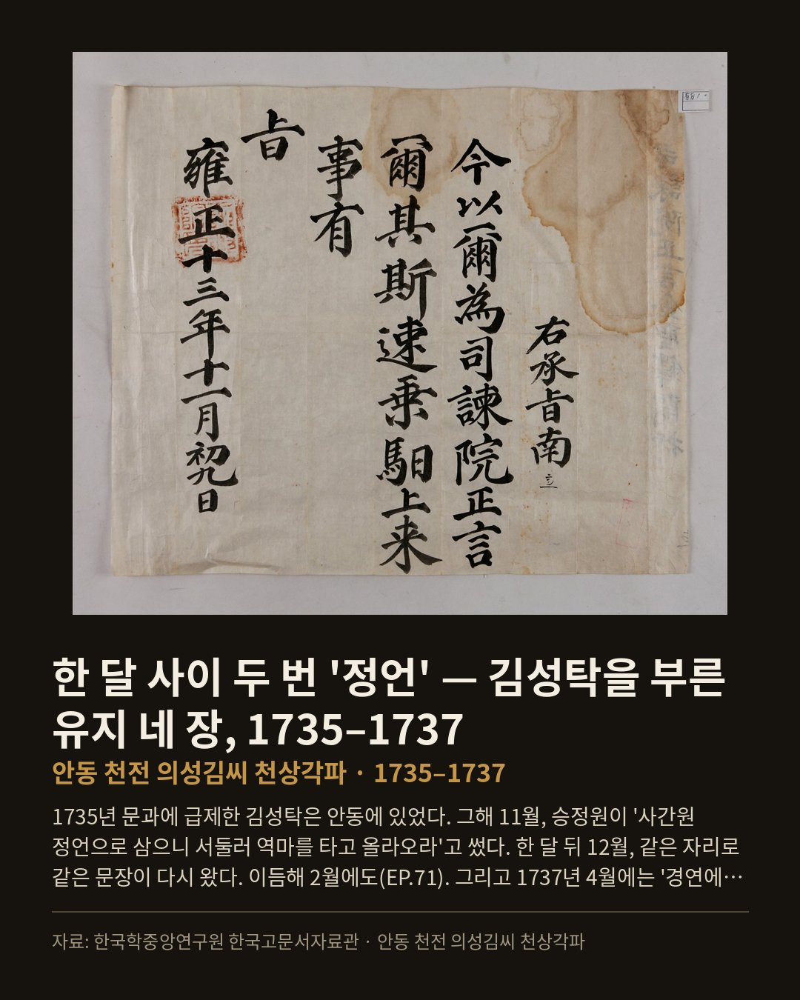
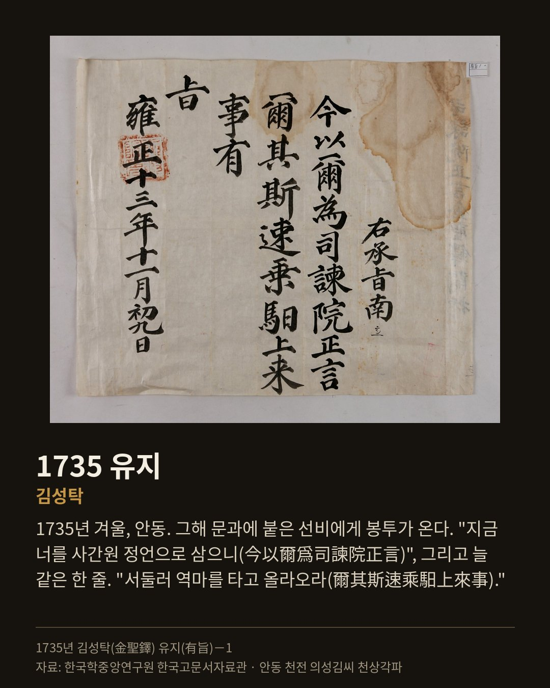

# EP.187 한 달 사이 두 번 '정언' — 김성탁을 부른 유지 네 장, 1735–1737

안동 천전 의성김씨 천상각파 (문중) · 1735년 문과에 급제한 김성탁은 안동에 있었다. 그해 11월, 승정원이 '사간원 정언으로 삼으니 서둘러 역마를 타고 올라오라'고 썼다. 한 달 뒤 12월, 같은 자리로 같은 문장이 다시 왔다. 이듬해 2월에도(EP.71). 그리고 1737년 4월에는 '경연에 입번할 일이 급하다'며 홍문관 부수찬으로, 5월에는 교리로. 다섯 번의 부름이 1년 반 사이에 이어졌다

- 🌐 [전시 웹페이지](https://changgi.github.io/archive-tools/examples/cheonsang-seongtak/exhibit.html) (한자 위 한글 독음 · 원문 해석) · [수업 활동지](https://changgi.github.io/archive-tools/examples/cheonsang-seongtak/handout.html)
- 🎬 영상: [릴스 9:16](https://changgi.github.io/archive-tools-next/media/ep187-cheonsang-seongtak_reel.mp4) · [가로 16:9](https://changgi.github.io/archive-tools-next/media/ep187-cheonsang-seongtak_wide.mp4) · 홍보 글: [`promo.md`](promo.md)
- 카드뉴스: [`cards/`](cards/) · SNS 글: [`sns.txt`](sns.txt) · 판독·해석 표: [`selection.csv`](selection.csv)

<!-- DELIVERY -->
## 전달 에디팅 — 이 기록을 이렇게 전합니다

- **핵심 정서** — 조용한 긴장
- **한 문장** — 같은 자리로 거듭 부르는 유지는, 부름을 받은 사람이 곧바로 올라가지 않았다는 흔적일 수 있다 — 문장은 그대로인데 날짜만 한 달씩 밀려 오는 종이들이, 지방에 머문 한 선비와 그를 부르는 조정 사이의 시간을 보여 준다.
- **열기** — 한 달 사이에, 같은 사람을 같은 자리로 두 번 불렀습니다.
- **펼치기** — 김성탁 유지－1 → 김성탁 유지－2 (1735–1737년) — 1735년 11월 사간원 정언 → 12월 다시 정언 → (1736년 2월 정언, EP.71) → 1737년 4월 홍문관 부수찬('경연 입번이 급하다') → 5월 홍문관 교리로 놓았습니다.
- **절정** — "경연에 입번할 일이 급하니(經筵入番事緊)" — 화면·공간에서 이 한 줄만 크게, 소리를 줄여 집중
- **여운** — 같은 문장이 다섯 번 왔다면, 그 사람은 몇 번째에 길을 나섰을까요? — 질문으로 끝내고 답은 보는 사람에게
- **감각과 물질** — 네 장 모두의 '爾其斯速乘馹上來事' — 그리고 셋째 장에만 있는 '撰經筵入番事緊' · 역마 방울·말발굽 소리와 함께 펼치는 두루마리
- **통로와 매개** — 온라인: 릴스(열기) → 카드뉴스(펼치기) → 전시 웹페이지(절정·원문) → 비하인드 카드(여운) / 오프라인: 원본 크기 복제·낭독·참여 벽 / 남기기: 활동지·질문 카드
- **여운 장치** — 거듭 받은 연락(메일 · 문자)에 답하지 못했던 때 떠올리기
- **전달 에디팅 전** — 4건의 문서를 1735–1737년 연대순으로 놓고 문서명 · 유형 · 해설을 붙인다 — 정확하지만, 지나가면 잊힌다.
- **전달 에디팅 후** — 핵심 정서는 「조용한 긴장」. 「한 달 사이에, 같은 사람을 같은 자리로 두 번 불렀습니다.」로 열고, 문서를 대비와 순서로 펼친 뒤, "경연에 입번할 일이 급하니(經筵入番事緊)"에서 멈춘다. 네 장 모두의 '爾其斯速乘馹上來事' — 그리고 셋째 장에만 있는 '撰經筵入番事緊'. 마지막엔 「거듭 받은 연락(메일 · 문자)에 답하지 못했던 때 떠올리기」로 보는 사람이 자기 이야기를 남기고 떠나게 한다.

전문: [`delivery.md`](delivery.md)
<!-- /DELIVERY -->

<!-- CURATOR -->
## 비하인드 — 큐레이터 노트

- **왜 이 문서들인가** — EP.71에서 김성탁(金聖鐸)의 1711년 진사 백패 · 1735년 문과 홍패와 1736년 2월 정언 유지를 읽었습니다. 같은 집안에 그 앞뒤의 유지가 네 장 더 남아 있어, 날짜 순서대로 이어 붙였습니다.
- **전하고 싶은 것** — 같은 자리로 거듭 부르는 유지는, 부름을 받은 사람이 곧바로 올라가지 않았다는 흔적일 수 있다 — 문장은 그대로인데 날짜만 한 달씩 밀려 오는 종이들이, 지방에 머문 한 선비와 그를 부르는 조정 사이의 시간을 보여 준다.
- **이렇게 보이길 바랐다** — 1735년 11월 사간원 정언 → 12월 다시 정언 → (1736년 2월 정언, EP.71) → 1737년 4월 홍문관 부수찬('경연 입번이 급하다') → 5월 홍문관 교리로 놓았습니다.
- **이렇게 써 주세요** — 조선 후기 유지의 형식, 사간원(정언)과 홍문관(부수찬 · 교리)의 청요직, 경연 입번, 지방 사족의 출사와 사양, 같은 임명의 반복이 뜻하는 것 수업에 쓰세요.
- **만들며 있었던 일** — 첫 장의 날짜 '初□日'의 둘째 글자는 '九'로 보이나 확정하지 않았습니다. 김성탁이 실제로 사양했는지, 올라갔는지는 이 유지들로 알 수 없어 '거듭 불렀다'는 사실만 적었습니다. 그가 1737년 스승 이현일의 신원을 청하는 상소로 유배되었다는 것은 문서 밖의 알려진 사실로, 해제에서만 짧게 다뤘습니다.
- **남겨 둔 질문** — 같은 문장이 다섯 번 왔다면, 그 사람은 몇 번째에 길을 나섰을까요?
- **제작 기록** — 문서 4건 · 1735–1737년 · 원본 사진 8면(문서 전체) · 원문 판독 4건 · 번역 4건 · 못 읽은 글자 □ 1 · 불확실 (?) 0

전문: [`curator.md`](curator.md) · 비하인드 카드: [`behind/`](behind/) · 채널별 홍보안: [`channels.md`](channels.md)
<!-- /CURATOR -->

## 이야기 — 사료가 말하는 대로

한 달 사이에, 같은 사람을 같은 자리로 두 번 불렀습니다.

> **1735 유지** — 1735년 겨울, 안동. 그해 문과에 붙은 선비에게 봉투가 온다. "지금 너를 사간원 정언으로 삼으니(今以爾爲司諫院正言)", 그리고 늘 같은 한 줄. "서둘러 역마를 타고 올라오라(爾其斯速乘馹上來事)."
> **1735 유지** — 한 달 뒤, 섣달. 또 봉투가 온다. 직함도 문장도 똑같다. "사간원 정언(司諫院正言)." "서둘러 역마를 타고 올라오라." 다른 것은 서명한 승지의 성뿐. 두 달 뒤, 세 번째 봉투가 또 온다.
> **1737 유지** — 이듬해 봄, 1737년 4월. 이번에는 홍문관이다. 그리고 처음으로 이유가 붙는다. "경연에 입번할 일이 급하니(經筵入番事緊)". 임금의 공부 자리가 비었다. 서둘러 올라오라.
> **1737 유지** — 그리고 5월. 다섯 번째 봉투. "홍문관 교리로 삼으니(爲弘文館校理)". 한 해 반 동안 다섯 번, 같은 한 줄이 그를 불렀다. "서둘러 역마를 타고 올라오라." 그해 그는 스승을 변호하는 글을 올렸다가, 서울이 아닌 먼 유배지로 떠났다고 전한다.

| 표지 | 1번 카드 | 마무리 |
|---|---|---|
|  |  |  |

## 선별 문서 (4점)

| # | 연도 | 유형 | 문서명 | 원본 |
|---|---|---|---|---|
| 1 | 1735 | 유지 | 1735년 김성탁(金聖鐸) 유지(有旨)－1 | [원본 보기](https://archive.aks.ac.kr/viewer/viewer.do#imgnode.do?itemId=book&gubun=booktree&depth=6&upPath=01%5E0167%5EL016707%5EL016707F02%5EL016707F0201&dataId=G002%2BAKS%2BKSM-XA.1735.1111-20101008.B005b_005_00319_XXX&itemType=) |
| 2 | 1735 | 유지 | 1735년 김성탁(金聖鐸) 유지(有旨)－2 | [원본 보기](https://archive.aks.ac.kr/viewer/viewer.do#imgnode.do?itemId=book&gubun=booktree&depth=6&upPath=01%5E0167%5EL016707%5EL016707F02%5EL016707F0201&dataId=G002%2BAKS%2BKSM-XA.1735.1111-20101008.B005b_005_00320_XXX&itemType=) |
| 3 | 1737 | 유지 | 1737년 김성탁(金聖鐸) 유지(有旨)－1 | [원본 보기](https://archive.aks.ac.kr/viewer/viewer.do#imgnode.do?itemId=book&gubun=booktree&depth=6&upPath=01%5E0167%5EL016707%5EL016707F02%5EL016707F0201&dataId=G002%2BAKS%2BKSM-XA.1737.1111-20101008.B005b_005_00322_XXX&itemType=) |
| 4 | 1737 | 유지 | 1737년 김성탁(金聖鐸) 유지(有旨)－2 | [원본 보기](https://archive.aks.ac.kr/viewer/viewer.do#imgnode.do?itemId=book&gubun=booktree&depth=6&upPath=01%5E0167%5EL016707%5EL016707F02%5EL016707F0201&dataId=G002%2BAKS%2BKSM-XA.1737.1111-20101008.B005b_005_00323_XXX&itemType=) |

## 원문 판독과 해석

### 1. 1735년 김성탁(金聖鐸) 유지(有旨)－1

**원문 판독**

```
今以爾爲司諫院正言
爾其斯速乘馹上來
事有
旨
右承旨南(서명)
雍正十三年十一月初□日
```

**원문 해석** 지금 너를 사간원 정언으로 삼으니, 너는 서둘러 역마를 타고 올라오라는 유지가 있었다. 우승지 남(서명). 옹정 13년(1735) 11월 초□일.

**해제** 1735년(영조 11) 11월, 그해 문과에 급제한 김성탁을 사간원 정언(正言, 정6품)으로 삼아 부른 유지입니다. 사간원은 임금에게 간언하는 대간 기관이고, 정언은 그 가장 아래 자리이지만 젊은 문신이 거치는 '청요직'으로 꼽혔습니다. 문장은 EP.174 김훤의 유지와 같은 정해진 틀이고, 우승지가 써서 서명했습니다. 연호 위에 승정원 관인이 찍혔습니다. 날짜의 둘째 글자는 '九'로 보이나 확정하지 않았습니다.

### 2. 1735년 김성탁(金聖鐸) 유지(有旨)－2

**원문 판독**

```
今以爾爲司諫院正言爾
其斯速乘馹上來事有
旨
同副承旨李(서명)
雍正十三年十二月十一日
```

**원문 해석** 지금 너를 사간원 정언으로 삼으니, 너는 서둘러 역마를 타고 올라오라는 유지가 있었다. 동부승지 이(서명). 옹정 13년(1735) 12월 11일.

**해제** 한 달 뒤인 12월 11일, 같은 사간원 정언으로 다시 부른 유지입니다. 직함과 문장이 앞 장과 한 글자도 다르지 않고, 쓴 승지만 우승지에서 동부승지로 바뀌었습니다. 같은 사람을 같은 자리로 거듭 부른 것은, 앞의 부름 뒤 자리에서 물러났거나(사직) 올라오지 않은 사정이 있었음을 짐작하게 합니다. 이 집안에는 두 달 뒤인 1736년 2월 29일에 다시 정언으로 부른 유지도 남아 있습니다(EP.71).

### 3. 1737년 김성탁(金聖鐸) 유지(有旨)－1

**원문 판독**

```
今以爾爲弘文館副修
撰經筵入番事緊爾其
斯速乘馹上來事有
旨
同副承旨李(서명)
乾隆二年四月十七日
```

**원문 해석** 지금 너를 홍문관 부수찬으로 삼는다. 경연에 입번할 일이 급하니, 너는 서둘러 역마를 타고 올라오라는 유지가 있었다. 동부승지 이(서명). 건륭 2년(1737) 4월 17일.

**해제** 1737년(영조 13) 4월, 김성탁을 홍문관 부수찬(副修撰, 종6품)으로 삼아 부른 유지입니다. 홍문관은 경서와 사서를 다루고 임금의 경연(經筵)을 맡은 기관으로, '옥당(玉堂)'이라 불린 가장 영예로운 자리였습니다. 이 장에는 정해진 문장 사이에 '경연에 입번할 일이 급하니(經筵入番事緊)'라는 한 구절이 더 들어 있어, 임금의 공부 자리에 들어갈 사람이 급히 필요했음을 보여 줍니다. 네 장 가운데 유일하게 사정을 덧붙인 유지입니다.

### 4. 1737년 김성탁(金聖鐸) 유지(有旨)－2

**원문 판독**

```
今以爾爲弘文館校理爾
其斯速乘馹上來事有
旨
右承旨鄭(서명)
乾隆二年五月十一日
```

**원문 해석** 지금 너를 홍문관 교리로 삼으니, 너는 서둘러 역마를 타고 올라오라는 유지가 있었다. 우승지 정(서명). 건륭 2년(1737) 5월 11일.

**해제** 한 달도 안 된 5월 11일, 김성탁을 홍문관 교리(校理, 정5품)로 삼아 부른 유지입니다. 부수찬에서 두 등 올랐습니다. 1735년 11월부터 1737년 5월까지 1년 반 사이에 이 집안에 남은 유지만 다섯 장이며, 직함은 정언(세 번) → 부수찬 → 교리로 이어졌습니다. 김성탁은 같은 1737년, 스승 이현일(李玄逸)의 신원을 청하는 상소를 올렸다가 유배되어 유배지에서 세상을 떠난 것으로 알려져 있으나, 이 유지들에는 그 일이 나오지 않습니다.

판독·해석·이야기는 이미지에 근거한 초안이며(검토 전 "초안" 표시), 정확한 판독은 원문 확인이 필요합니다. □는 읽지 못한 글자, (?)는 불확실한 글자입니다.
이미지: 한국학중앙연구원 한국고문서자료관 소장·제공. "원본" 링크를 누르면 자료관 뷰어에서 그 문서가 열립니다. 재사용은 자료관에 문의하세요(소장처 동의 필요).
