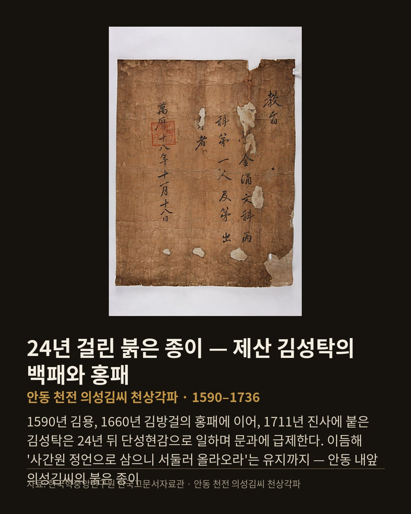
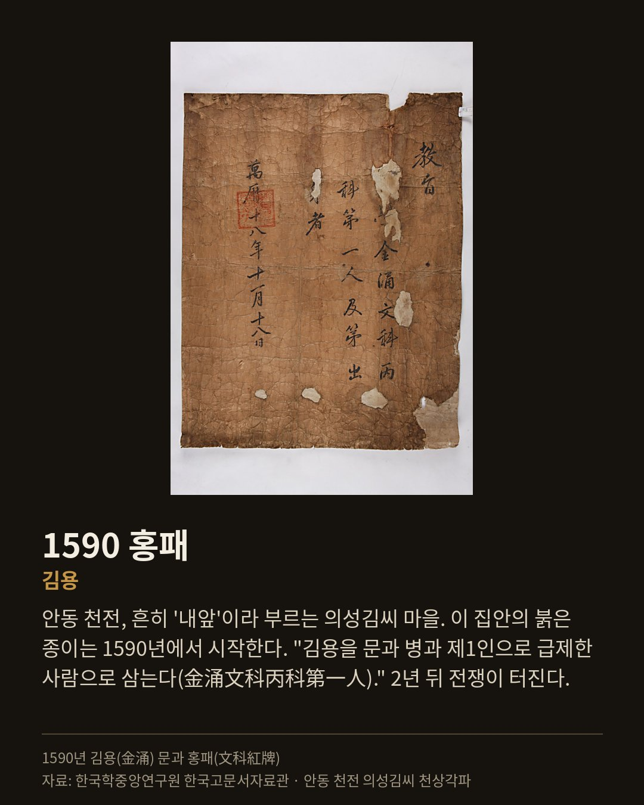

# EP.71 24년 걸린 붉은 종이 — 제산 김성탁의 백패와 홍패

안동 천전 의성김씨 천상각파 (문중) · 1590년 김용, 1660년 김방걸의 홍패에 이어, 1711년 진사에 붙은 김성탁은 24년 뒤 단성현감으로 일하며 문과에 급제한다. 이듬해 '사간원 정언으로 삼으니 서둘러 올라오라'는 유지까지 — 안동 내앞 의성김씨의 붉은 종이

- 🌐 [전시 웹페이지](https://changgi.github.io/archive-tools/examples/cheonsang/exhibit.html) (한자 위 한글 독음 · 원문 해석) · [수업 활동지](https://changgi.github.io/archive-tools/examples/cheonsang/handout.html)
- 🎬 영상: [릴스 9:16](https://changgi.github.io/archive-tools/examples/media/ep71-cheonsang_reel.mp4) · [가로 16:9](https://changgi.github.io/archive-tools/examples/media/ep71-cheonsang_wide.mp4) · 홍보 글: [`promo.md`](promo.md)
- 카드뉴스: [`cards/`](cards/) · SNS 글: [`sns.txt`](sns.txt) · 판독·해석 표: [`selection.csv`](selection.csv)

## 이야기 — 사료가 말하는 대로

진사에서 문과 급제까지 24년. 쉰둘의 선비가 다시 과거장에 섰습니다.

> **1590 홍패** — 안동 천전, 흔히 '내앞'이라 부르는 의성김씨 마을. 이 집안의 붉은 종이는 1590년에서 시작한다. "김용을 문과 병과 제1인으로 급제한 사람으로 삼는다(金涌文科丙科第一人)." 2년 뒤 전쟁이 터진다.
> **1711 백패** — 121년 뒤 1711년, 같은 집안의 김성탁이 진사가 된다. "유학 김성탁을 진사 3등 제11인으로 합격한 사람으로 삼는다(幼學金聖鐸進士三等第十一人)." 다음 종이까지 24년이 걸린다.
> **1735 홍패** — 1735년 봄, 쉰둘의 김성탁은 단성현감을 지낸 뒤였다. 그런데도 과거에 다시 나섰고, 을과 1등으로 붙었다. "전 단성현감 김성탁을 문과 을과 제1인으로(前行丹城縣監 … 金聖鐸文科乙科第一人)."
> **1736 유지** — 이듬해 2월, 안동으로 부름이 온다. "너를 사간원 정언으로 삼으니, 서둘러 역마를 타고 올라오라." 24년을 기다린 길이 이렇게 열렸다.

| 표지 | 1번 카드 | 마무리 |
|---|---|---|
|  |  |  |

## 선별 문서 (4점)

| # | 연도 | 유형 | 문서명 | 원본 |
|---|---|---|---|---|
| 1 | 1590 | 홍패 | 1590년 김용(金涌) 문과 홍패(文科紅牌) | [원본 보기](https://archive.aks.ac.kr/viewer/viewer.do#imgnode.do?itemId=book&gubun=booktree&depth=6&upPath=01%5E0167%5EL016707%5EL016707F02%5EL016707F0201&dataId=G002%2BAKS%2BKSM-XA.1590.1111-20101008.B005j_005_00053_XXX&itemType=) |
| 2 | 1711 | 백패 | 1711년 김성탁(金聖鐸) 진사 백패(進士白牌) | [원본 보기](https://archive.aks.ac.kr/viewer/viewer.do#imgnode.do?itemId=book&gubun=booktree&depth=6&upPath=01%5E0167%5EL016707%5EL016707F02%5EL016707F0201&dataId=G002%2BAKS%2BKSM-XA.1711.1111-20101008.B005b_005_00005_XXX&itemType=) |
| 3 | 1735 | 홍패 | 1735년 김성탁(金聖鐸) 문과 홍패(文科紅牌) | [원본 보기](https://archive.aks.ac.kr/viewer/viewer.do#imgnode.do?itemId=book&gubun=booktree&depth=6&upPath=01%5E0167%5EL016707%5EL016707F02%5EL016707F0201&dataId=G002%2BAKS%2BKSM-XA.1735.1111-20101008.B005b_005_00010_XXX&itemType=) |
| 4 | 1736 | 유지 | 1736년 김성탁(金聖鐸) 유지(有旨) | [원본 보기](https://archive.aks.ac.kr/viewer/viewer.do#imgnode.do?itemId=book&gubun=booktree&depth=6&upPath=01%5E0167%5EL016707%5EL016707F02%5EL016707F0201&dataId=G002%2BAKS%2BKSM-XA.1736.1111-20101008.B005b_005_00321_XXX&itemType=) |

## 원문 판독과 해석

### 1. 1590년 김용(金涌) 문과 홍패(文科紅牌)

**원문 판독**

```
敎旨
(…)金涌文科丙
科第一人及第出
身者
萬曆十八年十月十八日 (도장)
```

**원문 해석** 교지. ○○ 김용을 문과 병과 제1인으로 급제하여 출신한 사람으로 삼는다. 만력 18년(1590) 10월 18일.

**해제** 1590년(선조 23), 김용(金涌, 1557~1620)이 문과에 급제하고 받은 홍패입니다. 학봉 김성일의 조카로, 2년 뒤 임진왜란 때 의병을 일으킨 것으로 알려져 있습니다(문서 밖 사실 — 확인 필요). 이름 앞 신분 표시 부분이 떨어져 나갔습니다.

### 2. 1711년 김성탁(金聖鐸) 진사 백패(進士白牌)

**원문 판독**

```
敎旨
幼學金聖鐸進士三等第十一人
入格者
康熙五十年三月初八日 (도장)
```

**원문 해석** 교지. 유학 김성탁을 진사시 3등 제11인으로 합격한 사람으로 삼는다. 강희 50년(1711) 3월 8일.

**해제** 1711년(숙종 37), 제산(霽山) 김성탁(金聖鐸, 1684~1747)이 스물여덟에 진사시에 합격하고 받은 백패입니다.

### 3. 1735년 김성탁(金聖鐸) 문과 홍패(文科紅牌)

**원문 판독**

```
敎旨
朝奉大夫前行丹城縣監晉州
鎭管兵馬節制都尉金聖鐸文
科乙科第一人及第出身者
雍正十三年閏四月十七日 (도장)
```

**원문 해석** 교지. 조봉대부 전 행 단성현감 진주진관 병마절제도위 김성탁을 문과 을과 제1인으로 급제하여 출신한 사람으로 삼는다. 옹정 13년(1735) 윤4월 17일.

**해제** 1735년(영조 11) 윤4월, 쉰둘의 김성탁이 문과 을과 1등으로 급제하고 받은 홍패입니다. 이미 음직으로 단성현감을 지낸 뒤였습니다. 이 집안 홍패 가운데 붉은빛이 가장 짙게 남아 있습니다.

### 4. 1736년 김성탁(金聖鐸) 유지(有旨)

**원문 판독**

```
同副承旨申(押)
今以爾爲司諫院正
言 爾其斯速乘馹
上來事 有
旨
乾隆元年二月二十九日 (도장)
```

**원문 해석** 동부승지 신(申)이 씀. 이제 너를 사간원 정언으로 삼으니, 너는 서둘러 역마를 타고 올라오라는 유지. 건륭 원년(1736) 2월 29일.

**해제** 1736년(영조 12) 2월, 급제 이듬해 김성탁을 사간원 정언(정6품)으로 삼아 부른 유지입니다. 김성탁은 이후 1737년 스승 이현일의 신원을 청하는 상소로 유배되어 유배지에서 세상을 떠난 것으로 알려져 있습니다(문서 밖 사실 — 확인 필요).

판독·해석·이야기는 이미지에 근거한 초안이며(검토 전 "초안" 표시), 정확한 판독은 원문 확인이 필요합니다. □는 읽지 못한 글자, (?)는 불확실한 글자입니다.
이미지: 한국학중앙연구원 한국고문서자료관 소장·제공. "원본" 링크를 누르면 자료관 뷰어에서 그 문서가 열립니다. 재사용은 자료관에 문의하세요(소장처 동의 필요).
