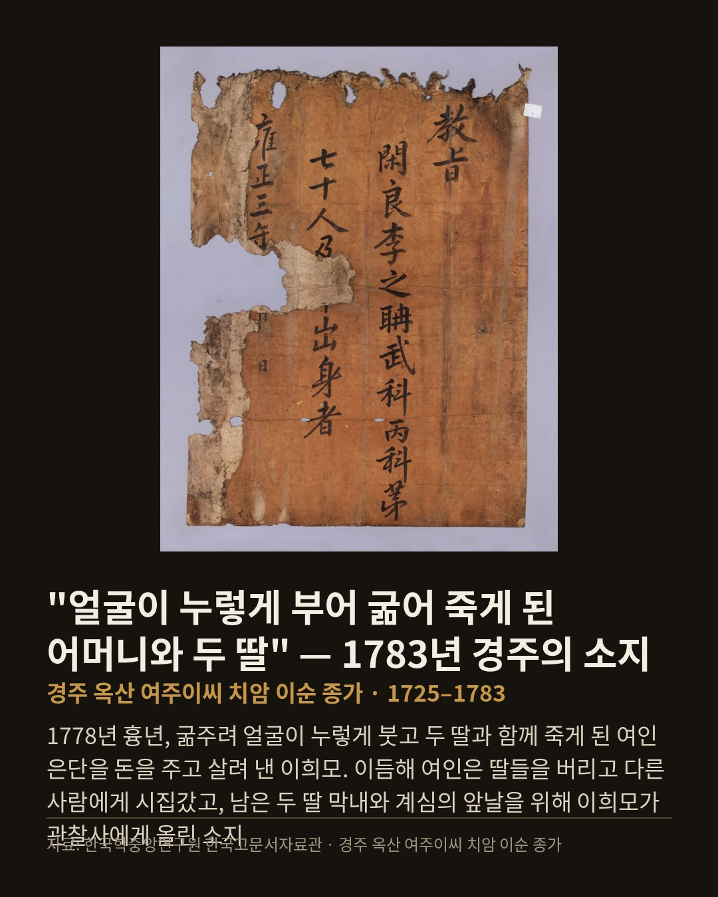
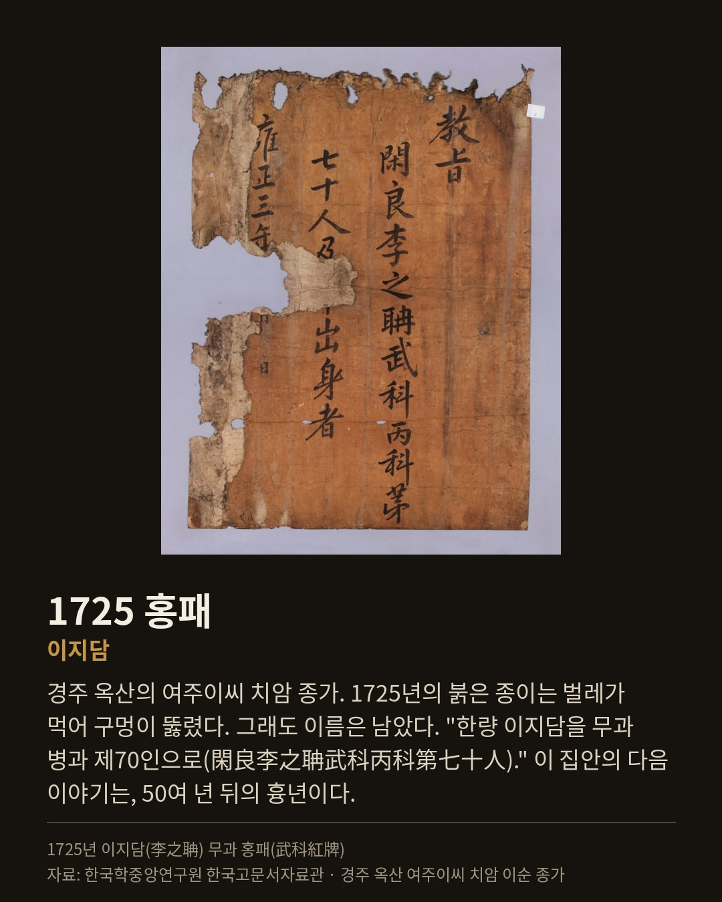
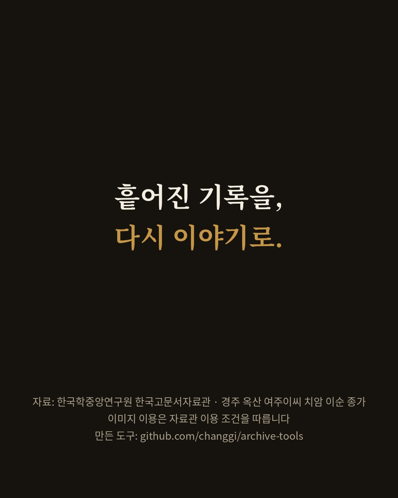

# EP.67 "얼굴이 누렇게 부어 굶어 죽게 된 어머니와 두 딸" — 1783년 경주의 소지

경주 옥산 여주이씨 치암 이순 종가 (문중) · 1778년 흉년, 굶주려 얼굴이 누렇게 붓고 두 딸과 함께 죽게 된 여인 은단을 돈을 주고 살려 낸 이희모. 이듬해 여인은 딸들을 버리고 다른 사람에게 시집갔고, 남은 두 딸 막내와 계심의 앞날을 위해 이희모가 관찰사에게 올린 소지

- 🌐 [전시 웹페이지](https://changgi.github.io/archive-tools/examples/chiam/exhibit.html) (한자 위 한글 독음 · 원문 해석) · [수업 활동지](https://changgi.github.io/archive-tools/examples/chiam/handout.html)
- 🎬 영상: [릴스 9:16](https://changgi.github.io/archive-tools-next/media/ep67-chiam_reel.mp4) · [가로 16:9](https://changgi.github.io/archive-tools-next/media/ep67-chiam_wide.mp4) · 홍보 글: [`promo.md`](promo.md)
- 카드뉴스: [`cards/`](cards/) · SNS 글: [`sns.txt`](sns.txt) · 판독·해석 표: [`selection.csv`](selection.csv)


<!-- DELIVERY -->
## 전달 에디팅 — 이 기록을 이렇게 전합니다

- **핵심 정서** — 연민
- **한 문장** — 기근의 기록은 숫자가 아니라 이름(은단, 막내, 계심)으로 남아 있다는 것.
- **열기** — 흉년에 살려 낸 어머니가, 두 딸을 두고 밤중에 떠났습니다.
- **펼치기** — 이지담 무과 홍패 → 이희모 소지 (1725–1783년) — '얼굴이 온통 누렇게 부어'라는 묘사를 피하지 않고 인용해, 굶주림의 실상을 직시하게 했습니다.
- **절정** — "은단이라는 여인이 얼굴이 온통 누렇게 부어, 두 딸을 데리고 굶어 죽을 지경이었습니다(滿面浮黃 率其二女 至於餓死之境)" — 화면·공간에서 이 한 줄만 크게, 소리를 줄여 집중
- **여운** — 막내와 계심은 그 뒤 어떤 삶을 살았을까요? — 질문으로 끝내고 답은 보는 사람에게
- **감각과 물질** — 어두운 방, 은단·막내·계심 세 이름만 빛으로 — 기근 사진 연출은 피함 · 붉은 종이를 실물 크기로 복제해 벽에 거는 연출 · 연명한 이름을 벽에 길게 나열하고 관아 마당처럼 서서 읽는 동선
- **통로와 매개** — 온라인: 릴스(열기) → 카드뉴스(펼치기) → 전시 웹페이지(절정·원문) → 비하인드 카드(여운) / 오프라인: 원본 크기 복제·낭독·참여 벽 / 남기기: 활동지·질문 카드
- **여운 장치** — 세 이름을 함께 부르는 시간
- **전달 에디팅 전** — 2건의 문서를 1725–1783년 연대순으로 놓고 문서명 · 유형 · 해설을 붙인다 — 정확하지만, 지나가면 잊힌다.
- **전달 에디팅 후** — 핵심 정서는 「연민」. 「흉년에 살려 낸 어머니가, 두 딸을 두고 밤중에 떠났습니다.」로 열고, 문서를 대비와 순서로 펼친 뒤, "은단이라는 여인이 얼굴이 온통 누렇게 부어, 두 딸을 데리고 굶어 죽을 지경이었습니다(滿面浮黃 率其二女 至於餓死之境)"에서 멈춘다. 어두운 방, 은단·막내·계심 세 이름만 빛으로 — 기근 사진 연출은 피함. 마지막엔 「세 이름을 함께 부르는 시간」로 보는 사람이 자기 이야기를 남기고 떠나게 한다.

전문: [`delivery.md`](delivery.md)
<!-- /DELIVERY -->

<!-- CURATOR -->
## 비하인드 — 큐레이터 노트

- **왜 이 문서들인가** — 1778년 흉년에 굶주린 여인을 살려 낸 사람이, 버려진 두 딸의 앞날을 위해 관찰사에게 올린 소지가 남아 있었습니다.
- **전하고 싶은 것** — 기근의 기록은 숫자가 아니라 이름(은단, 막내, 계심)으로 남아 있다는 것.
- **이렇게 보이길 바랐다** — '얼굴이 온통 누렇게 부어'라는 묘사를 피하지 않고 인용해, 굶주림의 실상을 직시하게 했습니다.
- **이렇게 써 주세요** — 재난과 구휼, 노비·매매 문제를 다루는 인권·역사 수업에 쓰세요. 민감한 내용이니 맥락 설명과 함께 쓰세요.
- **남겨 둔 질문** — 막내와 계심은 그 뒤 어떤 삶을 살았을까요?
- **제작 기록** — 문서 2건 · 1725–1783년 · 원본 사진 2면(문서 전체) · 원문 판독 2건 · 번역 2건 · 못 읽은 글자 □ 0 · 불확실 (?) 2

전문: [`curator.md`](curator.md)
<!-- /CURATOR -->

## 이야기 — 사료가 말하는 대로

흉년에 살려 낸 어머니가, 두 딸을 두고 밤중에 떠났습니다.

> **1725 홍패** — 경주 옥산의 여주이씨 치암 종가. 1725년의 붉은 종이는 벌레가 먹어 구멍이 뚫렸다. 그래도 이름은 남았다. "한량 이지담을 무과 병과 제70인으로(閑良李之聃武科丙科第七十人)." 이 집안의 다음 이야기는, 50여 년 뒤의 흉년이다.
> **1783 소지** — 1778년, 경주에 큰 흉년이 든다. 5년 뒤 이희모가 관찰사에게 그해 일을 쓴다. "은단이라는 여인이 얼굴이 온통 누렇게 부어, 두 딸을 데리고 굶어 죽을 지경이었습니다(滿面浮黃 率其二女 至於餓死之境)." 그는 돈을 들여 셋을 살렸다. 그런데 몇 해 뒤 어머니는 재가하며 두 딸을 두고 밤중에 떠났다. 남은 아이의 이름은 막내와 계심이었다.

| 표지 | 1번 카드 | 마무리 |
|---|---|---|
|  |  |  |

## 선별 문서 (2점)

| # | 연도 | 유형 | 문서명 | 원본 |
|---|---|---|---|---|
| 1 | 1725 | 홍패 | 1725년 이지담(李之聃) 무과 홍패(武科紅牌) | [원본 보기](https://archive.aks.ac.kr/viewer/viewer.do#imgnode.do?itemId=book&gubun=booktree&depth=6&upPath=01%5E0167%5EL016794%5EL016794F02%5EL016794F0201&dataId=G002%2BAKS%2BKSM-XA.1725.1111-20101008.B043b_066_00001_XXX&itemType=) |
| 2 | 1783 | 소지 | 1783년 이희모(李希謨) 소지(所志) | [원본 보기](https://archive.aks.ac.kr/viewer/viewer.do#imgnode.do?itemId=book&gubun=booktree&depth=6&upPath=01%5E0167%5EL016794%5EL016794F02%5EL016794F0202&dataId=G002%2BAKS%2BKSM-XB.1783.4713-20101008.B043b_066_00104_XXX&itemType=) |

## 원문 판독과 해석

### 1. 1725년 이지담(李之聃) 무과 홍패(武科紅牌)

**원문 판독**

```
敎旨
閑良李之聃武科丙科第
七十人及[第]出身者 (훼손)
雍正三年 (훼손) 月 日 (도장)
```

**원문 해석** 교지. 한량 이지담을 무과 병과 제70인으로 급제하여 출신한 사람으로 삼는다. 옹정 3년(1725) ○월 일.

**해제** 1725년(영조 원년), 경주 옥산 여주이씨 집안의 이지담(李之聃)이 무과에 급제하고 받은 홍패입니다. 벌레 먹고 찢겨 가운데가 비었지만 이름과 순위는 남아 있습니다. 이 집안은 치암(恥庵) 이순의 후손가입니다.

### 2. 1783년 이희모(李希謨) 소지(所志)

**원문 판독**

```
慶州幼學李希謨
右謹言所志矣段 去戊戌年分 時値大凶 所謂銀丹稱名之女 滿面浮黃 率其二女 至於餓死之境(?)
錢 仍爲救活 作夫使居 葉下矣 去年偶然喪夫 改嫁於他人 而棄其女息莫乃 桂心二女於矣身家(…)
死丁寧 次知生活 使之使喚云云是遣 其日夜棄其兒 單入於轄(?) 無去處逃亡 矣身 矜憐其兒之無依 收(…)
爲去乎 參商敎是後 考次 題音 行下爲只爲
行下向敎是事
巡使道 處分
癸卯二月 日
(왼쪽 큰 흘림 — 관찰사 처분, 판독 필요) (도장)
```

**원문 해석** 경주 유학 이희모. 삼가 아뢰는 소지. 지난 무술년(1778) 무렵, 때마침 큰 흉년을 만나 은단(銀丹)이라는 여인이 얼굴이 온통 누렇게 부어 두 딸을 데리고 굶어 죽을 지경에 이르렀기에, [제가] 돈을 [주고] 구해 살려 남편을 얻어 [제 집] 아래에서 살게 하였습니다. 그런데 지난해 우연히 남편이 죽자 다른 사람에게 다시 시집가면서 딸 막내(莫乃)와 계심(桂心) 두 아이를 제 집에 버려두고, '죽든 살든 맡아 기르고 부리라'고 하고는 그날 밤 아이들을 버리고 혼자 … 들어가 간 곳 없이 달아났습니다. 저는 의지할 데 없는 아이들이 가엾어 거두어 … 하오니, 헤아려 살피신 뒤 뒷날 증거로 삼을 수 있도록 처분(題音)을 내려 주십시오. 관찰사께서 처분하실 일. 계묘년(1783) 2월 일.

**해제** 1783년(정조 7, 癸卯) 2월, 경주 유학 이희모(李希謨)가 경상도 관찰사에게 올린 소지입니다. 1778년(戊戌) 큰 흉년 때 굶주려 '얼굴이 온통 누렇게 부은(滿面浮黃)' 여인 은단과 두 딸을 돈을 써서 살렸는데, 은단이 남편을 잃은 뒤 재가하며 두 딸을 이희모 집에 버리고 떠났으니, 아이들을 거두어 기르는 것을 증명하는 처분을 내려 달라는 청원입니다. 흉년에 굶주린 사람을 살린 사람이 그를 부릴 수 있게 한 '구활(救活)' 규정과 관련된 문서로 보입니다. 해서로 또렷해 본문 대부분을 판독했고, 줄 끝 일부는 잘렸습니다.

판독·해석·이야기는 이미지에 근거한 초안이며(검토 전 "초안" 표시), 정확한 판독은 원문 확인이 필요합니다. □는 읽지 못한 글자, (?)는 불확실한 글자입니다.
이미지: 한국학중앙연구원 한국고문서자료관 소장·제공. "원본" 링크를 누르면 자료관 뷰어에서 그 문서가 열립니다. 재사용은 자료관에 문의하세요(소장처 동의 필요).
