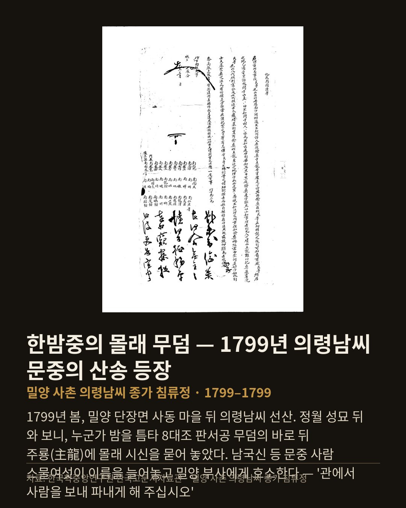
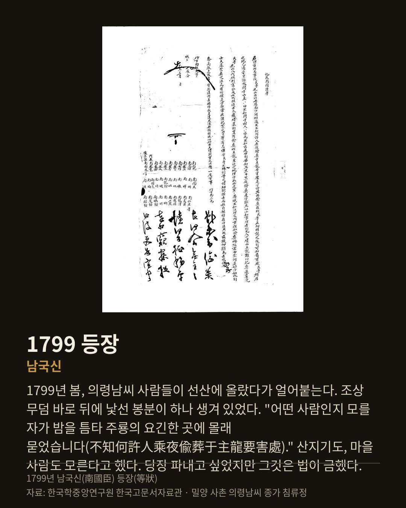
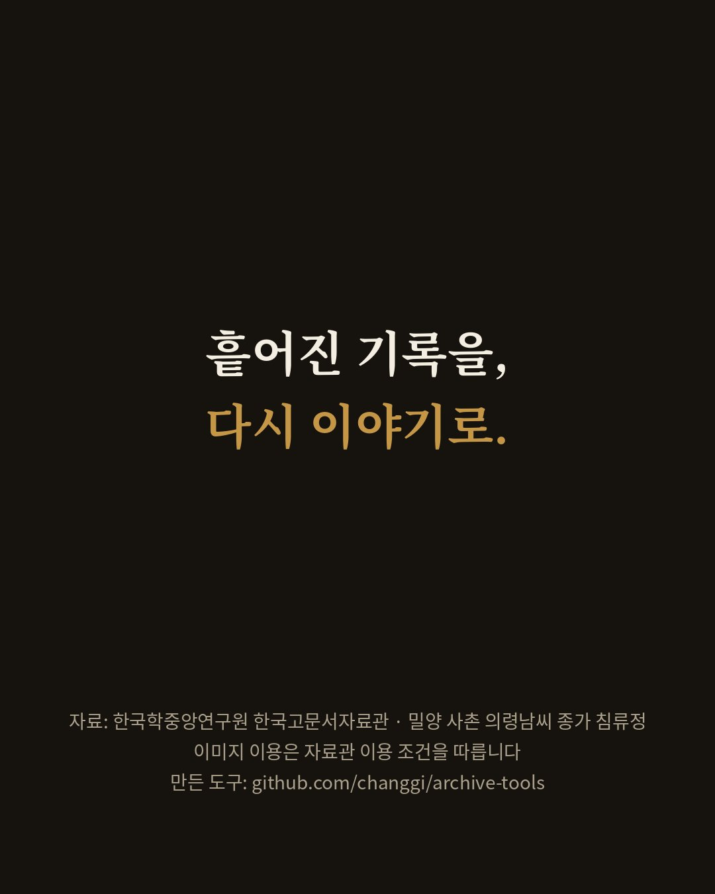

# EP.96 한밤중의 몰래 무덤 — 1799년 의령남씨 문중의 산송 등장

밀양 사촌 의령남씨 종가 침류정 (문중) · 1799년 봄, 밀양 단장면 사동 마을 뒤 의령남씨 선산. 정월 성묘 뒤 와 보니, 누군가 밤을 틈타 8대조 판서공 무덤의 바로 뒤 주룡(主龍)에 몰래 시신을 묻어 놓았다. 남국신 등 문중 사람 스물여섯이 이름을 늘어놓고 밀양 부사에게 호소한다 — '관에서 사람을 보내 파내게 해 주십시오'

- 🌐 [전시 웹페이지](https://changgi.github.io/archive-tools/examples/chimryujeong/exhibit.html) (한자 위 한글 독음 · 원문 해석) · [수업 활동지](https://changgi.github.io/archive-tools/examples/chimryujeong/handout.html)
- 🎬 영상: [릴스 9:16](https://changgi.github.io/archive-tools/examples/media/ep96-chimryujeong_reel.mp4) · [가로 16:9](https://changgi.github.io/archive-tools/examples/media/ep96-chimryujeong_wide.mp4) · 홍보 글: [`promo.md`](promo.md)
- 카드뉴스: [`cards/`](cards/) · SNS 글: [`sns.txt`](sns.txt) · 판독·해석 표: [`selection.csv`](selection.csv)

## 이야기 — 사료가 말하는 대로

어느 날 밤, 조상 무덤 바로 뒤에 낯선 무덤이 생겼습니다.

> **1799 등장** — 1799년 봄, 의령남씨 사람들이 선산에 올랐다가 얼어붙는다. 조상 무덤 바로 뒤에 낯선 봉분이 하나 생겨 있었다. "어떤 사람인지 모를 자가 밤을 틈타 주룡의 요긴한 곳에 몰래 묻었습니다(不知何許人乘夜偸葬于主龍要害處)." 산지기도, 마을 사람도 모른다고 했다. 당장 파내고 싶었지만 그것은 법이 금했다. 그래서 스물여섯 명이 이름을 적었다. "관에서 사람을 보내 파내게 해 주십시오(自官別遣將差 掘移)."

| 표지 | 1번 카드 | 마무리 |
|---|---|---|
|  |  |  |

## 선별 문서 (1점)

| # | 연도 | 유형 | 문서명 | 원본 |
|---|---|---|---|---|
| 1 | 1799 | 등장 | 1799년 남국신(南國臣) 등장(等狀) | [원본 보기](https://archive.aks.ac.kr/viewer/viewer.do#imgnode.do?itemId=book&gubun=booktree&depth=6&upPath=01%5E0150%5EL015020%5EL015020F02%5EL015020F0202&dataId=G002%2BAKS%2BKSM-XB.1799.4827-20101008.B046a_070_00014_XXX&itemType=) |

## 원문 판독과 해석

### 1. 1799년 남국신(南國臣) 등장(等狀)

**원문 판독**

```
化民南國臣等
右謹言所志事段 民等先山在於丹場面沙洞村後矣 不知何許人乘夜偸葬于主龍要害處是乎所 其所偸葬在於民等正初瞻謁之後 則可知屬耳 民等所
居之地 已過二十里許 故問于山直 山直曰不知 問于村人 村人亦爲不知云是乎則 安知其某日某夜偸葬是乎旀 且以小知事理者 則凡人之墳山主龍 難以犯葬是去等 況
民等先山八代祖判書公及七代祖進士公巖墳墓 則豈有偸葬於主龍至近之地理乎 此必是蚩蚩愚氓 不知法理之所重 但知偸葬晦跡之由 奈何是如乎 如此則
士夫塚禁葬之法 焉有所據是乎旀 常庶漢犯禁之習 寧有忌憚乎 民等不勝刻骨之憤 切欲掘去而私自掘移 在乎法典 故玆敢仰籲爲去乎
參商敎是後 自官別遣將差 掘移敎是遣 且使無識頑氓 以知士夫墳閣重之法 懲一勵百事 行下爲只爲
行下向敎是事
城主　處分
己未三月　日
(연명) 南尙堯 南尙天 南尙??? 南仁臣 … 門長 南處寬 … 後宗孫 南國臣 …
(좌측 하단 · 부사의 제사(題辭) 초서, 판독 생략)
```

**원문 해석** 교화를 입는 백성 남국신 등. 삼가 아뢰는 소지의 일은 이러합니다. 저희 선산은 단장면 사동촌 뒤에 있는데, 어떤 사람인지 모를 자가 밤을 틈타 주룡(主龍)의 요긴한 곳에 몰래 장사를 지냈습니다. 그 투장은 저희가 정월 초에 성묘한 뒤의 일이니 최근임을 알 수 있습니다. 저희 사는 곳이 [선산에서] 이미 20리가 넘어 산지기에게 물으니 모른다 하고, 마을 사람에게 물어도 모른다 하니, 어느 날 어느 밤에 몰래 묻었는지 어찌 알겠습니까. 또 사리를 조금이라도 아는 자라면 남의 무덤 산 주룡에는 감히 묻지 못하는 법인데, 하물며 저희 선산은 8대조 판서공과 7대조 진사공의 무덤이니 어찌 주룡에 그토록 가까이 몰래 묻는 이치가 있겠습니까. 이는 반드시 어리석은 백성이 법의 중함은 모르고 몰래 묻고 자취를 감출 줄만 안 까닭이니 어찌하겠습니까. 이렇다면 사대부 무덤에 장사를 금하는 법이 어디에 근거하겠으며, 상민들이 금령을 범하는 버릇이 어찌 꺼림이 있겠습니까. 저희는 뼈에 사무치는 분함을 이기지 못해 당장 파내고 싶으나, 사사로이 파서 옮기는 것은 법전에 [금지되어] 있으므로 감히 우러러 호소합니다. 헤아려 살피신 뒤 관에서 따로 장차(將差)를 보내 파서 옮기게 하시고, 또 무식하고 완악한 백성으로 하여금 사대부 분묘가 중함을 알게 하여 하나를 징계해 백을 경계하도록 처분해 주십시오. 성주께서 처분하실 일. 기미년(1799) 3월 일. (연명) 남상요, 남상천 … 문장 남처관, 후손 남국신 등.

**해제** 조선 후기에 가장 흔한 소송 가운데 하나였던 산송(山訟), 그중에서도 남의 묘역에 몰래 시신을 묻는 '투장(偸葬)'을 고발하며 의령남씨 문중이 밀양 부사(성주)에게 올린 등장(等狀, 여럿이 연명한 소지)입니다. 주룡(主龍)은 풍수에서 무덤 뒤로 이어지는 산줄기로, 이곳에 다른 무덤이 들어서면 집안의 기운을 해친다고 믿었습니다. 사적으로 파내는 것은 금지되어 있어 관의 처분을 요청한 것입니다. 본문에 '是乎所(-이온바)', '是乎旀(-이오며)', '是去等(-이거든)', '爲去乎(-하오니)', '敎是遣(-하시고)', '爲只爲(-하기 위하여)' 같은 이두가 가득합니다. 왼쪽 아래 큰 초서는 부사가 내린 처분(제사)으로, 판독을 생략했습니다. 연명자 일부 이름은 불확실합니다.

판독·해석·이야기는 이미지에 근거한 초안이며(검토 전 "초안" 표시), 정확한 판독은 원문 확인이 필요합니다. □는 읽지 못한 글자, (?)는 불확실한 글자입니다.
이미지: 한국학중앙연구원 한국고문서자료관 소장·제공. "원본" 링크를 누르면 자료관 뷰어에서 그 문서가 열립니다. 재사용은 자료관에 문의하세요(소장처 동의 필요).
