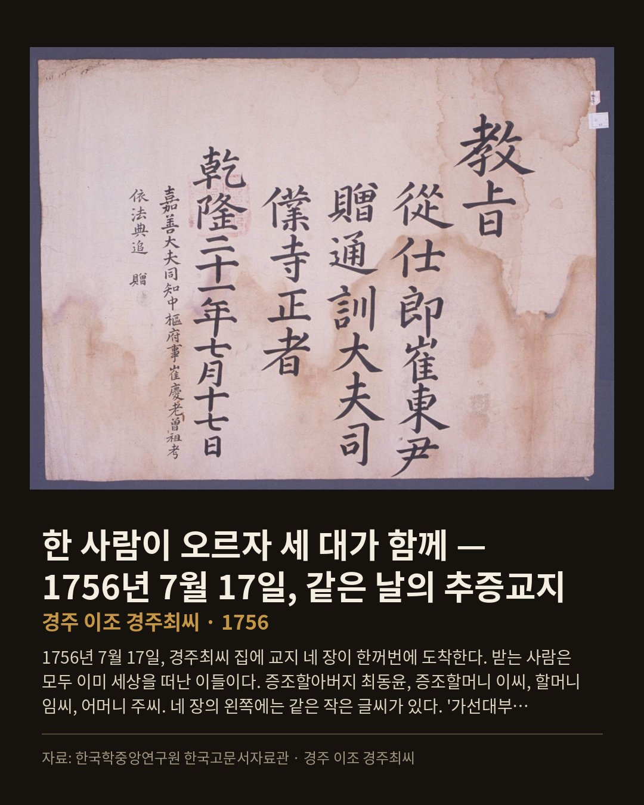
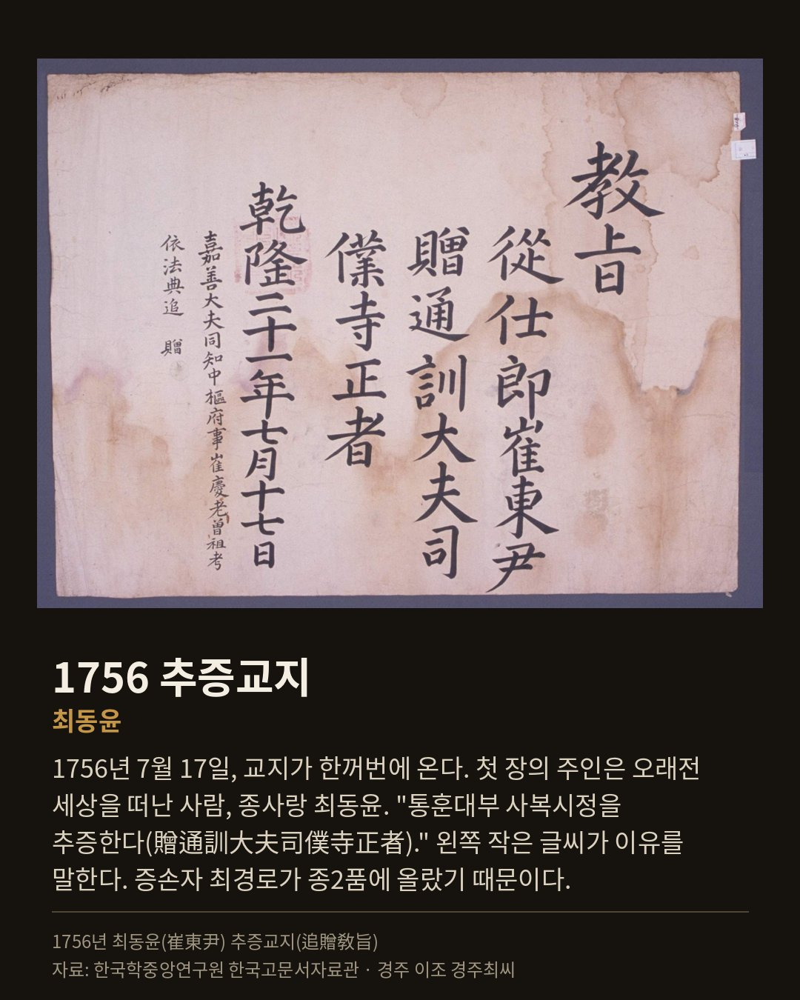

# EP.156 한 사람이 오르자 세 대가 함께 — 1756년 7월 17일, 같은 날의 추증교지 네 장

경주 이조 경주최씨 (문중) · 1756년 7월 17일, 경주최씨 집에 교지 네 장이 한꺼번에 도착한다. 받는 사람은 모두 이미 세상을 떠난 이들이다. 증조할아버지 최동윤, 증조할머니 이씨, 할머니 임씨, 어머니 주씨. 네 장의 왼쪽에는 같은 작은 글씨가 있다. '가선대부 동지중추부사 최경로의 … 법전에 따라 추증한다'

- 🌐 [전시 웹페이지](https://changgi.github.io/archive-tools/examples/choi-ijo-chujeung/exhibit.html) (한자 위 한글 독음 · 원문 해석) · [수업 활동지](https://changgi.github.io/archive-tools/examples/choi-ijo-chujeung/handout.html)
- 🎬 영상: [릴스 9:16](https://changgi.github.io/archive-tools-next/media/ep156-choi-ijo-chujeung_reel.mp4) · [가로 16:9](https://changgi.github.io/archive-tools-next/media/ep156-choi-ijo-chujeung_wide.mp4) · 홍보 글: [`promo.md`](promo.md)
- 카드뉴스: [`cards/`](cards/) · SNS 글: [`sns.txt`](sns.txt) · 판독·해석 표: [`selection.csv`](selection.csv)

<!-- DELIVERY -->
## 전달 에디팅 — 이 기록을 이렇게 전합니다

- **핵심 정서** — 숙연함
- **한 문장** — 추증은 산 사람의 벼슬이 죽은 조상에게 거슬러 올라가는 제도다 — 최경로가 종2품에 오르자, 법전대로 어머니 · 할머니 · 증조부모가 한 등씩 낮춰 품계를 받았다.
- **열기** — 1756년 여름 같은 날, 세상을 떠난 네 사람이 함께 벼슬을 받았습니다.
- **펼치기** — 최동윤 추증교지 → 이씨 추증교지 → 임씨 추증교지 → 주씨 추증교지 (1756년) — 증조할아버지 최동윤(통훈대부 사복시정) → 증조할머니 이씨(숙인) → 할머니 임씨(숙부인) → 어머니 주씨(정부인)로, 위 대에서 아래 대로 내려오며 품계가 한 단계씩 높아지는 모양이 보이게 놓았습니다.
- **절정** — "유인 주씨에게 정부인을 추증한다(孺人朱氏 贈貞夫人者)" — 화면·공간에서 이 한 줄만 크게, 소리를 줄여 집중
- **여운** — 살아서 받지 못한 이름을 죽은 뒤에 받는다는 것은, 누구를 위한 일이었을까요? — 질문으로 끝내고 답은 보는 사람에게
- **감각과 물질** — 같은 날짜 '乾隆二十一年七月十七日'과 같은 작은 글씨 '依法典追贈'이 네 장에 똑같이 · 어보·관인 탁본 스탬프를 찍어 보는 체험
- **통로와 매개** — 온라인: 릴스(열기) → 카드뉴스(펼치기) → 전시 웹페이지(절정·원문) → 비하인드 카드(여운) / 오프라인: 원본 크기 복제·낭독·참여 벽 / 남기기: 활동지·질문 카드
- **여운 장치** — 우리 집안 4대의 이름과 관계를 한 장에 그려 보기
- **전달 에디팅 전** — 4건의 문서를 1756년 연대순으로 놓고 문서명 · 유형 · 해설을 붙인다 — 정확하지만, 지나가면 잊힌다.
- **전달 에디팅 후** — 핵심 정서는 「숙연함」. 「1756년 여름 같은 날, 세상을 떠난 네 사람이 함께 벼슬을 받았습니다.」로 열고, 문서를 대비와 순서로 펼친 뒤, "유인 주씨에게 정부인을 추증한다(孺人朱氏 贈貞夫人者)"에서 멈춘다. 같은 날짜 '乾隆二十一年七月十七日'과 같은 작은 글씨 '依法典追贈'이 네 장에 똑같이. 마지막엔 「우리 집안 4대의 이름과 관계를 한 장에 그려 보기」로 보는 사람이 자기 이야기를 남기고 떠나게 한다.

전문: [`delivery.md`](delivery.md)
<!-- /DELIVERY -->

<!-- CURATOR -->
## 비하인드 — 큐레이터 노트

- **왜 이 문서들인가** — EP.154 · 155에서 최진립 한 사람의 고신을 읽은 뒤, 같은 집안에서 날짜 하나로 묶인 교지 네 장을 찾았습니다. 한 사람이 아니라 '세 대'가 받은 교지입니다.
- **전하고 싶은 것** — 추증은 산 사람의 벼슬이 죽은 조상에게 거슬러 올라가는 제도다 — 최경로가 종2품에 오르자, 법전대로 어머니 · 할머니 · 증조부모가 한 등씩 낮춰 품계를 받았다.
- **이렇게 보이길 바랐다** — 증조할아버지 최동윤(통훈대부 사복시정) → 증조할머니 이씨(숙인) → 할머니 임씨(숙부인) → 어머니 주씨(정부인)로, 위 대에서 아래 대로 내려오며 품계가 한 단계씩 높아지는 모양이 보이게 놓았습니다.
- **이렇게 써 주세요** — 조선의 추증 제도(『경국대전』의 3대 추증), 문무관 품계와 외명부(정부인 · 숙부인 · 숙인), 노인직 · 수직, 가문의 위상과 문서 보존 수업에 쓰세요.
- **만들며 있었던 일** — 네 장 모두 해서로 또렷합니다. 최경로가 어떤 경로로 가선대부 동지중추부사가 되었는지(노인직 등)는 문서에 없어 판단하지 않았습니다. 할아버지 · 아버지의 추증교지는 이 묶음에 없습니다. 최동윤과 최진립의 관계는 돌림자만 같을 뿐 문서로 확인하지 않았습니다.
- **남겨 둔 질문** — 살아서 받지 못한 이름을 죽은 뒤에 받는다는 것은, 누구를 위한 일이었을까요?
- **제작 기록** — 문서 4건 · 1756년 · 원본 사진 4면(문서 전체) · 원문 판독 4건 · 번역 4건

전문: [`curator.md`](curator.md) · 비하인드 카드: [`behind/`](behind/) · 채널별 홍보안: [`channels.md`](channels.md)
<!-- /CURATOR -->

## 이야기 — 사료가 말하는 대로

1756년 여름 같은 날, 세상을 떠난 네 사람이 함께 벼슬을 받았습니다.

> **1756 추증교지** — 1756년 7월 17일, 교지가 한꺼번에 온다. 첫 장의 주인은 오래전 세상을 떠난 사람, 종사랑 최동윤. "통훈대부 사복시정을 추증한다(贈通訓大夫司僕寺正者)." 왼쪽 작은 글씨가 이유를 말한다. 증손자 최경로가 종2품에 올랐기 때문이다.
> **1756 추증교지** — 둘째 장, 증조할머니. 이름은 없다. "유인 이씨에게 숙인을 추증한다(孺人李氏 贈淑人者)." 9품 관원의 아내였던 그는, 남편과 함께 3품 관원의 아내가 된다.
> **1756 추증교지** — 셋째 장, 할머니 임씨. 한 대 내려오자 한 칸 올라간다. "유인 임씨에게 숙부인을 추증한다(孺人任氏 贈淑夫人者)." 숙인에서 숙부인으로. 법전이 정한 계단 그대로다.
> **1756 추증교지** — 마지막 장, 어머니 주씨. 가장 가까운 사람이 가장 높은 이름을 받는다. "유인 주씨에게 정부인을 추증한다(孺人朱氏 贈貞夫人者)." 아들이 오른 자리만큼, 어머니도 올랐다. 네 장의 날짜는 모두 같다. 7월 17일.

| 표지 | 1번 카드 | 마무리 |
|---|---|---|
|  |  |  |

## 선별 문서 (4점)

| # | 연도 | 유형 | 문서명 | 원본 |
|---|---|---|---|---|
| 1 | 1756 | 추증교지 | 1756년 최동윤(崔東尹) 추증교지(追贈敎旨) | [원본 보기](https://archive.aks.ac.kr/viewer/viewer.do#imgnode.do?itemId=book&gubun=booktree&depth=6&upPath=01%5E0167%5EL016706%5EL016706F02%5EL016706F0201&dataId=G002%2BAKS%2BKSM-XA.1756.1111-20101008.B033a_050_00025_XXX&itemType=) |
| 2 | 1756 | 추증교지 | 1756년 이씨(李氏) 추증교지(追贈敎旨) | [원본 보기](https://archive.aks.ac.kr/viewer/viewer.do#imgnode.do?itemId=book&gubun=booktree&depth=6&upPath=01%5E0167%5EL016706%5EL016706F02%5EL016706F0201&dataId=G002%2BAKS%2BKSM-XA.1756.1111-20101008.B033a_050_00026_XXX&itemType=) |
| 3 | 1756 | 추증교지 | 1756년 임씨(任氏) 추증교지(追贈敎旨) | [원본 보기](https://archive.aks.ac.kr/viewer/viewer.do#imgnode.do?itemId=book&gubun=booktree&depth=6&upPath=01%5E0167%5EL016706%5EL016706F02%5EL016706F0201&dataId=G002%2BAKS%2BKSM-XA.1756.1111-20101008.B033a_050_00027_XXX&itemType=) |
| 4 | 1756 | 추증교지 | 1756년 주씨(朱氏) 추증교지(追贈敎旨) | [원본 보기](https://archive.aks.ac.kr/viewer/viewer.do#imgnode.do?itemId=book&gubun=booktree&depth=6&upPath=01%5E0167%5EL016706%5EL016706F02%5EL016706F0201&dataId=G002%2BAKS%2BKSM-XA.1756.1111-20101008.B033a_050_00028_XXX&itemType=) |

## 원문 판독과 해석

### 1. 1756년 최동윤(崔東尹) 추증교지(追贈敎旨)

**원문 판독**

```
敎旨
從仕郞崔東尹
贈通訓大夫司
僕寺正者
乾隆二十一年七月十七日
嘉善大夫同知中樞府事崔慶老曾祖考 依法典追贈
```

**원문 해석** 교지. 종사랑 최동윤에게 통훈대부 사복시정을 추증한다. 건륭 21년(1756) 7월 17일. 가선대부 동지중추부사 최경로의 증조할아버지이므로 법전에 따라 추증한다.

**해제** 1756년(영조 32) 7월 17일, 종사랑(從仕郞, 정9품) 최동윤(崔東尹)에게 통훈대부(通訓大夫, 정3품 당하) 사복시정(司僕寺正)을 추증(追贈)한 교지입니다. 왼쪽 작은 글씨가 까닭을 밝힙니다. '가선대부 동지중추부사 최경로(崔慶老)의 증조할아버지(曾祖考)이므로 법전에 따라 추증한다(依法典追贈).' 『경국대전』은 종2품 이상 관원의 3대 조상에게 벼슬을 추증하되, 아버지는 본인과 같게, 할아버지와 증조는 한 등씩 낮추게 했습니다. 정9품으로 세상을 떠난 증조가 정3품을 받은 것입니다. 같은 날짜의 교지가 세 장 더 있습니다.

### 2. 1756년 이씨(李氏) 추증교지(追贈敎旨)

**원문 판독**

```
敎旨
孺人李氏
贈淑人者
乾隆二十一年七月十七日
嘉善大夫同知中樞府事崔慶老曾祖妣 依法典追贈
```

**원문 해석** 교지. 유인 이씨에게 숙인을 추증한다. 건륭 21년(1756) 7월 17일. 가선대부 동지중추부사 최경로의 증조할머니이므로 법전에 따라 추증한다.

**해제** 같은 날, 최경로의 증조할머니(曾祖妣) 이씨에게 숙인(淑人)을 추증한 교지입니다. 여성은 이름 없이 성으로만 적히며, 남편의 품계에 맞춰 외명부(外命婦) 칭호를 받습니다. 유인(孺人)은 9품 관원의 아내, 숙인은 정 · 종3품 당하관의 아내 칭호로, 남편 최동윤이 통훈대부(정3품 당하)를 추증받은 것에 맞춘 것입니다. 이름 없는 여성이 성 한 글자로 교지를 받는 모습은 EP.139의 정빈 이씨 교지와도 겹칩니다.

### 3. 1756년 임씨(任氏) 추증교지(追贈敎旨)

**원문 판독**

```
敎旨
孺人任氏
贈淑夫人
者
乾隆二十一年七月十七日
嘉善大夫同知中樞府事崔慶老祖妣 依法典追贈
```

**원문 해석** 교지. 유인 임씨에게 숙부인을 추증한다. 건륭 21년(1756) 7월 17일. 가선대부 동지중추부사 최경로의 할머니이므로 법전에 따라 추증한다.

**해제** 같은 날, 최경로의 할머니(祖妣) 임씨에게 숙부인(淑夫人)을 추증한 교지입니다. 숙부인은 정3품 당상관의 아내 칭호로, 증조할머니(숙인)보다 한 단계 높습니다. 할아버지 쪽 교지는 이 묶음에 없으나, 할아버지가 정3품 당상(통정대부)을 추증받은 데 맞춘 것으로 보입니다. 한 대 내려올 때마다 한 단계씩 높아지는 추증 규정이 네 장 사이에서 그대로 드러납니다.

### 4. 1756년 주씨(朱氏) 추증교지(追贈敎旨)

**원문 판독**

```
敎旨
孺人朱氏
贈貞夫人
者
乾隆二十一年七月十七日
嘉善大夫同知中樞府事崔慶老妣 依法典追贈
```

**원문 해석** 교지. 유인 주씨에게 정부인을 추증한다. 건륭 21년(1756) 7월 17일. 가선대부 동지중추부사 최경로의 어머니이므로 법전에 따라 추증한다.

**해제** 같은 날, 최경로의 어머니(妣) 주씨에게 정부인(貞夫人)을 추증한 교지입니다. 정부인은 정 · 종2품 관원의 아내 칭호로, 아들 최경로의 품계(가선대부, 종2품)와 같은 등급입니다. 아버지는 아들과 같은 품계를 받는다는 규정에 맞춰, 어머니도 같은 등급을 받았습니다. 네 장 가운데 가장 높은 칭호가 가장 가까운 사람, 어머니에게 갔습니다. 최경로가 어떤 경로로 가선대부 동지중추부사가 되었는지는 이 문서들로 알 수 없습니다.

판독·해석·이야기는 이미지에 근거한 초안이며(검토 전 "초안" 표시), 정확한 판독은 원문 확인이 필요합니다. □는 읽지 못한 글자, (?)는 불확실한 글자입니다.
이미지: 한국학중앙연구원 한국고문서자료관 소장·제공. "원본" 링크를 누르면 자료관 뷰어에서 그 문서가 열립니다. 재사용은 자료관에 문의하세요(소장처 동의 필요).
