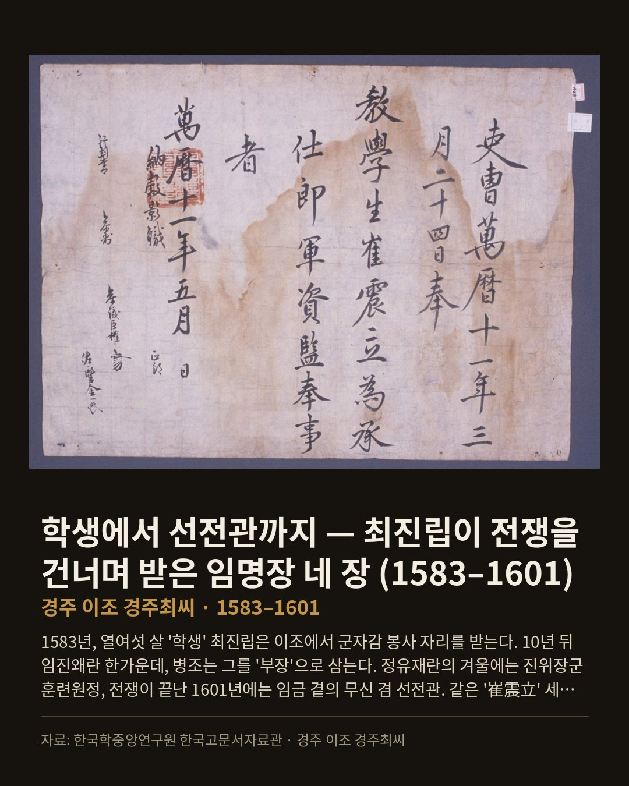
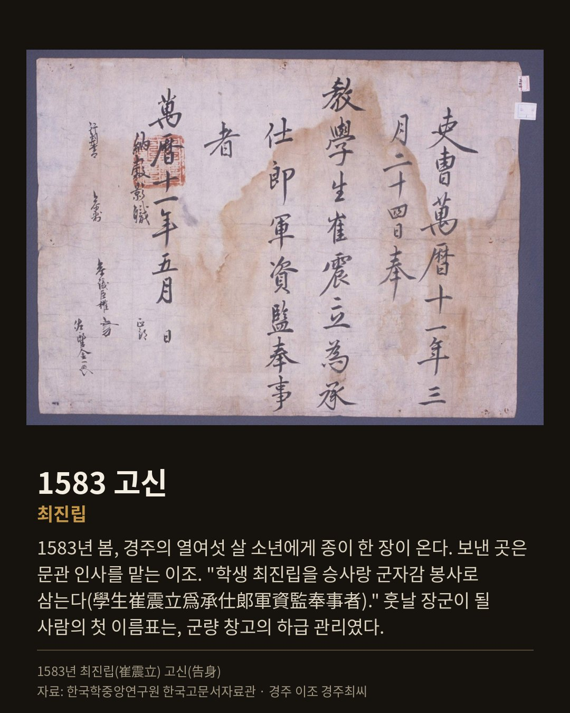

# EP.154 학생에서 선전관까지 — 최진립이 전쟁을 건너며 받은 임명장 네 장 (1583–1601)

경주 이조 경주최씨 (문중) · 1583년, 열여섯 살 '학생' 최진립은 이조에서 군자감 봉사 자리를 받는다. 10년 뒤 임진왜란 한가운데, 병조는 그를 '부장'으로 삼는다. 정유재란의 겨울에는 진위장군 훈련원정, 전쟁이 끝난 1601년에는 임금 곁의 무신 겸 선전관. 같은 '崔震立' 세 글자 옆에서 직함만 바뀌어 간다

- 🌐 [전시 웹페이지](https://changgi.github.io/archive-tools/examples/choi-ijo-gosin1/exhibit.html) (한자 위 한글 독음 · 원문 해석) · [수업 활동지](https://changgi.github.io/archive-tools/examples/choi-ijo-gosin1/handout.html)
- 🎬 영상: [릴스 9:16](https://changgi.github.io/archive-tools-next/media/ep154-choi-ijo-gosin1_reel.mp4) · [가로 16:9](https://changgi.github.io/archive-tools-next/media/ep154-choi-ijo-gosin1_wide.mp4) · 홍보 글: [`promo.md`](promo.md)
- 카드뉴스: [`cards/`](cards/) · SNS 글: [`sns.txt`](sns.txt) · 판독·해석 표: [`selection.csv`](selection.csv)

<!-- DELIVERY -->
## 전달 에디팅 — 이 기록을 이렇게 전합니다

- **핵심 정서** — 뿌듯함
- **한 문장** — 한 사람의 임명장을 차례로 놓으면 이력서가 된다 — 학생에서 문관 봉사로, 전쟁 속 부장으로, 장군 품계와 훈련원으로, 그리고 임금 곁의 선전관으로.
- **열기** — 무과에 붙기 11년 전, 열여섯 살 최진립은 먼저 문관 벼슬을 받았습니다.
- **펼치기** — 최진립 고신 → 최진립 고신－1 (1583–1601년) — 1583(이조, 학생 → 군자감 봉사) → 1593(병조, 전 봉사 → 부장) → 1597(진위장군 훈련원정) → 1601(무신 겸 선전관)으로, 발급처가 이조에서 병조로, 다시 '교지'로 바뀌는 모습이 보이게 했습니다.
- **절정** — "학생 최진립을 승사랑 군자감 봉사로 삼는다(學生崔震立爲承仕郞軍資監奉事者)" — 화면·공간에서 이 한 줄만 크게, 소리를 줄여 집중
- **여운** — 열여섯 살 '학생'이 받은 첫 임명장을, 그는 일흔 살까지 간직했을까요? — 질문으로 끝내고 답은 보는 사람에게
- **감각과 물질** — 같은 크기의 종이 네 장, 같은 '崔震立' 세 글자 — 그 옆 직함만 바뀐다 · 어보·관인 탁본 스탬프를 찍어 보는 체험
- **통로와 매개** — 온라인: 릴스(열기) → 카드뉴스(펼치기) → 전시 웹페이지(절정·원문) → 비하인드 카드(여운) / 오프라인: 원본 크기 복제·낭독·참여 벽 / 남기기: 활동지·질문 카드
- **여운 장치** — 내 이력의 첫 줄과 지금의 줄을 나란히 적어 보기
- **전달 에디팅 전** — 4건의 문서를 1583–1601년 연대순으로 놓고 문서명 · 유형 · 해설을 붙인다 — 정확하지만, 지나가면 잊힌다.
- **전달 에디팅 후** — 핵심 정서는 「뿌듯함」. 「무과에 붙기 11년 전, 열여섯 살 최진립은 먼저 문관 벼슬을 받았습니다.」로 열고, 문서를 대비와 순서로 펼친 뒤, "학생 최진립을 승사랑 군자감 봉사로 삼는다(學生崔震立爲承仕郞軍資監奉事者)"에서 멈춘다. 같은 크기의 종이 네 장, 같은 '崔震立' 세 글자 — 그 옆 직함만 바뀐다. 마지막엔 「내 이력의 첫 줄과 지금의 줄을 나란히 적어 보기」로 보는 사람이 자기 이야기를 남기고 떠나게 한다.

전문: [`delivery.md`](delivery.md)
<!-- /DELIVERY -->

<!-- CURATOR -->
## 비하인드 — 큐레이터 노트

- **왜 이 문서들인가** — EP.36에서 최진립의 무과 홍패 · 교서 · 시호 교지를 읽었습니다. 같은 집안에는 그가 받은 고신(임명장)이 스무 장 가까이 남아 있어, 두 편으로 나누어 그의 50년을 따라가기로 했습니다. 이번은 전쟁 전후의 앞 절반입니다.
- **전하고 싶은 것** — 한 사람의 임명장을 차례로 놓으면 이력서가 된다 — 학생에서 문관 봉사로, 전쟁 속 부장으로, 장군 품계와 훈련원으로, 그리고 임금 곁의 선전관으로.
- **이렇게 보이길 바랐다** — 1583(이조, 학생 → 군자감 봉사) → 1593(병조, 전 봉사 → 부장) → 1597(진위장군 훈련원정) → 1601(무신 겸 선전관)으로, 발급처가 이조에서 병조로, 다시 '교지'로 바뀌는 모습이 보이게 했습니다.
- **이렇게 써 주세요** — 조선의 관직 임명 문서(고신 · 교지)의 서식, 문관과 무관의 품계, 임진왜란 · 정유재란기의 무관 등용, 한 인물의 생애를 문서로 재구성하기 수업에 쓰세요.
- **만들며 있었던 일** — 네 장 모두 해서로 또렷하나 1593년 장은 가장자리가 해져 날짜의 일부를 확정하지 못했습니다. 1583년에 열여섯 살이던 그가 어떤 경로로 봉사가 되었는지(음직 등)는 문서에 없어 판단하지 않았습니다. 최진립의 생몰(1568–1637)과 무과 급제(1594)는 EP.36과 알려진 사실을 따랐습니다.
- **남겨 둔 질문** — 열여섯 살 '학생'이 받은 첫 임명장을, 그는 일흔 살까지 간직했을까요?
- **제작 기록** — 문서 4건 · 1583–1601년 · 원본 사진 4면(문서 전체) · 원문 판독 4건 · 번역 4건 · 못 읽은 글자 □ 1 · 불확실 (?) 0

전문: [`curator.md`](curator.md) · 비하인드 카드: [`behind/`](behind/) · 채널별 홍보안: [`channels.md`](channels.md)
<!-- /CURATOR -->

## 이야기 — 사료가 말하는 대로

무과에 붙기 11년 전, 열여섯 살 최진립은 먼저 문관 벼슬을 받았습니다.

> **1583 고신** — 1583년 봄, 경주의 열여섯 살 소년에게 종이 한 장이 온다. 보낸 곳은 문관 인사를 맡는 이조. "학생 최진립을 승사랑 군자감 봉사로 삼는다(學生崔震立爲承仕郞軍資監奉事者)." 훗날 장군이 될 사람의 첫 이름표는, 군량 창고의 하급 관리였다.
> **1593 고신** — 10년 뒤, 나라는 전쟁 중이다. 이번에 종이를 보낸 곳은 병조. 첫머리가 달라졌다. "전 봉사 최진립을 병절교위 부장으로 삼는다(前奉事崔震立爲秉節校尉部將者)." 군량을 세던 사람이, 이제 군사를 거느린다.
> **1597 고신** — 다시 4년 뒤, 정유재란의 겨울. 종이의 첫 두 글자가 바뀐다. '敎旨', 임금이 직접 내리는 문서다. "최진립을 진위장군 수 훈련원정으로 삼는다(崔震立爲振威將軍守訓鍊院正者)." 부장에서 장군의 품계까지, 4년이 걸렸다.
> **1601 고신** — 전쟁이 끝나고, 1601년 정월. 최진립은 서른넷이다. "어모장군, 무신 겸 선전관으로 삼는다(禦侮將軍武臣兼宣傳官者)." 임금의 명을 전하는 자리. 열여섯 살 학생이 18년 만에 왕의 곁에 섰다.

| 표지 | 1번 카드 | 마무리 |
|---|---|---|
|  |  |  |

## 선별 문서 (4점)

| # | 연도 | 유형 | 문서명 | 원본 |
|---|---|---|---|---|
| 1 | 1583 | 고신 | 1583년 최진립(崔震立) 고신(告身) | [원본 보기](https://archive.aks.ac.kr/viewer/viewer.do#imgnode.do?itemId=book&gubun=booktree&depth=6&upPath=01%5E0167%5EL016706%5EL016706F02%5EL016706F0201&dataId=G002%2BAKS%2BKSM-XA.1583.1111-20101008.B033a_050_00002_XXX&itemType=) |
| 2 | 1593 | 고신 | 1593년 최진립(崔震立) 고신(告身) | [원본 보기](https://archive.aks.ac.kr/viewer/viewer.do#imgnode.do?itemId=book&gubun=booktree&depth=6&upPath=01%5E0167%5EL016706%5EL016706F02%5EL016706F0201&dataId=G002%2BAKS%2BKSM-XA.1593.1111-20101008.B033a_050_00003_XXX&itemType=) |
| 3 | 1597 | 고신 | 1597년 최진립(崔震立) 고신(告身)－1 | [원본 보기](https://archive.aks.ac.kr/viewer/viewer.do#imgnode.do?itemId=book&gubun=booktree&depth=6&upPath=01%5E0167%5EL016706%5EL016706F02%5EL016706F0201&dataId=G002%2BAKS%2BKSM-XA.1597.1111-20101008.B033a_050_00005_XXX&itemType=) |
| 4 | 1601 | 고신 | 1601년 최진립(崔震立) 고신(告身) | [원본 보기](https://archive.aks.ac.kr/viewer/viewer.do#imgnode.do?itemId=book&gubun=booktree&depth=6&upPath=01%5E0167%5EL016706%5EL016706F02%5EL016706F0201&dataId=G002%2BAKS%2BKSM-XA.1601.1111-20101008.B033a_050_00009_XXX&itemType=) |

## 원문 판독과 해석

### 1. 1583년 최진립(崔震立) 고신(告身)

**원문 판독**

```
吏曹萬曆十一年三
月二十四日奉
敎學生崔震立爲承
仕郞軍資監奉事
者
萬曆十一年五月 日
(이조 당상 · 낭관 서명)
```

**원문 해석** 이조가 만력 11년(1583) 3월 24일 받든 임금의 명에 따라, 학생 최진립을 승사랑 군자감 봉사로 삼는다. 만력 11년 5월 일.

**해제** 1583년(선조 16) 이조(吏曹)가 '학생(學生)' 최진립(崔震立)을 승사랑(承仕郞, 종8품 문산계) 군자감 봉사(軍資監奉事, 종8품)로 임명한 고신(告身)입니다. 고신은 관직 임명장으로, 4품 이하는 이조 · 병조가 '某曹 某年月日奉 敎 某爲某職者'의 틀로 발급합니다. 군자감은 군량을 관리하는 관청이고, 문관 인사를 맡은 이조의 문서입니다. 1568년생인 최진립은 이때 열여섯 살이었으며, 무과에 급제한 것은 11년 뒤인 1594년입니다(EP.36). 어떤 경로로 이 자리를 받았는지는 문서에 없습니다. 왼쪽 아래에 이조 관원들의 직함과 서명이 있습니다.

### 2. 1593년 최진립(崔震立) 고신(告身)

**원문 판독**

```
兵曹萬曆二十一年二月 … 日奉
敎前奉事崔震立爲
秉節校尉部將
者
萬曆二十一年二月 日
(병조 당상 · 낭관 서명)
```

**원문 해석** 병조가 만력 21년(1593) 2월 ○일 받든 임금의 명에 따라, 전 봉사 최진립을 병절교위 부장으로 삼는다. 만력 21년 2월 일.

**해제** 임진왜란 이듬해인 1593년(선조 26) 2월, 이번에는 무관 인사를 맡은 병조(兵曹)가 '전 봉사(前奉事)' 최진립을 병절교위(秉節校尉, 종6품 무산계) 부장(部將)으로 임명한 고신입니다. 10년 전 문관 봉사였던 그가 전쟁 속에서 무관의 길로 들어섰음을 보여 줍니다. 부장은 오위(五衛)의 부(部)를 거느리는 무관 직임입니다. 이듬해 1594년 무과 홍패(EP.36)에 그는 이미 '부장 최진립'으로 적혀 있습니다. 가장자리가 해져 날짜의 일부를 확정하지 못했습니다.

### 3. 1597년 최진립(崔震立) 고신(告身)－1

**원문 판독**

```
敎旨
崔震立爲振威
將軍守訓鍊院
正者
萬曆二十五年十一月 日
```

**원문 해석** 교지. 최진립을 진위장군 수 훈련원정으로 삼는다. 만력 25년(1597) 11월 일.

**해제** 정유재란이 일어난 1597년(선조 30) 11월, 최진립을 진위장군(振威將軍, 정3품 당하 무산계) 수 훈련원정(守訓鍊院正)으로 삼은 교지입니다. 이제 발급 주체가 이조 · 병조가 아니라 임금의 '교지(敎旨)'이고, 어보가 찍혔습니다. 3품 이상 고신은 교지 형식으로 내립니다. 품계보다 높은 직을 맡을 때 '守', 낮은 직을 맡을 때 '行'을 붙이는데, 여기서는 품계(정3품 당하)보다 직(훈련원정, 정3품)이 높아 '守'가 붙은 것으로 보입니다. 훈련원은 무관 시험과 군사 훈련을 맡던 관청입니다. 무과 급제 3년 만의 일입니다.

### 4. 1601년 최진립(崔震立) 고신(告身)

**원문 판독**

```
敎旨
崔震立爲禦
侮將軍武臣
兼宣傳官者
萬曆二十九年正月二十□日
```

**원문 해석** 교지. 최진립을 어모장군 무신 겸 선전관으로 삼는다. 만력 29년(1601) 정월 2○일.

**해제** 전쟁이 끝난 뒤인 1601년(선조 34) 정월, 최진립을 어모장군(禦侮將軍, 정3품 당하 무산계) 무신 겸 선전관(武臣兼宣傳官)으로 삼은 교지입니다. 선전관은 임금 가까이에서 명령을 전하고 호위하는 무관 직임으로, 무신 가운데 뽑아 겸하게 했습니다. 1597년 진위장군에서 어모장군으로 무산계가 한 단계 올랐습니다. 학생 · 봉사 · 부장 · 훈련원정을 거친 18년의 앞 절반이 여기서 끝나고, 다음 편(EP.155)에서는 변방 수령과 수군절도사의 시기로 이어집니다. 날짜 일의 자리 한 글자는 확정하지 못했습니다.

판독·해석·이야기는 이미지에 근거한 초안이며(검토 전 "초안" 표시), 정확한 판독은 원문 확인이 필요합니다. □는 읽지 못한 글자, (?)는 불확실한 글자입니다.
이미지: 한국학중앙연구원 한국고문서자료관 소장·제공. "원본" 링크를 누르면 자료관 뷰어에서 그 문서가 열립니다. 재사용은 자료관에 문의하세요(소장처 동의 필요).
