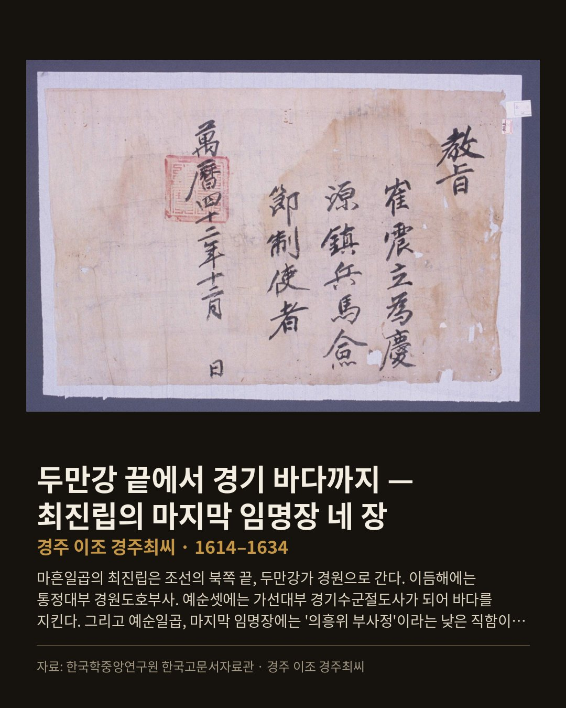
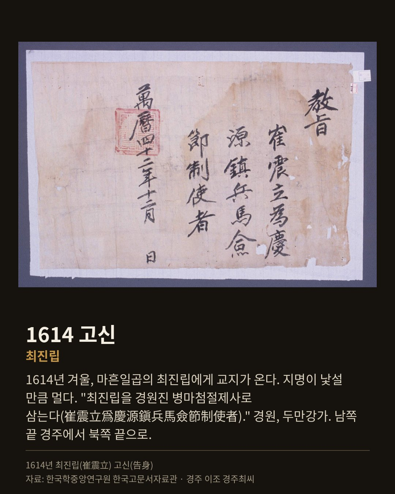

# EP.155 두만강 끝에서 경기 바다까지 — 최진립의 마지막 임명장 네 장 (1614–1634)

경주 이조 경주최씨 (문중) · 마흔일곱의 최진립은 조선의 북쪽 끝, 두만강가 경원으로 간다. 이듬해에는 통정대부 경원도호부사. 예순셋에는 가선대부 경기수군절도사가 되어 바다를 지킨다. 그리고 예순일곱, 마지막 임명장에는 '의흥위 부사정'이라는 낮은 직함이 적혀 있다. 3년 뒤 그는 병자호란의 싸움터로 나간다

- 🌐 [전시 웹페이지](https://changgi.github.io/archive-tools/examples/choi-ijo-gosin2/exhibit.html) (한자 위 한글 독음 · 원문 해석) · [수업 활동지](https://changgi.github.io/archive-tools/examples/choi-ijo-gosin2/handout.html)
- 🎬 영상: [릴스 9:16](https://changgi.github.io/archive-tools-next/media/ep155-choi-ijo-gosin2_reel.mp4) · [가로 16:9](https://changgi.github.io/archive-tools-next/media/ep155-choi-ijo-gosin2_wide.mp4) · 홍보 글: [`promo.md`](promo.md)
- 카드뉴스: [`cards/`](cards/) · SNS 글: [`sns.txt`](sns.txt) · 판독·해석 표: [`selection.csv`](selection.csv)

<!-- DELIVERY -->
## 전달 에디팅 — 이 기록을 이렇게 전합니다

- **핵심 정서** — 숙연함
- **한 문장** — 품계는 올라가도 직함은 오르내린다 — 통정 · 가선대부의 품계를 지닌 장군이 마지막에는 오위의 낮은 자리(부사정)를 받았다. 고신은 벼슬의 높이가 아니라 맡은 일의 기록이다.
- **열기** — 예순일곱 장군의 마지막 임명장에는, 가장 낮은 직함이 적혀 있었습니다.
- **펼치기** — 최진립 고신 → 최진립 고신－1 (1614–1634년) — 1614(경원진 병마첨절제사) → 1615(통정대부 경원도호부사) → 1630(가선대부 경기수군절도사) → 1634(가선대부 행 의흥위 부사정)로, 북쪽 끝에서 바다로, 그리고 다시 도성의 오위로 옮겨 가는 지도를 그리게 했습니다.
- **절정** — "가선대부 행 경기수군절도사로 삼는다(嘉善大夫行京畿水軍節度使者)" — 화면·공간에서 이 한 줄만 크게, 소리를 줄여 집중
- **여운** — 두만강과 경기 바다를 지킨 장군에게, 마지막 직함은 어떤 의미였을까요? — 질문으로 끝내고 답은 보는 사람에게
- **감각과 물질** — '嘉善大夫' 네 글자는 그대로인데, 그 아래 직함이 '水軍節度使'에서 '副司正'으로 내려간다 · 어보·관인 탁본 스탬프를 찍어 보는 체험
- **통로와 매개** — 온라인: 릴스(열기) → 카드뉴스(펼치기) → 전시 웹페이지(절정·원문) → 비하인드 카드(여운) / 오프라인: 원본 크기 복제·낭독·참여 벽 / 남기기: 활동지·질문 카드
- **여운 장치** — 한 사람의 삶을 지도 위 장소 네 곳으로 정리해 보기
- **전달 에디팅 전** — 4건의 문서를 1614–1634년 연대순으로 놓고 문서명 · 유형 · 해설을 붙인다 — 정확하지만, 지나가면 잊힌다.
- **전달 에디팅 후** — 핵심 정서는 「숙연함」. 「예순일곱 장군의 마지막 임명장에는, 가장 낮은 직함이 적혀 있었습니다.」로 열고, 문서를 대비와 순서로 펼친 뒤, "가선대부 행 경기수군절도사로 삼는다(嘉善大夫行京畿水軍節度使者)"에서 멈춘다. '嘉善大夫' 네 글자는 그대로인데, 그 아래 직함이 '水軍節度使'에서 '副司正'으로 내려간다. 마지막엔 「한 사람의 삶을 지도 위 장소 네 곳으로 정리해 보기」로 보는 사람이 자기 이야기를 남기고 떠나게 한다.

전문: [`delivery.md`](delivery.md)
<!-- /DELIVERY -->

<!-- CURATOR -->
## 비하인드 — 큐레이터 노트

- **왜 이 문서들인가** — EP.154(1583–1601)에 이어 최진립 고신의 뒤 절반입니다. 같은 집안의 고신 가운데 변방 · 바다 · 마지막 직함을 보여 주는 네 장을 골랐습니다.
- **전하고 싶은 것** — 품계는 올라가도 직함은 오르내린다 — 통정 · 가선대부의 품계를 지닌 장군이 마지막에는 오위의 낮은 자리(부사정)를 받았다. 고신은 벼슬의 높이가 아니라 맡은 일의 기록이다.
- **이렇게 보이길 바랐다** — 1614(경원진 병마첨절제사) → 1615(통정대부 경원도호부사) → 1630(가선대부 경기수군절도사) → 1634(가선대부 행 의흥위 부사정)로, 북쪽 끝에서 바다로, 그리고 다시 도성의 오위로 옮겨 가는 지도를 그리게 했습니다.
- **이렇게 써 주세요** — 조선의 품계와 관직(行 · 守), 북방 진보와 수군 체제, 오위 체아직, 병자호란 전야의 무관, 한 인물의 생애 연표 만들기 수업에 쓰세요.
- **만들며 있었던 일** — 네 장 모두 해서로 또렷하나 1615년 장의 날짜 일부는 확정하지 못했습니다. 1634년 '의흥위 부사정'은 품계에 비해 낮은 직이어서 '行'이 붙었고, 실무보다 녹봉을 위한 오위 체아직으로 보았으나 그 사정은 문서에 없습니다. 병자호란 때의 전사(1637)는 EP.36과 알려진 사실을 따랐습니다.
- **남겨 둔 질문** — 두만강과 경기 바다를 지킨 장군에게, 마지막 직함은 어떤 의미였을까요?
- **제작 기록** — 문서 4건 · 1614–1634년 · 원본 사진 4면(문서 전체) · 원문 판독 4건 · 번역 4건

전문: [`curator.md`](curator.md) · 비하인드 카드: [`behind/`](behind/) · 채널별 홍보안: [`channels.md`](channels.md)
<!-- /CURATOR -->

## 이야기 — 사료가 말하는 대로

예순일곱 장군의 마지막 임명장에는, 가장 낮은 직함이 적혀 있었습니다.

> **1614 고신** — 1614년 겨울, 마흔일곱의 최진립에게 교지가 온다. 지명이 낯설 만큼 멀다. "최진립을 경원진 병마첨절제사로 삼는다(崔震立爲慶源鎭兵馬僉節制使者)." 경원, 두만강가. 남쪽 끝 경주에서 북쪽 끝으로.
> **1615 고신** — 이듬해, 같은 경원. 이번에는 앞에 네 글자가 붙는다. "통정대부 행 경원도호부사(通政大夫行慶源都護府使)." 통정대부, 당상관이다. 국경의 군사 지휘관이 이제 그 고을 전체를 맡는다.
> **1630 고신** — 열다섯 해 뒤, 예순셋. 이번에는 바다다. "가선대부 행 경기수군절도사로 삼는다(嘉善大夫行京畿水軍節度使者)." 두만강을 지키던 장군이, 이제 도성으로 들어오는 바닷길을 지킨다.
> **1634 고신** — 그리고 예순일곱, 1634년 봄. 품계는 그대로 가선대부인데, 직함이 낮다. "가선대부 행 의흥위 부사정으로 삼는다(嘉善大夫行義興衛副司正者)." 일흔을 앞둔 장군의 마지막 무렵 임명장. 3년 뒤 겨울, 그는 다시 싸움터로 나가 돌아오지 않았다.

| 표지 | 1번 카드 | 마무리 |
|---|---|---|
|  |  |  |

## 선별 문서 (4점)

| # | 연도 | 유형 | 문서명 | 원본 |
|---|---|---|---|---|
| 1 | 1614 | 고신 | 1614년 최진립(崔震立) 고신(告身) | [원본 보기](https://archive.aks.ac.kr/viewer/viewer.do#imgnode.do?itemId=book&gubun=booktree&depth=6&upPath=01%5E0167%5EL016706%5EL016706F02%5EL016706F0201&dataId=G002%2BAKS%2BKSM-XA.1614.1111-20101008.B033a_050_00011_XXX&itemType=) |
| 2 | 1615 | 고신 | 1615년 최진립(崔震立) 고신(告身) | [원본 보기](https://archive.aks.ac.kr/viewer/viewer.do#imgnode.do?itemId=book&gubun=booktree&depth=6&upPath=01%5E0167%5EL016706%5EL016706F02%5EL016706F0201&dataId=G002%2BAKS%2BKSM-XA.1615.1111-20101008.B033a_050_00012_XXX&itemType=) |
| 3 | 1630 | 고신 | 1630년 최진립(崔震立) 고신(告身)－1 | [원본 보기](https://archive.aks.ac.kr/viewer/viewer.do#imgnode.do?itemId=book&gubun=booktree&depth=6&upPath=01%5E0167%5EL016706%5EL016706F02%5EL016706F0201&dataId=G002%2BAKS%2BKSM-XA.1630.1111-20101008.B033a_050_00016_XXX&itemType=) |
| 4 | 1634 | 고신 | 1634년 최진립(崔震立) 고신(告身) | [원본 보기](https://archive.aks.ac.kr/viewer/viewer.do#imgnode.do?itemId=book&gubun=booktree&depth=6&upPath=01%5E0167%5EL016706%5EL016706F02%5EL016706F0201&dataId=G002%2BAKS%2BKSM-XA.1634.1111-20101008.B033a_050_00020_XXX&itemType=) |

## 원문 판독과 해석

### 1. 1614년 최진립(崔震立) 고신(告身)

**원문 판독**

```
敎旨
崔震立爲慶
源鎭兵馬僉
節制使者
萬曆四十二年十一月 日
```

**원문 해석** 교지. 최진립을 경원진 병마첨절제사로 삼는다. 만력 42년(1614) 11월 일.

**해제** 1614년(광해군 6) 11월 최진립을 경원진(慶源鎭) 병마첨절제사(兵馬僉節制使, 종3품)로 삼은 교지입니다. 경원은 함경도 두만강가, 조선 동북쪽 끝의 진(鎭)으로 여진과 맞닿은 국경입니다. 첨절제사는 진을 지휘하는 무관입니다. 경주에서 태어난 그는 마흔일곱에 나라의 반대편 끝으로 갔습니다. 이 교지에는 품계가 적혀 있지 않습니다.

### 2. 1615년 최진립(崔震立) 고신(告身)

**원문 판독**

```
敎旨
崔震立爲通
政大夫行慶
源都護府使
者
萬曆四十三年 … 月初 … 日
```

**원문 해석** 교지. 최진립을 통정대부 행 경원도호부사로 삼는다. 만력 43년(1615) …월 초○일.

**해제** 이듬해 1615년(광해군 7), 최진립을 통정대부(通政大夫, 정3품 당상) 행 경원도호부사(慶源都護府使, 종3품)로 삼은 교지입니다. 정3품 당상관인 통정대부에 올랐고, 품계보다 낮은 종3품 도호부사를 맡아 '行'이 붙었습니다. 진의 군사 지휘관(첨절제사)에서 고을 전체를 다스리는 수령(도호부사)으로 바뀌었습니다. 국경 고을의 부사는 군사와 행정을 함께 맡았습니다. 날짜의 월 · 일 일부는 확정하지 못했습니다.

### 3. 1630년 최진립(崔震立) 고신(告身)－1

**원문 판독**

```
敎旨
崔震立爲
嘉善大夫
行京畿水
軍節度使
者
崇禎三年十二月二十一日
```

**원문 해석** 교지. 최진립을 가선대부 행 경기수군절도사로 삼는다. 숭정 3년(1630) 12월 21일.

**해제** 1630년(인조 8) 12월, 예순셋의 최진립을 가선대부(嘉善大夫, 종2품) 행 경기수군절도사(京畿水軍節度使, 정3품)로 삼은 교지입니다. 수군절도사는 한 도의 수군을 거느리는 최고 지휘관으로, 경기수사는 강화 · 교동 등 도성으로 들어오는 바닷길을 지켰습니다. 북쪽 국경에서 서쪽 바다로 옮긴 셈입니다. EP.36의 교서('경기수군절도사 겸 교동도호부사 · 삼도수군통어사')는 이 무렵 그의 직임을 이어 보여 줍니다. 연호가 명의 '崇禎'으로 바뀌었습니다.

### 4. 1634년 최진립(崔震立) 고신(告身)

**원문 판독**

```
敎旨
崔震立爲
嘉善大夫
行義興衛
副司正者
崇禎七年四月初三日
```

**원문 해석** 교지. 최진립을 가선대부 행 의흥위 부사정으로 삼는다. 숭정 7년(1634) 4월 3일.

**해제** 1634년(인조 12) 4월, 예순일곱의 최진립을 가선대부 행 의흥위 부사정(義興衛副司正)으로 삼은 교지입니다. 부사정은 오위의 종7품 직으로, 종2품 가선대부의 품계에 견주어 크게 낮아 '行'이 붙었습니다. 오위의 낮은 직은 현직에서 물러난 무관에게 녹봉을 주기 위한 체아직으로 자주 쓰였으며, 이 교지도 그런 성격으로 보입니다(문서에 사정은 적혀 있지 않음). 같은 집안 고신에는 1633년 같은 품계의 '용양위 부호군' 등도 있습니다. 3년 뒤 1637년 정월, 일흔의 최진립은 병자호란 때 남한산성을 구하러 나섰다가 전사합니다(EP.36).

판독·해석·이야기는 이미지에 근거한 초안이며(검토 전 "초안" 표시), 정확한 판독은 원문 확인이 필요합니다. □는 읽지 못한 글자, (?)는 불확실한 글자입니다.
이미지: 한국학중앙연구원 한국고문서자료관 소장·제공. "원본" 링크를 누르면 자료관 뷰어에서 그 문서가 열립니다. 재사용은 자료관에 문의하세요(소장처 동의 필요).
