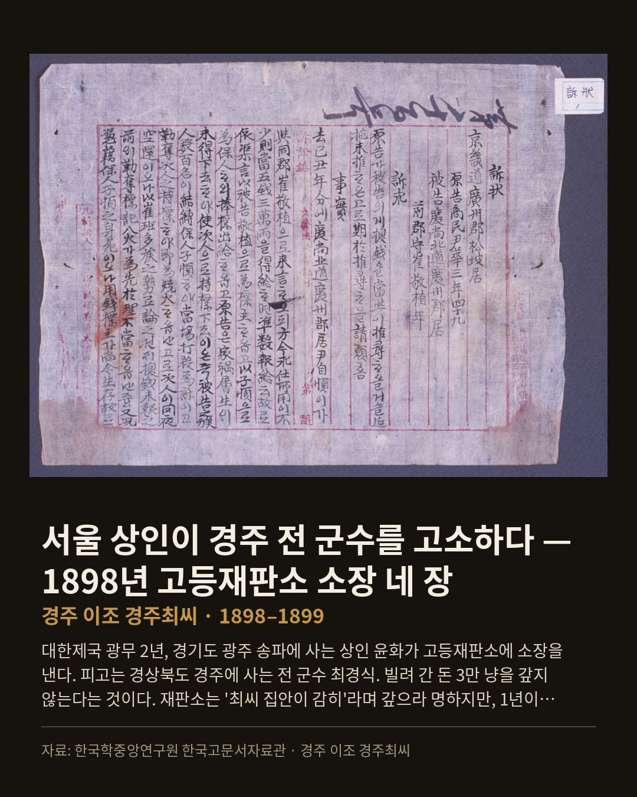
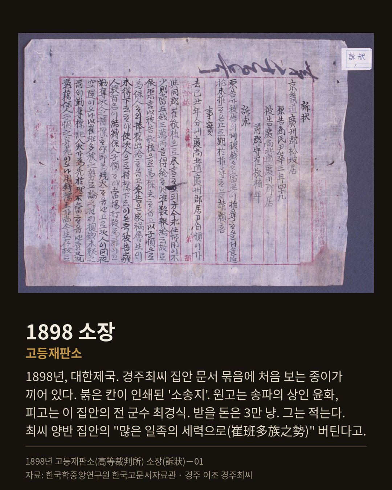

# EP.158 서울 상인이 경주 전 군수를 고소하다 — 1898년 고등재판소 소장 네 장

경주 이조 경주최씨 (문중) · 대한제국 광무 2년, 경기도 광주 송파에 사는 상인 윤화가 고등재판소에 소장을 낸다. 피고는 경상북도 경주에 사는 전 군수 최경식. 빌려 간 돈 3만 냥을 갚지 않는다는 것이다. 재판소는 '최씨 집안이 감히'라며 갚으라 명하지만, 1년이 지나도록 돈은 오지 않는다. 인쇄된 '訴訟紙' 위에 한글 토가 섞인 문장으로, 근대 재판의 첫 몇 해가 지나간다

- 🌐 [전시 웹페이지](https://changgi.github.io/archive-tools/examples/choi-ijo-sosong/exhibit.html) (한자 위 한글 독음 · 원문 해석) · [수업 활동지](https://changgi.github.io/archive-tools/examples/choi-ijo-sosong/handout.html)
- 🎬 영상: [릴스 9:16](https://changgi.github.io/archive-tools-next/media/ep158-choi-ijo-sosong_reel.mp4) · [가로 16:9](https://changgi.github.io/archive-tools-next/media/ep158-choi-ijo-sosong_wide.mp4) · 홍보 글: [`promo.md`](promo.md)
- 카드뉴스: [`cards/`](cards/) · SNS 글: [`sns.txt`](sns.txt) · 판독·해석 표: [`selection.csv`](selection.csv)

<!-- DELIVERY -->
## 전달 에디팅 — 이 기록을 이렇게 전합니다

- **핵심 정서** — 긴장
- **한 문장** — 같은 집안 문서에서 '소지'가 '소장'으로 바뀌었다 — 수령에게 올리던 호소문이, 원고 · 피고 · 사실을 칸 나눠 적는 인쇄 소송지가 되었다. 그러나 판결과 집행 사이의 거리는 여전히 멀었다.
- **열기** — 1898년, 서울 상인이 경주의 전 군수를 재판소에 고소했습니다.
- **펼치기** — 고등재판소 소장－01 → 고등재판소 소장－02 → 고등재판소 소장－08 → 고등재판소 소장－10 (1898–1899년) — 소장(원고 윤화, 피고 최경식) → 1898년 7월 지령(갚으라) → 1898년 10월 지령('한두 번이 아니다') → 1899년 10월 평리원 청원서(아직도)로, 같은 사건이 1년 넘게 이어지는 흐름으로 놓았습니다. 피고 쪽 집안에 남은 문서라는 점도 함께 생각하게 했습니다.
- **절정** — "본 재판소의 지시가 한두 번이 아니다(本所指飭이 非止一再)" — 화면·공간에서 이 한 줄만 크게, 소리를 줄여 집중
- **여운** — 고소당한 쪽의 집에 소장이 남아 있다는 것은, 무엇을 뜻할까요? — 질문으로 끝내고 답은 보는 사람에게
- **감각과 물질** — 붉은 인쇄 칸과 '訴訟紙' 도장 — 조선 문서와 같은 먹으로, 다른 형식을 채운다
- **통로와 매개** — 온라인: 릴스(열기) → 카드뉴스(펼치기) → 전시 웹페이지(절정·원문) → 비하인드 카드(여운) / 오프라인: 원본 크기 복제·낭독·참여 벽 / 남기기: 활동지·질문 카드
- **여운 장치** — 가족 문서 가운데 '근대식 서식'으로 바뀐 첫 서류 찾아보기
- **전달 에디팅 전** — 4건의 문서를 1898–1899년 연대순으로 놓고 문서명 · 유형 · 해설을 붙인다 — 정확하지만, 지나가면 잊힌다.
- **전달 에디팅 후** — 핵심 정서는 「긴장」. 「1898년, 서울 상인이 경주의 전 군수를 재판소에 고소했습니다.」로 열고, 문서를 대비와 순서로 펼친 뒤, "본 재판소의 지시가 한두 번이 아니다(本所指飭이 非止一再)"에서 멈춘다. 붉은 인쇄 칸과 '訴訟紙' 도장 — 조선 문서와 같은 먹으로, 다른 형식을 채운다. 마지막엔 「가족 문서 가운데 '근대식 서식'으로 바뀐 첫 서류 찾아보기」로 보는 사람이 자기 이야기를 남기고 떠나게 한다.

전문: [`delivery.md`](delivery.md)
<!-- /DELIVERY -->

<!-- CURATOR -->
## 비하인드 — 큐레이터 노트

- **왜 이 문서들인가** — EP.154–157에서 경주최씨의 조선 시대 문서를 읽은 뒤, 같은 집안에 대한제국 때의 재판 문서가 열 장 묶여 있는 것을 보았습니다. 그 가운데 소장 · 지령 · 청원서로 이어지는 네 장을 골랐습니다.
- **전하고 싶은 것** — 같은 집안 문서에서 '소지'가 '소장'으로 바뀌었다 — 수령에게 올리던 호소문이, 원고 · 피고 · 사실을 칸 나눠 적는 인쇄 소송지가 되었다. 그러나 판결과 집행 사이의 거리는 여전히 멀었다.
- **이렇게 보이길 바랐다** — 소장(원고 윤화, 피고 최경식) → 1898년 7월 지령(갚으라) → 1898년 10월 지령('한두 번이 아니다') → 1899년 10월 평리원 청원서(아직도)로, 같은 사건이 1년 넘게 이어지는 흐름으로 놓았습니다. 피고 쪽 집안에 남은 문서라는 점도 함께 생각하게 했습니다.
- **이렇게 써 주세요** — 갑오개혁 이후 근대 사법제도(고등재판소 · 평리원 · 지방재판소), 소송 서식의 변화(소지 → 소장), 국한문 혼용, 상업 채무와 지방 유력가 수업에 쓰세요.
- **만들며 있었던 일** — 소장 본문은 국한문 혼용 해서라 대부분 읽었으나, 지령의 초서 부분과 금액 · 날짜 일부는 확정하지 못해 …로 두었습니다. 돈이 어떤 거래에서 생겼는지(보증 · 대리 등), 최경식이 실제로 갚았는지는 이 네 장으로 판단하지 않았습니다. 원고 측 주장만 담긴 문서라는 점을 해제에 밝혔습니다.
- **남겨 둔 질문** — 고소당한 쪽의 집에 소장이 남아 있다는 것은, 무엇을 뜻할까요?
- **제작 기록** — 문서 4건 · 1898–1899년 · 원본 사진 5면(문서 전체) · 원문 판독 4건 · 번역 4건

전문: [`curator.md`](curator.md) · 비하인드 카드: [`behind/`](behind/) · 채널별 홍보안: [`channels.md`](channels.md)
<!-- /CURATOR -->

## 이야기 — 사료가 말하는 대로

1898년, 서울 상인이 경주의 전 군수를 재판소에 고소했습니다.

> **1898 소장** — 1898년, 대한제국. 경주최씨 집안 문서 묶음에 처음 보는 종이가 끼어 있다. 붉은 칸이 인쇄된 '소송지'. 원고는 송파의 상인 윤화, 피고는 이 집안의 전 군수 최경식. 받을 돈은 3만 냥. 그는 적는다. 최씨 양반 집안의 "많은 일족의 세력으로(崔班多族之勢)" 버틴다고.
> **1898 소장** — 그해 7월 2일. 고등재판소의 답이 경상북도 재판소로 내려간다. 원고의 말은 이렇다. "최씨 일족이 차용증을 빼앗아 불태웠다(崔族之奪票燒火)." 재판소는 명한다. 잡아다 대질하고, 받아 주라.
> **1898 소장** — 석 달 뒤, 10월 17일. 지령은 짜증으로 시작한다. "본 재판소의 지시가 한두 번이 아니다(本所指飭이 非止一再)." 위에서는 명하고, 아래에서는 움직이지 않는다. 원고는 또 소장을 냈다.
> **1899 소장** — 그리고 1년 뒤, 1899년 10월. 재판소 이름이 평리원으로 바뀌었다. 윤화의 종이는 그대로다. "여러 번 지령을 받들었는데도 한 번도 대질하지 못했다(屢奉指令之下에一未得對質)." 그는 피고를 서울로 잡아 올려 달라고 쓴다. 그리고 이 종이들은, 고소당한 쪽의 집에 남았다.

| 표지 | 1번 카드 | 마무리 |
|---|---|---|
|  |  |  |

## 선별 문서 (4점)

| # | 연도 | 유형 | 문서명 | 원본 |
|---|---|---|---|---|
| 1 | 1898 | 소장 | 1898년 고등재판소(高等裁判所) 소장(訴狀)－01 | [원본 보기](https://archive.aks.ac.kr/viewer/viewer.do#imgnode.do?itemId=book&gubun=booktree&depth=6&upPath=01%5E0167%5EL016706%5EL016706F02%5EL016706F0202&dataId=G002%2BAKS%2BKSM-XB.1898.1102-20190131.B033a_000_B02002035&itemType=) |
| 2 | 1898 | 소장 | 1898년 고등재판소(高等裁判所) 소장(訴狀)－02 | [원본 보기](https://archive.aks.ac.kr/viewer/viewer.do#imgnode.do?itemId=book&gubun=booktree&depth=6&upPath=01%5E0167%5EL016706%5EL016706F02%5EL016706F0202&dataId=G002%2BAKS%2BKSM-XB.1898.1102-20190131.B033a_000_B02002036&itemType=) |
| 3 | 1898 | 소장 | 1898년 고등재판소(高等裁判所) 소장(訴狀)－08 | [원본 보기](https://archive.aks.ac.kr/viewer/viewer.do#imgnode.do?itemId=book&gubun=booktree&depth=6&upPath=01%5E0167%5EL016706%5EL016706F02%5EL016706F0202&dataId=G002%2BAKS%2BKSM-XB.1898.1102-20190131.B033a_000_B02002048&itemType=) |
| 4 | 1899 | 소장 | 1898년 고등재판소(高等裁判所) 소장(訴狀)－10 | [원본 보기](https://archive.aks.ac.kr/viewer/viewer.do#imgnode.do?itemId=book&gubun=booktree&depth=6&upPath=01%5E0167%5EL016706%5EL016706F02%5EL016706F0202&dataId=G002%2BAKS%2BKSM-XB.1898.1102-20190131.B033a_000_B02002050&itemType=) |

## 원문 판독과 해석

### 1. 1898년 고등재판소(高等裁判所) 소장(訴狀)－01

**원문 판독**

```
訴狀
京畿道廣州郡松坡居 原告商民尹華
被告慶尙北道慶州郡居 前郡守崔敬植
訴求
事實
去己丑年分에 慶尙北道慶州郡居尹自愼이가 與同郡崔敬植으로 …
… 錢三萬兩을得給ᄒ고 …
被告敬植으로 爲標主 … 子愼으로 爲保人 …
… 被告之族人數百名이 結縛保人子愼 …
… 崔班多族之勢로 …
```

**원문 해석** 소장. 경기도 광주군 송파에 사는 원고 상인 윤화. 경상북도 경주군에 사는 피고 전 군수 최경식. 청구: 원고가 피고에게 (빌려준) 돈을 받아 내고자 함. 사실: 지난 기축년(1889)에 경주군에 사는 윤자신이 같은 군의 최경식과 … 돈 3만 냥을 건네주고 … 피고 경식을 채무자(표주)로, 자신을 보증인으로 삼았는데 … 원고는 집안에 화가 겹쳐 내려가지 못하던 차에 … 피고의 일족 수백 명이 보증인 자신을 묶어 … 그 자리에서 때려 죽이려 하였고 … 최씨 양반 집안의 많은 일족의 세력으로 … 지금까지 (피고가) 살아 있으므로 ….

**해제** 광무 2년(1898) 원고 상인 윤화(尹華)가 고등재판소에 낸 소장(訴狀)입니다. 붉은 괘선이 인쇄된 '소송지(訴訟紙)'에 원고 · 피고 · 청구(訴求) · 사실(事實)을 칸 나눠 적는 근대식 서식이며, 한문에 한글 토를 단 국한문 혼용입니다. 갑오개혁(1895) 뒤 재판소구성법으로 생긴 재판 제도의 문서입니다. 원고는 경기도 광주 송파의 상인, 피고는 경주의 전 군수 최경식(崔敬植)입니다. 1889년 무렵 최경식을 채무자로, 윤자신을 보증인으로 3만 냥이 오갔으나 갚지 않았다는 주장이며, '최씨 양반 집안의 많은 일족의 세력(崔班多族之勢)'으로 버틴다고 호소합니다. 원고 측 주장만 담긴 문서입니다. 위쪽의 큰 초서는 접수 표시로 보입니다. 일부 구절과 숫자는 확정하지 못했습니다.

### 2. 1898년 고등재판소(高等裁判所) 소장(訴狀)－02

**원문 판독**

```
指令
崔族之奪票燒火ᄂᆞᆫ …
… 保人 …
… 被告ᄂᆞᆫ …
捉致質判後 督推給이 爲可事
光武二年七月二日
(고등재판소 인)
慶尙北道裁判所判事 閣下
```

**원문 해석** 지령. 최씨 일족이 표(차용증)를 빼앗아 불태운 일은 … 보증인 … 피고는 … 잡아다 대질하여 판결한 뒤 독촉하여 받아 주는 것이 옳다. 광무 2년(1898) 7월 2일. (고등재판소 인) 경상북도재판소 판사 각하.

**해제** 광무 2년(1898) 7월 2일 고등재판소가 원고의 소장에 대해 내린 지령(指令)입니다. 지령은 상급 재판소가 하급 재판소나 당사자에게 내리는 처분 문서로, 붉은 '指令' 인쇄 아래 초서로 내용을 적고 큰 관인을 찍었습니다. 받는 쪽은 '경상북도재판소 판사 각하'로, 피고가 사는 경주 관할 재판소에 사건을 내려보낸 것입니다. 첫머리의 '최씨 일족이 표를 빼앗아 불태웠다(崔族之奪票燒火)'는 원고의 주장을 받아, '잡아다 대질 판결한 뒤 독촉하여 받아 주라(捉致質判後 督推給)'고 명했습니다. 가운데 초서 구절 일부는 확정하지 못했습니다.

### 3. 1898년 고등재판소(高等裁判所) 소장(訴狀)－08

**원문 판독**

```
指令
本所指飭이 非止一再어늘
尙不質査 … 致此煩訴 …
到即詳査ᄒ야 果如所訴어든
枉因推給ᄒ야 無至呼冤之境이 宜當事
光武二年十月十七日
(고등재판소 인)
慶尙北道裁判所判事 閣下
```

**원문 해석** 지령. 본 재판소의 지시가 한두 번이 아닌데도 아직 대질 조사하지 않아 … 이렇게 거듭 호소하게 만들었다. … (이 지령이) 닿는 즉시 자세히 조사하여, 과연 호소한 대로라면 … 받아 주어 억울하다고 부르짖는 지경에 이르지 않게 하는 것이 마땅하다. 광무 2년(1898) 10월 17일. (고등재판소 인) 경상북도재판소 판사 각하.

**해제** 석 달 뒤 광무 2년(1898) 10월 17일 고등재판소가 다시 경상북도재판소에 내린 지령입니다. 첫 줄이 '본 재판소의 지시가 한두 번이 아니다(本所指飭이 非止一再)'로, 하급 재판소가 7월의 지령을 따르지 않아 원고가 다시 호소했음을 보여 줍니다. 묶음에는 같은 해 9월 7일 지령('거듭 지시해도 대질하지 않으니 엄히 처리하라')도 있습니다. 판결을 내리는 재판소와 그것을 실행하는 지방 사이의 거리가 근대 재판 제도의 초기에도 컸음을 보여 줍니다.

### 4. 1898년 고등재판소(高等裁判所) 소장(訴狀)－10

**원문 판독**

```
請願書
京畿道廣州松坡居商民尹華
被告慶尙北道慶州郡居前郡守崔敬植
訴求
被告ᄂᆞᆫ原告에게對ᄒ야當報ᄒᆞᆯ錢을不報ᄒᆞᆫ事와
幷此訴訟費用을判償ᄒᆞᆯ旨에裁判을請願홈
事實
原告의至冤ᄒᆞᆫ事狀은屢次具陳於前訴ᄒ앗사오니 …
屢奉指令之下에一未得對質則可知其被告之有勢力 …
伏願被告崔敬植을卽爲捉上ᄒ야 …
平理院裁判長 處分
光武三年十月 日
```

**원문 해석** 청원서. 경기도 광주 송파에 사는 상인 윤화. 피고 경상북도 경주군에 사는 전 군수 최경식. 청구: 피고가 원고에게 갚아야 할 돈을 갚지 않은 일과, 아울러 이 소송 비용을 물어 주게 하는 재판을 청원함. 사실: 원고의 지극히 억울한 사정은 여러 번 앞서 소장으로 갖추어 아뢰었는데 … 여러 번 지령을 받들었는데도 한 번도 대질하지 못했으니 피고에게 세력이 있음을 알 수 있고, 먼 시골의 고집스러운 버릇으로 엄한 지시를 업신여기며 관을 끼고 … 엎드려 바라건대 피고 최경식을 즉시 잡아 올려 … 평리원 재판장 처분. 광무 3년(1899) 10월 일.

**해제** 1년 뒤 광무 3년(1899) 10월, 윤화가 이번에는 평리원(平理院) 재판장에게 낸 청원서입니다. 1899년 재판소구성법 개정으로 고등재판소가 평리원으로 이름이 바뀌었고, 같은 소송지 양식에 '평리원 재판장 처분'으로 받는 곳만 달라졌습니다. 청구에 처음으로 '소송 비용(訴訟費用)'을 물어 달라는 요구가 붙었습니다. '여러 번 지령을 받들었는데도 한 번도 대질하지 못했으니 피고에게 세력이 있음을 알 수 있다(屢奉指令之下에一未得對質則可知其被告之有勢力)'며 피고를 서울로 잡아 올려 달라고 청합니다. 원고 측 주장만 담겨 있으며, 이 사건이 어떻게 끝났는지는 이 묶음으로 알 수 없습니다.

판독·해석·이야기는 이미지에 근거한 초안이며(검토 전 "초안" 표시), 정확한 판독은 원문 확인이 필요합니다. □는 읽지 못한 글자, (?)는 불확실한 글자입니다.
이미지: 한국학중앙연구원 한국고문서자료관 소장·제공. "원본" 링크를 누르면 자료관 뷰어에서 그 문서가 열립니다. 재사용은 자료관에 문의하세요(소장처 동의 필요).
