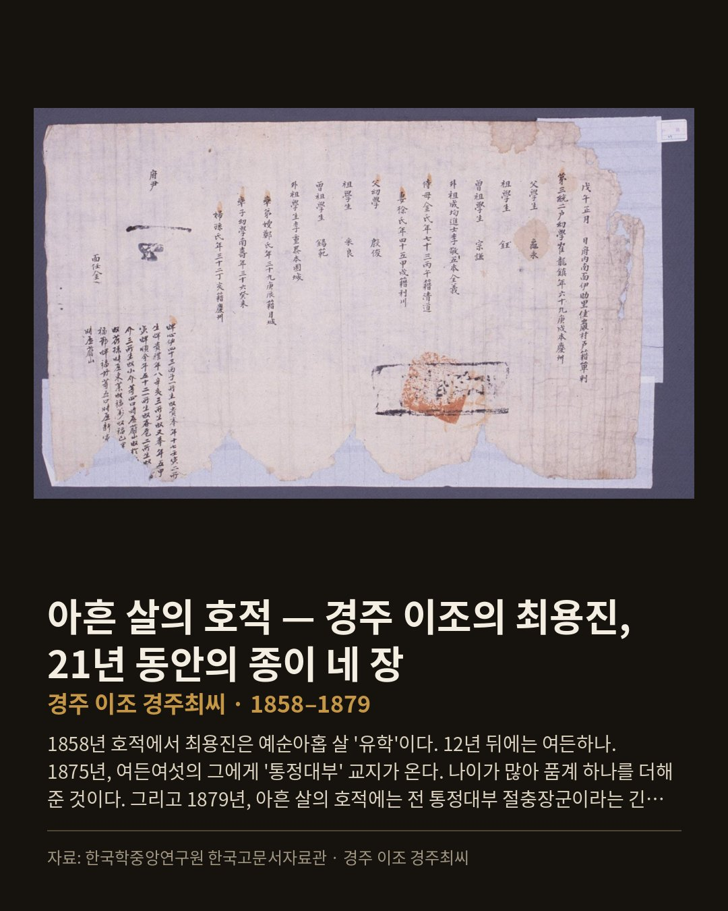
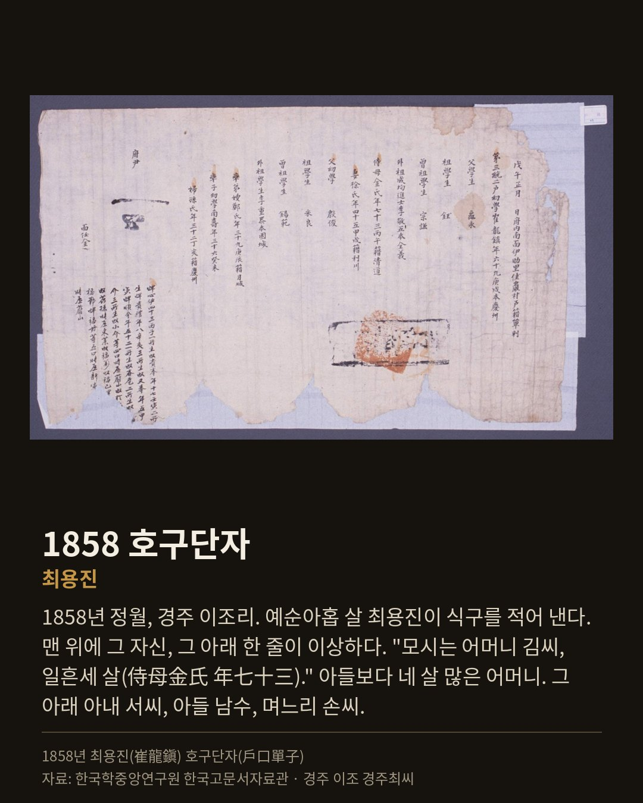

# EP.157 아흔 살의 호적 — 경주 이조의 최용진, 21년 동안의 종이 네 장

경주 이조 경주최씨 (문중) · 1858년 호적에서 최용진은 예순아홉 살 '유학'이다. 12년 뒤에는 여든하나. 1875년, 여든여섯의 그에게 '통정대부' 교지가 온다. 나이가 많아 품계 하나를 더해 준 것이다. 그리고 1879년, 아흔 살의 호적에는 전 통정대부 절충장군이라는 긴 직함이 붙는다. 그 아래 아내와 며느리, 손자의 이름 옆에는 '今故', 이제 세상에 없다는 두 글자가 적혀 있다

- 🌐 [전시 웹페이지](https://changgi.github.io/archive-tools/examples/choi-ijo-yongjin/exhibit.html) (한자 위 한글 독음 · 원문 해석) · [수업 활동지](https://changgi.github.io/archive-tools/examples/choi-ijo-yongjin/handout.html)
- 🎬 영상: [릴스 9:16](https://changgi.github.io/archive-tools-next/media/ep157-choi-ijo-yongjin_reel.mp4) · [가로 16:9](https://changgi.github.io/archive-tools-next/media/ep157-choi-ijo-yongjin_wide.mp4) · 홍보 글: [`promo.md`](promo.md)
- 카드뉴스: [`cards/`](cards/) · SNS 글: [`sns.txt`](sns.txt) · 판독·해석 표: [`selection.csv`](selection.csv)

<!-- DELIVERY -->
## 전달 에디팅 — 이 기록을 이렇게 전합니다

- **핵심 정서** — 먹먹함
- **한 문장** — 호적은 3년마다 찍은 가족사진이다 — 예순아홉에서 아흔까지, 한 노인의 직함은 늘고 곁의 가족은 줄었다.
- **열기** — 아흔 살 노인의 호적에, '이제 없다'는 글자가 세 번 적혀 있었습니다.
- **펼치기** — 최용진 호구단자 → 최용진 고신－1 (1858–1879년) — 1858(69세 유학, 어머니 · 아내 · 아들 · 며느리) → 1870(81세, 아들 이름이 바뀜) → 1875(86세, 나이로 받은 통정대부) → 1879(90세, 전 통정대부 절충장군, 아내 · 며느리 · 손자 '今故')로, 위로는 직함이, 아래로는 가족 이름 옆의 글자가 바뀌어 가는 모습을 보이게 했습니다.
- **절정** — "아내 서씨, 이제 없음(妻徐氏 今故)" — 화면·공간에서 이 한 줄만 크게, 소리를 줄여 집중
- **여운** — 아흔 살의 호적을 쓰며, 그는 '今故'라는 글자를 몇 번 불러 주었을까요? — 질문으로 끝내고 답은 보는 사람에게
- **감각과 물질** — 줄마다 같은 자리 — 나이는 늘고, 이름 옆에는 '今故'가 붙는다 · 나의 신분증 만들기 체험 카드 · 어보·관인 탁본 스탬프를 찍어 보는 체험
- **통로와 매개** — 온라인: 릴스(열기) → 카드뉴스(펼치기) → 전시 웹페이지(절정·원문) → 비하인드 카드(여운) / 오프라인: 원본 크기 복제·낭독·참여 벽 / 남기기: 활동지·질문 카드
- **여운 장치** — 우리 가족의 10년 전 · 지금을 한 줄씩 적어 비교해 보기
- **전달 에디팅 전** — 4건의 문서를 1858–1879년 연대순으로 놓고 문서명 · 유형 · 해설을 붙인다 — 정확하지만, 지나가면 잊힌다.
- **전달 에디팅 후** — 핵심 정서는 「먹먹함」. 「아흔 살 노인의 호적에, '이제 없다'는 글자가 세 번 적혀 있었습니다.」로 열고, 문서를 대비와 순서로 펼친 뒤, "아내 서씨, 이제 없음(妻徐氏 今故)"에서 멈춘다. 줄마다 같은 자리 — 나이는 늘고, 이름 옆에는 '今故'가 붙는다. 마지막엔 「우리 가족의 10년 전 · 지금을 한 줄씩 적어 비교해 보기」로 보는 사람이 자기 이야기를 남기고 떠나게 한다.

전문: [`delivery.md`](delivery.md)
<!-- /DELIVERY -->

<!-- CURATOR -->
## 비하인드 — 큐레이터 노트

- **왜 이 문서들인가** — EP.140에서 제주 강세건 집안의 호적을 읽었습니다. 경주최씨 집안에는 최용진 한 사람의 호구단자가 1858년부터 1879년까지 아홉 장 남아 있어, 그 가운데 나이 · 직함 · 가족이 크게 바뀌는 세 장과, 그 사이에 받은 교지 한 장을 골랐습니다.
- **전하고 싶은 것** — 호적은 3년마다 찍은 가족사진이다 — 예순아홉에서 아흔까지, 한 노인의 직함은 늘고 곁의 가족은 줄었다.
- **이렇게 보이길 바랐다** — 1858(69세 유학, 어머니 · 아내 · 아들 · 며느리) → 1870(81세, 아들 이름이 바뀜) → 1875(86세, 나이로 받은 통정대부) → 1879(90세, 전 통정대부 절충장군, 아내 · 며느리 · 손자 '今故')로, 위로는 직함이, 아래로는 가족 이름 옆의 글자가 바뀌어 가는 모습을 보이게 했습니다.
- **이렇게 써 주세요** — 조선 후기 호구단자의 서식(사조 · 솔거 가족 · 노비), 노인직(나이에 따른 품계), 3년 주기 호적과 '今故' 표기, 장수와 가족 구성 변화 수업에 쓰세요.
- **만들며 있었던 일** — 네 장 모두 해서로 또렷합니다. 1858년에 '侍母 김씨 73세'가 69세 아들보다 네 살 많게 적힌 까닭(계모 등)은 판단하지 않았습니다. 1875년 교지의 작은 글씨 '年八十六 加一資'는 나이에 따라 품계를 더한 노인직으로 읽었고, 뒤의 몇 글자는 확정하지 못했습니다. 노비 기재는 줄였습니다.
- **남겨 둔 질문** — 아흔 살의 호적을 쓰며, 그는 '今故'라는 글자를 몇 번 불러 주었을까요?
- **제작 기록** — 문서 4건 · 1858–1879년 · 원본 사진 4면(문서 전체) · 원문 판독 4건 · 번역 4건 · 해제에 "확인 필요"를 단 문서 2건

전문: [`curator.md`](curator.md) · 비하인드 카드: [`behind/`](behind/) · 채널별 홍보안: [`channels.md`](channels.md)
<!-- /CURATOR -->

## 이야기 — 사료가 말하는 대로

아흔 살 노인의 호적에, '이제 없다'는 글자가 세 번 적혀 있었습니다.

> **1858 호구단자** — 1858년 정월, 경주 이조리. 예순아홉 살 최용진이 식구를 적어 낸다. 맨 위에 그 자신, 그 아래 한 줄이 이상하다. "모시는 어머니 김씨, 일흔세 살(侍母金氏 年七十三)." 아들보다 네 살 많은 어머니. 그 아래 아내 서씨, 아들 남수, 며느리 손씨.
> **1870 호구단자** — 12년 뒤, 1870년. 여든한 살. 어머니의 줄은 사라졌다. 대신 아들 이름 옆에 작은 글씨가 붙는다. "남수를 헌수로 고침(南壽 改憲壽)." 그리고 새 식구, 조카 성수와 그 아내 황씨.
> **1875 고신** — 1875년 여름, 여든여섯. 평생 '유학'이던 노인에게 교지가 온다. "최용진을 통정대부로 삼는다(崔龍鎭爲通政大夫者)." 옆의 작은 글씨가 이유다. "나이 여든여섯, 한 자급을 더함(年八十六 加一資)." 오래 산 것이 벼슬이 되었다.
> **1879 호구단자** — 그리고 1879년, 아흔 살. 이름 앞의 직함은 가장 길어졌다. 전 통정대부 절충장군 행 용양위 부호군. 하지만 아래로 내려가면 두 글자가 거듭 나온다. "아내 서씨, 이제 없음(妻徐氏 今故)." 며느리도, 손자도. 가장 오래 산 사람이, 가장 많은 이름을 떠나보낸 호적이다.

| 표지 | 1번 카드 | 마무리 |
|---|---|---|
|  |  |  |

## 선별 문서 (4점)

| # | 연도 | 유형 | 문서명 | 원본 |
|---|---|---|---|---|
| 1 | 1858 | 호구단자 | 1858년 최용진(崔龍鎭) 호구단자(戶口單子) | [원본 보기](https://archive.aks.ac.kr/viewer/viewer.do#imgnode.do?itemId=book&gubun=booktree&depth=6&upPath=01%5E0167%5EL016706%5EL016706F02%5EL016706F0204&dataId=G002%2BAKS%2BKSM-XD.1858.4713-20101008.B033a_050_00122_XXX&itemType=) |
| 2 | 1870 | 호구단자 | 1870년 최용진(崔龍鎭) 호구단자(戶口單子) | [원본 보기](https://archive.aks.ac.kr/viewer/viewer.do#imgnode.do?itemId=book&gubun=booktree&depth=6&upPath=01%5E0167%5EL016706%5EL016706F02%5EL016706F0204&dataId=G002%2BAKS%2BKSM-XD.1870.4713-20101008.B033a_050_00126_XXX&itemType=) |
| 3 | 1875 | 고신 | 1875년 최용진(崔龍鎭) 고신(告身)－1 | [원본 보기](https://archive.aks.ac.kr/viewer/viewer.do#imgnode.do?itemId=book&gubun=booktree&depth=6&upPath=01%5E0167%5EL016706%5EL016706F02%5EL016706F0201&dataId=G002%2BAKS%2BKSM-XA.1875.1111-20101008.B033a_050_00029_XXX&itemType=) |
| 4 | 1879 | 호구단자 | 1879년 최용진(崔龍鎭) 호구단자(戶口單子) | [원본 보기](https://archive.aks.ac.kr/viewer/viewer.do#imgnode.do?itemId=book&gubun=booktree&depth=6&upPath=01%5E0167%5EL016706%5EL016706F02%5EL016706F0204&dataId=G002%2BAKS%2BKSM-XD.1879.4713-20101008.B033a_050_00130_XXX&itemType=) |

## 원문 판독과 해석

### 1. 1858년 최용진(崔龍鎭) 호구단자(戶口單子)

**원문 판독**

```
戊午正月 日 府內南面伊助里佳巖村戶籍單子
第三統二戶 幼學崔龍鎭 年六十九庚戌 本慶州
父學生 龜永 祖學生 鈺 曾祖學生 宗謙
外祖成均進士李敬五 本全義
侍母金氏 年七十三丙午 籍淸道
妻徐氏 年四十五甲戌 籍利川
父幼學 殷俊 祖學生 秉良 曾祖學生 錫範 外祖學生李重泰 本固城
率弟嫂鄭氏 年三十九庚辰 籍月城
率子幼學南壽 年三十六癸未
婦孫氏 年三十二丁亥 籍慶州
(노비 줄임)
府尹 (수결)
```

**원문 해석** 무오년(1858) 정월 일, 경주부 내남면 이조리 가암촌 호적단자. 제3통 제2호. 유학 최용진, 예순아홉 살, 경술생, 본관 경주. 아버지 학생 구영, 할아버지 학생 옥, 증조 학생 종겸, 외조 성균진사 이경오(본관 전의). 모시는 어머니 김씨, 일흔세 살, 병오생, 본관 청도. 아내 서씨, 마흔다섯 살, 갑술생, 본관 이천(그 아버지 은준 · 할아버지 병량 · 증조 석범 · 외조 이중태). 함께 사는 제수 정씨, 서른아홉 살, 경진생. 함께 사는 아들 유학 남수, 서른여섯 살, 계미생. 며느리 손씨, 서른두 살, 정해생. (노비 줄임) 부윤 (수결).

**해제** 무오년(1858, 철종 9) 정월 경주부 내남면 이조리(伊助里) 가암촌의 최용진(崔龍鎭) 호가 관에 낸 호구단자(戶口單子)입니다. 호구단자는 3년마다 호적을 만들 때 각 집이 가족과 노비를 적어 내는 문서로, 관에서 확인하고 부윤이 서명했습니다. 이조리는 이 소장처 이름 '경주 이조'의 그 마을입니다. 호주와 아내의 사조(아버지 · 할아버지 · 증조 · 외조)를 적는 형식은 EP.140의 제주 준호구와 같습니다. 눈에 띄는 것은 '모시는 어머니(侍母) 김씨 73세 병오생'으로, 69세 경술생 아들보다 네 살 위입니다. 생모가 아닐 가능성(계모 등)이 있으나 문서만으로 판단하지 않았습니다. 동생은 없고 제수(弟嫂)가 함께 살아, 동생이 먼저 세상을 떠난 것으로 보입니다.

### 2. 1870년 최용진(崔龍鎭) 호구단자(戶口單子)

**원문 판독**

```
庚午正月 日 府內南面伊助里佳巖村戶籍單子
第三統二戶 幼學崔龍鎭 年八十一庚戌 本慶州
父學生 龜永 祖學生 鈺 曾祖學生 宗謙 外祖成均進士李敬五 本全義
妻徐氏 年五十七甲戌 籍利川 …
率子幼學南壽 改憲壽 年四十八癸未
婦孫氏 年四十四丁亥 籍慶州
率弟嫂鄭氏 年五十一庚辰 籍月城
姪子幼學星壽 年二十四丁未
婦黃氏 年二十七甲辰 籍昌原
(노비 줄임)
上有司崔 面任林
府尹 (수결)
```

**원문 해석** 경오년(1870) 정월 일, 경주부 내남면 이조리 가암촌 호적단자. 제3통 제2호. 유학 최용진, 여든한 살, 경술생. (사조 같음.) 아내 서씨, 쉰일곱 살. 함께 사는 아들 유학 남수(헌수로 고침), 마흔여덟 살, 계미생. 며느리 손씨, 마흔네 살. 함께 사는 제수 정씨, 쉰한 살. 조카 유학 성수, 스물네 살, 정미생. 그 아내 황씨, 스물일곱 살, 갑진생. (노비 줄임) 상유사 최 · 면임 임. 부윤 (수결).

**해제** 12년 뒤 경오년(1870, 고종 7)의 호구단자입니다. 최용진은 여든한 살로, 경술생에 맞게 나이가 정확히 12살 늘었습니다. 아내 · 아들 · 며느리 · 제수의 나이도 모두 12살씩 늘었습니다. 1858년의 '모시는 어머니 김씨'는 이 장에 없어, 그 사이에 세상을 떠난 것으로 보입니다. 아들 이름 옆에 '南壽 改憲壽(남수를 헌수로 고침)'라고 적어, 호적에서 이름을 바꾼 기록이 남았습니다. 제수 정씨의 아들로 보이는 조카 성수 부부가 새로 함께 삽니다. 끝에 마을 유사 최씨와 면임 임씨가 확인했습니다.

### 3. 1875년 최용진(崔龍鎭) 고신(告身)－1

**원문 판독**

```
敎旨
崔龍鎭爲
通政大夫
者
光緖元年七月 日
(작은 글씨) 年八十六 加一資 …
```

**원문 해석** 교지. 최용진을 통정대부로 삼는다. 광서 원년(1875) 7월 일. (작은 글씨) 나이 여든여섯, 한 자급을 더함 ….

**해제** 1875년(고종 12) 7월, 여든여섯 살 최용진을 통정대부(通政大夫, 정3품 당상)로 삼은 교지입니다. 직함 없이 품계만 적혔고, 연호 옆 작은 글씨 '年八十六 加一資(나이 86, 한 자급을 더함)'가 까닭을 밝힙니다. 조선은 80세 이상 노인에게 품계를 내리는 노인직(老人職)을 두었으며, 이 교지가 그 예입니다. 같은 해 같은 내용의 교지가 한 장 더 있고, 두 달 뒤 9월에는 '절충장군 행 용양위 부호군' 교지(같은 집안 소장)를 받습니다. 4년 뒤 호적의 긴 직함은 이 두 교지에서 왔습니다. 작은 글씨 끝 몇 글자는 확정하지 못했습니다.

### 4. 1879년 최용진(崔龍鎭) 호구단자(戶口單子)

**원문 판독**

```
己卯正月 日 府內南面伊助里佳巖村戶籍單子
第三統二戶 前通政大夫折衝將軍行龍驤衛副護軍崔龍鎭 年九十庚戌
本慶州 父學生 龜永 祖學生 鈺 曾祖學生 宗謙 外祖成均進士李敬五 本全義
妻徐氏 今故
率子幼學南壽 年五十七癸未
婦孫氏 今故
孫幼學鉉冕 今故
孫婦金氏 年二十九辛亥 籍慶州
孫童蒙鉉曾 年二十庚申
率弟嫂鄭氏 年六十庚辰 籍月城
姪子幼學星壽 年三十三丁未
婦黃氏 年三十六甲辰 籍昌原
(노비 줄임)
上有司崔 面任盧
府尹 (수결)
```

**원문 해석** 기묘년(1879) 정월 일, 경주부 내남면 이조리 가암촌 호적단자. 제3통 제2호. 전 통정대부 절충장군 행 용양위 부호군 최용진, 아흔 살, 경술생, 본관 경주. (사조 같음.) 아내 서씨, 이제 없음. 함께 사는 아들 유학 남수, 쉰일곱 살, 계미생. 며느리 손씨, 이제 없음. 손자 유학 현면, 이제 없음. 손자며느리 김씨, 스물아홉 살, 신해생. 손자 동몽 현증, 스무 살, 경신생. 함께 사는 제수 정씨, 예순 살. 조카 유학 성수, 서른세 살. 그 아내 황씨, 서른여섯 살. (노비 줄임) 상유사 최 · 면임 노. 부윤 (수결).

**해제** 기묘년(1879, 고종 16)의 호구단자로, 최용진은 아흔 살입니다. 이름 앞에 1875년 두 교지에서 온 '전 통정대부 절충장군 행 용양위 부호군'이 붙었습니다. 한편 가족 줄에는 '今故(이제 없음)'가 세 번 나옵니다. 아내 서씨, 며느리 손씨, 그리고 맏손자로 보이는 현면. 사람이 죽어도 바로 지우지 않고 '今故'로 표시하는 것이 호적의 관행입니다. 남은 식구는 아들 남수(1870년에 헌수로 고쳤다고 했으나 다시 남수로 적힘), 손자며느리 김씨, 스무 살 손자 현증, 제수와 조카 부부입니다. 1858년부터 9장의 호구단자가 이어지며, 이 장이 그 마지막입니다.

판독·해석·이야기는 이미지에 근거한 초안이며(검토 전 "초안" 표시), 정확한 판독은 원문 확인이 필요합니다. □는 읽지 못한 글자, (?)는 불확실한 글자입니다.
이미지: 한국학중앙연구원 한국고문서자료관 소장·제공. "원본" 링크를 누르면 자료관 뷰어에서 그 문서가 열립니다. 재사용은 자료관에 문의하세요(소장처 동의 필요).
