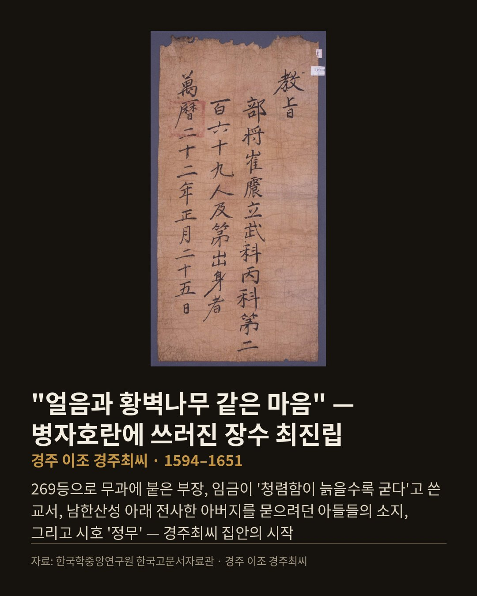
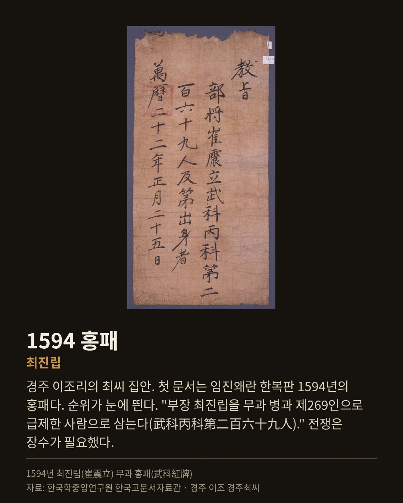
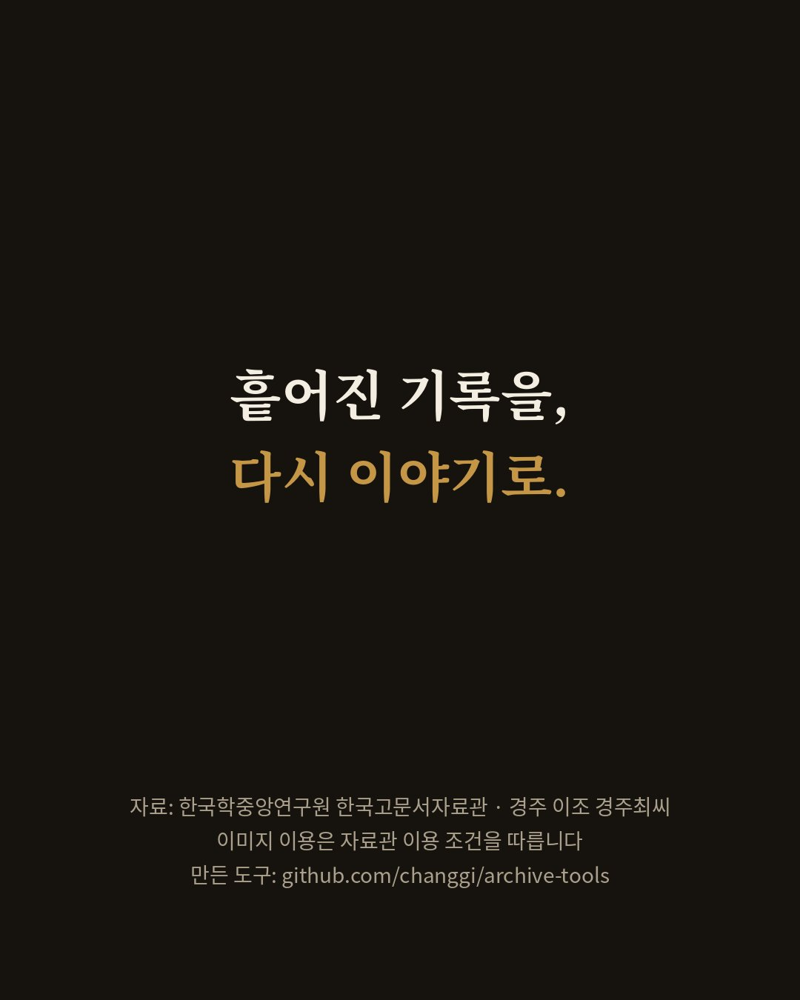

# EP.36 "얼음과 황벽나무 같은 마음" — 병자호란에 쓰러진 장수 최진립

경주 이조 경주최씨 (문중) · 269등으로 무과에 붙은 부장, 임금이 '청렴함이 늙을수록 굳다'고 쓴 교서, 남한산성 아래 전사한 아버지를 묻으려던 아들들의 소지, 그리고 시호 '정무' — 경주최씨 집안의 시작

- 🌐 [전시 웹페이지](https://changgi.github.io/archive-tools/examples/choi-ijo/exhibit.html) (한자 위 한글 독음 · 원문 해석) · [수업 활동지](https://changgi.github.io/archive-tools/examples/choi-ijo/handout.html)
- 🎬 영상: [릴스 9:16](https://changgi.github.io/archive-tools-next/media/ep36-choi-ijo_reel.mp4) · [가로 16:9](https://changgi.github.io/archive-tools-next/media/ep36-choi-ijo_wide.mp4) · 홍보 글: [`promo.md`](promo.md)
- 카드뉴스: [`cards/`](cards/) · SNS 글: [`sns.txt`](sns.txt) · 판독·해석 표: [`selection.csv`](selection.csv)


<!-- DELIVERY -->
## 전달 에디팅 — 이 기록을 이렇게 전합니다

- **핵심 정서** — 굳셈
- **한 문장** — 나이 든 장수의 충성은 비유 하나로 오래 기억되었다는 것.
- **열기** — 임금은 한 늙은 장수를 "얼음 같은 마음"이라 불렀습니다.
- **펼치기** — 최진립 무과 홍패 → 최진립 교서 → 최동열 등 소지 → 최진립 증시교지 (1594–1651년) — 무과 홍패 → '얼음 같은 마음'의 교서 → 사후의 시호로 생애를 구성했습니다.
- **절정** — "최진립에게 정무공이라는 시호를 내린다(崔震立贈諡貞武公者)" — 화면·공간에서 이 한 줄만 크게, 소리를 줄여 집중
- **여운** — 예순아홉의 장수는 마지막 전장으로 가며 무엇을 생각했을까요? — 질문으로 끝내고 답은 보는 사람에게
- **감각과 물질** — 얼음처럼 차가운 유리 위에 교서, "얼음과 황벽나무" 비유를 소재로 · 붉은 종이를 실물 크기로 복제해 벽에 거는 연출 · 두루마리를 실제 길이로 펼친 복제 · 연명한 이름을 벽에 길게 나열하고 관아 마당처럼 서서 읽는 동선
- **통로와 매개** — 온라인: 릴스(열기) → 카드뉴스(펼치기) → 전시 웹페이지(절정·원문) → 비하인드 카드(여운) / 오프라인: 원본 크기 복제·낭독·참여 벽 / 남기기: 활동지·질문 카드
- **여운 장치** — "나를 비유하는 한 가지"
- **전달 에디팅 전** — 4건의 문서를 1594–1651년 연대순으로 놓고 문서명 · 유형 · 해설을 붙인다 — 정확하지만, 지나가면 잊힌다.
- **전달 에디팅 후** — 핵심 정서는 「굳셈」. 「임금은 한 늙은 장수를 "얼음 같은 마음"이라 불렀습니다.」로 열고, 문서를 대비와 순서로 펼친 뒤, "최진립에게 정무공이라는 시호를 내린다(崔震立贈諡貞武公者)"에서 멈춘다. 얼음처럼 차가운 유리 위에 교서, "얼음과 황벽나무" 비유를 소재로. 마지막엔 「"나를 비유하는 한 가지"」로 보는 사람이 자기 이야기를 남기고 떠나게 한다.

전문: [`delivery.md`](delivery.md)
<!-- /DELIVERY -->

<!-- CURATOR -->
## 비하인드 — 큐레이터 노트

- **왜 이 문서들인가** — 늙은 장수 최진립을 '얼음과 황벽나무 같은 마음'이라 부른 교서와, 병자호란에서 쓰러진 뒤의 기림이 이어져 있었습니다.
- **전하고 싶은 것** — 나이 든 장수의 충성은 비유 하나로 오래 기억되었다는 것.
- **이렇게 보이길 바랐다** — 무과 홍패 → '얼음 같은 마음'의 교서 → 사후의 시호로 생애를 구성했습니다.
- **이렇게 써 주세요** — 병자호란과 무장, 경주 최부잣집의 뿌리를 다루는 수업에 쓰세요.
- **남겨 둔 질문** — 예순아홉의 장수는 마지막 전장으로 가며 무엇을 생각했을까요?
- **제작 기록** — 문서 4건 · 1594–1651년 · 원본 사진 5면(문서 전체) · 원문 판독 4건 · 번역 4건 · 못 읽은 글자 □ 7 · 불확실 (?) 5 · 해제에 "확인 필요"를 단 문서 1건

전문: [`curator.md`](curator.md)
<!-- /CURATOR -->

## 이야기 — 사료가 말하는 대로

임금은 한 늙은 장수를 '얼음과 황벽나무 같은 마음'이라 불렀습니다.

> **1594 홍패** — 경주 이조리의 최씨 집안. 첫 문서는 임진왜란 한복판 1594년의 홍패다. 순위가 눈에 띈다. "부장 최진립을 무과 병과 제269인으로 급제한 사람으로 삼는다(武科丙科第二百六十九人)." 전쟁은 장수가 필요했다.
> **1633 교서** — 40년 뒤 1633년, 예순다섯의 최진립은 강화 바다를 지키는 수군통어사가 된다. 임금의 교서는 그의 사람됨부터 적는다. "경은 마음이 얼음과 황벽나무처럼 곧고(心貞氷蘗), 그 청렴함은 늙을수록 더욱 굳다(其廉潔老益堅)."
> **1637 소지** — 1637년, 병자호란. 일흔이 다 된 최진립은 남한산성으로 가는 길에 전사한 것으로 전한다. 아들 넷이 이름을 나란히 적고 관아에 글을 올린다. "저희 돌아가신 아버지의 장지를 언양 땅에 정하였는데(矣等亡父葬山定於彦陽地)." 장수는 묻힐 곳을 두고도 싸워야 했다.
> **1651 증시교지** — 14년 뒤, 나라는 그에게 이름 하나를 더 준다. "최진립에게 정무공이라는 시호를 내린다(崔震立贈諡貞武公者)." 곧을 정(貞), 굳셀 무(武). 교서가 '얼음 같은 마음'이라 했던 그 사람이었다.

| 표지 | 1번 카드 | 마무리 |
|---|---|---|
|  |  |  |

## 선별 문서 (4점)

| # | 연도 | 유형 | 문서명 | 원본 |
|---|---|---|---|---|
| 1 | 1594 | 홍패 | 1594년 최진립(崔震立) 무과 홍패(武科紅牌) | [원본 보기](https://archive.aks.ac.kr/viewer/viewer.do#imgnode.do?itemId=book&gubun=booktree&depth=6&upPath=01%5E0167%5EL016706%5EL016706F02%5EL016706F0201&dataId=G002%2BAKS%2BKSM-XA.1594.1111-20101008.B033a_050_00032_XXX&itemType=) |
| 2 | 1633 | 교서 | 1633년 최진립(崔震立) 교서(敎書) | [원본 보기](https://archive.aks.ac.kr/viewer/viewer.do#imgnode.do?itemId=book&gubun=booktree&depth=6&upPath=01%5E0167%5EL016706%5EL016706F02%5EL016706F0201&dataId=G002%2BAKS%2BKSM-XA.1633.1111-20101008.B033a_050_00001_XXX&itemType=) |
| 3 | 1637 | 소지 | 1637년 최동열(崔東說) 등 소지(所志) | [원본 보기](https://archive.aks.ac.kr/viewer/viewer.do#imgnode.do?itemId=book&gubun=booktree&depth=6&upPath=01%5E0167%5EL016706%5EL016706F02%5EL016706F0202&dataId=G002%2BAKS%2BKSM-XB.1637.4713-20101008.B033a_050_00155_XXX&itemType=) |
| 4 | 1651 | 증시교지 | 1651년 최진립(崔震立) 증시교지(贈諡敎旨) | [원본 보기](https://archive.aks.ac.kr/viewer/viewer.do#imgnode.do?itemId=book&gubun=booktree&depth=6&upPath=01%5E0167%5EL016706%5EL016706F02%5EL016706F0201&dataId=G002%2BAKS%2BKSM-XA.1651.1111-20101008.B033a_050_00022_XXX&itemType=) |

## 원문 판독과 해석

### 1. 1594년 최진립(崔震立) 무과 홍패(武科紅牌)

**원문 판독**

```
敎旨
部將崔震立武科丙科第二
百六十九人及第出身者
萬曆二十二年正月二十五日 (도장)
```

**원문 해석** 교지. 부장 최진립을 무과 병과 제269인으로 급제하여 출신한 사람으로 삼는다. 만력 22년(1594) 1월 25일.

**해제** 1594년(선조 27) 1월, 임진왜란 중에 치른 무과에 최진립(崔震立, 1568~1637)이 급제하고 받은 홍패입니다. 이미 '부장(部將)'이라는 군직을 띠고 있었고, 순위는 병과 제269인입니다. 전쟁 중에는 군사를 모으려고 한 번에 수백, 수천 명을 뽑는 무과를 열었기 때문에 이런 순위가 나옵니다.

### 2. 1633년 최진립(崔震立) 교서(敎書)

**원문 판독**

```
敎行京畿水軍節度使兼喬桐都護府使京畿公
淸黃海等道水軍統禦使崔震立書
王若曰 久勞圻營 成效已著 新兼統禦 簡命寔
宣 遵朝家之近規 循廟堂之僉擧 惟卿 心
貞氷蘗 業專韜鈐 北鎭分符 □□服其淸
白 西關貫羽 部伍推其忠勤 頃超拜乎亞卿
旋擢置於水鎭 其廉潔老益堅 於持
身 是以□名少不損於治郡 予故欲專於
委任 卿其試觀乎此時 奏唱驕矜(?) 實爲
虛中之詐(?) 鄒民疾視 皆無親上之心 況玆
江都修繕之辰 爰思水軍總制之策 接公
淸黃海之界 舟楫易通 控畿輔下流之衝
綢繆孔急 玆授卿京畿水軍節度使兼喬桐
都護府使京畿公淸黃海等道水軍統禦使
前任如故 云云 難乎其人 兼帶惟新 卿祗
愼乎厥職 樓船戰艦 左右之取辦具全 海防
舟師 彼此之便宜自斷 於戲 制南河內 周訪
之責非輕 保障繭絲 尹鐸之寄有意 故玆
敎示 想宜知悉
崇禎六年正月初四日 (도장 4)
```

**원문 해석** 경기수군절도사 겸 교동도호부사 경기·공청·황해 등 도 수군통어사 최진립에게 내리는 교서. 왕은 이르노라. 오랫동안 경기 수영에서 수고하여 공이 이미 드러났으니, 새로 통어사를 겸하게 하는 임명을 이에 내린다. 조정의 근래 규정을 따르고 묘당(의정부)의 공론을 좇은 것이다. 생각건대 경은 마음이 얼음과 황벽나무(氷蘗)처럼 곧고, 하는 일은 병법에 전념하였다. 북쪽 진에서 병부를 나누어 맡았을 때 … 그 청백함에 복종하였고, 서관(평안도)에서 활을 쏠 때에는 부대가 그 충성과 근면을 추앙하였다. 얼마 전 아경(참판)으로 뛰어올랐다가 곧 수군 진영에 발탁되었으니, 그 청렴함은 늙을수록 더욱 굳어 몸가짐에 … 고을을 다스리는 데도 조금도 손상되지 않았다. 그러므로 내가 오로지 맡기고자 한다. 경은 지금의 때를 살펴보라. [오랑캐가] 교만하게 큰소리치는 것은 실로 속이 빈 거짓이요, … 백성이 흘겨보아 모두 윗사람을 따르는 마음이 없다. 하물며 지금은 강화도를 수리하는 때라 수군을 통제할 방책을 생각하니, 공청·황해의 경계에 닿아 배가 쉽게 통하고 경기의 하류 요충을 쥐고 있어 미리 대비함이 매우 급하다. 이에 경에게 경기수군절도사 겸 교동도호부사 경기·공청·황해 등 도 수군통어사를 제수하고 전임은 그대로 둔다. … 경은 그 직분을 삼가 누선과 전함을 좌우에서 갖추고, 바다 방비와 수군의 일은 형편에 따라 스스로 결단하라. 아아, … 보장(保障)의 맡김에 뜻이 있으니, 이에 교시하노라. 잘 알리라 생각한다. 숭정 6년(1633) 1월 4일.

**해제** 1633년(인조 11) 1월, 최진립을 경기수군절도사 겸 교동도호부사로서 경기·충청(공청)·황해 3도의 수군을 통솔하는 통어사(統禦使)에 임명하며 내린 교서(敎書)입니다. 정묘호란(1627) 뒤 후금의 위협 속에 강화도 방비를 정비하던 때입니다. 최진립의 청렴을 '마음이 얼음과 황벽나무처럼 곧다(心貞氷蘗)', '청렴함이 늙을수록 더욱 굳다(廉潔老益堅)'고 칭찬했습니다. 반듯한 해서로 거의 전문을 판독했으나, 몇 글자는 불확실하여 (?)와 □로 표시했습니다.

### 3. 1637년 최동열(崔東說) 등 소지(所志)

**원문 판독**

```
□人崔東說
東亮
東吉
東璟 代□國範(?)
右謹言所志矣段 矣等亡父葬山定於彦陽地 而本府居□□李容(?)等
懸絶之意 而終以慶州 彦陽各定官(?) … (큰 붓 처분 글씨와 겹침)
矣等極未安矣 以爲長拔爲有(…)
計前期發引 已到山所 爲有在果 大槩 巡察使 … 以明決 彦陽(…)
(…) (가운데·왼쪽 여러 줄은 흘림과 처분 글씨가 겹쳐 판독 필요)
(왼쪽 큰 흘림 — 관의 처분(題辭), 판독 필요)
```

**원문 해석** 최동열·최동량·최동길·최동경(대리 최국범?). 삼가 아뢰는 소지. 저희 돌아가신 아버지의 장지를 언양 땅에 정하였는데, 본부(경주)에 사는 이용(?) 등이 … 경주와 언양이 각각 관을 정하여 … 저희는 매우 불안합니다. … 기일에 앞서 발인하여 이미 산소에 이르렀는데, 대개 순찰사가 … 밝게 결정하여 … (이하 판독 필요)

**해제** 1637년(인조 15), 병자호란 때 남한산성 구원에 나섰다가 전사한 최진립의 아들 최동열(崔東說) 형제가 올린 소지입니다. 아버지의 장지를 언양 땅에 정하고 발인까지 마쳤으나, 장지를 둘러싼 다툼이나 관할 문제가 생긴 것으로 보입니다. 오른쪽 앞부분만 판독했고, 가운데의 큰 처분(題辭) 글씨가 본문과 겹쳐 대부분 판독이 필요합니다. 최진립의 전사 경위는 문서 밖의 사실이라 확인이 필요합니다.

### 4. 1651년 최진립(崔震立) 증시교지(贈諡敎旨)

**원문 판독**

```
敎旨
贈資憲大夫兵曹判書兼知
義禁府事 行嘉善大夫工曹
參判兼五衛都摠府副摠管
崔震立贈諡貞武公者
辛卯六月二十九日 (도장)
```

**원문 해석** 교지. 자헌대부 병조판서 겸 지의금부사로 추증된, 행 가선대부 공조참판 겸 오위도총부 부총관 최진립에게 '정무공(貞武公)'이라는 시호를 내린다. 신묘년(1651) 6월 29일.

**해제** 1651년(효종 2, 辛卯) 6월, 최진립에게 시호 '정무(貞武)'를 내린 증시교지입니다. 전사 뒤 병조판서로 추증되었고(贈資憲大夫兵曹判書), 생전의 마지막 관직은 공조참판이었습니다. 시호의 '貞'은 곧고 바름, '武'는 무공을 뜻하는 글자로 흔히 풀이되며, 18년 전 교서가 칭찬한 '곧은 마음'과 이어집니다.

판독·해석·이야기는 이미지에 근거한 초안이며(검토 전 "초안" 표시), 정확한 판독은 원문 확인이 필요합니다. □는 읽지 못한 글자, (?)는 불확실한 글자입니다.
이미지: 한국학중앙연구원 한국고문서자료관 소장·제공. "원본" 링크를 누르면 자료관 뷰어에서 그 문서가 열립니다. 재사용은 자료관에 문의하세요(소장처 동의 필요).
