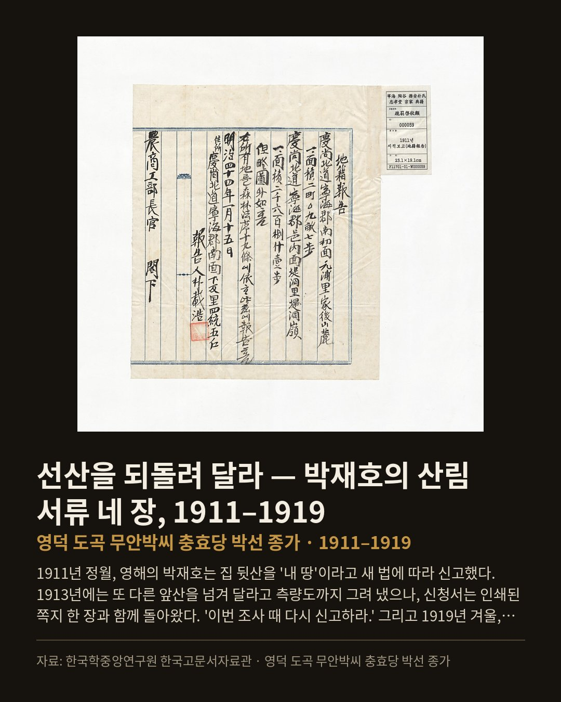
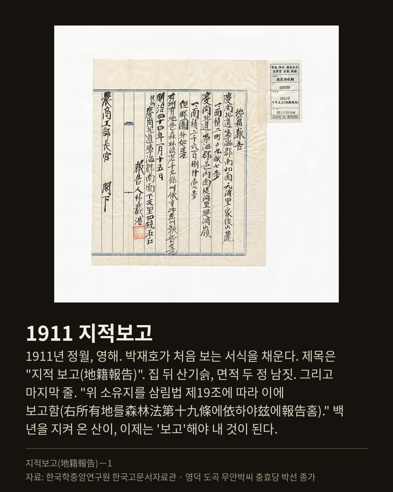
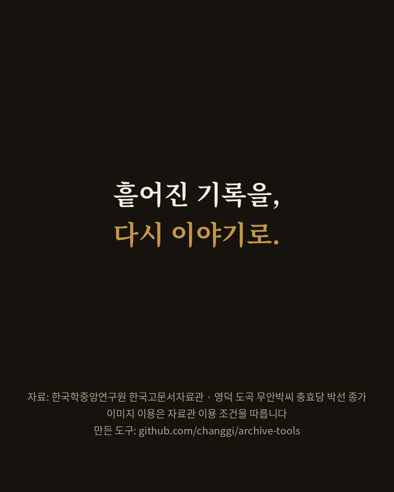

# EP.180 선산을 되돌려 달라 — 박재호의 산림 서류 네 장, 1911–1919

영덕 도곡 무안박씨 충효당 박선 종가 (문중) · 1911년 정월, 영해의 박재호는 집 뒷산을 '내 땅'이라고 새 법에 따라 신고했다. 1913년에는 또 다른 앞산을 넘겨 달라고 측량도까지 그려 냈으나, 신청서는 인쇄된 쪽지 한 장과 함께 돌아왔다. '이번 조사 때 다시 신고하라.' 그리고 1919년 겨울, 그는 조상 무덤 두 기가 있는 산이 '필요 없는 국유림'으로 편입되어 일본인 남작에게 대부되었다는 소식을 듣고 붓을 들었다. '백여 년을 지켜 온 숲'이라고

- 🌐 [전시 웹페이지](https://changgi.github.io/archive-tools/examples/chunghyo-bak-imya/exhibit.html) (한자 위 한글 독음 · 원문 해석) · [수업 활동지](https://changgi.github.io/archive-tools/examples/chunghyo-bak-imya/handout.html)
- 🎬 영상: [릴스 9:16](https://changgi.github.io/archive-tools-next/media/ep180-chunghyo-bak-imya_reel.mp4) · [가로 16:9](https://changgi.github.io/archive-tools-next/media/ep180-chunghyo-bak-imya_wide.mp4) · 홍보 글: [`promo.md`](promo.md)
- 카드뉴스: [`cards/`](cards/) · SNS 글: [`sns.txt`](sns.txt) · 판독·해석 표: [`selection.csv`](selection.csv)

<!-- DELIVERY -->
## 전달 에디팅 — 이 기록을 이렇게 전합니다

- **핵심 정서** — 억울함
- **한 문장** — 조선의 산은 '지켜 온 사람'의 것이었지만, 1908년 삼림법과 1910년대 임야조사는 '신고한 사람'의 것으로 바꾸었다 — 같은 집안이 8년 동안 신고서 · 신청서 · 측량도 · 청원서를 차례로 써야 했던 까닭이다.
- **열기** — 백오십 년 지킨 조상의 산이, 어느 날 '필요 없는 국유림'이 되었습니다.
- **펼치기** — 지적보고－1 → 국유산양여원－1 → 국유산양여원－1－3 → 청원서－1 (1911–1919년) — 1911년 1월 삼림법 제19조에 따른 지적보고(신고) → 1913년 9월 국유산 양여 신청과 반려 쪽지 → 같은 신청에 붙인 실측도 → 1919년 12월 선산을 되돌려 달라는 청원서로 놓았습니다.
- **절정** — "백여 년을 지켜 온 숲(百餘年禁護之林)" — 화면·공간에서 이 한 줄만 크게, 소리를 줄여 집중
- **여운** — 백오십 년의 '지킴'과 한 장의 '신고' 가운데, 무엇이 소유의 증거였을까요? — 질문으로 끝내고 답은 보는 사람에게
- **감각과 물질** — 1913년 신청서 위에 덧붙은 인쇄 쪽지 '一次願書를返還함' — 그리고 1919년 청원서의 '百餘年禁護之林' · 연명한 이름을 벽에 길게 나열하고 관아 마당처럼 서서 읽는 동선
- **통로와 매개** — 온라인: 릴스(열기) → 카드뉴스(펼치기) → 전시 웹페이지(절정·원문) → 비하인드 카드(여운) / 오프라인: 원본 크기 복제·낭독·참여 벽 / 남기기: 활동지·질문 카드
- **여운 장치** — 우리 집 땅 · 선산 등기에 얽힌 이야기 물어보기
- **전달 에디팅 전** — 4건의 문서를 1911–1919년 연대순으로 놓고 문서명 · 유형 · 해설을 붙인다 — 정확하지만, 지나가면 잊힌다.
- **전달 에디팅 후** — 핵심 정서는 「억울함」. 「백오십 년 지킨 조상의 산이, 어느 날 '필요 없는 국유림'이 되었습니다.」로 열고, 문서를 대비와 순서로 펼친 뒤, "백여 년을 지켜 온 숲(百餘年禁護之林)"에서 멈춘다. 1913년 신청서 위에 덧붙은 인쇄 쪽지 '一次願書를返還함' — 그리고 1919년 청원서의 '百餘年禁護之林'. 마지막엔 「우리 집 땅 · 선산 등기에 얽힌 이야기 물어보기」로 보는 사람이 자기 이야기를 남기고 떠나게 한다.

전문: [`delivery.md`](delivery.md)
<!-- /DELIVERY -->

<!-- CURATOR -->
## 비하인드 — 큐레이터 노트

- **왜 이 문서들인가** — 영덕 도곡 무안박씨 충효당 종가 문서 199건 가운데, 1911년부터 1919년까지 박재호(朴載浩)가 산림 문제로 관에 낸 서류가 한 묶음 남아 있습니다. 그 가운데 네 장을 일어난 순서대로 놓았습니다.
- **전하고 싶은 것** — 조선의 산은 '지켜 온 사람'의 것이었지만, 1908년 삼림법과 1910년대 임야조사는 '신고한 사람'의 것으로 바꾸었다 — 같은 집안이 8년 동안 신고서 · 신청서 · 측량도 · 청원서를 차례로 써야 했던 까닭이다.
- **이렇게 보이길 바랐다** — 1911년 1월 삼림법 제19조에 따른 지적보고(신고) → 1913년 9월 국유산 양여 신청과 반려 쪽지 → 같은 신청에 붙인 실측도 → 1919년 12월 선산을 되돌려 달라는 청원서로 놓았습니다.
- **이렇게 써 주세요** — 1908년 삼림법의 지적 신고, 1910년대 임야조사사업과 국유림 · 연고자 제도, 측량도의 등장, 일제강점기 조선인의 청원 문서와 그 문체(국한문 · 일본어 섞임), 근대 토지 소유권의 형성 수업에 쓰세요.
- **만들며 있었던 일** — 1911 · 1913년 서류의 땅(영해군 남초면 원포리 · 읍내면 제동령 · 갈□동 앞산)과 1919년 청원서의 땅(영덕군 창수면 수동 성주봉)은 서로 다른 곳입니다. 1913년 신청서의 땅 이름 한 글자와 면적 일부는 흘림이라 확정하지 못했습니다. '내지인 스미토모 남작(內地人住友男爵)'이 누구인지, 청원이 받아들여졌는지는 이 문서들로 확인하지 않았습니다. 1914년 영해군이 영덕군에 합쳐져 박재호의 주소가 바뀌었습니다.
- **남겨 둔 질문** — 백오십 년의 '지킴'과 한 장의 '신고' 가운데, 무엇이 소유의 증거였을까요?
- **제작 기록** — 문서 4건 · 1911–1919년 · 원본 사진 5면(문서 전체) · 원문 판독 4건 · 번역 4건

전문: [`curator.md`](curator.md) · 비하인드 카드: [`behind/`](behind/) · 채널별 홍보안: [`channels.md`](channels.md)
<!-- /CURATOR -->

## 이야기 — 사료가 말하는 대로

백오십 년 지킨 조상의 산이, 어느 날 '필요 없는 국유림'이 되었습니다.

> **1911 지적보고** — 1911년 정월, 영해. 박재호가 처음 보는 서식을 채운다. 제목은 "지적 보고(地籍報告)". 집 뒤 산기슭, 면적 두 정 남짓. 그리고 마지막 줄. "위 소유지를 삼림법 제19조에 따라 이에 보고함(右所有地를森林法第十九條에依하야玆에報告홈)." 백 년을 지켜 온 산이, 이제는 '보고'해야 내 것이 된다.
> **1913 국유산양여원** — 두 해 뒤, 1913년 가을. 이번에는 신고에서 빠진 앞산이다. 그는 조선총독에게 넘겨 달라고 쓴다. 신청서는 돌아왔다. 위에 인쇄된 쪽지 한 장이 붙어서. "이번 출원한 곳은 그때 신고하게 하고, 원서를 한 번 돌려보냄(一次願書를返還홈)." 날짜 칸은 비어 있었다.
> **1913 국유산양여원** — 그 신청서에는 그림이 붙어 있었다. 산줄기 대신 직선과 삼각형. 다섯 조각으로 나눈 땅. 붉은 숫자로 더한다. 합계 "885.32". 26년 전 임영근은 붓으로 무덤 사이 '서른 걸음'을 그렸다. 이제 산은 숫자가 되었다.
> **1919 청원서** — 그리고 1919년 겨울. 이번에는 조상 무덤이 있는 산이다. "백오십여 년 동안 마음을 다해 금하고 보호하여(及今一百五十餘年以來로積心禁護하야)" 소나무와 참나무가 아름드리가 되었다. 그 산이 "필요 없는 국유림"이 되어, 일본인 남작에게 빌려졌다. 그는 다섯 사람의 이름으로 쓴다. "백여 년을 지켜 온 숲(百餘年禁護之林)"을, 돌려 달라고.

| 표지 | 1번 카드 | 마무리 |
|---|---|---|
|  |  |  |

## 선별 문서 (4점)

| # | 연도 | 유형 | 문서명 | 원본 |
|---|---|---|---|---|
| 1 | 1911 | 지적보고 | 지적보고(地籍報告)－1 | [원본 보기](https://archive.aks.ac.kr/viewer/viewer.do#imgnode.do?itemId=book&gubun=booktree&depth=6&upPath=01%5E0167%5EL016765%5EL016765F02%5EL016765F0203&dataId=G002%2BAKS%2BKSM-XC.1911.4777-20211130.B071a_099_00020_XXX&itemType=) |
| 2 | 1913 | 국유산양여원 | 국유산양여원(國有山讓與願)－1 | [원본 보기](https://archive.aks.ac.kr/viewer/viewer.do#imgnode.do?itemId=book&gubun=booktree&depth=6&upPath=01%5E0167%5EL016765%5EL016765F02%5EL016765F0202&dataId=G002%2BAKS%2BKSM-XB.1913.4777-20211130.B071a_099_00012_XXX&itemType=) |
| 3 | 1913 | 국유산양여원 | 국유산양여원(國有山讓與願)－1－3 | [원본 보기](https://archive.aks.ac.kr/viewer/viewer.do#imgnode.do?itemId=book&gubun=booktree&depth=6&upPath=01%5E0167%5EL016765%5EL016765F02%5EL016765F0202&dataId=G002%2BAKS%2BKSM-XB.1913.4777-20211130.B071a_099_00015_XXX&itemType=) |
| 4 | 1919 | 청원서 | 청원서(請願書)－1 | [원본 보기](https://archive.aks.ac.kr/viewer/viewer.do#imgnode.do?itemId=book&gubun=booktree&depth=6&upPath=01%5E0167%5EL016765%5EL016765F02%5EL016765F0202&dataId=G002%2BAKS%2BKSM-XB.1919.4777-20211130.B071a_099_00009_XXX&itemType=) |

## 원문 판독과 해석

### 1. 지적보고(地籍報告)－1

**원문 판독**

```
地籍報告
慶尙北道寧海郡南初面元浦里家後山麓
一面積二町○九畝七步
慶尙北道寧海郡邑內面堤洞里堤洞嶺
一面積二千六百 … 步
但略圖外如홈
右所有地를森林法第十九條에依하야玆에報告홈
明治四十四年一月十五日
住所 慶尙北道寧海郡南面下反里四統五戶
報告人 朴載浩 (인)
農商工部長官 閣下
```

**원문 해석** 지적 보고. 경상북도 영해군 남초면 원포리 집 뒤 산기슭, 면적 2정 9무 7보. 경상북도 영해군 읍내면 제동리 제동령, 면적 2,600 … 보. 다만 약도는 따로 붙인 것과 같음. 위 소유지를 삼림법 제19조에 따라 이에 보고함. 메이지 44년(1911) 1월 15일. 주소 경상북도 영해군 남면 하반리 4통 5호. 보고인 박재호 (도장). 농상공부장관 각하.

**해제** 1911년 1월, 영해군 남면 하반리의 박재호가 자기 산 두 곳을 조선총독부 농상공부장관에게 신고한 지적보고(地籍報告)입니다. 1908년(융희 2)에 공포된 삼림법(森林法) 제19조는 산림 소유자가 3년 안에 그 면적과 약도를 신고하게 하고, 신고하지 않은 산은 국유로 보게 했습니다. 이 보고는 그 3년 기한이 끝나 가던 1911년 1월에 냈습니다. 국한문 혼용으로 쓰였고, 면적 단위는 정(町) · 무(畝) · 보(步)를 썼습니다. 둘째 산의 면적 일부는 흘림이라 읽지 못했습니다. 조선 시대에는 대대로 묘를 쓰고 나무를 길러 온 사람이 산의 주인이었지만, 이제는 '신고'가 소유의 조건이 되었습니다.

### 2. 국유산양여원(國有山讓與願)－1

**원문 판독**

```
(겉) 大正二年九月二十九日經由邑內面長 南 … (인)
國有山讓與願
… 洞前山內國有山野 …
… 讓與御許可相成度 …
… 圖面相添此段 …
大正二年九月二十日
慶尙北道寧海郡南面下反洞四統五戶
出願人 朴載浩 (인)
朝鮮總督伯爵寺內正毅 殿
(덧붙인 인쇄 쪽지)
本年度부터始作할林野整理調查는各林野所有者及緣故者는全히申告을한後此에依하야國有私有를決定할터인바緣故를有한國有林野에對하야는其緣故者에讓與或은貸付處分을行할豫定인故로本出願箇所는其時에申告하케하와一次願書를返還홈
大正 年 月 日
慶尙北道 (도장)
```

**원문 해석** (겉) 다이쇼 2년(1913) 9월 29일 읍내면장 남 … 경유 (도장). 국유산 양여원. … 동 앞산 안의 국유 산야를 … 양여해 주시도록 허가해 주시기 바랍니다 … 도면을 붙여 이에 … 다이쇼 2년 9월 20일. 경상북도 영해군 남면 하반동 4통 5호 출원인 박재호 (도장). 조선총독 백작 데라우치 마사타케 귀하. (덧붙인 인쇄 쪽지) 올해부터 시작할 임야정리조사는 각 임야의 소유자와 연고자가 모두 신고한 뒤 이에 따라 국유 · 사유를 결정할 터인바, 연고가 있는 국유 임야에 대해서는 그 연고자에게 양여 또는 대부 처분을 할 예정이므로, 이번 출원한 곳은 그때 신고하게 하고 원서를 한 번 돌려보냄. 다이쇼 년 월 일. 경상북도 (도장).

**해제** 1913년 9월, 박재호가 조선총독 데라우치 마사타케(寺內正毅)에게 낸 국유산 양여원(國有山讓與願)입니다. 삼림법 신고에서 빠져 국유로 된 산 가운데 자기 집안과 연고가 있는 곳을 넘겨 달라는 신청서로, 일본어 문투('御許可相成度')가 섞였습니다. 신청서는 읍내면장을 거쳐 올라갔습니다. 그 위에 경상북도가 인쇄한 쪽지가 풀로 붙어 있습니다. '올해부터 시작할 임야 정리 조사 때 연고자 신고를 받아 국유 · 사유를 정할 것이니, 그때 신고하라'며 신청서를 돌려보낸다는 내용입니다. 날짜 칸은 비어 있어, 같은 쪽지를 많은 신청서에 붙였음을 보여 줍니다. 왼쪽 겉장에는 측량 면적 계산표가 붉은 글씨로 적혀 있습니다.

### 3. 국유산양여원(國有山讓與願)－1－3

**원문 판독**

```
國有山出願區域實測圖
縮尺一千二百分一
慶尙北道寧海郡邑內面葛 … 洞前山
面積八百八十五步三合二勺
出願人
慶尙北道寧海郡南面下反洞四統五戶
朴載浩 (인)
大正二年九月二十日
(붉은 글씨) 計算表 (1)99.84 (2)86.18 (3)524.19 (4)72.4 (5)104.1 885.32
```

**원문 해석** 국유산 출원 구역 실측도. 축척 1,200분의 1. 경상북도 영해군 읍내면 갈 … 동 앞산, 면적 885보 3홉 2작. 출원인 경상북도 영해군 남면 하반동 4통 5호 박재호 (도장). 다이쇼 2년(1913) 9월 20일. (붉은 글씨) 계산표: (1) 99.84 (2) 86.18 (3) 524.19 (4) 72.4 (5) 104.1, 합계 885.32.

**해제** 앞의 양여 신청서에 붙인 실측도입니다. 신청한 산을 다각형으로 그리고, 그 안을 삼각형 다섯 개로 나누어 각각의 넓이를 구한 뒤 더했습니다. 붉은 글씨의 '계산표(計算表)'가 그 다섯 넓이와 합계 885.32이고, 이것이 본문의 '885보 3홉 2작'입니다. 방위(동 · 서 · 남 · 북)와 축척 1,200분의 1을 적어, 조선 후기 산송의 산도(EP.173)처럼 산줄기와 무덤을 그리던 방식이 측량 도면으로 바뀌었음을 보여 줍니다. 땅 이름의 한 글자는 흘림이라 확정하지 못했습니다.

### 4. 청원서(請願書)－1

**원문 판독**

```
請願書
本人等의先祖墳墓二個所을本郡蒼水面水洞案山聖主峰
에入葬하얍고當時自喜庵石門外十餘町步之山地을占有하고
其山下洞居住者로써任守護之責하야及今一百五十餘年以
來로積心禁護하야松樹櫟木은拱抱成林하고尙鬱蒼之美
況矣오且登錄於地籍屆矣라其山下洞人이莫不指點爲本
人等의所有先山이더니
大正三年度不要存林調查之地에不幸而編入되야內地人
住友男爵이得貸付許可云하니百餘年禁護之林과數
百人尊慕之地가尙如此則祖先墳墓之地을不得保하고累
世所有權을不得守矣니本人等이豈不痛切骨髓乎大凡
人之疾痛에必呼父母은是常情也오生民之有冤에仰達
於按法之下도亦是常情也라伏聞
閣下朝鮮總治赴任하신後一視同仁하신다난仁化를均被코져
하와別紙略圖을添에具由仰訴하오니
御查照하신後該山地를今番林野整理調查時本人等의
게返還하시와神人無憾케하심을望하야伏以願書懇乞홈
大正八年十二月十四日
慶尙北道盈德郡丑山面陶谷洞
右願人代表者 朴載浩 (인)
朴胤燦 (인) 朴鎬燦 (인) 朴夏燦 (인) 朴德燦 (인)
```

**원문 해석** 청원서. 저희의 선조 무덤 두 기를 이 군 창수면 수동의 안산 성주봉에 모셨고, 그때 자희암 석문 밖 십여 정보의 산지를 차지하여 그 산 아래 마을에 사는 사람에게 지키는 책임을 맡겼습니다. 지금까지 백오십여 년 동안 마음을 다해 금하고 보호하여 소나무와 참나무가 아름드리 숲을 이루고 지금도 울창하며, 또 지적 신고에도 올렸습니다. 그 산 아래 마을 사람들은 누구나 저희 집안의 선산이라고 가리켰습니다. 그런데 다이쇼 3년(1914)의 불요존림(不要存林) 조사 대상지에 불행히도 편입되어, 내지인(일본인) 스미토모 남작이 대부 허가를 얻었다고 합니다. 백여 년을 지켜 온 숲과 수백 사람이 우러르는 땅이 이러하니, 조상의 무덤 자리를 지키지 못하고 대대로 내려온 소유권을 지키지 못하게 되었습니다. 저희가 어찌 뼈에 사무치게 아프지 않겠습니까. 무릇 사람이 아프면 반드시 부모를 부르는 것이 인지상정이고, 백성이 원통한 일이 있으면 법을 맡은 이에게 우러러 아뢰는 것 또한 인지상정입니다. 엎드려 듣건대 각하께서 조선 총독으로 부임하신 뒤 '일시동인(一視同仁)'하신다 하니, 그 어진 교화를 고루 입고자 따로 약도를 붙여 사유를 갖추어 우러러 호소합니다. 살펴보신 뒤 그 산지를 이번 임야 정리 조사 때 저희에게 돌려주시어, 신(조상)과 사람 모두 유감이 없게 해 주시기를 바라며 엎드려 원서로 간절히 빕니다. 다이쇼 8년(1919) 12월 14일. 경상북도 영덕군 축산면 도곡동. 청원인 대표 박재호 (도장), 박윤찬 · 박호찬 · 박하찬 · 박덕찬 (도장).

**해제** 1919년 12월, 박재호와 집안사람 네 명이 조선 총독에게 낸 청원서입니다. 1914년에 영해군이 영덕군에 합쳐져 주소가 '영덕군 축산면 도곡동'으로 바뀌었습니다. 내용은 창수면 수동 성주봉의 선조 무덤 두 기가 있는 산을 150여 년 동안 지켜 왔고 지적 신고도 했는데, 1914년(다이쇼 3) '불요존림(不要存林)', 곧 국가가 계속 가질 필요가 없는 국유림 조사 때 편입되어 일본인 '스미토모 남작(住友男爵)'에게 대부가 허가되었다는 것입니다. 그래서 이번 임야정리조사 때 돌려 달라고 청했습니다. '각하께서 부임하신 뒤 일시동인(一視同仁)하신다 하니'라는 구절은, 3 · 1운동 뒤인 1919년 가을 새 총독이 부임하며 내세운 말을 끌어 쓴 것으로 보입니다. 한문 구절 사이에 '하야', '이더니', '하신다난' 같은 한글 토가 섞인 국한문 문체입니다. 청원의 결과는 이 문서로 알 수 없습니다.

판독·해석·이야기는 이미지에 근거한 초안이며(검토 전 "초안" 표시), 정확한 판독은 원문 확인이 필요합니다. □는 읽지 못한 글자, (?)는 불확실한 글자입니다.
이미지: 한국학중앙연구원 한국고문서자료관 소장·제공. "원본" 링크를 누르면 자료관 뷰어에서 그 문서가 열립니다. 재사용은 자료관에 문의하세요(소장처 동의 필요).
