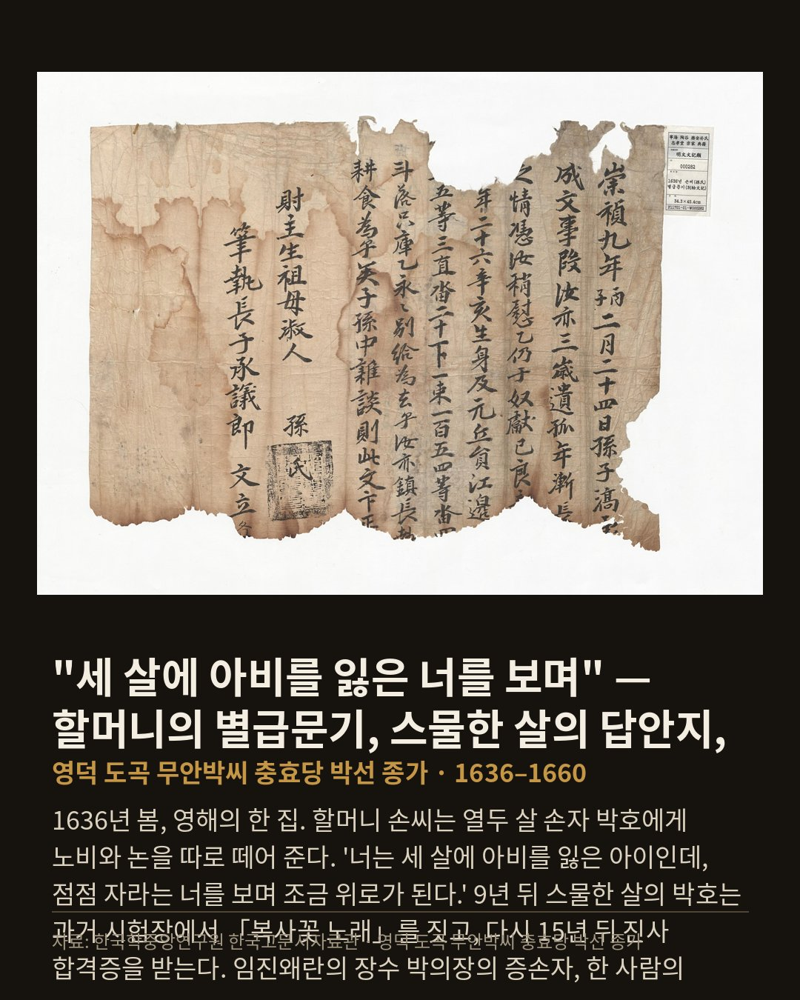
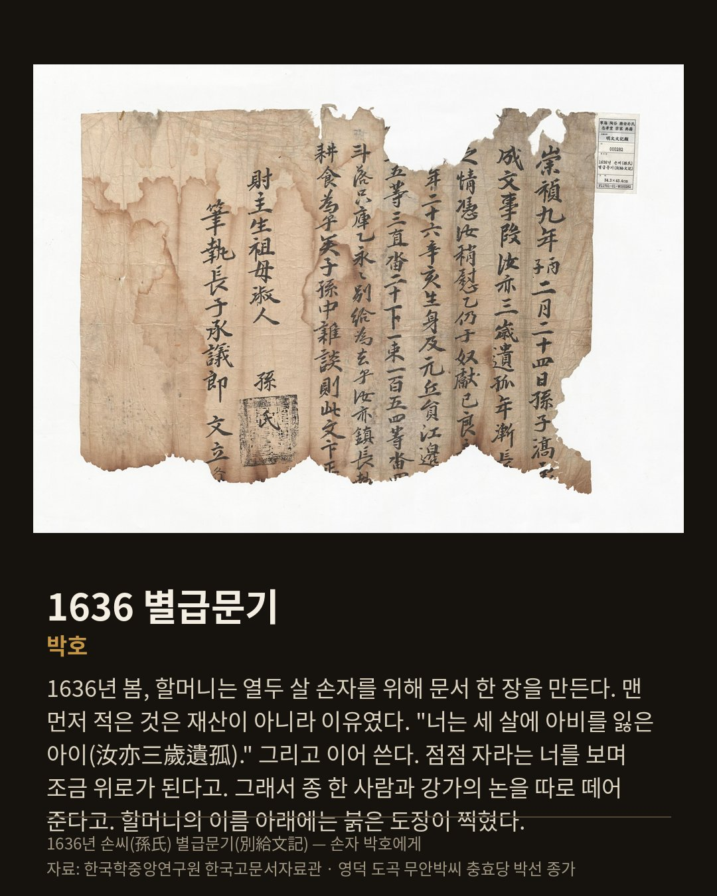
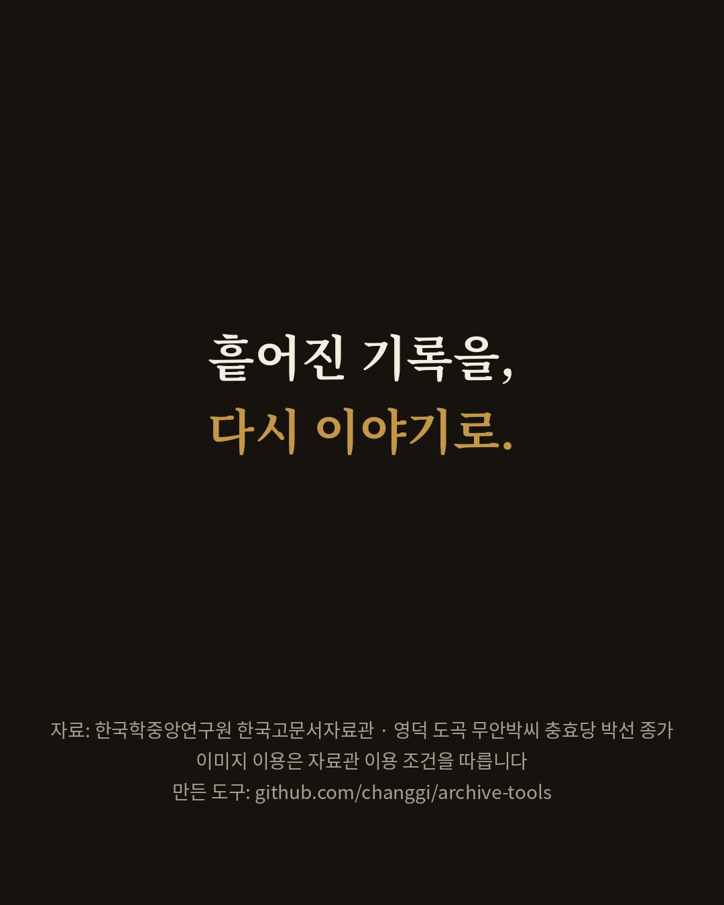

# EP.114 "세 살에 아비를 잃은 너를 보며" — 할머니의 별급문기, 스물한 살의 답안지, 서른여섯의 합격증

영덕 도곡 무안박씨 충효당 박선 종가 (문중) · 1636년 봄, 영해의 한 집. 할머니 손씨는 열두 살 손자 박호에게 노비와 논을 따로 떼어 준다. '너는 세 살에 아비를 잃은 아이인데, 점점 자라는 너를 보며 조금 위로가 된다.' 9년 뒤 스물한 살의 박호는 과거 시험장에서 「복사꽃 노래」를 짓고, 다시 15년 뒤 진사 합격증을 받는다. 임진왜란의 장수 박의장의 증손자, 한 사람의 서른여섯 해가 석 장에 담겼다

- 🌐 [전시 웹페이지](https://changgi.github.io/archive-tools/examples/chunghyo-bak/exhibit.html) (한자 위 한글 독음 · 원문 해석) · [수업 활동지](https://changgi.github.io/archive-tools/examples/chunghyo-bak/handout.html)
- 🎬 영상: [릴스 9:16](https://changgi.github.io/archive-tools/examples/media/ep114-chunghyo-bak_reel.mp4) · [가로 16:9](https://changgi.github.io/archive-tools/examples/media/ep114-chunghyo-bak_wide.mp4) · 홍보 글: [`promo.md`](promo.md)
- 카드뉴스: [`cards/`](cards/) · SNS 글: [`sns.txt`](sns.txt) · 판독·해석 표: [`selection.csv`](selection.csv)

<!-- DELIVERY -->
## 전달 에디팅 — 이 기록을 이렇게 전합니다

- **핵심 정서** — 뭉클함
- **한 문장** — 한 사람의 삶은 여러 문서에 흩어져 있다 — 재산 문서, 답안지, 합격증이 모이면 한 아이의 서른여섯 해가 된다.
- **열기** — 세 살에 아버지를 잃은 손자에게, 할머니는 이렇게 적었습니다.
- **펼치기** — 손씨 별급문기 — 손자 박호에게 → 박호 시권 — 「도화시」 → 박호 진사 백패 (1636–1660년) — 할머니의 별급문기(12세) → 과거 답안지(21세) → 진사 백패(36세) 순으로, 위로받던 아이가 자기 이름을 얻기까지를 따라가게 구성했습니다.
- **절정** — "너는 세 살에 아비를 잃은 아이(汝亦三歲遺孤)" — 화면·공간에서 이 한 줄만 크게, 소리를 줄여 집중
- **여운** — 할머니는 손자가 진사가 되는 것을 보았을까요? — 질문으로 끝내고 답은 보는 사람에게
- **감각과 물질** — 할머니의 붉은 도장, 시험관의 큰 붓 자국, 흰 종이 백패 · 시험장 책상과 답안지 체험 · 흰 종이 한 장에 조명 하나
- **통로와 매개** — 온라인: 릴스(열기) → 카드뉴스(펼치기) → 전시 웹페이지(절정·원문) → 비하인드 카드(여운) / 오프라인: 원본 크기 복제·낭독·참여 벽 / 남기기: 활동지·질문 카드
- **여운 장치** — 나를 위로해 준 사람에게 한 줄 적어 보기
- **전달 에디팅 전** — 3건의 문서를 1636–1660년 연대순으로 놓고 문서명 · 유형 · 해설을 붙인다 — 정확하지만, 지나가면 잊힌다.
- **전달 에디팅 후** — 핵심 정서는 「뭉클함」. 「세 살에 아버지를 잃은 손자에게, 할머니는 이렇게 적었습니다.」로 열고, 문서를 대비와 순서로 펼친 뒤, "너는 세 살에 아비를 잃은 아이(汝亦三歲遺孤)"에서 멈춘다. 할머니의 붉은 도장, 시험관의 큰 붓 자국, 흰 종이 백패. 마지막엔 「나를 위로해 준 사람에게 한 줄 적어 보기」로 보는 사람이 자기 이야기를 남기고 떠나게 한다.

전문: [`delivery.md`](delivery.md)
<!-- /DELIVERY -->

<!-- CURATOR -->
## 비하인드 — 큐레이터 노트

- **왜 이 문서들인가** — 별급문기의 '汝亦三歲遺孤' 한 구절과, 9년 뒤 답안지 속 아버지 이름 앞의 '학생' 두 글자가 서로를 설명하는 것을 보고 세 장을 한 사람의 이야기로 묶었습니다.
- **전하고 싶은 것** — 한 사람의 삶은 여러 문서에 흩어져 있다 — 재산 문서, 답안지, 합격증이 모이면 한 아이의 서른여섯 해가 된다.
- **이렇게 보이길 바랐다** — 할머니의 별급문기(12세) → 과거 답안지(21세) → 진사 백패(36세) 순으로, 위로받던 아이가 자기 이름을 얻기까지를 따라가게 구성했습니다.
- **이렇게 써 주세요** — 가족사와 상속(분재 · 별급), 과거 시험의 답안지(시권)와 채점, 진로와 긴 준비의 이야기에 쓰세요.
- **만들며 있었던 일** — 별급문기는 가장자리가 떨어져 재산 목록 여러 글자를 읽지 못했고, 시권은 긴 답안의 앞부분만 읽었습니다. 채점 표시 '三之中'과 몇몇 이름 글자는 불확실합니다. 나이는 시권의 '年二十一'에서 계산한 추정입니다.
- **남겨 둔 질문** — 할머니는 손자가 진사가 되는 것을 보았을까요?
- **제작 기록** — 문서 3건 · 1636–1660년 · 원본 사진 6면(문서 전체) · 원문 판독 3건 · 번역 3건 · 못 읽은 글자 □ 1 · 불확실 (?) 11

전문: [`curator.md`](curator.md) · 비하인드 카드: [`behind/`](behind/) · 채널별 홍보안: [`channels.md`](channels.md)
<!-- /CURATOR -->

## 이야기 — 사료가 말하는 대로

세 살에 아버지를 잃은 손자에게, 할머니는 이렇게 적었습니다.

> **1636 별급문기** — 1636년 봄, 할머니는 열두 살 손자를 위해 문서 한 장을 만든다. 맨 먼저 적은 것은 재산이 아니라 이유였다. "너는 세 살에 아비를 잃은 아이(汝亦三歲遺孤)." 그리고 이어 쓴다. 점점 자라는 너를 보며 조금 위로가 된다고. 그래서 종 한 사람과 강가의 논을 따로 떼어 준다고. 할머니의 이름 아래에는 붉은 도장이 찍혔다.
> **1645 시권** — 9년 뒤, 그 아이는 스물한 살이 되어 시험장에 앉아 있다. 답안지 오른쪽 끝에 그는 자신을 이렇게 적는다. "유학 박호, 나이 스물하나, 본관 무안, 영해에 산다(幼學朴滈年二十一 本務安 居寧海)." 아버지 이름 앞에는 '학생', 벼슬 없이 떠난 사람이라는 뜻이다. 시제는 복사꽃. 그는 이렇게 시작한다. "궁궐 동산의 봄빛은 술처럼 짙고(禁苑春色濃如酒)." 아래쪽에는 시험관의 큰 붓 자국이 남았다.
> **1660 백패** — 다시 15년. 흰 종이 한 장이 그 집에 도착한다. "유학 박호는 진사 3등 제24인으로 입격하였다(幼學朴滈進士三等第二十四人入格者)." 세 살에 아버지를 잃은 아이, 할머니의 위로였던 아이가, 서른여섯에 받은 이름이었다.

| 표지 | 1번 카드 | 마무리 |
|---|---|---|
|  |  |  |

## 선별 문서 (3점)

| # | 연도 | 유형 | 문서명 | 원본 |
|---|---|---|---|---|
| 1 | 1636 | 별급문기 | 1636년 손씨(孫氏) 별급문기(別給文記) — 손자 박호에게 | [원본 보기](https://archive.aks.ac.kr/viewer/viewer.do#imgnode.do?itemId=book&gubun=booktree&depth=6&upPath=01%5E0167%5EL016765%5EL016765F02%5EL016765F0205&dataId=G002%2BAKS%2BKSM-XE.1636.4777-20211130.B071a_099_00052_XXX&itemType=) |
| 2 | 1645 | 시권 | 1645년 박호(朴滈) 시권(試券) — 「도화시」 | [원본 보기](https://archive.aks.ac.kr/viewer/viewer.do#imgnode.do?itemId=book&gubun=booktree&depth=6&upPath=01%5E0167%5EL016765%5EL016765F02%5EL016765F0204&dataId=G002%2BAKS%2BKSM-XD.1645.4777-20211130.B071a_099_00043_XXX&itemType=) |
| 3 | 1660 | 백패 | 1660년 박호(朴滈) 진사 백패(進士白牌) | [원본 보기](https://archive.aks.ac.kr/viewer/viewer.do#imgnode.do?itemId=book&gubun=booktree&depth=6&upPath=01%5E0167%5EL016765%5EL016765F02%5EL016765F0201&dataId=G002%2BAKS%2BKSM-XA.1660.4777-20211130.B071a_099_00001_XXX&itemType=) |

## 원문 판독과 해석

### 1. 1636년 손씨(孫氏) 별급문기(別給文記) — 손자 박호에게

**원문 판독**

```
崇禎九年丙子二月二十四日孫子滈亦中(?)
成文事段汝亦三歲遺孤年漸長(?)…
之情憑汝稍慰乙仍于奴獻己良妻(?)…
年二十六辛亥生身及元丘(?)員江邊(?)…
五斗(?)三直畓二十卜一束一百五四卜畓四(?)…
斗落只庫乙永永別給爲去乎汝亦鎭長耕
食爲乎矣子孫中雜談則此文下(?)…
財主 生祖母 淑人 孫氏(印)
筆執 長子 承議郞 文立
```

**원문 해석** 숭정 9년 병자년(1636) 2월 24일, 손자 호에게 문서를 만들어 주는 일. 너는 세 살에 아비를 잃은 아이로, 나이가 점점 자라니 … 마음을 너로 인해 조금이나마 위로받기에, 사내종 헌기(獻己)와 양처 사이에서 난 … 스물여섯 살 신해년생 자신과, 원구(?) 들 강가의 … 논 … 마지기를 영영 따로 떼어 주니, 너는 오래도록 갈아먹되, 자손 가운데 딴말을 하는 자가 있거든 이 문서로 … (관에 고하여 바로잡으라). 재주(財主) 친할머니 숙인 손씨(도장). 필집(筆執) 맏아들 승의랑 문립.

**해제** 1636년(인조 14, 崇禎 9) 영해 무안박씨 집안의 할머니 손씨(孫氏)가 손자 박호(朴滈)에게 노비와 논을 따로 떼어 준 별급문기(別給文記)입니다. 별급은 정식 상속(분재) 외에 특별한 이유로 재산을 따로 주는 것입니다. 할머니는 그 이유를 '너는 세 살에 아비를 잃은 아이(汝亦三歲遺孤)'라고 적었습니다. 박호는 1645년 시권에 '나이 스물하나'로 적혀 있어, 이때 열두 살 무렵이었던 것으로 보입니다(추정). 문서는 이두(乙, 爲去乎, 爲乎矣 등)가 섞인 투식이며, 가장자리가 떨어져 나가 재산 목록의 여러 글자를 읽지 못했습니다. 글은 할머니의 맏아들(박호의 큰아버지로 보임, 추정) 문립이 대신 썼습니다.

### 2. 1645년 박호(朴滈) 시권(試券) — 「도화시」

**원문 판독**

```
幼學朴滈年二十一 本務安 居寧海
父 學生 □起(?)
祖 朝散大夫 璘(?)
曾祖 贈… 行嘉義大夫慶尙左道兵馬節度使兼蔚山都護府使 毅長
外祖 通訓大夫前行鎭川縣監 權應生 本安東
命歌桃花詩 詩
禁苑春色濃如酒萬樹夭桃紅…
鑾車今日趂芳景詠花諸公爭獻…
皇還敎侍女唱麗句嬌歌俱絶奇…
仙李回葉春一代群英才不羈…
宮物色鮮雨霽桃園仙仗移天門佳氣…
天欲低詞臣濟濟相追隨爭吟芳樹…
(채점) 三之中(?)
```

**원문 해석** (응시자 정보) 유학 박호, 나이 스물하나, 본관 무안, 영해 거주. 아버지 학생 □기, 할아버지 조산대부 린(?), 증조부 … 행 가의대부 경상좌도병마절도사 겸 울산도호부사 의장, 외할아버지 통훈대부 전 진천현감 권응생(본관 안동). (시제) 「복사꽃 노래를 짓게 하다(命歌桃花詩)」, 시. (답안 앞부분) 궁궐 동산의 봄빛은 술처럼 짙고, 만 그루 고운 복사꽃이 붉게 … 임금의 수레가 오늘 꽃다운 경치를 따라 나서니, 꽃을 읊는 여러 신하들이 다투어 바치고 … 신하들이 줄지어 서로 뒤따르며 꽃다운 나무를 다투어 읊는다 … (채점 표시) 삼지중(?).

**해제** 1645년(인조 23) 스물한 살의 박호가 과거에서 제출한 답안지, 시권(試券)입니다. 오른쪽 끝에는 응시자의 이름 · 나이 · 본관 · 거주지와 아버지 · 할아버지 · 증조부 · 외할아버지를 적었는데, 시험 중에는 이 부분을 접어 봉하고 채점했습니다. 증조부 '경상좌도병마절도사 겸 울산도호부사 의장(毅長)'은 임진왜란 때 활약한 박의장(朴毅長)으로 보입니다. 아버지 앞의 '학생(學生)'은 벼슬 없이 세상을 떠난 이에게 붙이는 말로, 앞의 별급문기에서 '세 살에 아비를 잃었다'는 말과 맞습니다. 시제는 '명가도화시(命歌桃花詩)'이며, 궁궐 정원의 복사꽃과 임금의 행차를 노래한 답안이 이어집니다. 답안이 길어 앞부분만 읽었습니다. 아래쪽의 큰 먹 글씨는 채점 표시로, 흔히 '三上 · 三中 · 三下' 같은 등급을 적습니다. 여기서는 '三之中'으로 읽었으나 불확실합니다. 연도는 자료관 목록을 따랐습니다.

### 3. 1660년 박호(朴滈) 진사 백패(進士白牌)

**원문 판독**

```
敎旨
幼學朴滈進士三等第二
十四人入格者
順治十七年九月十八日
```

**원문 해석** 교지. 유학 박호는 진사시에 3등 제24인으로 입격한 자이다. 순치 17년(1660) 9월 18일.

**해제** 1660년(현종 1, 順治 17) 박호가 진사시에 3등 제24인으로 합격하고 받은 백패(白牌)입니다. 1645년 시권의 '나이 스물하나'를 기준으로 하면 서른여섯 살 무렵의 합격입니다(추정). 연호 위에 어보가 찍혀 있습니다. 1645년 시권이 어떤 시험의 답안이었고 그때 합격했는지는 이 문서들만으로는 알 수 없습니다.

판독·해석·이야기는 이미지에 근거한 초안이며(검토 전 "초안" 표시), 정확한 판독은 원문 확인이 필요합니다. □는 읽지 못한 글자, (?)는 불확실한 글자입니다.
이미지: 한국학중앙연구원 한국고문서자료관 소장·제공. "원본" 링크를 누르면 자료관 뷰어에서 그 문서가 열립니다. 재사용은 자료관에 문의하세요(소장처 동의 필요).
