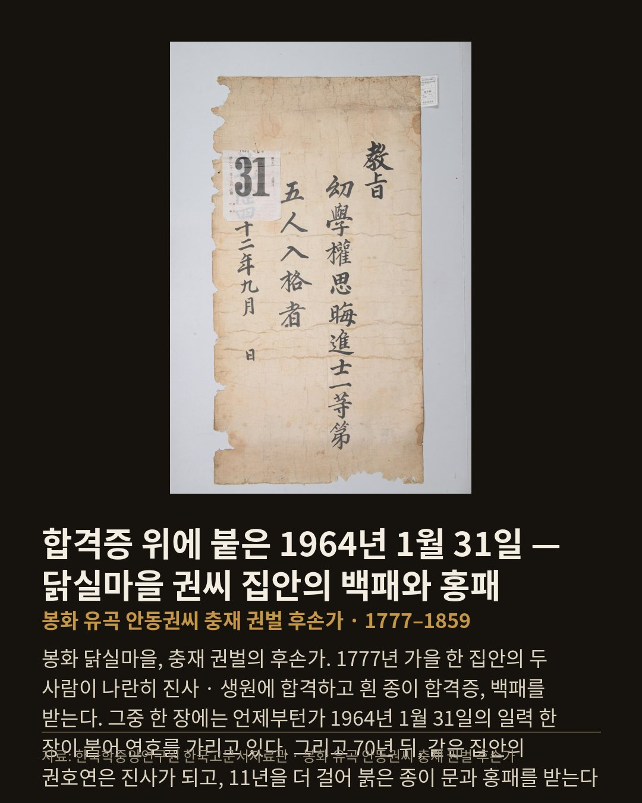
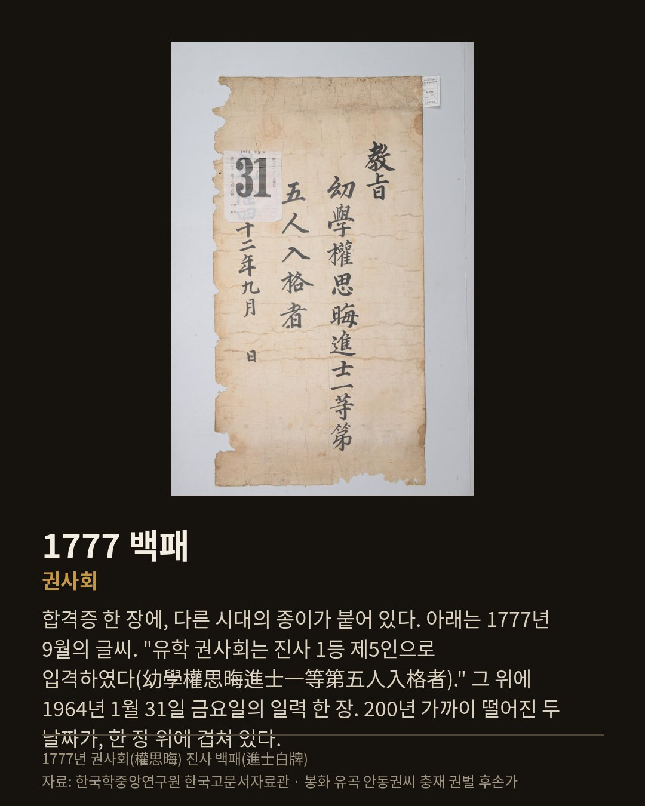
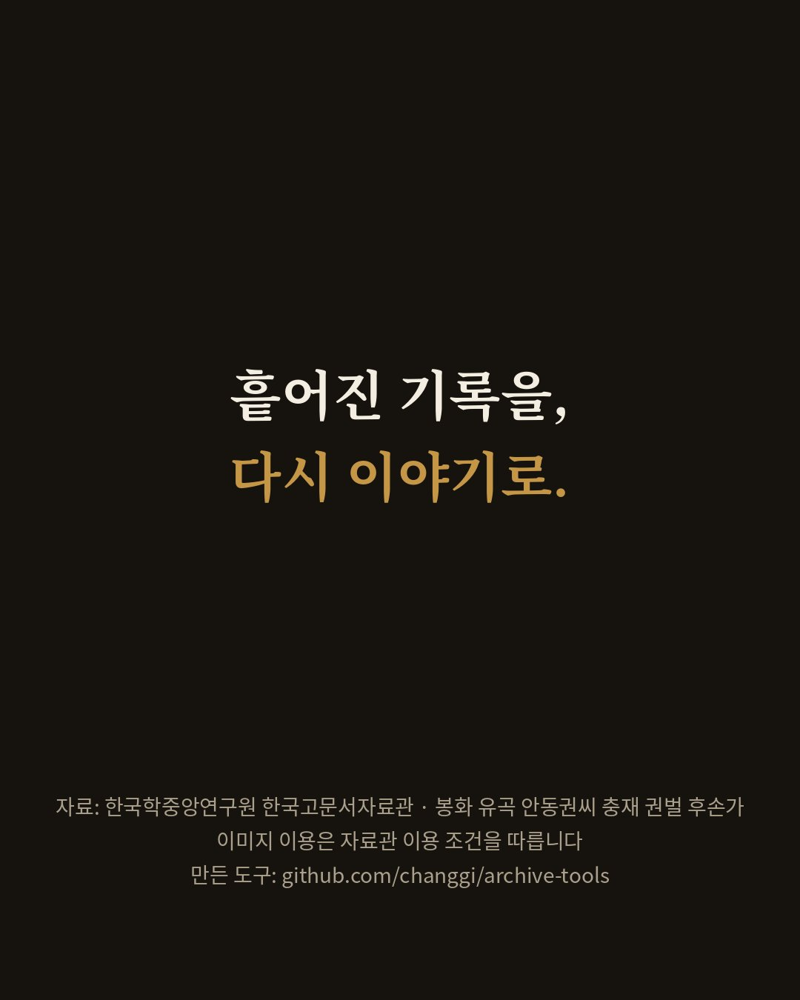

# EP.111 합격증 위에 붙은 1964년 1월 31일 — 닭실마을 권씨 집안의 백패와 홍패

봉화 유곡 안동권씨 충재 권벌 후손가 (문중) · 봉화 닭실마을, 충재 권벌의 후손가. 1777년 가을 한 집안의 두 사람이 나란히 진사 · 생원에 합격하고 흰 종이 합격증, 백패를 받는다. 그중 한 장에는 언제부턴가 1964년 1월 31일의 일력 한 장이 붙어 연호를 가리고 있다. 그리고 70년 뒤, 같은 집안의 권호연은 진사가 되고, 11년을 더 걸어 붉은 종이 문과 홍패를 받는다

- 🌐 [전시 웹페이지](https://changgi.github.io/archive-tools/examples/chungjae2/exhibit.html) (한자 위 한글 독음 · 원문 해석) · [수업 활동지](https://changgi.github.io/archive-tools/examples/chungjae2/handout.html)
- 🎬 영상: [릴스 9:16](https://changgi.github.io/archive-tools-next/media/ep111-chungjae2_reel.mp4) · [가로 16:9](https://changgi.github.io/archive-tools-next/media/ep111-chungjae2_wide.mp4) · 홍보 글: [`promo.md`](promo.md)
- 카드뉴스: [`cards/`](cards/) · SNS 글: [`sns.txt`](sns.txt) · 판독·해석 표: [`selection.csv`](selection.csv)

<!-- DELIVERY -->
## 전달 에디팅 — 이 기록을 이렇게 전합니다

- **핵심 정서** — 뭉클함
- **한 문장** — 문서는 만들어진 날만이 아니라 지켜진 날들도 품는다 — 1777년의 합격과 1964년의 일력이 한 장 위에 겹친다.
- **열기** — 250년 전 합격증 위에, 누군가 1964년 1월 31일 달력 한 장을 붙여 놓았습니다.
- **펼치기** — 권사회 진사 백패 → 권이도 생원 백패 → 권호연 진사 백패 → 권호연 문과 홍패 (1777–1859년) — 일력이 붙은 진사 백패 → 같은 해 생원 백패 → 70년 뒤 권호연의 진사 백패 → 11년 뒤 문과 홍패로, 흰 종이가 붉은 종이가 되는 흐름으로 구성했습니다.
- **절정** — "진사 권호연은 문과 병과 제15인으로 급제하였다(進士權好淵文科丙科第十五人及第出身者)" — 화면·공간에서 이 한 줄만 크게, 소리를 줄여 집중
- **여운** — 1964년 1월 31일, 그 집에서는 무슨 일이 있었을까요? — 질문으로 끝내고 답은 보는 사람에게
- **감각과 물질** — 흰 종이 백패와 붉은 종이 홍패, 그 위에 붙은 일력 한 장 · 흰 종이 한 장에 조명 하나 · 붉은 종이를 실물 크기로 복제해 벽에 거는 연출
- **통로와 매개** — 온라인: 릴스(열기) → 카드뉴스(펼치기) → 전시 웹페이지(절정·원문) → 비하인드 카드(여운) / 오프라인: 원본 크기 복제·낭독·참여 벽 / 남기기: 활동지·질문 카드
- **여운 장치** — 오래 기다려 받은 '합격'을 떠올리기
- **전달 에디팅 전** — 4건의 문서를 1777–1859년 연대순으로 놓고 문서명 · 유형 · 해설을 붙인다 — 정확하지만, 지나가면 잊힌다.
- **전달 에디팅 후** — 핵심 정서는 「뭉클함」. 「250년 전 합격증 위에, 누군가 1964년 1월 31일 달력 한 장을 붙여 놓았습니다.」로 열고, 문서를 대비와 순서로 펼친 뒤, "진사 권호연은 문과 병과 제15인으로 급제하였다(進士權好淵文科丙科第十五人及第出身者)"에서 멈춘다. 흰 종이 백패와 붉은 종이 홍패, 그 위에 붙은 일력 한 장. 마지막엔 「오래 기다려 받은 '합격'을 떠올리기」로 보는 사람이 자기 이야기를 남기고 떠나게 한다.

전문: [`delivery.md`](delivery.md)
<!-- /DELIVERY -->

<!-- CURATOR -->
## 비하인드 — 큐레이터 노트

- **왜 이 문서들인가** — 반듯한 백패 위에 붙은 1964년 일력 한 장을 보는 순간, 이 문서를 지켜 온 사람들의 시간이 함께 보였습니다.
- **전하고 싶은 것** — 문서는 만들어진 날만이 아니라 지켜진 날들도 품는다 — 1777년의 합격과 1964년의 일력이 한 장 위에 겹친다.
- **이렇게 보이길 바랐다** — 일력이 붙은 진사 백패 → 같은 해 생원 백패 → 70년 뒤 권호연의 진사 백패 → 11년 뒤 문과 홍패로, 흰 종이가 붉은 종이가 되는 흐름으로 구성했습니다.
- **이렇게 써 주세요** — 과거 제도(소과와 대과, 백패와 홍패), 기록 보존의 역사, '오래 준비한 꿈' 이야기에 쓰세요.
- **만들며 있었던 일** — 네 장 모두 글씨가 선명합니다. 첫 장의 연호 석 자는 일력에 가려 같은 날짜의 다른 백패로 보충해 읽었습니다. 일력을 붙인 사람과 이유, 권사회 · 권이도 · 권호연의 가계상 관계는 확인하지 않았습니다.
- **남겨 둔 질문** — 1964년 1월 31일, 그 집에서는 무슨 일이 있었을까요?
- **제작 기록** — 문서 4건 · 1777–1859년 · 원본 사진 8면(문서 전체) · 원문 판독 4건 · 번역 4건 · 해제에 "확인 필요"를 단 문서 1건

전문: [`curator.md`](curator.md) · 비하인드 카드: [`behind/`](behind/) · 채널별 홍보안: [`channels.md`](channels.md)
<!-- /CURATOR -->

## 이야기 — 사료가 말하는 대로

250년 전 합격증 위에, 누군가 1964년 1월 31일 달력 한 장을 붙여 놓았습니다.

> **1777 백패** — 합격증 한 장에, 다른 시대의 종이가 붙어 있다. 아래는 1777년 9월의 글씨. "유학 권사회는 진사 1등 제5인으로 입격하였다(幼學權思晦進士一等第五人入格者)." 그 위에 1964년 1월 31일 금요일의 일력 한 장. 200년 가까이 떨어진 두 날짜가, 한 장 위에 겹쳐 있다.
> **1777 백패** — 같은 가을, 같은 집에 한 장이 더 왔다. "유학 권이도는 생원 3등 제38인으로 입격하였다(幼學權履度生員三等第三十八人入格者)." 한 사람은 진사, 한 사람은 생원. 닭실마을의 그해 9월은 두 배로 기뻤을 것이다.
> **1848 백패** — 70년 뒤, 이 집안에 다시 흰 종이가 왔다. "유학 권호연은 진사 3등 제44인으로 입격하였다(幼學權好淵進士三等第四十四人入格者)." 1848년 5월 17일. 그러나 이것은 첫 관문일 뿐이었다.
> **1859 홍패** — 그리고 11년. 흰 종이는 붉은 종이가 되었다. "진사 권호연은 문과 병과 제15인으로 급제하였다(進士權好淵文科丙科第十五人及第出身者)." 이름 앞의 두 글자가 '유학'에서 '진사'로 바뀌어 있다. 그 두 글자에 11년이 들어 있다.

| 표지 | 1번 카드 | 마무리 |
|---|---|---|
|  |  |  |

## 선별 문서 (4점)

| # | 연도 | 유형 | 문서명 | 원본 |
|---|---|---|---|---|
| 1 | 1777 | 백패 | 1777년 권사회(權思晦) 진사 백패(進士白牌) | [원본 보기](https://archive.aks.ac.kr/viewer/viewer.do#imgnode.do?itemId=book&gubun=booktree&depth=6&upPath=01%5E0167%5EL016776%5EL016776F02%5EL016776F0201&dataId=G002%2BAKS%2BKSM-XA.1777.4792-20220125.B080b_126_00001_XXX&itemType=) |
| 2 | 1777 | 백패 | 1777년 권이도(權履度) 생원 백패(生員白牌) | [원본 보기](https://archive.aks.ac.kr/viewer/viewer.do#imgnode.do?itemId=book&gubun=booktree&depth=6&upPath=01%5E0167%5EL016776%5EL016776F02%5EL016776F0201&dataId=G002%2BAKS%2BKSM-XA.1777.4792-20220125.B080b_126_00334_XXX&itemType=) |
| 3 | 1848 | 백패 | 1848년 권호연(權好淵) 진사 백패(進士白牌) | [원본 보기](https://archive.aks.ac.kr/viewer/viewer.do#imgnode.do?itemId=book&gubun=booktree&depth=6&upPath=01%5E0167%5EL016776%5EL016776F02%5EL016776F0201&dataId=G002%2BAKS%2BKSM-XA.1848.4792-20220125.B080b_126_00336_XXX&itemType=) |
| 4 | 1859 | 홍패 | 1859년 권호연(權好淵) 문과 홍패(文科紅牌) | [원본 보기](https://archive.aks.ac.kr/viewer/viewer.do#imgnode.do?itemId=book&gubun=booktree&depth=6&upPath=01%5E0167%5EL016776%5EL016776F02%5EL016776F0201&dataId=G002%2BAKS%2BKSM-XA.1859.4792-20220125.B080b_126_00332_XXX&itemType=) |

## 원문 판독과 해석

### 1. 1777년 권사회(權思晦) 진사 백패(進士白牌)

**원문 판독**

```
敎旨
幼學權思晦進士一等第
五人入格者
[乾隆四]十二年九月 日
(덧붙은 일력) 1964 甲辰年 / 陽(大)一月 31 金曜日 / 陰(小)十二月十七日 己卯
```

**원문 해석** 교지. 유학 권사회는 진사시에 1등 제5인으로 입격한 자이다. [건륭 4]2년(1777) 9월 일. (덧붙은 일력: 1964년 갑진년, 양력 1월 31일 금요일, 음력 12월 17일 기묘)

**해제** 1777년(정조 1, 乾隆 42) 권사회(權思晦)가 진사시에 1등 제5인으로 합격하고 받은 백패(白牌)입니다. 생원 · 진사시(소과) 합격증은 흰 종이에 써서 백패라 합니다. 연호 부분에 1964년 1월 31일자 일력(하루 한 장씩 뜯는 달력) 한 장이 붙어 '乾隆四' 석 자를 가리고 있는데, 뒤로 비치는 획과 같은 해 같은 날짜의 다른 백패(권이도)로 보아 '乾隆四十二年'으로 읽었습니다. 일력은 문서를 보관하던 집안의 누군가가 찢어진 곳을 메우려 붙인 것으로 짐작되나(추정), 그 까닭은 알 수 없습니다. 일력에 적힌 '1964 甲辰年'과 '음력 12월 17일 己卯'는 해가 바뀌기 전인 계묘년 섣달을 함께 적은 것입니다.

### 2. 1777년 권이도(權履度) 생원 백패(生員白牌)

**원문 판독**

```
敎旨
幼學權履度生員三等第
三十八人入格者
乾隆四十二年九月 日
```

**원문 해석** 교지. 유학 권이도는 생원시에 3등 제38인으로 입격한 자이다. 건륭 42년(1777) 9월 일.

**해제** 같은 해 같은 달, 같은 집안의 권이도(權履度)가 생원시에 3등 제38인으로 합격하고 받은 백패입니다. 생원시는 경전 이해를, 진사시는 시와 부 같은 글짓기를 시험했습니다. 한 집안에서 같은 시험에 두 사람이 합격해 진사와 생원 백패가 나란히 전합니다. 두 사람의 가계상 관계는 이번에 확인하지 않았습니다. 연호 위에 어보가 찍혀 있고, 위쪽에 구멍이 나 있습니다.

### 3. 1848년 권호연(權好淵) 진사 백패(進士白牌)

**원문 판독**

```
敎旨
幼學權好淵進士三等
第四十四人入格者
道光二十八年五月十七日
```

**원문 해석** 교지. 유학 권호연은 진사시에 3등 제44인으로 입격한 자이다. 도광 28년(1848) 5월 17일.

**해제** 1848년(헌종 14, 道光 28) 권호연(權好淵)이 진사시에 3등 제44인으로 합격하고 받은 백패입니다. 앞의 1777년 백패로부터 70여 년 뒤입니다. 소과에 합격하면 생원 · 진사라는 칭호를 얻고 성균관에 들어갈 자격이 생기지만, 벼슬길의 본격적인 관문은 대과(문과)였습니다. 연호 위에 어보가 찍혀 있습니다.

### 4. 1859년 권호연(權好淵) 문과 홍패(文科紅牌)

**원문 판독**

```
敎旨
進士權好淵文科丙科
第十五人及第出身者
咸豐九年三月二十日
```

**원문 해석** 교지. 진사 권호연은 문과 병과 제15인으로 급제하여 출신한 자이다. 함풍 9년(1859) 3월 20일.

**해제** 1859년(철종 10, 咸豐 9) 권호연이 문과(대과)에 병과 제15인으로 급제하고 받은 홍패(紅牌)입니다. 붉은 종이에 써서 홍패라 합니다. 앞의 백패에서 '유학(幼學)'이던 그는 여기서 '진사(進士)'로 불립니다. 진사가 된 지 11년 만의 급제입니다. 문과는 갑과 3인, 을과 7인, 병과 23인 등 33인을 뽑는 것이 기본이었습니다. 연호 위에 어보 자국이 남아 있습니다.

판독·해석·이야기는 이미지에 근거한 초안이며(검토 전 "초안" 표시), 정확한 판독은 원문 확인이 필요합니다. □는 읽지 못한 글자, (?)는 불확실한 글자입니다.
이미지: 한국학중앙연구원 한국고문서자료관 소장·제공. "원본" 링크를 누르면 자료관 뷰어에서 그 문서가 열립니다. 재사용은 자료관에 문의하세요(소장처 동의 필요).
