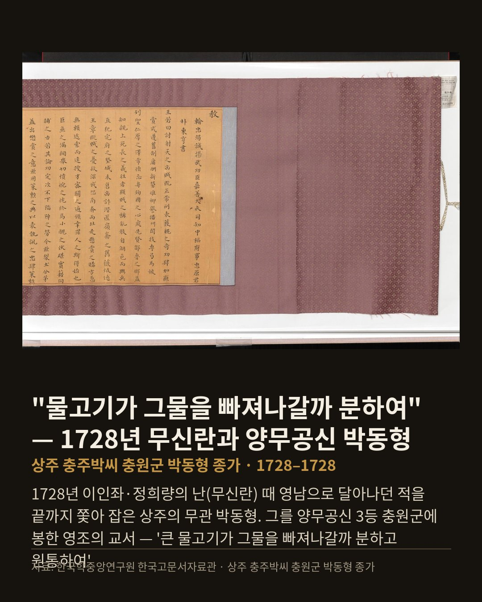
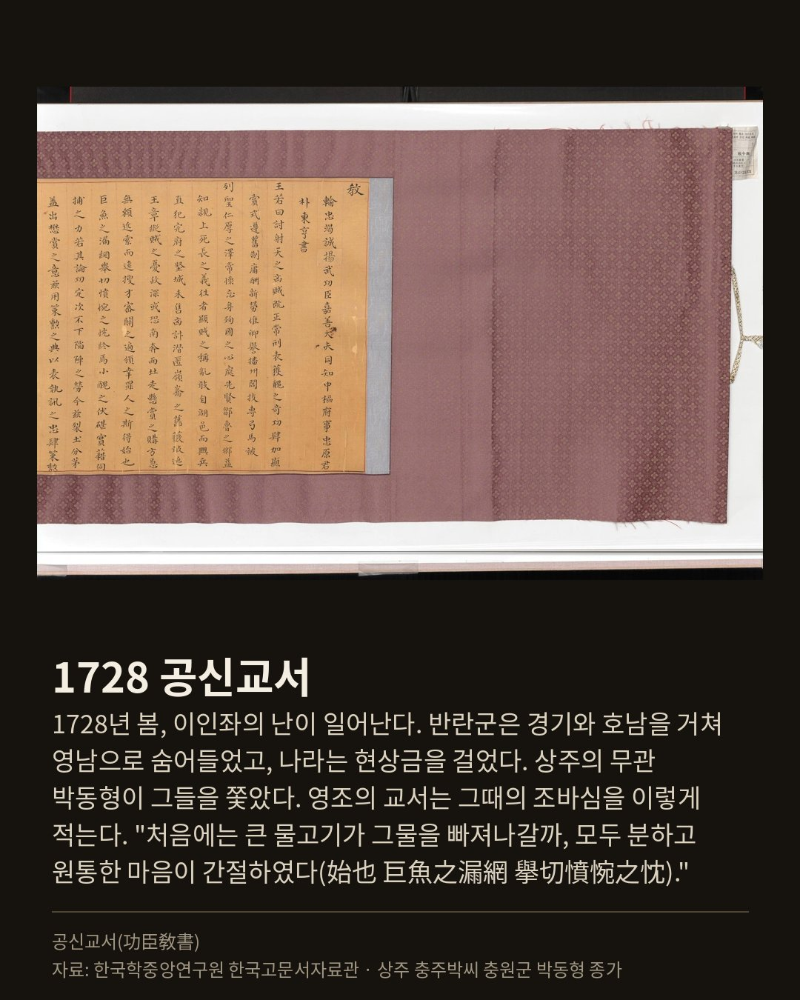
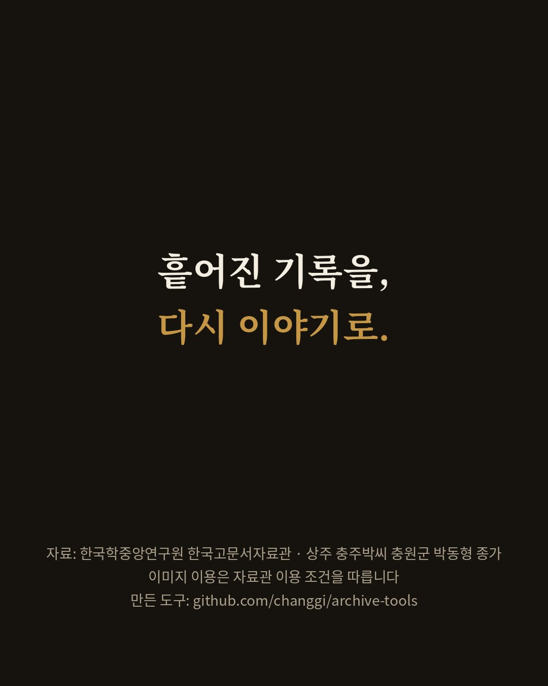

# EP.72 "물고기가 그물을 빠져나갈까 분하여" — 1728년 무신란과 양무공신 박동형

상주 충주박씨 충원군 박동형 종가 (문중) · 1728년 이인좌·정희량의 난(무신란) 때 영남으로 달아나던 적을 끝까지 쫓아 잡은 상주의 무관 박동형. 그를 양무공신 3등 충원군에 봉한 영조의 교서 — '큰 물고기가 그물을 빠져나갈까 분하고 원통하여'

- 🌐 [전시 웹페이지](https://changgi.github.io/archive-tools/examples/chungwongun/exhibit.html) (한자 위 한글 독음 · 원문 해석) · [수업 활동지](https://changgi.github.io/archive-tools/examples/chungwongun/handout.html)
- 🎬 영상: [릴스 9:16](https://changgi.github.io/archive-tools/examples/media/ep72-chungwongun_reel.mp4) · [가로 16:9](https://changgi.github.io/archive-tools/examples/media/ep72-chungwongun_wide.mp4) · 홍보 글: [`promo.md`](promo.md)
- 카드뉴스: [`cards/`](cards/) · SNS 글: [`sns.txt`](sns.txt) · 판독·해석 표: [`selection.csv`](selection.csv)


<!-- DELIVERY -->
## 전달 에디팅 — 이 기록을 이렇게 전합니다

- **핵심 정서** — 조바심과 해소
- **한 문장** — 큰 역사적 사건 뒤에는 지방의 이름 없는 무관들이 있었다는 것.
- **열기** — 1728년, 반란군이 달아났습니다. 나라는 '큰 물고기가 그물을 빠져나갈까' 두려워했습니다.
- **펼치기** — 공신교서 (1728년) — '큰 물고기가 그물을 빠져나갈까(巨魚之漏網)'라는 비유를 이야기의 중심 장면으로 세웠습니다.
- **절정** — "처음에는 큰 물고기가 그물을 빠져나갈까, 모두 분하고 원통한 마음이 간절하였다(始也 巨魚之漏網 擧切憤惋之忱)" — 화면·공간에서 이 한 줄만 크게, 소리를 줄여 집중
- **여운** — 적을 쫓던 박동형에게 반란군은 어떤 사람들이었을까요? — 질문으로 끝내고 답은 보는 사람에게
- **감각과 물질** — 그물 설치 속 "큰 물고기가 그물을 빠져나갈까" 한 줄 · 두루마리를 실제 길이로 펼친 복제
- **통로와 매개** — 온라인: 릴스(열기) → 카드뉴스(펼치기) → 전시 웹페이지(절정·원문) → 비하인드 카드(여운) / 오프라인: 원본 크기 복제·낭독·참여 벽 / 남기기: 활동지·질문 카드
- **여운 장치** — "반란군은 어떤 사람들이었을까" 질문
- **전달 에디팅 전** — 1건의 문서를 1728년 연대순으로 놓고 문서명 · 유형 · 해설을 붙인다 — 정확하지만, 지나가면 잊힌다.
- **전달 에디팅 후** — 핵심 정서는 「조바심과 해소」. 「1728년, 반란군이 달아났습니다. 나라는 '큰 물고기가 그물을 빠져나갈까' 두려워했습니다.」로 열고, 문서를 한 장의 집중로 펼친 뒤, "처음에는 큰 물고기가 그물을 빠져나갈까, 모두 분하고 원통한 마음이 간절하였다(始也 巨魚之漏網 擧切憤惋之忱)"에서 멈춘다. 그물 설치 속 "큰 물고기가 그물을 빠져나갈까" 한 줄. 마지막엔 「"반란군은 어떤 사람들이었을까" 질문」로 보는 사람이 자기 이야기를 남기고 떠나게 한다.

전문: [`delivery.md`](delivery.md)
<!-- /DELIVERY -->

<!-- CURATOR -->
## 비하인드 — 큐레이터 노트

- **왜 이 문서들인가** — 상주의 무관 박동형이 1728년 무신란(이인좌의 난) 진압 공으로 받은 공신교서가 해서로 또렷하게 남아 있었습니다.
- **전하고 싶은 것** — 큰 역사적 사건 뒤에는 지방의 이름 없는 무관들이 있었다는 것.
- **이렇게 보이길 바랐다** — '큰 물고기가 그물을 빠져나갈까(巨魚之漏網)'라는 비유를 이야기의 중심 장면으로 세웠습니다.
- **이렇게 써 주세요** — 영조 대 정치사·무신란 단원에서 '반란을 진압한 사람들'의 시선으로 읽는 자료로 쓰세요.
- **만들며 있었던 일** — 교서는 6면인데 처음엔 2면만 받아 첫 면을 판독했습니다(원본 묶음에는 6면 전체). 반란군 경로는 교서의 표현을 옮긴 것이라 사실 확인이 필요합니다.
- **남겨 둔 질문** — 적을 쫓던 박동형에게 반란군은 어떤 사람들이었을까요?
- **제작 기록** — 문서 1건 · 1728년 · 원본 사진 6면(문서 전체) · 원문 판독 1건 · 번역 1건 · 해제에 "확인 필요"를 단 문서 1건

전문: [`curator.md`](curator.md)
<!-- /CURATOR -->

## 이야기 — 사료가 말하는 대로

1728년, 반란군이 달아났습니다. 나라는 '큰 물고기가 그물을 빠져나갈까' 두려워했습니다.

> **1728 공신교서** — 1728년 봄, 이인좌의 난이 일어난다. 반란군은 경기와 호남을 거쳐 영남으로 숨어들었고, 나라는 현상금을 걸었다. 상주의 무관 박동형이 그들을 쫓았다. 영조의 교서는 그때의 조바심을 이렇게 적는다. "처음에는 큰 물고기가 그물을 빠져나갈까, 모두 분하고 원통한 마음이 간절하였다(始也 巨魚之漏網 擧切憤惋之忱)." 그리고 끝내 잡았다. 그는 공신이 되어 '충원군'이라는 이름을 받았다.

| 표지 | 1번 카드 | 마무리 |
|---|---|---|
|  |  |  |

## 선별 문서 (1점)

| # | 연도 | 유형 | 문서명 | 원본 |
|---|---|---|---|---|
| 1 | 1728 | 공신교서 | 공신교서(功臣敎書) | [원본 보기](https://archive.aks.ac.kr/viewer/viewer.do#imgnode.do?itemId=book&gubun=booktree&depth=6&upPath=01%5E0167%5EL016761%5EL016761F02%5EL016761F0201&dataId=G002%2BAKS%2BKSM-XA.1728.4725-20220930.B087a_115_00001_XXX&itemType=) |

## 원문 판독과 해석

### 1. 공신교서(功臣敎書)

**원문 판독**

```
(겉 제첨) 揚武功臣三等朴東亨
敎
輸忠竭誠揚武功臣嘉善大夫同知中樞府事忠原君
朴東亨書
王若曰 討射天之凶賊 旣正常刑 表獲醜之奇功 肆加顯
賞 式遵舊制 庸酬新勞 惟卿 譽播州閭 技專弓馬 被
列聖仁厚之澤 常懷忘身殉國之心 處先賢鄒魯之鄕 益
知親上死長之義 往者 顯賊之稱亂 敢自湖邑而興兵
直犯完府之堅城 未售凶計 潛匿嶺裔之舊藪 鼓逃
王章 縱賊之憂 政深 或恐南奔而北走 懸賞之購方急
無賴近索而遠搜 才容闢之適須 幸羅人之斯得 始也
巨魚之漏網 擧切憤惋之忱 終焉小醜之伏碪 實藉同
捕之力 若其論功定次 不下陷陣之勞 今玆裂土分茅
蓋出懋賞之意 玆用策勳之典 以表執訊之忠 肆策勳
(이하 — 공신 3등 책봉 내용과 상으로 내린 노비·토지 등, 이미지 다음 면 · 판독 필요)
```

**원문 해석** 수충갈성 양무공신 가선대부 동지중추부사 충원군 박동형에게 내리는 교서. 왕은 이르노라. 하늘을 향해 활을 쏜(임금을 범한) 흉악한 역적을 치니 이미 떳떳한 형벌로 바로잡았고, 그 무리를 잡은 뛰어난 공을 드러내니 이에 빛나는 상을 더한다. 옛 제도를 따라 새로운 수고에 보답하노라. 생각건대 경은 이름이 고을에 퍼졌고 재주는 활쏘기와 말타기에 오로지 하였으며, 역대 임금의 어질고 두터운 은택을 입어 늘 몸을 잊고 나라에 목숨을 바칠 마음을 품었고, 선현의 추로(공자·맹자) 같은 고장에 살아 윗사람을 친애하고 어른을 위해 죽는 의리를 더욱 알았다. 지난번 역적이 난을 일으켜 감히 호남 고을에서 군사를 일으켜 곧바로 전주의 굳은 성을 범하였으나 흉계를 이루지 못하고, 영남 변두리의 옛 소굴에 몰래 숨어 북을 치며 나라의 법을 피하니, 적을 놓칠 근심이 깊어 혹 남쪽으로 달아나고 북쪽으로 도망할까 두려워 현상금을 건 수색이 급하였다. … 가까이 찾고 멀리 뒤져 … 다행히 그물을 친 사람이 마침내 잡았도다. 처음에는 큰 물고기가 그물을 빠져나갈까 모두 분하고 원통한 마음이 간절하였는데, 끝내 하찮은 무리가 도마 위에 엎드리게 된 것은 실로 함께 잡은 힘 덕분이다. 그 공을 논하여 차례를 정하면 적진을 무너뜨린 수고에 못지않으니, 이제 땅을 나누어 봉하는 것은 대개 상을 힘써 주려는 뜻에서 나왔다. 이에 공신을 책봉하는 법을 써서 [적을] 잡아 심문하게 한 충성을 드러내노라. … (이하 다음 면, 판독 필요)

**해제** 1728년(영조 4) 무신란(이인좌·정희량의 난) 진압의 공으로 상주의 무관 박동형(朴東亨)을 양무공신(揚武功臣) 3등, 충원군(忠原君)에 봉하며 내린 공신교서입니다. 반란군이 호남에서 일어나 전주성을 노렸다가 실패하고 영남으로 숨어들자, 박동형이 추격·체포에 공을 세운 것으로 적혀 있습니다. '큰 물고기가 그물을 빠져나갈까(巨魚之漏網)'라는 표현으로 적장을 놓칠까 조바심 내던 조정의 마음을 그렸습니다. 비단으로 장황한 두루마리이며, 해서로 정연해 첫 면을 거의 판독했습니다. 반란 경로에 대한 서술(湖邑·完府)은 교서의 표현을 옮긴 것으로, 사실관계는 확인이 필요합니다.

판독·해석·이야기는 이미지에 근거한 초안이며(검토 전 "초안" 표시), 정확한 판독은 원문 확인이 필요합니다. □는 읽지 못한 글자, (?)는 불확실한 글자입니다.
이미지: 한국학중앙연구원 한국고문서자료관 소장·제공. "원본" 링크를 누르면 자료관 뷰어에서 그 문서가 열립니다. 재사용은 자료관에 문의하세요(소장처 동의 필요).
