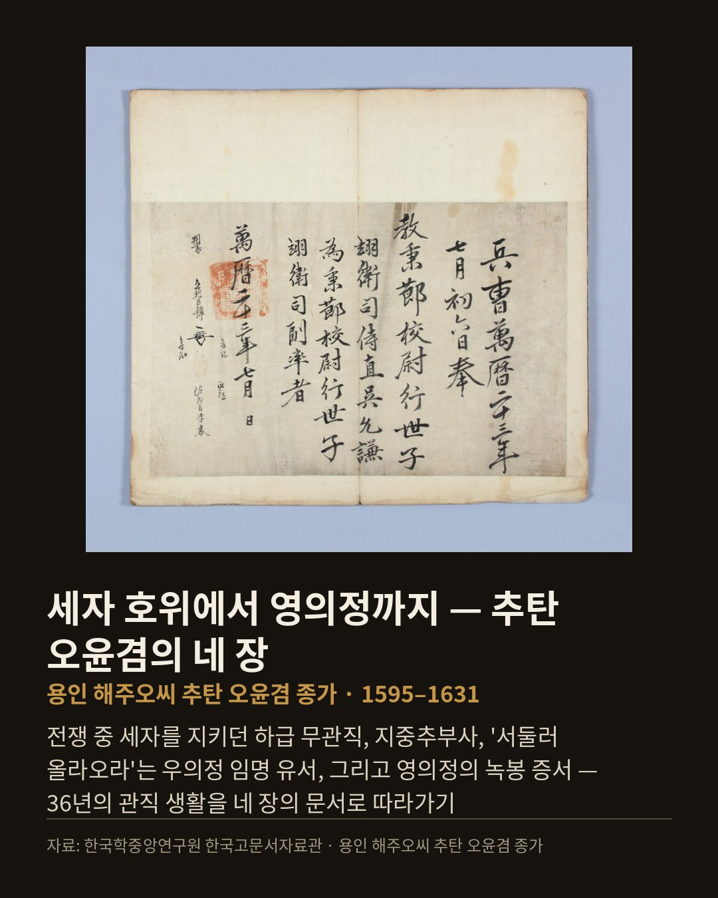
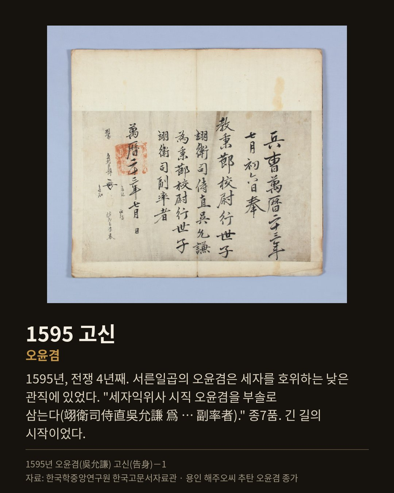
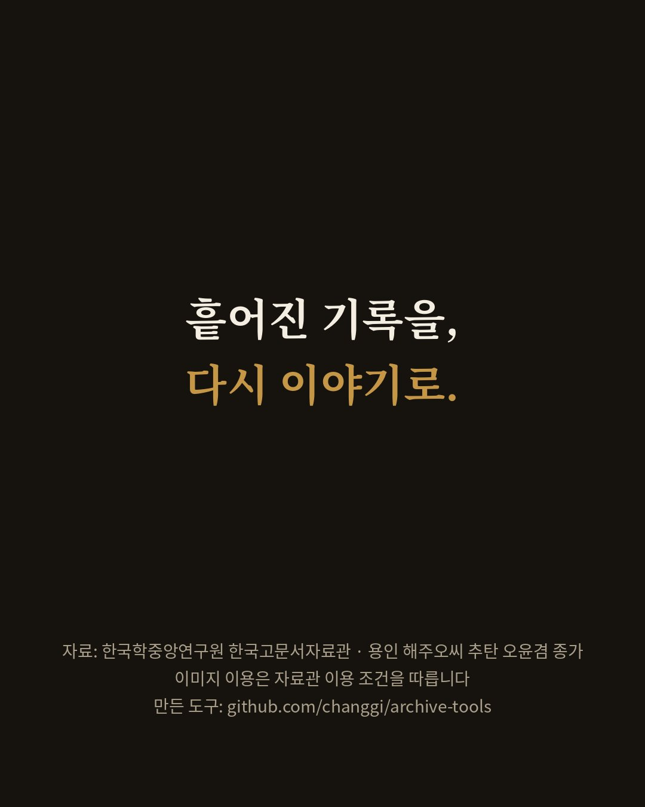

# EP.38 세자 호위에서 영의정까지 — 추탄 오윤겸의 네 장

용인 해주오씨 추탄 오윤겸 종가 (문중) · 전쟁 중 세자를 지키던 하급 무관직, 지중추부사, '서둘러 올라오라'는 우의정 임명 유서, 그리고 영의정의 녹봉 증서 — 36년의 관직 생활을 네 장의 문서로 따라가기

- 🌐 [전시 웹페이지](https://changgi.github.io/archive-tools/examples/chutan/exhibit.html) (한자 위 한글 독음 · 원문 해석) · [수업 활동지](https://changgi.github.io/archive-tools/examples/chutan/handout.html)
- 🎬 영상: [릴스 9:16](https://changgi.github.io/archive-tools/examples/media/ep38-chutan_reel.mp4) · [가로 16:9](https://changgi.github.io/archive-tools/examples/media/ep38-chutan_wide.mp4) · 홍보 글: [`promo.md`](promo.md)
- 카드뉴스: [`cards/`](cards/) · SNS 글: [`sns.txt`](sns.txt) · 판독·해석 표: [`selection.csv`](selection.csv)


<!-- DELIVERY -->
## 전달 에디팅 — 이 기록을 이렇게 전합니다

- **핵심 정서** — 성장
- **한 문장** — 높은 자리도 작은 직책에서 시작되었고, 임명장의 형식도 지위에 따라 바뀌었다는 것.
- **열기** — 종7품에서 영의정까지, 36년이 네 장의 종이에 남았습니다.
- **펼치기** — 오윤겸 고신－1 → 인조 유서 → 오윤겸 녹패 (1595–1631년) — 병조의 작은 고신 → 임금의 '敎旨'로 바뀐 첫머리 → 정승의 녹패로, 문서 형식의 변화를 보여 주었습니다.
- **절정** — "영의정 … 세자사 오윤겸에게 신미년 제1과 녹봉을 내린다(今辛未年第壹科祿者)" — 화면·공간에서 이 한 줄만 크게, 소리를 줄여 집중
- **여운** — 36년 동안 그를 버티게 한 것은 무엇이었을까요? — 질문으로 끝내고 답은 보는 사람에게
- **감각과 물질** — 문서 형식이 바뀌는 네 장을 크기 순으로 · 어보·관인 탁본 스탬프를 찍어 보는 체험 · 역마 방울·말발굽 소리와 함께 펼치는 두루마리
- **통로와 매개** — 온라인: 릴스(열기) → 카드뉴스(펼치기) → 전시 웹페이지(절정·원문) → 비하인드 카드(여운) / 오프라인: 원본 크기 복제·낭독·참여 벽 / 남기기: 활동지·질문 카드
- **여운 장치** — "나의 첫 직책" 기억 나누기
- **전달 에디팅 전** — 4건의 문서를 1595–1631년 연대순으로 놓고 문서명 · 유형 · 해설을 붙인다 — 정확하지만, 지나가면 잊힌다.
- **전달 에디팅 후** — 핵심 정서는 「성장」. 「종7품에서 영의정까지, 36년이 네 장의 종이에 남았습니다.」로 열고, 문서를 대비와 순서로 펼친 뒤, "영의정 … 세자사 오윤겸에게 신미년 제1과 녹봉을 내린다(今辛未年第壹科祿者)"에서 멈춘다. 문서 형식이 바뀌는 네 장을 크기 순으로. 마지막엔 「"나의 첫 직책" 기억 나누기」로 보는 사람이 자기 이야기를 남기고 떠나게 한다.

전문: [`delivery.md`](delivery.md)
<!-- /DELIVERY -->

<!-- CURATOR -->
## 비하인드 — 큐레이터 노트

- **왜 이 문서들인가** — 종7품 세자 호위에서 영의정까지, 36년이 네 장의 종이에 남아 있었습니다.
- **전하고 싶은 것** — 높은 자리도 작은 직책에서 시작되었고, 임명장의 형식도 지위에 따라 바뀌었다는 것.
- **이렇게 보이길 바랐다** — 병조의 작은 고신 → 임금의 '敎旨'로 바뀐 첫머리 → 정승의 녹패로, 문서 형식의 변화를 보여 주었습니다.
- **이렇게 써 주세요** — 관직 체계와 문서 서식 비교 학습에 쓰세요.
- **남겨 둔 질문** — 36년 동안 그를 버티게 한 것은 무엇이었을까요?
- **제작 기록** — 문서 4건 · 1595–1631년 · 원본 사진 4면(문서 전체) · 원문 판독 4건 · 번역 4건 · 해제에 "확인 필요"를 단 문서 1건

전문: [`curator.md`](curator.md)
<!-- /CURATOR -->

## 이야기 — 사료가 말하는 대로

세자 호위 종7품에서 영의정까지. 36년이 네 장의 종이에 남았습니다.

> **1595 고신** — 1595년, 전쟁 4년째. 서른일곱의 오윤겸은 세자를 호위하는 낮은 관직에 있었다. "세자익위사 시직 오윤겸을 부솔로 삼는다(翊衛司侍直吳允謙 爲 … 副率者)." 종7품. 긴 길의 시작이었다.
> **1626 고신** — 31년 뒤 1626년 정월, 문서의 첫머리가 바뀐다. 병조가 아니라 임금의 이름으로. "오윤겸을 숭록대부 행 지중추부사로 삼는다(吳允謙爲崇祿大夫行知中樞府事者)."
> **1626 유서** — 그해 가을, 임금은 그를 정승으로 부른다. "이제 경을 우의정으로 삼으니, 경은 서둘러 올라오라(卿其斯速上來)." 세자를 지키던 하급 관원이, 임금이 '경'이라 부르는 사람이 되었다.
> **1631 녹패** — 1631년, 일흔셋의 오윤겸이 받은 것은 녹봉 증서다. 직함이 두 줄을 채운다. "영의정 … 세자사 오윤겸에게 신미년 제1과 녹봉을 내린다(今辛未年第壹科祿者)." 세자를 지키며 시작한 길이, 세자를 가르치는 자리에서 닿았다.

| 표지 | 1번 카드 | 마무리 |
|---|---|---|
|  |  |  |

## 선별 문서 (4점)

| # | 연도 | 유형 | 문서명 | 원본 |
|---|---|---|---|---|
| 1 | 1595 | 고신 | 1595년 오윤겸(吳允謙) 고신(告身)－1 | [원본 보기](https://archive.aks.ac.kr/viewer/viewer.do#imgnode.do?itemId=book&gubun=booktree&depth=6&upPath=01%5E0141%5EL014152%5EL014152F02%5EL014152F0201&dataId=G002%2BAKS%2BKSM-XA.1595.1111-20101008.B024a_036_00001_XXX&itemType=) |
| 2 | 1626 | 고신 | 1626년 오윤겸(吳允謙) 고신(告身)－1 | [원본 보기](https://archive.aks.ac.kr/viewer/viewer.do#imgnode.do?itemId=book&gubun=booktree&depth=6&upPath=01%5E0141%5EL014152%5EL014152F02%5EL014152F0201&dataId=G002%2BAKS%2BKSM-XA.1626.1111-20101008.B024a_036_00056_XXX&itemType=) |
| 3 | 1626 | 유서 | 1626년 인조(仁祖) 유서(諭書) | [원본 보기](https://archive.aks.ac.kr/viewer/viewer.do#imgnode.do?itemId=book&gubun=booktree&depth=6&upPath=01%5E0141%5EL014152%5EL014152F02%5EL014152F0201&dataId=G002%2BAKS%2BKSM-XA.1626.1111-20101008.B024a_036_00193_XXX&itemType=) |
| 4 | 1631 | 녹패 | 1631년 오윤겸(吳允謙) 녹패(祿牌) | [원본 보기](https://archive.aks.ac.kr/viewer/viewer.do#imgnode.do?itemId=book&gubun=booktree&depth=6&upPath=01%5E0141%5EL014152%5EL014152F02%5EL014152F0201&dataId=G002%2BAKS%2BKSM-XA.1631.1111-20101008.B024a_036_00197_XXX&itemType=) |

## 원문 판독과 해석

### 1. 1595년 오윤겸(吳允謙) 고신(告身)－1

**원문 판독**

```
兵曹萬曆二十三年七月初六日奉
敎 東部校尉行世子
翊衛司侍直吳允謙
爲東部校尉行世子
翊衛司副率者
萬曆二十三年七月 日 (도장)
(왼쪽 작은 글씨 — 判書 參判 參議 參知 正郞 佐郞 직함과 서명)
```

**원문 해석** 병조가 만력 23년(1595) 7월 6일 [임금의] 명을 받들어, 동부 교위 행 세자익위사 시직 오윤겸을 동부 교위 행 세자익위사 부솔로 삼는다. 만력 23년 7월 일.

**해제** 1595년(선조 28) 7월, 병조가 오윤겸(吳允謙, 1559~1636)을 세자익위사 부솔(副率, 종7품)로 임명한 고신(임명장)입니다. 세자익위사는 세자를 호위하는 관청으로, 임진왜란 중 광해군의 분조(分朝)를 따르던 때입니다. 낮은 관직은 이조·병조 명의로 '奉敎(명을 받들어)'라고 써서 발급했습니다. 왼쪽에 병조 관원들의 직함과 서명이 있습니다.

### 2. 1626년 오윤겸(吳允謙) 고신(告身)－1

**원문 판독**

```
敎旨
吳允謙爲崇祿
大夫行知中樞
府事者
天啓六年正月二十二日 (도장)
```

**원문 해석** 교지. 오윤겸을 숭록대부 행 지중추부사로 삼는다. 천계 6년(1626) 1월 22일.

**해제** 1626년(인조 4) 1월, 오윤겸을 숭록대부(종1품) 지중추부사로 임명한 교지입니다. 31년 전 병조 명의의 작은 고신과 달리, 높은 품계는 임금 명의의 '敎旨'로 발급되었습니다. 오윤겸은 1617년 회답사로 일본에 다녀와 포로 송환에 힘쓴 것으로 알려져 있습니다(문서 밖 사실 — 확인 필요).

### 3. 1626년 인조(仁祖) 유서(諭書)

**원문 판독**

```
諭議政府右議政吳允
謙
諭
今以卿爲議政府右
議政 卿其斯速上來
故諭
天啓六年十月初二日 (도장 3)
```

**원문 해석** 의정부 우의정 오윤겸에게 이른다. 이제 경을 의정부 우의정으로 삼으니, 경은 서둘러 올라오라. 그러므로 이른다. 천계 6년(1626) 10월 2일.

**해제** 같은 1626년 10월, 인조가 오윤겸을 우의정에 임명하며 지방에 있던 그에게 서둘러 올라오라고 내린 유서(諭書)입니다. 정승을 부를 때는 '爾(너)' 대신 '卿(경)'이라 부르고, 유지가 아닌 유서 형식을 썼습니다. '斯速上來(서둘러 올라오라)'는 EP.17 이언적, EP.33 이수일의 유지에도 나오는 구절입니다.

### 4. 1631년 오윤겸(吳允謙) 녹패(祿牌)

**원문 판독**

```
吏曹奉
敎 賜大匡輔國崇祿大夫議政府領議政兼領經筵弘
文館藝文館春秋館觀象監事世子師吳允謙
今辛未年第壹科祿者
崇禎四年正月 日 (도장)
(왼쪽 작은 글씨 — 判書 參判 參議 正郞 佐郞 직함과 서명)
```

**원문 해석** 이조가 [임금의] 명을 받들어, 대광보국숭록대부 의정부 영의정 겸 영경연·홍문관·예문관·춘추관·관상감사 세자사 오윤겸에게 올해 신미년 제1과 녹봉을 내린다. 숭정 4년(1631) 1월 일.

**해제** 1631년(인조 9) 1월, 영의정 오윤겸에게 녹봉을 지급하라고 이조가 발급한 녹패(祿牌)입니다. 녹봉 등급인 '第壹科(제1과)'는 가장 높은 등급입니다. 직함에 영의정과 함께 세자의 스승(世子師)이 들어 있어, 36년 전 세자를 호위하던 시작과 겹쳐 읽힙니다.

판독·해석·이야기는 이미지에 근거한 초안이며(검토 전 "초안" 표시), 정확한 판독은 원문 확인이 필요합니다. □는 읽지 못한 글자, (?)는 불확실한 글자입니다.
이미지: 한국학중앙연구원 한국고문서자료관 소장·제공. "원본" 링크를 누르면 자료관 뷰어에서 그 문서가 열립니다. 재사용은 자료관에 문의하세요(소장처 동의 필요).
