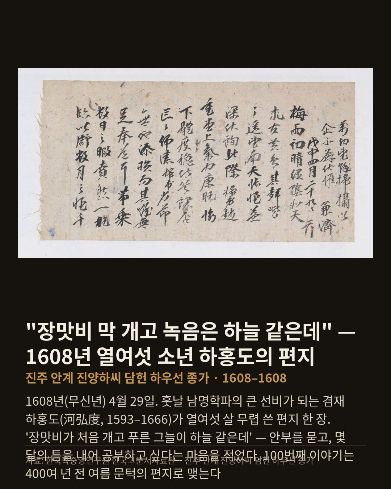
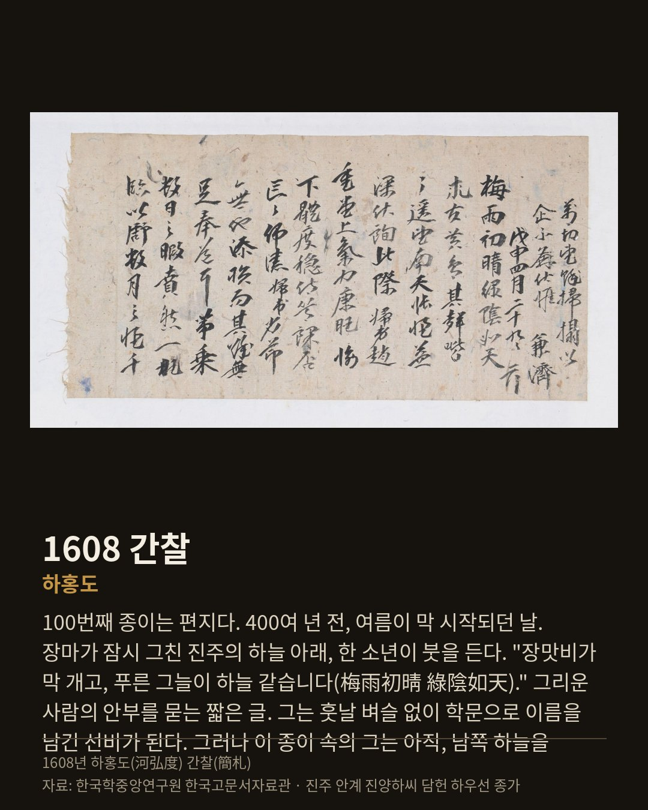
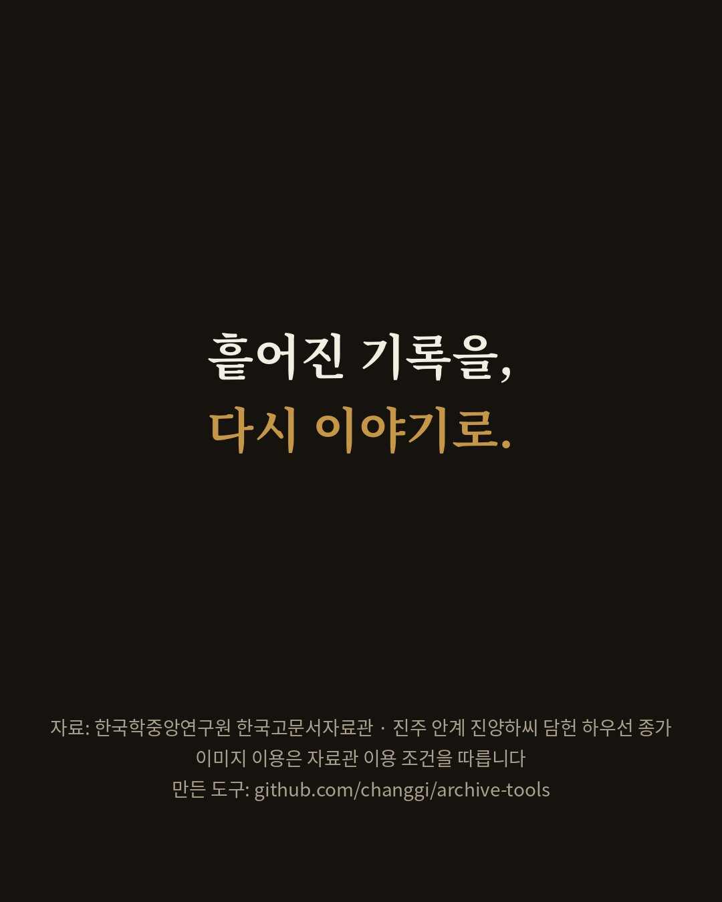

# EP.100 "장맛비 막 개고 녹음은 하늘 같은데" — 1608년 열여섯 소년 하홍도의 편지

진주 안계 진양하씨 담헌 하우선 종가 (문중) · 1608년(무신년) 4월 29일. 훗날 남명학파의 큰 선비가 되는 겸재 하홍도(河弘度, 1593–1666)가 열여섯 살 무렵 쓴 편지 한 장. '장맛비가 처음 개고 푸른 그늘이 하늘 같은데' — 안부를 묻고, 몇 달의 틈을 내어 공부하고 싶다는 마음을 적었다. 100번째 이야기는 400여 년 전 여름 문턱의 편지로 맺는다

- 🌐 [전시 웹페이지](https://changgi.github.io/archive-tools/examples/damheon/exhibit.html) (한자 위 한글 독음 · 원문 해석) · [수업 활동지](https://changgi.github.io/archive-tools/examples/damheon/handout.html)
- 🎬 영상: [릴스 9:16](https://changgi.github.io/archive-tools/examples/media/ep100-damheon_reel.mp4) · [가로 16:9](https://changgi.github.io/archive-tools/examples/media/ep100-damheon_wide.mp4) · 홍보 글: [`promo.md`](promo.md)
- 카드뉴스: [`cards/`](cards/) · SNS 글: [`sns.txt`](sns.txt) · 판독·해석 표: [`selection.csv`](selection.csv)


<!-- DELIVERY -->
## 전달 에디팅 — 이 기록을 이렇게 전합니다

- **핵심 정서** — 그리움
- **한 문장** — 고문서는 결국 사람의 마음을 담은 종이라는 것 — 100편이 하고 싶었던 말.
- **열기** — 100번째 고문서는, 400년 전 여름날의 편지입니다.
- **펼치기** — 하홍도 간찰 (1608년) — '장맛비 막 개고 녹음은 하늘 같은데'라는 계절 인사로 시작해, 그리움으로 끝나는 조용한 장면으로 구성했습니다.
- **절정** — "장맛비가 막 개고, 푸른 그늘이 하늘 같습니다(梅雨初晴 綠陰如天)" — 화면·공간에서 이 한 줄만 크게, 소리를 줄여 집중
- **여운** — 400년 뒤 누군가 읽을 편지를 쓴다면, 첫 문장을 어떻게 쓰겠어요? — 질문으로 끝내고 답은 보는 사람에게
- **감각과 물질** — 장맛비 소리와 초록 녹음 빛, 편지 한 장 · 손바닥 크기 복제를 직접 들고 읽기, 낭독 음성
- **통로와 매개** — 온라인: 릴스(열기) → 카드뉴스(펼치기) → 전시 웹페이지(절정·원문) → 비하인드 카드(여운) / 오프라인: 원본 크기 복제·낭독·참여 벽 / 남기기: 활동지·질문 카드
- **여운 장치** — 400년 뒤 누군가에게 편지 쓰기
- **전달 에디팅 전** — 1건의 문서를 1608년 연대순으로 놓고 문서명 · 유형 · 해설을 붙인다 — 정확하지만, 지나가면 잊힌다.
- **전달 에디팅 후** — 핵심 정서는 「그리움」. 「100번째 고문서는, 400년 전 여름날의 편지입니다.」로 열고, 문서를 한 장의 집중로 펼친 뒤, "장맛비가 막 개고, 푸른 그늘이 하늘 같습니다(梅雨初晴 綠陰如天)"에서 멈춘다. 장맛비 소리와 초록 녹음 빛, 편지 한 장. 마지막엔 「400년 뒤 누군가에게 편지 쓰기」로 보는 사람이 자기 이야기를 남기고 떠나게 한다.

전문: [`delivery.md`](delivery.md)
<!-- /DELIVERY -->

<!-- CURATOR -->
## 비하인드 — 큐레이터 노트

- **왜 이 문서들인가** — 100번째 이야기를 화려한 교지가 아니라, 한 소년이 쓴 여름날의 편지로 맺고 싶었습니다.
- **전하고 싶은 것** — 고문서는 결국 사람의 마음을 담은 종이라는 것 — 100편이 하고 싶었던 말.
- **이렇게 보이길 바랐다** — '장맛비 막 개고 녹음은 하늘 같은데'라는 계절 인사로 시작해, 그리움으로 끝나는 조용한 장면으로 구성했습니다.
- **이렇게 써 주세요** — 간찰 문화, 계절 인사 쓰기(손편지) 활동에 쓰세요.
- **만들며 있었던 일** — 초서가 매우 흘려 쓰여 판독은 부분적입니다. 무신년을 1608년으로 본 것은 목록 연대에 따른 것이라 확인이 필요합니다.
- **남겨 둔 질문** — 400년 뒤 누군가 읽을 편지를 쓴다면, 첫 문장을 어떻게 쓰겠어요?
- **제작 기록** — 문서 1건 · 1608년 · 원본 사진 1면(문서 전체) · 원문 판독 1건 · 번역 1건 · 못 읽은 글자 □ 17 · 불확실 (?) 2 · 해제에 "확인 필요"를 단 문서 1건

전문: [`curator.md`](curator.md)
<!-- /CURATOR -->

## 이야기 — 사료가 말하는 대로

100번째 고문서는, 400년 전 여름날의 편지입니다.

> **1608 간찰** — 100번째 종이는 편지다. 400여 년 전, 여름이 막 시작되던 날. 장마가 잠시 그친 진주의 하늘 아래, 한 소년이 붓을 든다. "장맛비가 막 개고, 푸른 그늘이 하늘 같습니다(梅雨初晴 綠陰如天)." 그리운 사람의 안부를 묻는 짧은 글. 그는 훗날 벼슬 없이 학문으로 이름을 남긴 선비가 된다. 그러나 이 종이 속의 그는 아직, 남쪽 하늘을 바라보며 누군가를 그리워하는 소년일 뿐이다.

| 표지 | 1번 카드 | 마무리 |
|---|---|---|
|  |  |  |

## 선별 문서 (1점)

| # | 연도 | 유형 | 문서명 | 원본 |
|---|---|---|---|---|
| 1 | 1608 | 간찰 | 1608년 하홍도(河弘度) 간찰(簡札) | [원본 보기](https://archive.aks.ac.kr/viewer/viewer.do#imgnode.do?itemId=book&gubun=booktree&depth=6&upPath=01%5E0150%5EL015011%5EL015011F02%5EL015011F0206&dataId=G002%2BKHD%2BKSM-XF.1608.0000-20161231.C0805_002_04057_XXX&itemType=) |

## 원문 판독과 해석

### 1. 1608년 하홍도(河弘度) 간찰(簡札)

**원문 판독**

```
(초서 간찰 · 부분 판독)
□切思懷 掃揭以
企 不審比惟　(兼濟)
　戊申四月二十九日
梅雨初晴 綠陰如天
□古黃鳥(?) 其聲喈(?)
□遙望南天 悵恨益
深 伏詢此際 □□
重堂上氣力康旺 □
下體度穩迪 … 謹
□□仰慕 □□ 弟 …
□無以添 □□□ 其懷無
足奉 … 弟乘
數月之暇 □□ 一枕
□以爲 數月之悵千
(이하 판독 불확실)
```

**원문 해석** (부분 번역) 간절히 그리운 마음에 … 우러러 바라옵니다. 요즈음 어떠하신지요. (무신년 4월 29일) 장맛비가 막 개고 푸른 그늘이 하늘을 덮었는데, … 꾀꼬리 소리 … 멀리 남쪽 하늘을 바라보니 서운하고 한스러움이 더욱 깊습니다. 엎드려 여쭙건대 이즈음 어른들께서는 기력이 강녕하시고, … 몸도 편안하신지요. … 저는 … 몇 달의 틈을 타서 … 몇 달 동안의 서운함이 천만 …

**해제** 진주 안계의 진양하씨 담헌 종가에 전하는 겸재(謙齋) 하홍도(河弘度)의 간찰입니다. 하홍도는 남명 조식의 학풍을 이은 진주의 대표적 처사로, 평생 벼슬에 나가지 않고 학문에 힘썼습니다. 날짜 '戊申四月二十九日'을 1608년으로 보면 그의 나이 열여섯 무렵의 편지가 되는데, 목록 연대를 따른 것으로 간지 해석(1668년 등)의 여지가 있어 확인이 필요합니다. 첫머리 '梅雨初晴 綠陰如天'은 음력 4월 말 여름의 문턱을 그린 계절 인사이며, 이어 상대 집안 어른(重堂)의 안부를 묻는 간찰의 정형을 따릅니다. 초서가 매우 흘려 쓰여 판독한 글자는 부분적이며, 상당 부분이 불확실합니다.

판독·해석·이야기는 이미지에 근거한 초안이며(검토 전 "초안" 표시), 정확한 판독은 원문 확인이 필요합니다. □는 읽지 못한 글자, (?)는 불확실한 글자입니다.
이미지: 한국학중앙연구원 한국고문서자료관 소장·제공. "원본" 링크를 누르면 자료관 뷰어에서 그 문서가 열립니다. 재사용은 자료관에 문의하세요(소장처 동의 필요).
