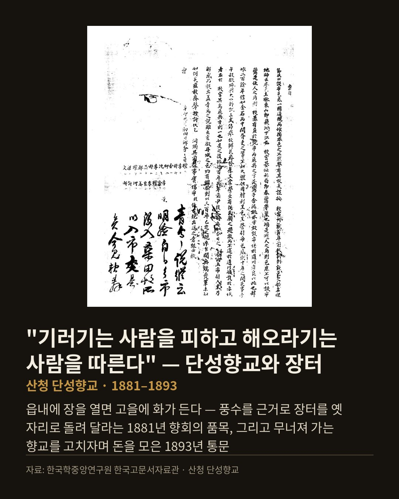
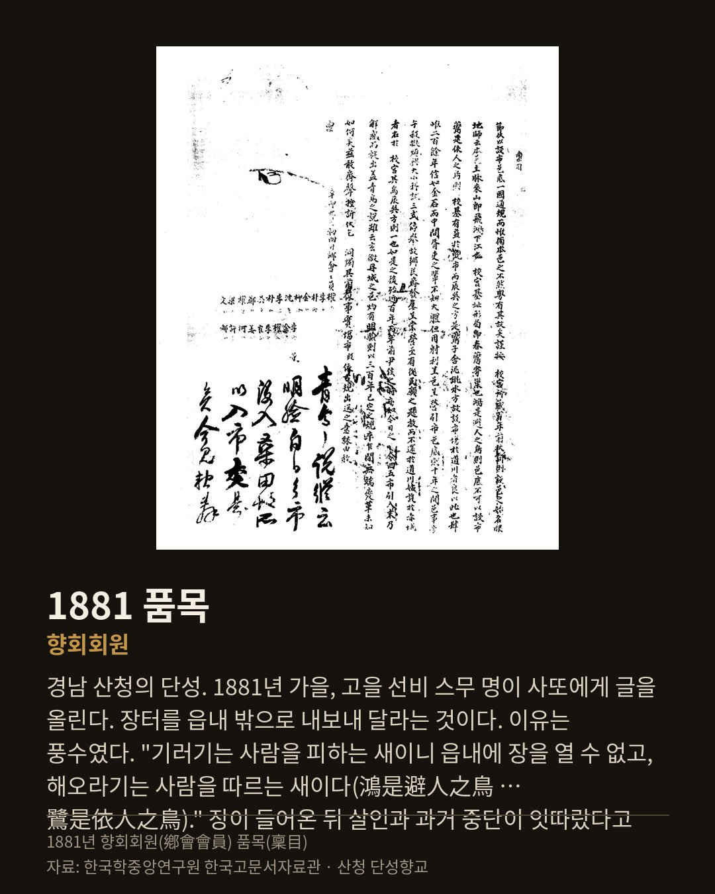
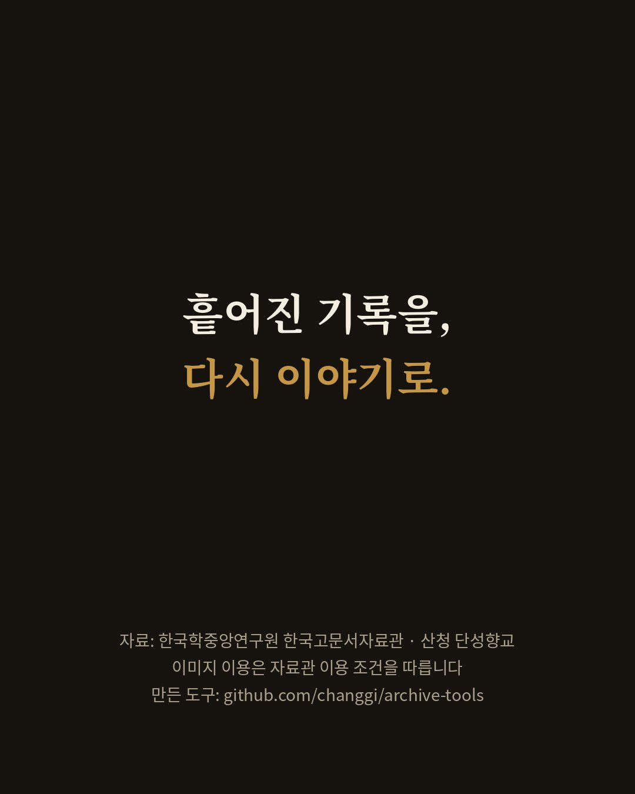

# EP.43 "기러기는 사람을 피하고 해오라기는 사람을 따른다" — 단성향교와 장터

산청 단성향교 (향교) · 읍내에 장을 열면 고을에 화가 든다 — 풍수를 근거로 장터를 옛 자리로 돌려 달라는 1881년 향회의 품목, 그리고 무너져 가는 향교를 고치자며 돈을 모은 1893년 통문

- 🌐 [전시 웹페이지](https://changgi.github.io/archive-tools/examples/danseong/exhibit.html) (한자 위 한글 독음 · 원문 해석) · [수업 활동지](https://changgi.github.io/archive-tools/examples/danseong/handout.html)
- 🎬 영상: [릴스 9:16](https://changgi.github.io/archive-tools-next/media/ep43-danseong_reel.mp4) · [가로 16:9](https://changgi.github.io/archive-tools-next/media/ep43-danseong_wide.mp4) · 홍보 글: [`promo.md`](promo.md)
- 카드뉴스: [`cards/`](cards/) · SNS 글: [`sns.txt`](sns.txt) · 판독·해석 표: [`selection.csv`](selection.csv)


<!-- DELIVERY -->
## 전달 에디팅 — 이 기록을 이렇게 전합니다

- **핵심 정서** — 낯선 지혜
- **한 문장** — 옛사람의 결정에는 그들 나름의 세계관(풍수)이 논리로 작동했다는 것.
- **열기** — 기러기가 놀라면 고을에 화가 든다. 그래서 이 고을은 읍내에 장을 열지 않았습니다.
- **펼치기** — 향회회원 품목 → 단성향교 통문 (1881–1893년) — 기러기와 해오라기의 비유를 그대로 살려, 낯선 논리를 존중하며 보여 주었습니다.
- **절정** — "기둥이 썩고 벽이 새어도, 고칠 비용이 없다(棟杇壁漏 而無修補之費矣)" — 화면·공간에서 이 한 줄만 크게, 소리를 줄여 집중
- **여운** — 오늘 우리 동네의 시설 위치를 정하는 '논리'는 무엇일까요? — 질문으로 끝내고 답은 보는 사람에게
- **감각과 물질** — 기러기와 해오라기 그림자, 장터 소리를 읍내 밖으로 옮기는 음향 이동
- **통로와 매개** — 온라인: 릴스(열기) → 카드뉴스(펼치기) → 전시 웹페이지(절정·원문) → 비하인드 카드(여운) / 오프라인: 원본 크기 복제·낭독·참여 벽 / 남기기: 활동지·질문 카드
- **여운 장치** — "우리 동네 시설은 어디에?" 지도 토론
- **전달 에디팅 전** — 2건의 문서를 1881–1893년 연대순으로 놓고 문서명 · 유형 · 해설을 붙인다 — 정확하지만, 지나가면 잊힌다.
- **전달 에디팅 후** — 핵심 정서는 「낯선 지혜」. 「기러기가 놀라면 고을에 화가 든다. 그래서 이 고을은 읍내에 장을 열지 않았습니다.」로 열고, 문서를 대비와 순서로 펼친 뒤, "기둥이 썩고 벽이 새어도, 고칠 비용이 없다(棟杇壁漏 而無修補之費矣)"에서 멈춘다. 기러기와 해오라기 그림자, 장터 소리를 읍내 밖으로 옮기는 음향 이동. 마지막엔 「"우리 동네 시설은 어디에?" 지도 토론」로 보는 사람이 자기 이야기를 남기고 떠나게 한다.

전문: [`delivery.md`](delivery.md)
<!-- /DELIVERY -->

<!-- CURATOR -->
## 비하인드 — 큐레이터 노트

- **왜 이 문서들인가** — '기러기는 사람을 피한다'는 풍수를 이유로 장터를 읍내 밖으로 옮겨 달라는 향회의 품목이 흥미로웠습니다.
- **전하고 싶은 것** — 옛사람의 결정에는 그들 나름의 세계관(풍수)이 논리로 작동했다는 것.
- **이렇게 보이길 바랐다** — 기러기와 해오라기의 비유를 그대로 살려, 낯선 논리를 존중하며 보여 주었습니다.
- **이렇게 써 주세요** — 풍수와 공간 인식, 시장의 역사 수업에 쓰세요.
- **남겨 둔 질문** — 오늘 우리 동네의 시설 위치를 정하는 '논리'는 무엇일까요?
- **제작 기록** — 문서 2건 · 1881–1893년 · 원본 사진 3면(문서 전체) · 원문 판독 2건 · 번역 2건 · 못 읽은 글자 □ 21 · 불확실 (?) 5 · 해제에 "확인 필요"를 단 문서 2건

전문: [`curator.md`](curator.md)
<!-- /CURATOR -->

## 이야기 — 사료가 말하는 대로

기러기가 놀라면 고을에 화가 든다. 그래서 이 고을은 300년 동안 읍내에 장을 열지 않았습니다.

> **1881 품목** — 경남 산청의 단성. 1881년 가을, 고을 선비 스무 명이 사또에게 글을 올린다. 장터를 읍내 밖으로 내보내 달라는 것이다. 이유는 풍수였다. "기러기는 사람을 피하는 새이니 읍내에 장을 열 수 없고, 해오라기는 사람을 따르는 새이다(鴻是避人之鳥 … 鷺是依人之鳥)." 장이 들어온 뒤 살인과 과거 중단이 잇따랐다고 그들은 적었다.
> **1893 통문** — 12년 뒤 1893년 겨울, 이번에는 향교가 고을에 글을 돌린다. 땅을 잃은 향교는 제사조차 지내기 어려웠다. "기둥이 썩고 벽이 새어도, 고칠 비용이 없다(棟杇壁漏 而無修補之費矣)." 장터를 지키던 선비들이, 이제 향교를 지키려 돈을 모은다.

| 표지 | 1번 카드 | 마무리 |
|---|---|---|
|  |  |  |

## 선별 문서 (2점)

| # | 연도 | 유형 | 문서명 | 원본 |
|---|---|---|---|---|
| 1 | 1881 | 품목 | 1881년 향회회원(鄕會會員) 품목(稟目) | [원본 보기](https://archive.aks.ac.kr/viewer/viewer.do#imgnode.do?itemId=book&gubun=booktree&depth=6&upPath=02%5E0248%5EL024806%5EL024806F02%5EL024806F0203&dataId=G002%2BAKS%2BKSM-XC.1881.4886-20101008.B050a_073_00030_XXX&itemType=) |
| 2 | 1893 | 통문 | 1893년 단성향교(丹城鄕校) 통문(通文) | [원본 보기](https://archive.aks.ac.kr/viewer/viewer.do#imgnode.do?itemId=book&gubun=booktree&depth=6&upPath=02%5E0248%5EL024806%5EL024806F02%5EL024806F0206&dataId=G002%2BAKS%2BKSM-XF.1893.4886-20101008.B050a_073_00033_XXX&itemType=) |

## 원문 판독과 해석

### 1. 1881년 향회회원(鄕會會員) 품목(稟目)

**원문 판독**

```
稟目
節伏以設市邑底 一國通規 而惟獨本邑之不然 果有其故矣 謹按 校宮所藏(?)百年前 杜郞(?)設邑之始 名眼
地師云 本邑主脈來山 卽飛鴻下江也 校宮基址形局 卽春鷺寄巢也 鴻是避人之鳥 則邑底不可以設市
鷺是依人之鳥 則 校基有益於設市 而辰巽之方 是鷺子含泥飮水方 故設市場於道川者 良以此也 肆
惟二百餘年 信如金石 而中間胥吏之輩 不知大體 但因射利 呈邑呈營 引市邑底 則十年之間 邑事
乎(?) 殺獄頻興 大小科試 三式停廢 故鄕民齊發 屢呈 營至有從民願之題敎 而不還於道川 姑設於本城
者在於 校宮 其爲辰巽方 則一也 如是之後 殆近百年 而年前尹侯之時 亦如今日之(…) 今四五市 引入 未乃
解惑 而旋出 蓋 靑烏之說 雖云玄微 母城之邑 灼有明驗 則以三百年已定之規 豈乍間無端廢革 未知
如何矣 玆敢齊聲控訴 伏乞 洞燭其前後事實 場市 依古規 出送之意 緣由 敎
稟
辛巳(?)九月初四日 鄕會員
權□ 李□ 朴□ 金□ 柳□ 沈□ 李□ 朴□ 吳□ 鄭□ 梁□ 文□
李□ 金□ 權□ 李□ 崔□ 姜□ 河□ 許□ 鄭□ (각 이름 아래 작은 글씨 — 판독 필요)
(왼쪽 큰 흘림 — 관의 처분(題辭), 판독 필요)
```

**원문 해석** 품목. 엎드려 아뢰건대, 읍내에 장을 여는 것은 온 나라의 통상 규정인데 오직 우리 고을만 그렇지 않은 데에는 과연 까닭이 있습니다. 삼가 향교에 간직된 [기록을] 살피건대, 고을을 처음 세울 때 이름난 지관이 말하기를 '이 고을의 주맥이 내려온 산은 날던 기러기가 강으로 내려앉는 형국(飛鴻下江)이고, 향교 터는 봄 해오라기가 둥지에 깃드는 형국(春鷺寄巢)이다. 기러기는 사람을 피하는 새이니 읍내에는 장을 열 수 없고, 해오라기는 사람을 따르는 새이니 향교 터 쪽은 장을 여는 데 이롭다. 진손(동남) 방향은 해오라기 새끼가 진흙을 머금고 물을 마시는 자리이므로 장터를 도천(道川)에 둔 것이 바로 이 때문이다' 하였습니다. 그래서 200여 년 동안 금석처럼 믿어 왔는데, 중간에 아전 무리가 대체를 모르고 이익만 좇아 고을과 감영에 글을 올려 장을 읍내로 끌어들이니, 10년 사이에 고을 일이 … 살인 옥사가 잇따르고 크고 작은 과거가 세 번이나 멈추었습니다. 그래서 고을 백성이 함께 일어나 여러 번 [감영에] 호소하여 백성의 원대로 하라는 처분까지 받았으나, 도천으로 돌리지 못하고 우선 본성(本城)에 두었으니, 향교 쪽 진손 방향이라는 점은 같았습니다. 그 뒤 거의 백 년이 지났는데, 몇 해 전 윤(尹) 사또 때에도 오늘처럼 … 지금 네댓 번 장을 끌어들였다가 미혹을 풀지 못하고 곧 다시 내보냈습니다. 풍수(靑烏)의 말이 비록 그윽하고 미묘하다 하나 이 고을에는 뚜렷한 증험이 있으니, 300년 동안 정해진 규정을 어찌 잠깐 사이에 까닭 없이 없애겠습니까. 이에 감히 소리를 모아 호소하오니, 엎드려 바라건대 앞뒤 사실을 살피시어 장터를 옛 규정대로 내보내도록 처분해 주십시오. 신사년(?) 9월 4일 향회원 권○·이○·박○ … 등.

**해제** 1881년(고종 18, 辛巳로 보임), 산청 단성의 향회원 20여 명이 단성현감에게 올린 품목(稟目)입니다. 대부분 고을은 읍내에 장을 여는데, 단성은 고을을 세울 때 지관이 '주산은 날던 기러기가 강에 내려앉는 형국이라 기러기(사람을 피하는 새)가 놀라니 읍내에 장을 열면 안 되고, 향교 터는 해오라기(사람을 따르는 새)가 둥지에 깃드는 형국'이라 하여 장터를 도천에 두었다는 내력을 듭니다. 아전들이 이익 때문에 장을 읍내로 끌어들인 뒤 살인 사건과 과거 중단 같은 재앙이 있었다며, 장터를 옛 자리로 돌려 달라고 청했습니다. 마이크로필름 복사본이라 획이 흐린 곳이 있고, 날짜의 간지와 처분 글씨는 확인이 필요합니다.

### 2. 1893년 단성향교(丹城鄕校) 통문(通文)

**원문 판독**

```
通文
右文爲通告事 伏以自鄕校土地之亦入沒
校財蕩然 以空春秋俎豆而無享需之
資矣 棟杇壁漏 而無修補之費矣 今異(?)
敎日興 各張𡙁勢 而吾夫子大中至正之敎
則日就泯滅 至於鄕校 而亦莫保其維持
凡我俱血氣而知尊夫子者 豈可一日安乎
心而不思所以經紀維持之策乎 第聞他
郡鄕校 已各有定策 而惟吾鄕則尙此因
循推遷 以至于今 尤是愧悚之甚者也 肆於
頃者 旣有鄕會於本校 略定規劃 而以人
人之各出誠力 爲醵金之方 玆送有司以告
惟
僉尊另出誠力 以敦大事 千萬善甚
癸巳十一月 日
丹城鄕校 (도장)
堂中
```

**원문 해석** 통문. 이 글은 두루 알리는 일이다. 엎드려 생각건대, 향교의 토지가 [관에] 들어가 몰수된 뒤로 향교 재산이 텅 비어, 봄가을 제사의 제기를 비워 둔 채 제수를 마련할 밑천이 없고, 기둥이 썩고 벽이 새어도 고칠 비용이 없다. 지금 다른 가르침이 날로 일어나 저마다 세력을 펼치는데, 우리 공자의 크고 바르고 지극한 가르침은 날로 사라져 가서, 향교조차 유지할 수 없게 되었다. 무릇 피와 기운을 갖추고 공자를 높일 줄 아는 우리가 어찌 하루라도 마음을 편히 하고 이를 지탱할 방책을 생각하지 않겠는가. 듣건대 다른 고을 향교는 이미 각자 정한 방책이 있는데 오직 우리 고을만 이처럼 미루고 미루어 지금에 이르렀으니 더욱 부끄럽고 송구하다. 이에 얼마 전 본 향교에서 향회를 열어 대략 규획을 정하고, 사람마다 정성과 힘을 내어 돈을 모으는 방법으로 하기로 하여, 이에 유사를 보내 알린다. 바라건대 여러분께서 특별히 정성과 힘을 내어 큰일을 도타이 해 주시면 천만다행이겠다. 계사년(1893) 11월 일. 단성향교. 당중(堂中, 각 문중·서당 앞).

**해제** 1893년(고종 30, 癸巳) 11월, 단성향교가 고을의 여러 문중에 돌린 통문(通文)입니다. 향교 토지가 몰수되어 제사 비용과 건물 수리비가 없으니, 향회에서 정한 대로 사람마다 돈을 내 달라는 모금 요청입니다. '다른 가르침이 날로 일어나(異敎日興)'는 같은 시기 퍼지던 동학이나 서학을 가리킨 것으로 보입니다(확인 필요). 해서로 또렷하게 써서 전문을 판독했습니다.

판독·해석·이야기는 이미지에 근거한 초안이며(검토 전 "초안" 표시), 정확한 판독은 원문 확인이 필요합니다. □는 읽지 못한 글자, (?)는 불확실한 글자입니다.
이미지: 한국학중앙연구원 한국고문서자료관 소장·제공. "원본" 링크를 누르면 자료관 뷰어에서 그 문서가 열립니다. 재사용은 자료관에 문의하세요(소장처 동의 필요).
