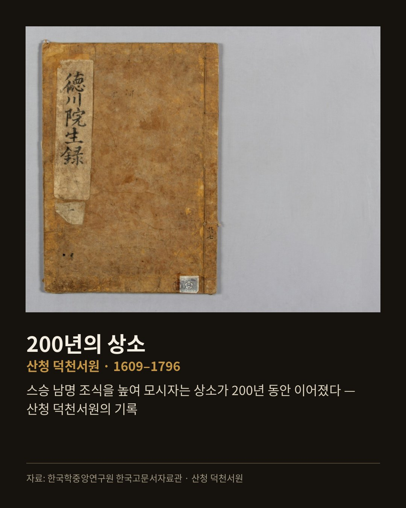
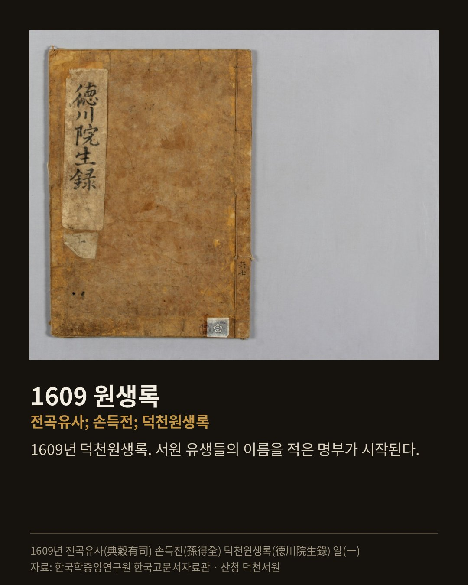
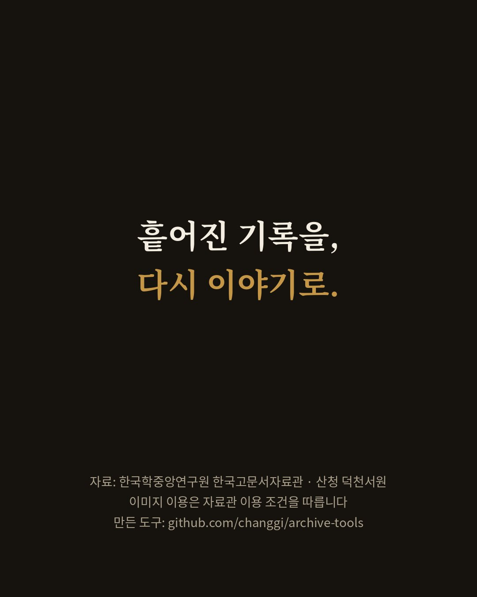

# EP.13 200년의 상소

산청 덕천서원 (서원) · 스승 남명 조식을 높여 모시자는 상소가 200년 동안 이어졌다 — 산청 덕천서원의 기록

- 🌐 [전시 웹페이지](https://changgi.github.io/archive-tools/examples/deokcheon/exhibit.html) · [수업 활동지](https://changgi.github.io/archive-tools/examples/deokcheon/handout.html)
- 🎬 영상: [릴스 9:16](https://changgi.github.io/archive-tools/examples/media/ep13-deokcheon_reel.mp4) · [가로 16:9](https://changgi.github.io/archive-tools/examples/media/ep13-deokcheon_wide.mp4) · 홍보 글: [`promo.md`](promo.md)
- 카드뉴스: [`cards/`](cards/) · SNS 글: [`sns.txt`](sns.txt) · 에디팅 결과: [`selection.csv`](selection.csv)

## 이야기 (영상 내레이션)

> 한 스승을 높이기 위해, 200년 동안 상소를 올린 사람들이 있습니다.
> 1609년, 덕천서원 유생들의 이름을 적은 원생록이 시작됩니다.
> 1614년부터, 그들은 스승 남명 조식을 높여 모시자는 상소를 올립니다.
> 1615년부터 1814년까지, 200년의 상소가 한 책에 모였고,
> 1730년에도 상소의 두루마리는 이어집니다.
> 스승을 향한 마음이, 200년의 기록이 되었습니다.

| 표지 | 1번 카드 | 마무리 |
|---|---|---|
|  |  |  |

<!-- CURATOR -->
## 비하인드 — 큐레이터 노트

- **왜 이 문서들인가** — 스승 남명 조식을 높이기 위해 200년 동안 올린 상소가 한 책으로 묶여 있었습니다.
- **전하고 싶은 것** — 한 사람을 기리는 마음이 세대를 넘어 이어질 수 있다는 것.
- **이렇게 보이길 바랐다** — 원생록으로 사람을 먼저 보여 주고, 200년의 상소로 그 끈기를 보여 주었습니다.
- **이렇게 써 주세요** — 남명학파, 서원과 학맥 수업에 쓰세요.
- **만들며 있었던 일** — 상소 묶음은 50면 안팎의 책이라 일부 면만 판독했습니다(원본 묶음에는 전체). 처음에는 문서명으로 캡션 초안만 만들었고, 뒤에 원문 전문 판독(v0.3.6)과 원문 해석(v0.4.0)을 더해 지금 모습이 되었습니다.
- **남겨 둔 질문** — 200년 동안 같은 상소를 올리게 한 힘은 무엇이었을까요?
- **제작 기록** — 문서 6건 · 1609–1796년 · 원본 사진 134면(문서 전체) · 원문 판독 6건 · 번역 6건 · 못 읽은 글자 □ 2 · 불확실 (?) 1

전문: [`curator.md`](curator.md)
<!-- /CURATOR -->

## 선별 문서 (6점)

| # | 연도 | 유형 | 문서명 | 원본 |
|---|---|---|---|---|
| 1 | 1609 | 원생록 | 1609년 전곡유사(典穀有司) 손득전(孫得全) 덕천원생록(德川院生錄) 일(一) | [원본 보기](https://archive.aks.ac.kr/viewer/viewer.do#imgnode.do?itemId=book&gubun=booktree&depth=6&upPath=02%5E0248%5EL024802%5EL024802F02%5EL024802F0207&dataId=G002%2BAKS%2BKSM-XG.1609.4886-20101008.B015a_025_00004_YYY&itemType=) |
| 2 | 1614 | 남명종향소문 | 1614〜1629년 남명종향소문(南冥從享疏文) | [원본 보기](https://archive.aks.ac.kr/viewer/viewer.do#imgnode.do?itemId=book&gubun=booktree&depth=6&upPath=02%5E0248%5EL024802%5EL024802F02%5EL024802F0207&dataId=G002%2BAKS%2BKSM-XG.1614.4886-20101008.B015a_025_00014_YYY&itemType=) |
| 3 | 1615 | 남명선생청무소본초 | 1615〜1814년 남명선생청무소본초(南冥先生請廡疏本抄) | [원본 보기](https://archive.aks.ac.kr/viewer/viewer.do#imgnode.do?itemId=book&gubun=booktree&depth=6&upPath=02%5E0248%5EL024802%5EL024802F02%5EL024802F0207&dataId=G002%2BAKS%2BKSM-XG.1615.4886-20101008.B015a_025_00016_YYY&itemType=) |
| 4 | 1730 | 남명선생종향소축 | 1730년 남명선생종향소축(南冥先生從享疏軸) | [원본 보기](https://archive.aks.ac.kr/viewer/viewer.do#imgnode.do?itemId=book&gubun=booktree&depth=6&upPath=02%5E0248%5EL024802%5EL024802F02%5EL024802F0207&dataId=G002%2BAKS%2BKSM-XG.1730.4886-20101008.B015a_025_00015_YYY&itemType=) |
| 5 | 1796 | 중수임안 | 1796년 중수임안(重修任案) | [원본 보기](https://archive.aks.ac.kr/viewer/viewer.do#imgnode.do?itemId=book&gubun=booktree&depth=6&upPath=02%5E0248%5EL024802%5EL024802F02%5EL024802F0207&dataId=G002%2BAKS%2BKSM-XG.1796.4886-20101008.B015a_025_00011_YYY&itemType=) |
| 6 | — | 홀기 | 홀기(笏記) | [원본 보기](https://archive.aks.ac.kr/viewer/viewer.do#imgnode.do?itemId=book&gubun=booktree&depth=6&upPath=02%5E0248%5EL024802%5EL024802F02%5EL024802F0207&dataId=G002%2BAKS%2BKSM-XG.0000.4886-20101008.B015b_025_00039_YYY&itemType=) |

이야기는 문서명과 이미지에서 보이는 것에 근거한 초안이며(검토 전 "초안" 표시), 판독·해석은 원문 확인이 필요합니다.
이미지: 한국학중앙연구원 한국고문서자료관 소장·제공. "원본" 링크를 누르면 자료관 뷰어에서 그 문서가 열립니다. 재사용은 자료관에 문의하세요(소장처 동의 필요).
