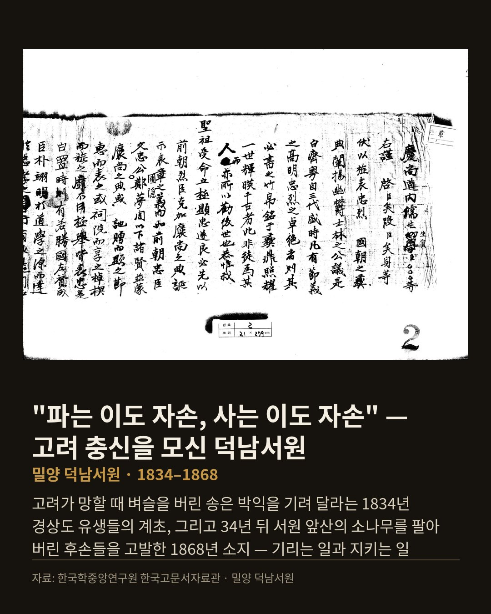
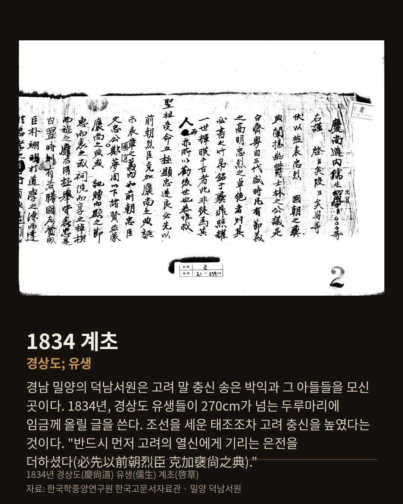
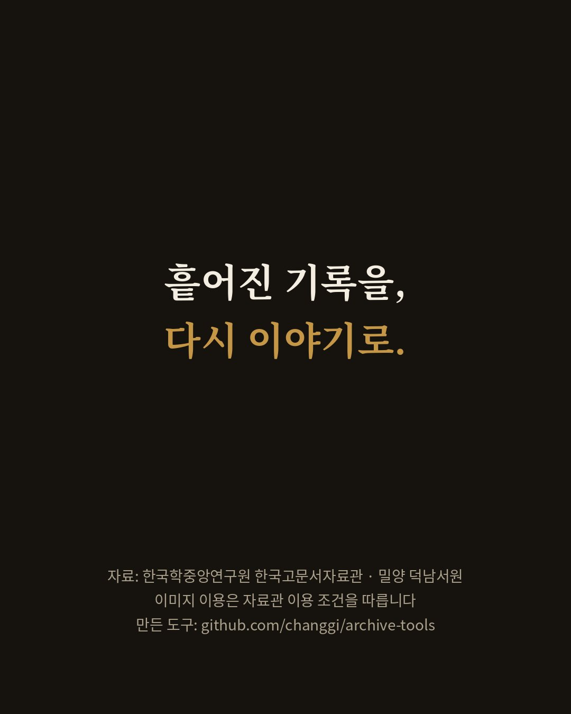

# EP.44 "파는 이도 자손, 사는 이도 자손" — 고려 충신을 모신 덕남서원

밀양 덕남서원 (서원) · 고려가 망할 때 벼슬을 버린 송은 박익을 기려 달라는 1834년 경상도 유생들의 계초, 그리고 34년 뒤 서원 앞산의 소나무를 팔아 버린 후손들을 고발한 1868년 소지 — 기리는 일과 지키는 일

- 🌐 [전시 웹페이지](https://changgi.github.io/archive-tools/examples/deoknam/exhibit.html) (한자 위 한글 독음 · 원문 해석) · [수업 활동지](https://changgi.github.io/archive-tools/examples/deoknam/handout.html)
- 🎬 영상: [릴스 9:16](https://changgi.github.io/archive-tools/examples/media/ep44-deoknam_reel.mp4) · [가로 16:9](https://changgi.github.io/archive-tools/examples/media/ep44-deoknam_wide.mp4) · 홍보 글: [`promo.md`](promo.md)
- 카드뉴스: [`cards/`](cards/) · SNS 글: [`sns.txt`](sns.txt) · 판독·해석 표: [`selection.csv`](selection.csv)


<!-- DELIVERY -->
## 전달 에디팅 — 이 기록을 이렇게 전합니다

- **핵심 정서** — 공동의 것
- **한 문장** — 공동의 재산을 지키는 일은 집안 안에서도 쉽지 않았다는 것.
- **열기** — 서원 앞산의 소나무를 누가 팔았을까요?
- **펼치기** — 경상도 유생 계초 → 박시묵 등 소지 (1834–1868년) — 1834년의 장엄한 상소 두루마리 → 1868년 소나무 분쟁으로, 이상과 현실을 대비했습니다.
- **절정** — "판 사람도 자손이요, 산 사람도 자손입니다(賣之者子孫也 買之亦者亦子孫也)" — 화면·공간에서 이 한 줄만 크게, 소리를 줄여 집중
- **여운** — 그 소나무는 지금도 서 있을까요? — 질문으로 끝내고 답은 보는 사람에게
- **감각과 물질** — 소나무 향, 베어진 그루터기 모형 · 연명한 이름을 벽에 길게 나열하고 관아 마당처럼 서서 읽는 동선
- **통로와 매개** — 온라인: 릴스(열기) → 카드뉴스(펼치기) → 전시 웹페이지(절정·원문) → 비하인드 카드(여운) / 오프라인: 원본 크기 복제·낭독·참여 벽 / 남기기: 활동지·질문 카드
- **여운 장치** — "함께 지켜야 할 것" 한 줄
- **전달 에디팅 전** — 2건의 문서를 1834–1868년 연대순으로 놓고 문서명 · 유형 · 해설을 붙인다 — 정확하지만, 지나가면 잊힌다.
- **전달 에디팅 후** — 핵심 정서는 「공동의 것」. 「서원 앞산의 소나무를 누가 팔았을까요?」로 열고, 문서를 대비와 순서로 펼친 뒤, "판 사람도 자손이요, 산 사람도 자손입니다(賣之者子孫也 買之亦者亦子孫也)"에서 멈춘다. 소나무 향, 베어진 그루터기 모형. 마지막엔 「"함께 지켜야 할 것" 한 줄」로 보는 사람이 자기 이야기를 남기고 떠나게 한다.

전문: [`delivery.md`](delivery.md)
<!-- /DELIVERY -->

<!-- CURATOR -->
## 비하인드 — 큐레이터 노트

- **왜 이 문서들인가** — 서원 앞산 소나무를 팔고 산 사람이 모두 같은 집안 자손이었다는 1868년 소지가 있었습니다.
- **전하고 싶은 것** — 공동의 재산을 지키는 일은 집안 안에서도 쉽지 않았다는 것.
- **이렇게 보이길 바랐다** — 1834년의 장엄한 상소 두루마리 → 1868년 소나무 분쟁으로, 이상과 현실을 대비했습니다.
- **이렇게 써 주세요** — 공유재 관리, 문중 갈등을 다루는 수업에 쓰세요.
- **남겨 둔 질문** — 그 소나무는 지금도 서 있을까요?
- **제작 기록** — 문서 2건 · 1834–1868년 · 원본 사진 9면(문서 전체) · 원문 판독 2건 · 번역 2건 · 못 읽은 글자 □ 3 · 불확실 (?) 10

전문: [`curator.md`](curator.md)
<!-- /CURATOR -->

## 이야기 — 사료가 말하는 대로

서원 앞산의 소나무를 누가 팔았을까요? 후손들이 고발한 사람은, 같은 후손이었습니다.

> **1834 계초** — 경남 밀양의 덕남서원은 고려 말 충신 송은 박익과 그 아들들을 모신 곳이다. 1834년, 경상도 유생들이 270cm가 넘는 두루마리에 임금께 올릴 글을 쓴다. 조선을 세운 태조조차 고려 충신을 높였다는 것이다. "반드시 먼저 고려의 열신에게 기리는 은전을 더하셨다(必先以前朝烈臣 克加襃尙之典)."
> **1868 소지** — 그러나 34년 뒤 1868년, 서원을 위협한 것은 바깥이 아니었다. 다른 고을에 사는 후손들이 사또에게 글을 올린다. 서원 앞산의 소나무가 팔려 나갔다. "판 사람도 자손이요, 산 사람도 자손입니다(賣之者子孫也 買之亦者亦子孫也)." 같은 해, 나라는 전국의 서원을 철폐하기 시작했다.

| 표지 | 1번 카드 | 마무리 |
|---|---|---|
|  |  |  |

## 선별 문서 (2점)

| # | 연도 | 유형 | 문서명 | 원본 |
|---|---|---|---|---|
| 1 | 1834 | 계초 | 1834년 경상도(慶尙道) 유생(儒生) 계초(啓草) | [원본 보기](https://archive.aks.ac.kr/viewer/viewer.do#imgnode.do?itemId=book&gubun=booktree&depth=6&upPath=02%5E0248%5EL024808%5EL024808F02%5EL024808F0202&dataId=G002%2BAKS%2BKSM-XB.1834.0000-20101008.B051b_076_00001_XXX&itemType=) |
| 2 | 1868 | 소지 | 1868년 박시묵(朴時黙) 등 소지(所志) | [원본 보기](https://archive.aks.ac.kr/viewer/viewer.do#imgnode.do?itemId=book&gubun=booktree&depth=6&upPath=02%5E0248%5EL024808%5EL024808F02%5EL024808F0202&dataId=G002%2BAKS%2BKSM-XB.1868.4827-20101008.B051b_076_00003_XXX&itemType=) |

## 원문 판독과 해석

### 1. 1834년 경상도(慶尙道) 유생(儒生) 계초(啓草)

**원문 판독**

```
慶尙道內儒生 生員 臣□□等
右謹 啓臣矣段 臣等
伏以旌表忠烈 國朝之彝
典 闡揚幽懿 士林之公議 是
白齊 粤自三代盛時 凡有節義
之高明忠烈之卓絶者 則其
必書之竹帛 銘于彝鼎 照耀
一世 輝映千古者 此非徒爲其
人 而亦所以勸後世也 恭惟我
聖祖受命立極 顯忠遂良 必先以
前朝烈臣 克加襃尙之典 誕
示表章之義 而如前朝忠臣
文忠公鄭夢周以下諸賢 並蒙(圃隱)
襃尙之典 或
贈而顯之節(?) 或
惠而表之 或祠院而享之 綽楔
而旌之 靡不用極 擧皆表忠(?)
白置 時則有若勝國左贊成
臣朴翊 學於道學之源 而達
於忠孝之□ (…)
(이하 270여 cm 두루마리 — 이미지 1면만 수집, 판독 필요)
```

**원문 해석** 경상도 안의 유생 생원 신 ○○ 등이 삼가 아룁니다. 엎드려 생각건대, 충렬을 정표하는 것은 나라의 떳떳한 법이요, 그윽이 숨은 아름다움을 드러내 밝히는 것은 사림의 공론입니다. 삼대(하·은·주)의 성대한 때부터 무릇 절의가 높고 충렬이 뛰어난 이는 반드시 역사에 쓰고 솥에 새겨 한 시대를 비추고 천고에 빛나게 하였으니, 이는 그 사람만을 위한 것이 아니라 후세를 권면하려는 것입니다. 삼가 생각건대 우리 성조(태조)께서 천명을 받아 나라를 세우시고 충신을 드러내고 어진 이를 이루실 때 반드시 먼저 고려의 열신에게 기리는 은전을 더하시어 표창의 뜻을 크게 보이셨으니, 고려의 충신 문충공 정몽주 이하 여러 현인이 모두 기리는 은전을 입어, 혹은 벼슬을 내려 드러내고, 혹은 은혜를 베풀어 표창하고, 혹은 사당과 서원에서 제사하고, 정려문을 세워 정표하여 극진하지 않음이 없었습니다. 이때 고려의 좌찬성 신 박익이 있었는데, 도학의 근원에서 배워 충효의 … 에 이르렀으니 … (이하 판독 필요)

**해제** 1834년(순조 34), 경상도 유생들이 고려 말의 충신 송은(松隱) 박익(朴翊, 1332~1398)을 기려 달라고 임금께 올리려 한 계(啓)의 초안(草)입니다. 조선을 세운 태조가 정몽주 등 고려 충신을 오히려 높였던 전례를 들어, 같은 시대의 박익에게도 은전을 내려 달라는 논리입니다. 길이 279cm의 두루마리 가운데 첫머리 한 면만 수집해 앞부분을 판독했습니다. 마이크로필름 복사본이라 획이 굵게 번진 곳이 있습니다.

### 2. 1868년 박시묵(朴時黙) 등 소지(所志)

**원문 판독**

```
淸道幼學 朴時默 朴政德 朴廷龍
謹伏言 德南書院 卽先祖松隱先生三父子安靈之所也 士林亦奉(?)雲(?)乃衛護之道(?) 何若(?)(…)
居近子孫 托以院用 院門外尺寸地 案山松 自與人賣之者 子孫也 買之亦(?)者 亦子孫也
遲退而一直覇(?)持 其在均是子孫之地 寧不寒心哉
特下 處分事
城主 處分
戊辰三月 日
(왼쪽 — 연명 박○○ 등 열 명 남짓, 판독 필요)
(왼쪽 큰 흘림 — 관의 처분: 院門案山 … 不有(?) … 賣(?) … 판독 필요)
```

**원문 해석** 청도의 유학 박시묵·박정덕·박정룡. 삼가 엎드려 아룁니다. 덕남서원은 곧 저희 선조 송은 선생 삼부자의 영혼을 모신 곳입니다. 사림도 받들어 지켜 왔는데 … 가까이 사는 자손이 서원에 쓴다는 핑계로 서원 문 밖의 한 자 한 치 땅과 앞산(案山)의 소나무를 스스로 남에게 팔았으니, 판 사람도 자손이요, 산 사람도 자손입니다. … 미루고 물러나 한결같이 붙들고 있으니, 똑같이 자손 된 처지에서 어찌 마음이 서늘하지 않겠습니까. 특별히 처분을 내려 주십시오. 사또께서 처분하실 일. 무진년(1868) 3월 일.

**해제** 1868년(고종 5, 戊辰) 3월, 청도에 사는 박익의 후손 박시묵 등이 밀양부사(城主)에게 올린 소지입니다. 덕남서원 근처에 사는 일부 후손이 '서원 비용'을 핑계로 서원 문 앞 땅과 앞산(案山) 소나무를 팔아 버렸으니 바로잡아 달라는 내용입니다. '판 자도 자손이요 산 자도 자손(賣之者子孫也 買之亦者亦子孫也)'이라는 구절에 문중 안의 갈등이 드러납니다. 본문 앞부분을 판독했고, 처분 글씨는 판독이 필요합니다. 같은 해 흥선대원군의 서원 철폐령이 내려졌습니다(문서 밖 사실).

판독·해석·이야기는 이미지에 근거한 초안이며(검토 전 "초안" 표시), 정확한 판독은 원문 확인이 필요합니다. □는 읽지 못한 글자, (?)는 불확실한 글자입니다.
이미지: 한국학중앙연구원 한국고문서자료관 소장·제공. "원본" 링크를 누르면 자료관 뷰어에서 그 문서가 열립니다. 재사용은 자료관에 문의하세요(소장처 동의 필요).
