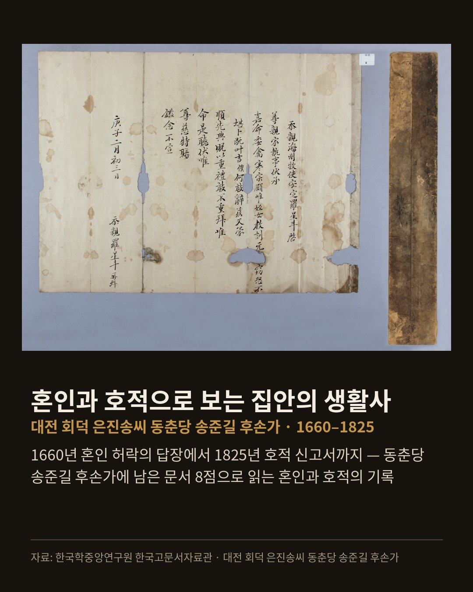
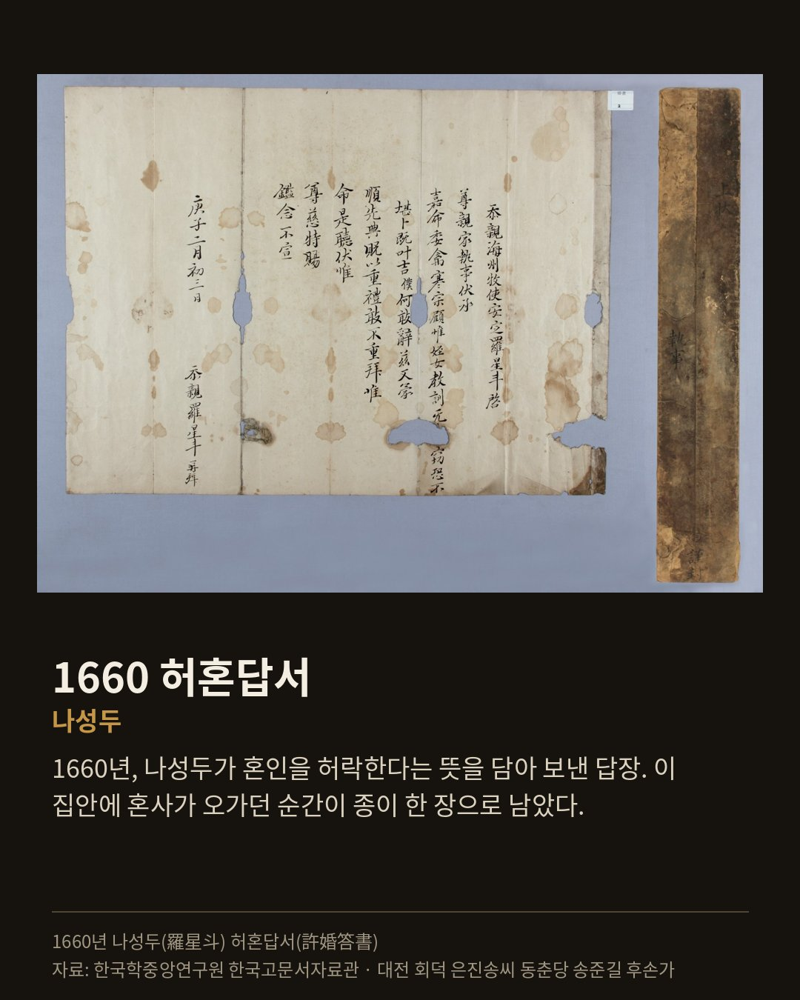
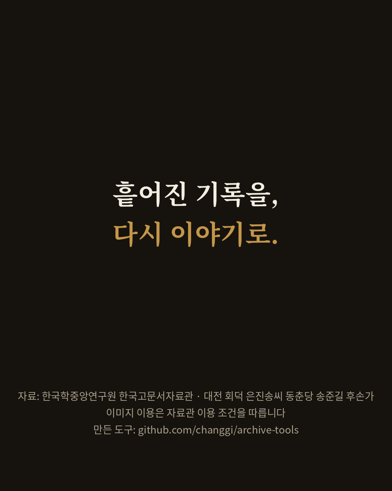

# 혼인과 호적으로 보는 집안의 생활사

대전 회덕 은진송씨 동춘당 송준길 후손가 · ③ 에디팅 후 — Claude가 다듬은 `이야기` 문장 사용

- 🌐 [전시 웹페이지](https://changgi.github.io/archive-tools/examples/dongchundang-marriage/exhibit.html) · [수업 활동지](https://changgi.github.io/archive-tools/examples/dongchundang-marriage/handout.html)
- 카드뉴스: [`cards/`](cards/) · SNS 글: [`sns.txt`](sns.txt) · 에디팅 결과: [`selection.csv`](selection.csv)

| 표지 | 1번 카드 | 마무리 |
|---|---|---|
|  |  |  |

## 선별 문서 (8점)

| # | 연도 | 유형 | 문서명 | 원본 |
|---|---|---|---|---|
| 1 | 1660 | 허혼답서 | 1660년 나성두(羅星斗) 허혼답서(許婚答書) | [원본 보기](https://archive.aks.ac.kr/viewer/viewer.do#imgnode.do?itemId=book&gubun=booktree&depth=6&upPath=01%5E0130%5EL013001%5EL013001F02%5EL013001F0206&dataId=G002%2BAKS%2BKSM-XF.1660.3023-20101008.B058a_083_00323_XXX&itemType=) |
| 2 | 1660 | 납폐서 | 1660년 송준길(宋浚吉) 납폐서(納幣書) | [원본 보기](https://archive.aks.ac.kr/viewer/viewer.do#imgnode.do?itemId=book&gubun=booktree&depth=6&upPath=01%5E0130%5EL013001%5EL013001F02%5EL013001F0206&dataId=G002%2BAKS%2BKSM-XF.1660.3023-20101008.B058a_083_00322_XXX&itemType=) |
| 3 | 1681 | 준호구 | 1681년 회덕현감(懷德縣監) 준호구(準戶口) | [원본 보기](https://archive.aks.ac.kr/viewer/viewer.do#imgnode.do?itemId=book&gubun=booktree&depth=6&upPath=01%5E0130%5EL013001%5EL013001F02%5EL013001F0204&dataId=G002%2BAKS%2BKSM-XD.1681.3023-20101008.B058a_083_00241_XXX&itemType=) |
| 4 | 1697 | 준호구 | 1697년 회덕현감(懷德縣監) 준호구(準戶口) | [원본 보기](https://archive.aks.ac.kr/viewer/viewer.do#imgnode.do?itemId=book&gubun=booktree&depth=6&upPath=01%5E0130%5EL013001%5EL013001F02%5EL013001F0204&dataId=G002%2BAKS%2BKSM-XD.1697.3023-20101008.B058a_083_00242_XXX&itemType=) |
| 5 | 1720 | 호구단자 | 1720년 송요화(宋堯和) 호구단자(戶口單子) | [원본 보기](https://archive.aks.ac.kr/viewer/viewer.do#imgnode.do?itemId=book&gubun=booktree&depth=6&upPath=01%5E0130%5EL013001%5EL013001F02%5EL013001F0204&dataId=G002%2BAKS%2BKSM-XD.1720.3023-20101008.B058a_083_00244_XXX&itemType=) |
| 6 | 1783 | 준호구 | 1783년 한성부(漢城府) 준호구(準戶口) | [원본 보기](https://archive.aks.ac.kr/viewer/viewer.do#imgnode.do?itemId=book&gubun=booktree&depth=6&upPath=01%5E0130%5EL013001%5EL013001F02%5EL013001F0204&dataId=G002%2BAKS%2BKSM-XD.1783.1111-20101008.B058a_083_00260_XXX&itemType=) |
| 7 | 1825 | 호구단자 | 1825년 송영로(宋永老) 호구단자(戶口單子) | [원본 보기](https://archive.aks.ac.kr/viewer/viewer.do#imgnode.do?itemId=book&gubun=booktree&depth=6&upPath=01%5E0130%5EL013001%5EL013001F02%5EL013001F0204&dataId=G002%2BAKS%2BKSM-XD.1825.3023-20101008.B058a_083_00279_XXX&itemType=) |
| 8 | — | 연길단자 | 연길단자(涓吉單子)－3 | [원본 보기](https://archive.aks.ac.kr/viewer/viewer.do#imgnode.do?itemId=book&gubun=booktree&depth=6&upPath=01%5E0130%5EL013001%5EL013001F02%5EL013001F0206&dataId=G002%2BAKS%2BKSM-XF.0000.3023-20101008.B058a_083_00339_XXX&itemType=) |

이미지: 한국학중앙연구원 한국고문서자료관 소장·제공. "원본" 링크를 누르면 자료관 뷰어에서 그 문서가 열립니다. 이미지를 다시 쓰려면 자료관에 문의하세요(소장처 동의 필요).
